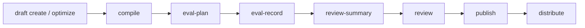
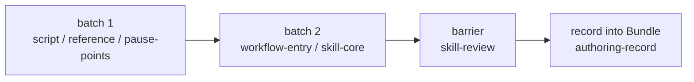

`comet bundle` manages platform-agnostic Skill Bundles, compile plans, Eval evidence, and human approval. Use [comet publish](/en/cli/publish) for everyday Bundle review and distribution.

Comet Any creates complete SDK applications. Use [comet creator](/en/cli/creator) to read authoring state and [comet application](/en/cli/application) to install and distribute them.

## When you need to use it directly

- Audit the Bundle draft and compile output.
- Debug a platform compile, capability gap, or executable disclosure.
- Record structured eval evidence by hand.
- Automation that needs the JSON backend commands.

## Common backend phases



## Skill Creator commands moved to `comet creator`

Since 0.4.0-beta.1, `comet creator` is the command-line entry that corresponds to Skill Creator. These older pre-release Bundle aliases are no longer the current commands:

```text
comet bundle factory-*
comet bundle authoring-*
comet bundle list
comet bundle status
```

The mapping is:

| Old pre-release command         | Current command                  |
| ------------------------------- | -------------------------------- |
| `comet bundle factory-guide`    | `comet creator guide`            |
| `comet bundle candidates`       | `comet creator candidates`       |
| `comet bundle factory-propose`  | `comet creator propose`          |
| `comet bundle factory-init`     | `comet creator init`             |
| `comet bundle factory-resolve`  | `comet creator resolve`          |
| `comet bundle factory-generate` | `comet creator generate`         |
| `comet bundle authoring-plan`   | `comet creator authoring-plan`   |
| `comet bundle authoring-record` | `comet creator authoring-record` |
| `comet bundle list/status`      | `comet creator list/status`      |

## Authoring protocol

`/comet-any` can build Skills that include business rules and execution steps. The **authoring protocol** organizes work as a directed acyclic graph of **authoring lanes**. Each lane produces output that must pass schema validation before the final Skill review.

### Authoring pipeline

Authoring proceeds in **batches**: lanes in the same batch run in parallel, and the next batch depends on the previous one:



| Lane             | Output                                                                                                        | Notes                             |
| ---------------- | ------------------------------------------------------------------------------------------------------------- | --------------------------------- |
| `script`         | Runtime scripts (workflow-state, workflow-guard, workflow-handoff, comet-plan, comet-check, comet-hook-guard) | The 6 core scripts                |
| `reference`      | workflow-protocol, resolved-skills, composition-report, authoring-lanes                                       | Protocol and composition evidence |
| `pause-points`   | decision-points, recovery                                                                                     | Decision points and recovery      |
| `workflow-entry` | Entry Skill content                                                                                           | Entry authoring                   |
| `skill-core`     | Node Skill content                                                                                            | Node authoring                    |
| `skill-review`   | skill-review                                                                                                  | Voting review (the barrier)       |

When the authoring protocol runs, use `comet creator authoring-plan` and `comet creator authoring-record`. These commands:

- Return the authoring plan: which lanes to run, the expected output of each lane, and the depth (`quick` covers only the necessary lanes, `full` covers all).
- Validate and record a lane's output.

- **Schema validation**: the lane's output JSON must match the lane's schema (status ∈ `DONE`/`DONE_WITH_CONCERNS`/`NEEDS_CONTEXT`/`BLOCKED`, with `artifacts`, `findings`, `evidence`, and other fields present).
- **Claim validation**: the outputs a lane claims (claims) must correspond to actual artifact files that exist and match.
- **Writing state**: after validation, the lane's output is committed to the Bundle's authoring state (`BundleAuthoringState`), recording the lane status, findings (severity ∈ `critical`/`important`/`minor`), and review evidence.
- **Review evidence**: the `skill-review` lane's evidence source ∈ `deterministic-check-only`/`llm-single`/`llm-multivote`, and it records the real review conclusion (voters, lenses, findings) instead of hardcoding `approved`.

### Authored content zones

A generated SKILL.md is made of two parts:

- **Auto zone**: frontmatter, the routing table, Entry/Exit checks, evidence format, and recovery — the control plane that never changes, generated from templates.
- **Authored zone**: the entry's `## Decision Core` and a node's `## Guidance` — dynamically authored by the skill-core / workflow-entry sub-agents.

Nodes are split into `delegates` (overlay layers → install a rich Skill, so thin guidance is correct) and `substance` (the workflow kernel, which must have rich authored guidance). A `substance` node that lacks authored content renders an explicit `AUTHORING PENDING` stub and appears in `unauthoredSubstanceNodes` — **this blocks publishing readiness**, preventing the generator from emitting hollow nodes that lack guidance.

## draft and compile commands

```bash
# Manually create or optimize the draft (for troubleshooting or explicit optimization)
comet bundle draft create <name> --default-locale en --json
comet bundle draft optimize <bundle> --name <name> --json

# Compile against the reference platform
comet bundle compile <name> --platform <id> --json
```

## eval commands

```bash
# Plan the eval workload
comet bundle eval-plan <name> --level quick --json
comet bundle eval-plan <name> --level full --json

# Record eval evidence
comet bundle eval-record <name> --result <file> --json
```

### eval-plan

Returns `BundleEvalPlan { level, components[], estimatedRuns, tokenWorkload, explanation }`. This is a **descriptive estimate**, not a token commitment:

| Level   | components                                                                          | estimatedRuns           |
| ------- | ----------------------------------------------------------------------------------- | ----------------------- |
| `quick` | static, entry-smoke, baseline, assertion-grading, platform-compile                  | `4 + entries*2`         |
| `full`  | everything in quick, plus trigger-accuracy, routing-overlap, failure-analysis, etc. | `quick + 6 + entries*3` |

### eval-record

The result must be bound to the current draft hash and the current eval manifest hash. The validation rules are:

- `result.schemaVersion !== 2` or `result.provider !== "comet-eval"` → rejected.
- `result.draftHash !== state.currentHash` → the file is written, but state does not advance.
- `result.evalManifestHash` does not equal the currently generated `comet/eval.yaml` hash → the file is written, but state does not advance.
- Everything passes (`result.passed` is true and `failures` is empty) → status advances to `eval-passed`.
- Otherwise it falls back to `draft`, clearing review/ready/conflict.

The eval-result JSON must follow the evidence schema and binding requirements above.

## review and publish commands

```bash
# Generate a review summary
comet bundle review-summary <name> --platform <id> --json

# Approve or reject
comet bundle review <name> --approve --reviewer <reviewer> --json
comet bundle review <name> --reject --reviewer <reviewer> --json

# Publish
comet bundle publish <name> --platform <id> --json

# Distribute
comet bundle distribute <name> --platform <id> --scope project --preview --json
comet bundle distribute <name> --platform <id> --scope project --json
```

Before publishing, check the readiness status in the review summary. Mark the Bundle as ready only after every publishing check passes. Fix the blockers reported in the JSON review and submit it for review again. See [comet publish](/en/cli/publish) for the user-facing command reference.

## Common options

| Option                      | Description                       |
| --------------------------- | --------------------------------- |
| `--project <dir>`           | Project root (default `.`)        |
| `--json`                    | Output structured JSON            |
| `--platform <id>`           | Target platform (repeatable)      |
| `--scope <project\|global>` | Distribution scope                |
| `--level <quick\|full>`     | Eval workload level               |
| `--result <path>`           | Eval result file path             |
| `--approve` / `--reject`    | Approve or reject                 |
| `--reviewer <name>`         | Reviewer                          |
| `--preview`                 | Distribution preview              |
| `--confirm-executables`     | Confirm executable disclosure     |
| `--skip-capability <cap>`   | Skip an optional capability       |
| `--default-locale <locale>` | Default language (`draft create`) |
| `--locale-option <locale>`  | Language options (repeatable)     |
| `--engine`                  | Enable Engine (`draft create`)    |

## The relationship between bundle and publish

`comet creator` is the creation and recovery entry, and `comet publish` is the publishing entry. `comet bundle` is the advanced backend that operates on internal state directly.

| Command         | Role                              | Who it is for                            |
| --------------- | --------------------------------- | ---------------------------------------- |
| `comet creator` | Creation state and recovery entry | Daily use, automation                    |
| `comet publish` | User publishing entry             | Daily use                                |
| `comet bundle`  | Advanced Bundle backend           | Audit, debugging, automation integration |

<Info>
  For the user-facing publishing path, prefer <a href="/en/cli/publish">comet publish</a>. Use{' '}
  <code>comet bundle</code> directly only when troubleshooting or auditing.
</Info>

## Next steps

- [comet publish](/en/cli/publish) — the user publishing entry
- [comet creator](/en/cli/creator) — the `/comet-any` creation state and recovery entry
- [SDK applications](/en/sdk/applications) — complete workflow packages and pinned dependencies
- [SDK application distribution](/en/cli/application) — complete application installation and platform distribution
