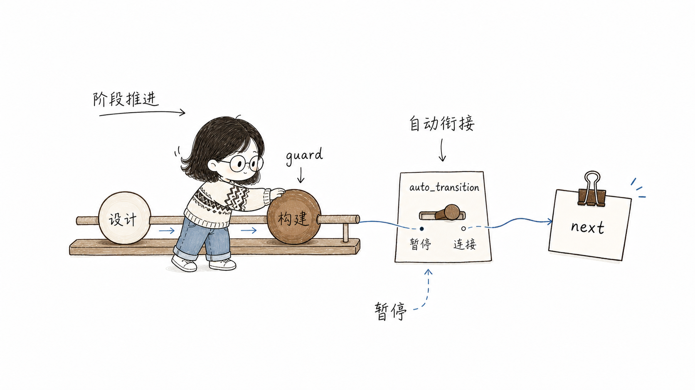

When a project is configured for Classic, `/comet-classic` reads the current phase, advances state, and selects the next Skill. This page explains that sequence and how recovery behaves around it.

<p align="center">
  
</p>

## Phase advancement and handoff

After a phase completes, the Agent runs the phase guard in the background. If the guard passes, the Agent runs `comet state next` to determine whether the next step is automatic, manual, or done.

| Result         | Meaning                         |
| -------------- | ------------------------------- |
| `NEXT: auto`   | Continue into the next Skill.   |
| `NEXT: manual` | Stop and show the next command. |
| `NEXT: done`   | Workflow is complete.           |

## State transition chain

Phase advancement and state transitions are run automatically by the Agent behind the scenes; you do not need to run these commands in a terminal during day-to-day work.

```text
open-complete -> design-complete -> build-complete -> verify-pass -> archived
                                                          ^
                                                   verify-fail (return to build)
```

<Accordion title="Background Agent command reference">

```bash
# Advance phase after phase-guard checks pass (called automatically before a phase Skill exits)
comet guard <change-name> <phase> --apply

# Trigger explicit state transition events (run by the Agent; available for terminal troubleshooting)
comet state transition <change-name> open-complete
comet state transition <change-name> design-complete
comet state transition <change-name> build-complete
comet state transition <change-name> verify-pass
comet state transition <change-name> verify-fail

# Resolve the next Skill after a phase updates
comet state next <change-name>
```

</Accordion>

## auto_transition setting

`classic.auto_transition` lives in `.comet/config.yaml` and is snapshotted into new Classic changes as `auto_transition`.

| Value   | Behavior                                             |
| ------- | ---------------------------------------------------- |
| `true`  | Continue automatically when safe.                    |
| `false` | Stop at phase boundaries and print the next command. |

Comet pauses at decision points and waits for your confirmation regardless of this setting.

## Always-stop points

Comet must stop for proposal/design/task review, PRD splitting, build-mode choices, verification failure decisions, the combined archive-and-delivery confirmation, and preset upgrade decisions.

## Why this matters

The Agent does not hardcode the next Skill. It delegates to `comet state next`, so configuration and current state decide the handoff.

## Next steps

- [Decision points](/en/concepts/decision-points)
- [Classic configuration](/en/classic/configuration) — `auto_transition` and configuration precedence
- [Workflow concepts](/en/concepts/workflow)
- [comet state](/en/scripts/comet-state)
