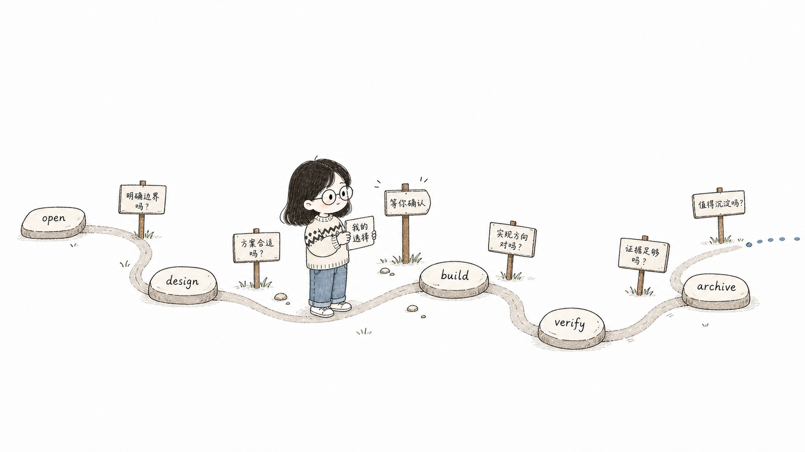

Comet advances unambiguous steps on its own, but leaves product direction and technical risk decisions to you. Every place that needs your input is a **blocking decision point**: Comet pauses, waits for your choice, and continues only after you answer.

This page lists every pause point in the five-stage workflow, so you know in advance where you will be asked to decide.

## How questions appear

On platforms that support interactive cards, such as Claude Code, Comet renders pause points as clickable single-choice or multiple-choice questions. Each option states what it does; Comet recommends one option, and you make the final choice.

| Scenario | What you see | What Comet does next |
| ------------------------------------------ | ---------------------------------------------------------------- | ------------------------------------------------------------- |
| Single-choice pause point | One question, such as whether to continue or which Git branch strategy to use | Comet updates state or runs the corresponding branch only after you confirm |
| Multiple-choice pause point | One question covering several settings at once, such as workspace isolation, execution mode, TDD strategy, and review mode | Comet writes all selected values to state in one step |
| No card support, or the first card call fails | Numbered text options that state "single choice" or "multiple choice", what each option does, and how to reply | Every later pause point in the session uses numbered text and does not retry the failed card |

<Note>
A plain numbered list does not mean the workflow is degraded. It only reflects a difference in input control: blocking rules, option meanings, and safety gates stay the same.
</Note>

## Pause points at a glance

Pause points are listed in stage order, and in the order they occur within a stage. A stage unlocks only after the last pause point of the previous stage is passed.

<Note>
Since 0.4.0-beta.5, Comet pauses only at **points that need a real decision from you**. The first three repairable failures, a single unambiguous next step, and operations that follow existing configuration run automatically without asking. When `auto_transition: false` prints `NEXT: manual`, Comet is returning terminal control only; **this is not a new decision point** and does not ask "Do you want to continue?"
</Note>

### 1. Routing stage

| # | Pause point | What you decide |
| ---- | ----------------- | ----------------------------------------------------------------- |
| 1    |Workflow target selection|When several changes are active, which one to continue, whether to create a new change, and which item to start first after a batch split|

### 2. open stage

| # | Pause point | What you decide |
| ---- | -------------------------- | ---------------------------------------- |
| 2    |PRD split pre-check|Whether a large requirement should be split into multiple independently deliverable changes|
| 3    |Workspace isolation|Use the current workspace (`current`), a new branch (`branch`), or a separate worktree (when parallel work is explicit, use a worktree directly)|
| 4    |Spec review (name and scope)|Final review of the change name, business scope, and whether proposal / design / tasks meet expectations|

### 3. design stage

| # | Pause point | What you decide |
| ---- | ------------ | -------------------------------- |
| 5    |Design confirmation|Confirm the technical approach agreed in brainstorming|

### 4. build stage

| # | Pause point | What you decide |
| ---- | -------------- | ----------------------------------------------------------------------------------------- |
| 6    |build joint decision|After plan-ready: continue immediately or pause to switch models, and settle execution mode + TDD strategy + review strictness in one step|
| 7    |Spec drift split|When new tasks exceed 50% of the initial task list, decide whether to split them into a new change|

### 5. verify stage

| # | Pause point | What you decide |
| ---- | ------------ | ---------------------------------------------------------------------- |
| 8    |Verification exception decision|Whether to accept non-blocking deviations (WARNING / SUGGESTION), how to handle spec drift, or which strategy to take after four consecutive failures|

### 6. archive stage

| # | Pause point | What you decide |
| ---- | ------------------ | ---------------------------------------------------------- |
| 9    |Archive and delivery confirmation|Choose the delivery method: archive locally only / archive and push / archive, push and create a PR / go back and adjust / defer archiving|

### 7. Preset upgrade signal (hotfix / tweak only)

| # | Pause point | What you decide |
| ---- | -------- | ---------------------------------------------------- |
| 10   |Upgrade evaluation|When a major architecture signal is hit, confirm whether to stay in the lightweight preset or upgrade to the full five-stage workflow|

  

Automatic advancement covers unambiguous transitions only. At a pause point, Comet waits for your confirmation before continuing.

## Pause point details

### 1 — Workflow target selection (routing stage)

| Attribute | Details |
| ---- | ------------------------------------------------------------------- |
|When it triggers|Several changes are active, a new change and an existing change both look like candidates, or a PRD batch split needs a starting item|
|What you decide|Which active change to continue with, whether to create a new change, and which item of a batch to start first|
|What you see|The active change list, the batch task list, and the branch status of each item|

Comet pauses only when there is real ambiguity. When exactly one active change is clearly relevant, it recommends resuming that change.

### 2 — PRD split pre-check (open stage)

| Attribute | Details |
| ---- | ------------------------------------------------- |
|When it triggers|The request is a large PRD or roadmap, or a clarification summary that contains several independent capabilities|
|What you decide|Whether to split the requirement into multiple smaller changes that can be delivered independently|
|What you see|A candidate split list with the name, objective, scope, and dependencies of each item|

Options:

| Option | Effect |
| ------------------------- | ------------------------------------------------------------------------------------------ |
|Create multiple OpenSpec changes|Run `/comet-open` for each item and persist the batch relationship to `.comet/batches/<batch-id>.json`|
|Keep it as one change|Continue with a single change and record why you did not split|
|Adjust the split plan|Refine the split boundaries and scope, then present the updated list for confirmation|

No artifact is written before you confirm the split. Each split item must pass both `openspec status --json` and `comet state check` before it counts as complete. See [Large PRD split](/en/guides/prd-splitting).

### 3 — Workspace isolation (open stage)

| Attribute | Details |
| ---- | -------------------------------------------------------------------------------------------------- |
|When it triggers|After a Classic change is created and before the OpenSpec artifacts and `.comet.yaml` are generated (it cannot be deferred to the build stage)|
|What you decide|The isolation mode: the current workspace (`current`), a new Git branch (`branch`), or a separate Git worktree|
|What you see|A comparison of the three isolation modes, with the scenarios each one suits|

When your request already states that work should run in parallel, Comet uses worktree isolation directly without asking again. Otherwise it presents all three options at once.

### 4 — Spec review (open stage)

| Attribute | Details |
| ---- | ------------------------------------------------------------------------------------------------- |
|When it triggers|proposal / design / tasks are drafted and pass the integrity check|
|What you decide|Whether the change name, business scope, and the three documents meet expectations|
|What you see|proposal (background and objective), design (technical choices), tasks (work items and key points), and the standard English identifiers Comet derives|

| Option | Effect |
| ------------------ | ------------------ |
|Confirm and continue|The phase guard lets the workflow proceed to design|
|Needs adjustment|Comet revises the documents from your feedback and presents them again|

<Note>
Since 0.4.0-beta.5, requirement clarification and naming early in the open stage are **non-blocking** by default. When the objective and the name are clear, the workflow continues without stopping to confirm intermediate drafts, and this pause point performs the single final review. Comet asks a joint question only when the change identity involves a mutually exclusive choice, such as whether to reuse an existing change.
</Note>

### 5 — Design confirmation (design stage)

| Attribute | Details |
| ---- | ------------------------------------------------------------ |
|When it triggers|After brainstorming produces a design approach and before the Design Doc is written|
|What you decide|Whether to adopt the proposed technical approach|
|What you see|The proposed approach, key trade-offs, technical risks, test strategy, and incremental Spec changes|

| Option | Effect |
| -------- | ---------------------------------- |
|Adopt|Finalize the design and create the Design Doc|
|Needs adjustment|Continue the discussion on the specific disagreements until you agree|

Before you confirm, Comet does not write the Design Doc, does not write state, and does not pass the phase guard.

### 6 — build joint decision (build stage)

After the implementation plan is drafted, one joint decision panel settles all execution settings at once:

| Attribute | Details |
| ---- | -------------------------------------------------------------------------------------------- |
|When it triggers|After the implementation plan is written to a file|
|What you decide|Continue executing immediately or pause to switch models, plus execution mode, TDD strategy, and review strictness|
|What you see|The plan-ready prompt and Comet's recommended value for each setting|

#### plan-ready action

| Option | Effect |
| --------------- | ------------------------------------------------------ |
|A: Continue now|Set `build_pause: null` and start implementing|
|B: Pause to switch models|Set `build_pause: plan-ready`, stop the session, and resume later|

Comet **supports planning with a stronger model and implementing with a lighter one**. After the plan is ready, you can pause, switch models or machines, and continue.

#### Execution mode

| Option | Characteristics |
| --------------------------- | --------------------------------------------------------------------- |
|`subagent-driven-development`|A background sub-agent implements task by task, with two-stage review|
|`executing-plans`|Lightweight mode that implements tasks in order in the main session|
|`direct`|Direct implementation (mainly for hotfix / tweak; the full workflow requires `direct_override: true`)|

#### TDD strategy

| Option | Characteristics |
| ------ | --------------------------------------------------- |
|`tdd`|Write the failing test first, then the implementation|
|`direct`|No enforced red-green-refactor, but related tests and regression evidence are still required|

#### Review strictness

| Option | Mechanism |
| ------------------------- | ------------------------------------------ |
|`off` / `standard` / `thorough`|See [Code review mechanism](/en/concepts/review-mode)|

Those settings are combined into one decision rather than two separate pauses. When branch or worktree isolation was chosen, the branch name follows the value you confirmed at pause point 3. Recommendations are for reference only and do not replace your confirmation.

### 7 — Spec drift split decision (build stage)

When implementation reveals new tasks that exceed 50% of the initial `tasks.md`, Comet pauses and asks you to assess the scope:

| Option | Effect |
| ----------------- | ----------------------------------------- |
|Split into a new change|Keep the current change focused and start a new change through `/comet-open` for the out-of-scope work|
|Continue in the current change|Expand the scope of this change and update `tasks.md` and the incremental Spec|

### 8 — Verification exception decision (verify stage)

| Attribute | Details |
| ---- | ------------------------------------------------------------------- |
|When it triggers|A check fails, and the failure cannot be fixed automatically or requires a judgment call|
|What you decide|Whether to accept a specific non-blocking deviation, how to handle spec drift, or which strategy to take after repeated failures|
|What you see|The failing checks, their severity (CRITICAL / IMPORTANT / WARNING / SUGGESTION), and the recommended fix|

Comet handles failures differently by severity:

| Severity and situation | How Comet handles it |
| ----------------------------------------------- | ------------------------------------------------------ |
|CRITICAL / IMPORTANT, or an objectively repairable problem|Run `verify-fail` and return to build for repair within the retry budget, without asking you|
|WARNING / SUGGESTION whose fix changes behavior or scope|Pause and let you choose between fixing and accepting. When you accept, record the reason and the impact|
|WARNING / SUGGESTION that can be fixed safely|Fix automatically and rerun the checks, without pausing|
|Unresolved after three consecutive repairs (the fourth failure)|Pause with two options only: "Keep repairing" or "Stop and seek an external decision"|

**CRITICAL and IMPORTANT findings cannot be waived.** Delivery stays blocked while they are unresolved. You are asked to decide only when accepting a WARNING / SUGGESTION deviation or choosing a strategy after the fourth failure.

#### Three ways to handle spec drift (full workflow check 6 only)

When the incremental Spec contradicts the original Design Doc, choose one of three paths:

| Path | Effect |
| ---- | ------------------------------------------------------------------------- |
| A    |Add an "Implementation Divergence" note to the Design Doc and record the justified adjustment|
| B    |Run `transition verify-fail` to return to build, then load `brainstorming` and realign|
| C    |Accept the deviation and continue verification; the reason is recorded in the verification report|

### 9 — Archive and delivery confirmation (archive stage)

| Attribute | Details |
| ---- | ------------------------------------------------------------------------------------------------- |
| When it triggers | After all acceptance checks pass and before the archive merge |
|What you decide|Whether to archive, and how to deliver the archive commit (keep locally / push / push and create a PR)|
|What you see|The change name, the verification report, the bound branch and workspace, uncommitted changes, the irreversible archive actions, and the planned remote operations|

| Option | Effect |
| --------------------------- | --------------------------------------------------------------------------------------------- |
|Archive locally only|Create the single archive commit and leave it on the current branch, without pushing or creating a PR|
|Archive and push|Create the single archive commit and push it to the associated remote branch|
|Archive, push, and create a PR|Create the archive commit, push it, and create a pull request against the main branch|
|Adjust or re-verify|Run `archive-reopen` to return to `phase: verify` and `/comet-verify`|
|Defer archiving|Keep the change active in `phase: archive` and write no archive marker|

<Note>
<code>branch_status: handled</code> means the delivery method is confirmed. It does not mean the push or the pull request succeeded. Comet writes the field after archiving completes and before the archive commit is created, and clears the selection only after the remote operation succeeds. The archive phase no longer loads <code>finishing-a-development-branch</code>.
</Note>

<Note>
Comet waits for your confirmation at pause point 9 before archiving, even when all checks pass. This applies whether <code>auto_transition</code> is enabled or disabled.
</Note>

### 10 — Preset upgrade evaluation (hotfix / tweak only)

| Attribute | Details |
| ---- | ------------------------------------------------------------------------ |
|When it triggers|A hotfix or tweak hits a signal that the change is larger than expected (cross-module work, a new API, a schema change, deep architectural work)|
|What you decide|Whether to stay in the lightweight preset or upgrade to the full five-stage workflow|
|What you see|The signal that triggered the question and the phase changes the upgrade brings|

| Option | Effect |
| ------------ | ----------------------------------------------------------------- |
|Continue the preset|Confirm that the scope is under control and continue the hotfix / tweak flow|
|Upgrade to the full workflow|Run `comet state transition <name> preset-escalate` to return to design and add architectural design|

## How pause points behave

All pause points follow the same protocol. Since 0.4.0-beta.5, the protocol first decides whether your input is needed at all:

- **User decision**: two or more valid options change the scope, behavior, acceptable risk, or an irreversible outcome, so you must choose.
- **Automatic handling**: only one safe next step remains (fixing an objective failure, checking state consistency, retrying an idempotent check, following persisted configuration). Comet runs it and reports the result without asking.
- **Stop condition**: a dependency is missing, state is corrupted, a path escapes the workspace, an external command is unavailable, or no valid next step exists. Comet reports the blocker and the recovery steps.
- **Manual handover**: `NEXT: manual` returns control without creating a decision point. Comet prints the hint and ends the call without asking "Do you want to continue?"

Only the first category uses the blocking rules. Choices that can be answered together are merged into one question, and a choice that is already persisted is not asked again. Comet checks platform capabilities and state before showing options, and only shows options that can actually run. When a field has exactly one valid value, Comet states it and applies it without a separate pause.

- **Never choose for you**: an option cannot be preselected from a recommendation, a default, or the current state.
- **Structured questions first**: show clickable single-choice or multiple-choice questions where the platform supports them, and fall back to numbered text otherwise.
- **Fall back once per session**: if the first structured question fails, every later pause point in that session uses numbered text.
- **Pause before acting**: Comet waits for your explicit choice before creating formal artifacts, running guards, or advancing the phase.
- **Recommendations are advisory**: a recommendation never replaces your confirmation.

## Next step

- [open stage](/en/phases/open) — Requirement clarification and spec generation
- [build stage](/en/phases/build) — Planning and implementation modes
- [verify stage](/en/phases/verify) — Automated checks and quality acceptance
- [archive stage](/en/phases/archive) — Archiving and multi-branch delivery
- [Workflow concepts](/en/concepts/workflow) — How the Classic five stages work together
