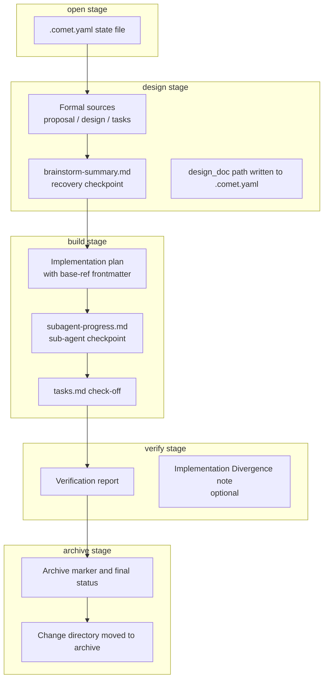

Comet creates a set of working files during the five-stage `/comet` flow. These files support context compression, recovery after an interruption, evidence recording, and handoff between phases. Your actual deliverables remain the requirement documents, the design, and the code.

Knowing these files helps you recover after context compression, know where to look when something goes wrong, and check the delivery before archiving.

## How artifacts move through the stages



<p align="center">
  
</p>

<p align="center">
  Each kind of artifact supports context, recovery, handoff, or verification evidence.
</p>

Below, `<classic-root>` stands for the Classic OpenSpec root. New projects store it in `docs/openspec/`; projects that keep the old layout use `openspec/`. The location is set by `classic.artifact_layout`. See [project file structure](/en/guides/project-structure).

## .comet.yaml: the state file for the whole workflow

| Attribute | Description |
| -------------- | ---------------------------------------------------- |
| Location       | `<classic-root>/changes/<name>/.comet.yaml`          |
| Created in     | open (`comet-state init`)                            |
| Updated in     | Each stage updates its own fields                    |
| Managed by     | Comet (written by scripts, checked by the guard)     |

This is the only state file shared across phases. Fields are filled in progressively as the workflow advances. See [state management](/en/concepts/state-management).

<Note>
  The Classic workflow treats <code>.comet.yaml</code> as the authoritative record of current state.
  <code>.comet/state-events.jsonl</code> is an append-only audit log that explains how the state
  reached its current value. <code>.comet/run-state.json</code> and <code>trajectory.jsonl</code> hold
  internal execution details that Comet maintains. Cross-session recovery relies mainly on{' '}
  <code>.comet.yaml</code>, the formal documents, and the checkpoint markdown; read the event log
  only when you need to find out why a state changed.
</Note>

### state-events.jsonl (state transition audit)

| Attribute | Description |
| ----------- | -------------------------------------------------------------------------------------------------------------- |
| Location    | `<classic-root>/changes/<name>/.comet/state-events.jsonl`                                                      |
| Created in  | The first successful state transition                                                                          |
| Purpose     | Records the state changes made by `comet-state transition`, `comet-guard --apply`, and archiving                |
| Managed by  | Comet appends to it; the file is readable and should not be edited by hand                                     |

It is not the source of current state; `.comet.yaml` remains authoritative. Use the event log to answer questions such as: was this `phase` changed by the guard, a manual transition, or archiving? Which fields actually changed?

## Artifacts of the design stage

The design stage produces the most intermediate artifacts, because it supports context compression and the shift from OpenSpec documents to an implementation design.

### Formal sources and the optional reading view

Classic reads proposal, design, tasks, and the delta Specs directly. The Agent reads the material it needs for the task and does not build a hash package.

When you want all of the context in one Markdown file, run `comet handoff <change-name> design --write --full`. It writes the original source content to `.comet/handoff/design-context.md` in the current change. The view is for reading only; it does not replace the formal sources or the design approval. See [comet handoff](/en/scripts/comet-handoff).

### brainstorm-summary.md

| Attribute | Description |
| ----------- | ------------------------------------------------------------------------------------------------------------------------- |
| Location    | `<classic-root>/changes/<name>/.comet/handoff/brainstorm-summary.md`                                                      |
| Created in  | The design stage, updated incrementally during brainstorming                                                              |
| Purpose     | **Recovery checkpoint for context compression**: restores confirmed design decisions after compression                     |
| Managed by  | The Agent, following the structure and location the Skill specifies                                                        |

It records:

- The confirmed technical approach
- Key trade-offs and risks
- The test strategy
- The Spec Patch, if any
- Unconfirmed items, marked `pending` or `candidate`

<Tip>
  <code>brainstorm-summary.md</code> is the main recovery point of the design stage. After context
  compression, the Agent restores confirmed decisions from it instead of repeating the
  brainstorming. The file is updated incrementally during the discussion, and the final version is
  written after you confirm the design.
</Tip>

## Artifacts of the build stage

The build stage artifacts support sub-agent scheduling recovery and task tracking.

### Implementation plan

| Attribute | Description |
| ----------- | ------------------------------------------------------------------------ |
| Location    | `docs/superpowers/plans/YYYY-MM-DD-<feature>.md`                         |
| Created in  | build, generated by a sub-agent that loads `writing-plans`               |
| Purpose     | The implementation plan; its frontmatter is key evidence in verify       |
| Managed by  | The Agent                                                                |

The plan frontmatter is the evidence verify relies on:

```yaml
---
change: <openspec-change-name>
design-doc: docs/superpowers/specs/YYYY-MM-DD-<topic>-design.md
base-ref: <git HEAD before implementation>
---
```

`base-ref` is the commit SHA before implementation starts; verify uses it to recalculate the size of the change. Comet writes the plan path to `.comet.yaml`.

### subagent-progress.md

| Attribute | Description |
| ----------- | --------------------------------------------------------------------------------------------------- |
| Location    | `<classic-root>/changes/<name>/.comet/subagent-progress.md`                                         |
| Created in  | build, only when `build_mode: subagent-driven-development`                                          |
| Purpose     | **Sub-agent scheduling checkpoint**, the build-stage counterpart of `brainstorm-summary.md`          |
| Managed by  | The main session                                                                                    |

It records the scheduling state of the current task:

- The current plan task text and the matching OpenSpec task text
- The current stage (`implementing`, `task-review`, `checkoff`, `done`, `blocked`)
- The implementation commit hash, changed files, and RED/GREEN evidence
- The selected `review_mode`
- Review stages that have passed and reviewer feedback that is still open
- The current number of review-and-fix rounds

<Warning>
  <code>subagent-progress.md</code> is rewritten for each task. Sub-agents, both implementers and
  reviewers, <strong>cannot edit it</strong>; only the main session writes it. The implementer writes
  code, the reviewer writes feedback, and the main session advances the checkpoint. This keeps a
  sub-agent from marking its own task complete.
</Warning>

### tasks.md

| Attribute | Description |
| ----------- | -------------------------------------------- |
| Location    | `<classic-root>/changes/<name>/tasks.md`     |
| Purpose     | Task completion tracking (`- [ ]` → `- [x]`) |
| Managed by  | The main session                             |

Comet has no separate checkbox file; task state lives in `tasks.md`. Use `grep -c '\- \[ \]' tasks.md` to count open items and `comet-state task-checkoff <file> <text>` to verify that a specific task is checked off.

In subagent mode, the implementer **cannot** check off tasks. Only the main session does so, after the task-level review that `review_mode` requires has passed. With `review_mode: off` there is no reviewer, so check-off relies on the self-test evidence.

## Artifacts of the verify stage

### Verification report

| Attribute | Description |
| ----------- | ------------------------------------------------------------------------------------------------------------- |
| Location    | `docs/superpowers/reports/YYYY-MM-DD-<change-name>-verify.md`                                                 |
| Created in  | verify; the result counts only after the file is written                                                      |
| Purpose     | Verification evidence: the 6-item (light) or 7-item (full) results, PASS/FAIL, and reasons for accepted risks |
| Managed by  | The Agent                                                                                                     |

Comet writes the `verification_report` path to `.comet.yaml`, and the guard requires the file to exist when `verify-pass` is applied.

### Implementation Divergence note (optional)

| Attribute | Description |
| ----------- | -------------------------------------------------------------------------------------------------------------------------------------- |
| Location    | Inside the Design Doc (`docs/superpowers/specs/...-design.md`)                                                                         |
| Trigger     | A full verify finds a contradiction between the delta spec and the Design Doc, and you choose to accept the deviation                   |
| Purpose     | Records how the implementation differs from the design documents                                                                       |

When you accept the deviation, the reason and its impact go into the verification report. At archive time, the normal flow adds `archived-with` to the Design Doc.

## Artifacts of the archive stage

Archiving creates no new files. It annotates existing artifacts and moves directories.

### Frontmatter annotations

| File | Annotation | Meaning |
| ---------------------------------------- | -------------------------------------------------------- | --------------------------------------------------------------------------- |
| Design Doc                               | `archived-with: <archiveName>` + `status: final`         | The archive it belongs to, plus its final status                            |
| Design Doc (when a deviation was accepted) | The acceptance reason recorded in the verification report | The deviation was confirmed and the design remains authoritative            |
| Plan                                     | `archived-with: <archiveName>`                           | The archive it belongs to                                                   |

### Archive directory

The whole change directory moves to `<classic-root>/changes/archive/YYYY-MM-DD-<name>/`, including `.comet.yaml`, `.comet/handoff/`, `.comet/subagent-progress.md`, and the delta spec. After the move, `.comet.yaml` has `archived: true`.

## Artifacts by purpose

| Purpose | Artifacts |
| ---------------- | ---------------------------------------------------------------------------------------- |
| Context recovery | Formal sources, brainstorm-summary.md, optional reading views                            |
| State recovery   | `.comet.yaml`, subagent-progress.md, brainstorm-summary.md                               |
| State audit      | state-events.jsonl                                                                       |
| Phase handoff    | Formal OpenSpec sources, confirmed proposals, actual check results                       |
| Evidence         | Verification report, plan metadata, tasks.md completion, Implementation Divergence notes |
| Lifecycle        | archived-with, status, archived: true                                                    |

## Find the right artifact

| Question | Where to look |
| --------------------------------- | ----------------------------------------------- |
| Current stage and execution mode  | `.comet.yaml`                                   |
| The requirement being implemented | Formal proposal, design, tasks, and delta Specs |
| Confirmed brainstorming decisions | `.comet/handoff/brainstorm-summary.md`          |
| Sub-agent task progress           | `.comet/subagent-progress.md`                   |
| Task completion                   | `tasks.md` checkboxes                           |
| Verification result               | `docs/superpowers/reports/...-verify.md`        |
| Whether a reading view is current | Compare it with the formal sources              |
| Why the phase changed             | Recent `.comet/state-events.jsonl` entries      |

## Next step

- [Workflow concepts](/en/concepts/workflow) — Where these artifacts fit in the five stages
- [State management](/en/concepts/state-management) — `.comet.yaml` fields and state invariants
- [Context compression](/en/concepts/context-compression) — How formal sources stay usable after compression
- [comet handoff](/en/scripts/comet-handoff) — How the reading view is generated
- [Resuming interrupted work](/en/guides/resuming-workflow) — Using these artifacts to resume
