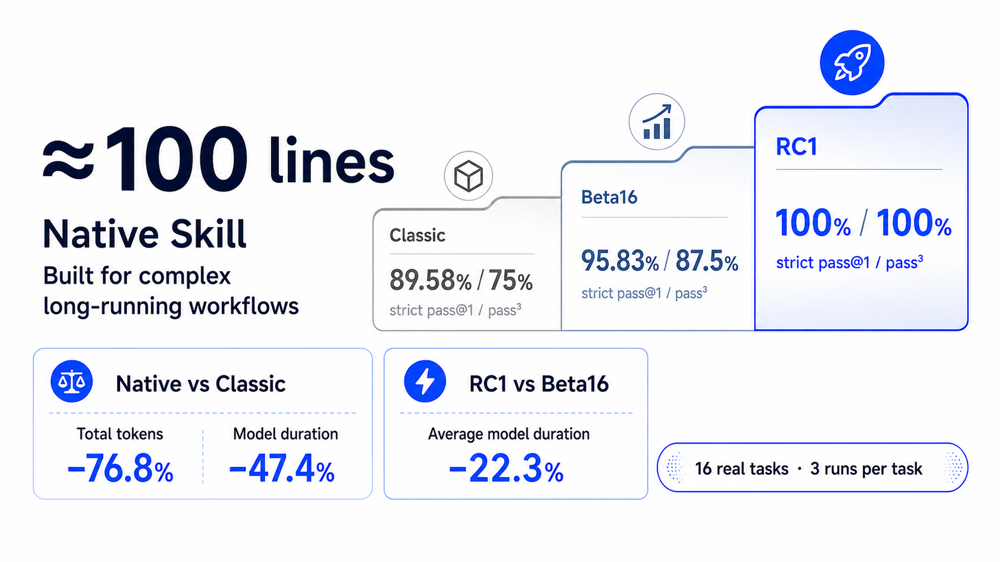
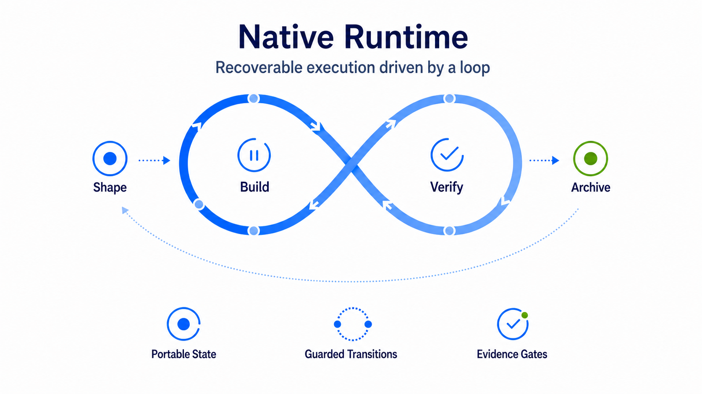
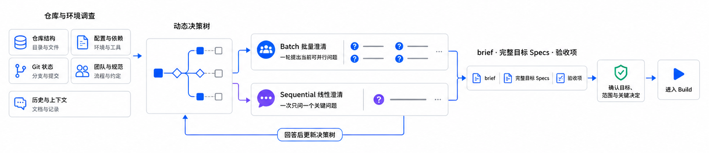
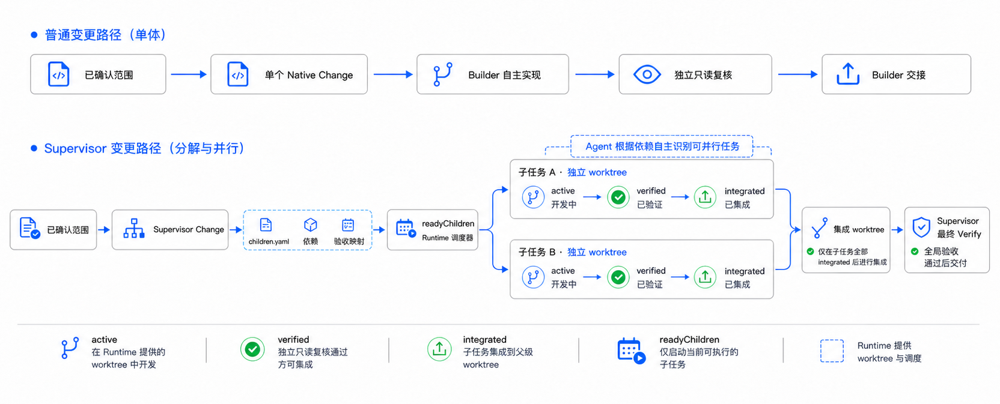

## Goal-driven Agent development model

Native is the requirement workflow designed by Comet for modern high-capability models. Models such as Fable 5 and GPT-5.6 have been able to independently investigate code, formulate solutions, and select testing strategies based on risks. For this type of model, continuing to enforce the application of fixed design, planning and TDD processes will bring limited additional benefits.

Native only stipulates two things:

- **Fix the requirements**: Use `brief.md` (which records the goals, scope, non-objectives, and confirmed user decisions) and the complete target Specs to clarify "what to do".
- **Determine completion with evidence**: The Runtime runs necessary checks, and Verify determines whether the result meets the acceptance criteria.

The methods for planning, implementation, testing and review are still independently chosen by the model.

In the evaluation experiment with Classic inside Comet Eval (16 tasks, 48 runs, taking 41 pairs of samples that both sides passed), the total token of Native was 76.8% less, the number of Agent rounds was 57.4% less, and the time consumption was 47.4% shorter. The pass rate for all three attempts is 87.5%. The experimental design and original figures can be found in [Native vs. 0.4.0 Classic Real Evaluation](/en/eval/comet-native-vs-040-experiment).



### How does Native Loop achieve its goals

Shape transforms user goals into briefs, Specs, and verifiable acceptance items; Build is independently implemented by the model. Runtime runs necessary checks, and Verify evaluates the original request and acceptance items.



Any failed items will return to Build together with the failure reason, be fixed and then re-verified. Archive requires every acceptance item to pass and the current result to be accepted. When encountering a new user decision or a block that cannot continue, the Loop will immediately pause and return to the user to avoid invalid retries.

### The difference from `/goal`

A Native Loop is also a Goal Loop. Both it and [`/goal`](https://learn.chatgpt.com/use-cases/follow-goals) enable agents to continuously advance around verifiable endpoints. The difference lies in that `/goal` offers universal long-term execution capabilities; Native Loop defines fixed stages, acceptance criteria, and state management specifically for software development.

| Comparison item           | `/goal`                                                  | Comet Native                                                                                                         |
| ------------------------- | -------------------------------------------------------- | -------------------------------------------------------------------------------------------------------------------- |
| Goal definition           | The user provides the target and the stop conditions     | Shape writes the goals as briefs, Specs and item-by-item acceptance criteria                                         |
| Status recovery         | Codex saves the running status of the Goal               | The status is saved with the project and can be continued from a new Runtime session                |
| Completed determination   | Codex determines whether the stop condition has been met | Runtime runs checks, then Verify evaluates each item against evidence                                                |
| Engineering collaboration | Focus on the continuous execution of the goal            | Built-in branches, worktree, parallel tasks, automatic return to Build for repair on failure, and archive management |
| Result retention          | Achieve the current Goal                                 | Keep reviewable requirements, statuses, acceptance results and archiving records                                     |

You can also combine the two: let `/goal` provide long-term continuous execution, and let Native handle the goals, workspaces, statuses, and completion determinations during the R&D process.

<Tip>
  **Benchmark data: Native vs. native Goal stability**

  In the [Native 0.5.3 vs. native Goal benchmark](/en/eval/comet-native-053-vs-goal-experiment), Comet compared Native 0.5.3 against Claude Code's native `/goal` mode without Comet on stratified tasks from SkillsBench and WorkBuddy-Bench.

  The results show that while native Goal is capable of passing tasks in isolated runs (pass@3 reached 100.0% on SkillsBench), the lack of deterministic quality gates leads to behavioral drift or timeouts across repeated executions (pass^3 for 3 consecutive perfect scores was 0.0% on SkillsBench). In contrast, through the acceptance-item constraints of the Shape stage and a Verify-stage rollback mechanism based on real test results, Comet Native achieves a 66.7% overall perfect score rate (vs. 44.4% for Goal) and a 33.3% pass^3 rate, demonstrating significantly higher stability on complex long-horizon tasks.
</Tip>

## Let Skill return to its essence

In the past, we often used skills to write a large number of engineering rules, allowing agents to develop according to fixed design, planning, TDD and review processes, such as Superpowers. When the models entered the Fable 5 and GPT-5.6 range, they already had stronger capabilities of autonomous investigation, planning and tool selection. Overly specific process regulations may instead conflict with the model's own reasoning path.

The underlying mechanism of a Skill is this: the Skill itself enters the Agent Harness process as a System Prompt. At runtime, the Agent decides whether to gradually load a certain Skill by checking whether the current task matches the Skill name and desc.

Therefore, Comet Native deliberately does not repeatedly write large sections of project execution rules during the Build phase. Take TDD as an example. In fact, if we need the Agent to adopt the content of TDD during implementation, we only need to install the Skill of TDD and ensure that the description of the Skill is suitable for the Coding task.

When Comet Native is executed, **The Agent will independently select the appropriate engineering Skill**. Comet Native Skill can thus focus on the workflow protocol of Native itself, while engineering methods such as TDD are provided by the corresponding Skill. This approach to ReAct Agent corresponds to the transformation of the industry's Agent architecture from Workflow exploration to full ReAct over the past two years, and the same changes are taking place in the Skill field. With this architecture, **more than 100 lines of Comet Native skills can carry out the work that was previously accomplished collaboratively by multiple skills of Comet Classic**.

## From the goal to the delivery, the four stages are automatically advanced

The four stages focus on four key outcomes: clear goals, controllable implementation, reliable acceptance, and traceable delivery. The model can independently determine the specific execution method, and the Runtime is responsible for automatically connecting the phases and pausing when you need to make a decision. For the internal components of the Runtime, see [Inside the Native Runtime](/en/native/runtime).

### Shape: Transform vague requirements into executable goals

Shape will first investigate the repository and then dynamically raise questions that need to be confirmed based on the known information. Information is divided into three categories:

- **Verifiable facts**: They can be identified from the code and the environment, and investigated by the Agent itself.
- **User decisions**: You confirm decisions that affect user-visible behavior, technical choices, or compatibility.
- **Implementation selection**: It does not affect the visible results for users and is left for the model to handle.

The entire Shape adopts a high-intensity clarification method similar to Grill Me. The Agent will dynamically maintain a decision tree. Each time a survey yields new facts or you confirm a choice, it updates the affected branches and then decides what exactly needs to be asked next. Whether you choose Batch or Sequential, for each question that requires your decision, recommendations and the actual impact of each option will be provided.

- **Batch (Batch Clarification)**: Display all current independent issues at once, suitable for those who wish to complete confirmation quickly.
- **Sequential (Linear Clarification)**: Ask only one key question that has the greatest impact at a time; Update the decision tree immediately after answering and then proceed to the next level.



Only when all key branches have been handled, the brief, Specs and acceptance criteria are consistent, and you confirm the ultimate goal, scope and key decisions, will the Runtime allow it to enter the Build. For details, see [Clarification Modes](/en/native/clarification-modes) and [Decision Ownership](/en/native/decision-ownership).

### Build: The model implements autonomously, while Comet manages the environment and state

After entering the Build process, the brief and Specs define "what is ultimately to be achieved", while the model independently selects the design plan, testing method, and engineering skills based on the task. Comet is responsible for the workspace, state, phase transition, and interrupt recovery, allowing the model to focus on the code itself.

You can complete a typical request in one change. For larger work that can be split into independent modules, Native uses Supervisor Change. It defines each subtask, its dependencies, and its acceptance scope, then prepares separate worktrees for subtasks that are ready to start. Subtasks can run in parallel across sessions, and Comet integrates results after they pass their checks and their dependencies are ready.



The code submitted by the Builder serves as a candidate implementation, and Verify checks it against the original request and all acceptance items. For details, see [Supervisor Change](/en/native/supervisor-change).

### Verify: Ensure that every completion is supported by evidence

Verify evaluates the Builder candidate against the original request, brief, complete Specs, actual implementation, and Runtime check results. New tasks allow acceptance in the current session, with independent review selected for task needs and your requirements. Reports record the actual review method. Valid Runtime checks from Build can be reused. Acceptance requires every listed item to pass. Missing, duplicate, or unknown items, fabricated evidence, and failed checks cannot count as passing. Existing tasks retain their original verification contracts.

If the acceptance fails, the Runtime will bring the failure reason back to the Build. When repairing, the Builder prioritizes checking the failed items and the affected scope. After the local issues are resolved, a final verification covering all acceptance items must be conducted again. When there are consecutive failures, progress stagnation, or execution errors reaching the upper limit, the Loop will pause and explain the reason to prevent further consumption of rounds.

For details, see [Native Loop](/en/native/native-loop) and [Verification and Repair](/en/native/verification-and-repair).

### Archive: Record the results that have passed the acceptance inspection

Native can enter Archive only when all acceptance items pass and the current result is accepted. The Runtime will generate `verification.md`, retain requirements, Specs, acceptance evidence and final conclusions, and apply the confirmed specifications to the project documentation.

Archive will reuse the passed checks while confirming that the code, specifications, and acceptance results still match. If the requirements or implementation change before archiving, the old results will become invalid and be returned to the correct stage for reprocessing.

Finally, Comet retains the current workspace, merges the results, pushes the branch, or creates a PR based on your delivery choices. A change workspace has three isolation modes: `current` (completed directly in the branch and directory you are working in), `branch`, and `worktree`. Changes in a `current` workspace are not asked how to deliver: Comet shows the current branch and directory, archiving performs no merge, push, or PR, and the archive completes directly after you confirm. A change isolated in a branch or worktree is presented with five mutually exclusive options before archiving: keep the workspace only, merge locally, push, push and create a PR, or defer the archive. In the future, whether changing sessions or devices, it will be possible to trace how this requirement was fulfilled from the official artifacts in the project. For details, see [Archive and Delivery](/en/native/archive-and-delivery), [Artifacts and State](/en/native/artifacts-and-state), and [Continuation and Checkpoints](/en/native/continuation-and-checkpoints).

## State and interruption recovery

When you close a session, switch devices, or the flow is interrupted, Comet reads the state saved in the project and continues from where it stopped. The state lives in three places:

1. `comet-state.yaml` in the change directory: it saves the stage, Loop, acceptance, handoff, check summary, Verifier conclusion, blocking cause, the last 50 execution records, and the next step. When you switch devices or the local execution state file is missing, the Runtime rebuilds from this YAML.
2. Local files under `.comet/runtime/native/`: `state.json`, logs, locks, and transactions. These files are not synchronized across devices; if lost, they are rebuilt from the YAML as described above.
3. `.comet/current-change.json`: it records which change the current work belongs to, so later edits are not written into another requirement. `status` and `show` remain read-only and keep this pointer while querying. If the current change has been deleted or archived, select again from the active changes:

   ```bash
   comet native select <change-name>
   ```

During recovery, if the code, artifact root, or branch/worktree does not match the recorded state, Comet stops and waits for you to handle it instead of continuing.

## The relationship with Classic

Native and Classic are two independent workflows, each targeting different model capabilities and development approaches. For how to choose between Native and Classic, see [How to Select](/en/native/native-vs-classic) `/comet` forwards according to the configuration in `.comet/config.yaml`, and each side manages its own change, Guard, status and directory respectively.

Continue reading: [Native Quick Start](/en/native/quickstart), [Native Loop](/en/native/native-loop), [Native artifacts and state](/en/native/artifacts-and-state) and [Safety and Recovery](/en/native/safety-and-recovery).
