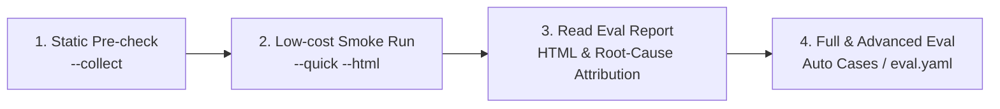

As long as you have a local directory containing `SKILL.md`, you can immediately evaluate its quality using `comet eval`.

Even if you have not written any test cases yet, **Eval automatically generates 2 to 4 matching evaluation test cases based on your Skill's content and executes them**. This guide follows the actual developer workflow: start with a zero-config static pre-check, run a low-cost smoke test, interpret report findings, and configure advanced settings as needed.

<Tip>
  Want to run standardized public benchmark tasks? In Dashboard, select **Built-in datasets** under New Evaluation to download WorkBuddy Code or SkillsBench. See [Built-in benchmark datasets](/en/cli/eval#built-in-benchmark-datasets).
</Tip>

## Quickstart Workflow



## Step 1: Zero-Config Static Pre-check (No API Keys Required)

Before making any real model calls, run `--collect` to verify Skill directory structures, manifests, and task discovery:

```bash
comet eval ./my-skill --collect
```

- **Requires no Docker, no API keys, and incurs zero token cost**;
- Runs static syntax checks and task scans locally;
- Once the command recognizes your Skill name and planned tasks, proceed to the next step.

## Step 2: Run a Low-Cost Smoke Evaluation

Before running a real evaluation, make sure your machine has:
- Python 3.11+ and `uv`
- Docker installed and running
- Your chosen Agent CLI (defaults to `claude-code` or `codex`) and corresponding model API keys

Run the fixed, low-cost smoke test to validate the full execution pipeline:

```bash
comet eval ./my-skill --quick --html
```

- `--quick` runs the built-in `generic-skill-smoke` task, verifying that the Skill can be properly loaded into the agent, invoked by the model, and produce expected output files;
- `--html` tells the runner to generate an interactive HTML report upon completion and print the report path to your terminal.

```text
✔ Loaded Skill: my-skill
✔ Launching isolated container environment...
✔ Executing smoke task: generic-skill-smoke
✔ Scoring complete: pass@1 = 100%
📄 Evaluation report generated: .comet/eval/runs/exp-2026-11-15/summary.html
```

## Step 3: Interpret Evaluation Reports and Root-Cause Failures

Open the generated `summary.html` in your browser (or view `summary.md` in the same directory):

1. **Pass Rates**: Check `pass@1`, `pass@k`, or `pass^k` metrics to measure Skill capability and consistency across repeated runs;
2. **Multi-Dimensional Rubric Scores**: Inspect task completion, formatting compliance, and absence of unwanted side effects;
3. **Precise Failure Attribution**: When a task fails, Comet automatically categorizes the root cause:
   - `harness`: Container, dependency, or runtime environment errors (e.g. Docker port conflicts or missing Python packages);
   - `workflow`: Workflow guidance flaws, such as the agent getting stuck or timing out;
   - `task`: The evaluation task definition or assertion criteria are incorrect or overly strict;
   - `model`: Model output instability or formatting anomalies.

## Step 4: Full Evaluation and Customizing Tasks

Once the smoke test succeeds, run a full evaluation:

```bash
comet eval ./my-skill --html
```

If no task is manually configured, the runner **automatically generates 2 to 4 test cases** tailored to your Skill, freezes and caches them, and executes the suite.

### Target Passing Options

You can pass a directory, a `SKILL.md` file directly, or an `eval.yaml` manifest:

```bash
# Pass the Skill directory: automatically discovers comet/eval.yaml if present
comet eval ./my-skill --html

# Pass SKILL.md directly
comet eval ./my-skill/SKILL.md --html

# Pass the manifest directly
comet eval ./my-skill/comet/eval.yaml --html
```

If your Skill lives outside the current project, pass `--project ./my-project` to designate where run logs and reports should be saved.

### Customizing Evaluation Tasks

To write domain-specific evaluation tasks, create a `comet/eval.yaml` file inside your Skill root:

```yaml
# my-skill/comet/eval.yaml
evaluation:
  tasks:
    - name: writes-summary
      prompt: Create summary.md in the current workspace with key findings.
      expect:
        files:
          - summary.md
        contains:
          summary.md:
            - '# Summary'
```

For advanced task bundles containing custom Dockerfiles and test scripts (`task.toml`), see [Configuring Evaluations and Custom Tasks](/en/eval/configuration).

## Step 5: Switch Evaluation Agents and Backends

### Changing the Evaluated Agent

The default agent is `claude-code`. You can specify a different primary Agent and an independent LLM-as-Judge model via CLI flags or `eval.yaml`:

```bash
# Specify codex via CLI
comet eval ./my-skill --agent codex --model gpt-4o --html
```

Or configure defaults in `eval.yaml` (CLI flags take precedence):

```yaml
execution:
  agent: codex
  model: gpt-4o
judge:
  agent: claude-code
  model: claude-3-7-sonnet
```

### Choosing an Evaluation Backend (Local / LangSmith / Langfuse)

Use `--suite` to specify where telemetry and test scores should sync:

| Backend | Command | Description |
| --- | --- | --- |
| `local` | `comet eval ./my-skill --html` | Default backend, generates local reports for fast iterations |
| `langsmith` | `comet eval ./my-skill --suite langsmith --html` | Generates local reports and syncs traces and Rubric scores to LangSmith |
| `langfuse` | `comet eval ./my-skill --suite langfuse --html` | Generates local reports and syncs task traces and metrics to Langfuse |

## Advanced Reference: User-Level `.env` Configuration

The first time you run any `comet eval` command, the CLI automatically generates a global configuration template in your user home directory (creating only missing files without overwriting existing ones):

- **Windows**: `%USERPROFILE%\.comet\eval\.env`
- **macOS / Linux**: `~/.comet/eval/.env`

You can maintain API keys and base URLs for frequently used models in this file without re-entering them in your terminal.

<Accordion title="View Complete Environment Variable Reference">
The auto-generated `.env` template includes configuration options for the following parameter groups:

| Parameter Group | Key Variables |
| --- | --- |
| Main Evaluation (Bench) | `BENCH_EVAL_AGENT`, `BENCH_API_KEY`, `BENCH_BASE_URL`, `BENCH_MODEL` |
| Independent Judge | `BENCH_LLM_JUDGE`, `BENCH_JUDGE_AGENT`, `BENCH_JUDGE_API_KEY`, `BENCH_JUDGE_BASE_URL`, `BENCH_JUDGE_MODEL` |
| Claude Code | `ANTHROPIC_API_KEY`, `ANTHROPIC_BASE_URL`, `ANTHROPIC_MODEL`, `CLAUDE_CODE_SUBAGENT_MODEL` |
| Codex | `OPENAI_API_KEY`, `OPENAI_BASE_URL`, `OPENAI_MODEL` |
| Qoder | `QODER_PERSONAL_ACCESS_TOKEN`, `QODER_BASE_URL`, `QODER_MODEL` |
| CodeBuddy | `CODEBUDDY_API_KEY`, `CODEBUDDY_BASE_URL`, `CODEBUDDY_MODEL` |
| External Observability | `LANGSMITH_API_KEY`, `LANGSMITH_PROJECT`, `LANGFUSE_PUBLIC_KEY`, `LANGFUSE_SECRET_KEY` |

All template parameters are commented out by default. Unconfigured items retain default behaviors. Store real API keys only in your local `.env` or current shell session, and never commit secrets to public repositories.
</Accordion>

## Further Reading

- [Evaluation System Overview](/en/eval/overview): In-depth look at evaluation tasks, profiles, scoring, and runners;
- [Scoring Metrics and Dual-Agent Evaluation](/en/eval/scoring): Understand Rubrics, `pass@k` / `pass^k`, and multi-turn interaction loops;
- [Evaluating SDK Applications](/en/eval/applications): How to automate evaluations for composite workflow applications built with Comet Any;
- [comet eval Command Reference](/en/cli/eval): View all CLI options, parameters, and troubleshooting guides.
