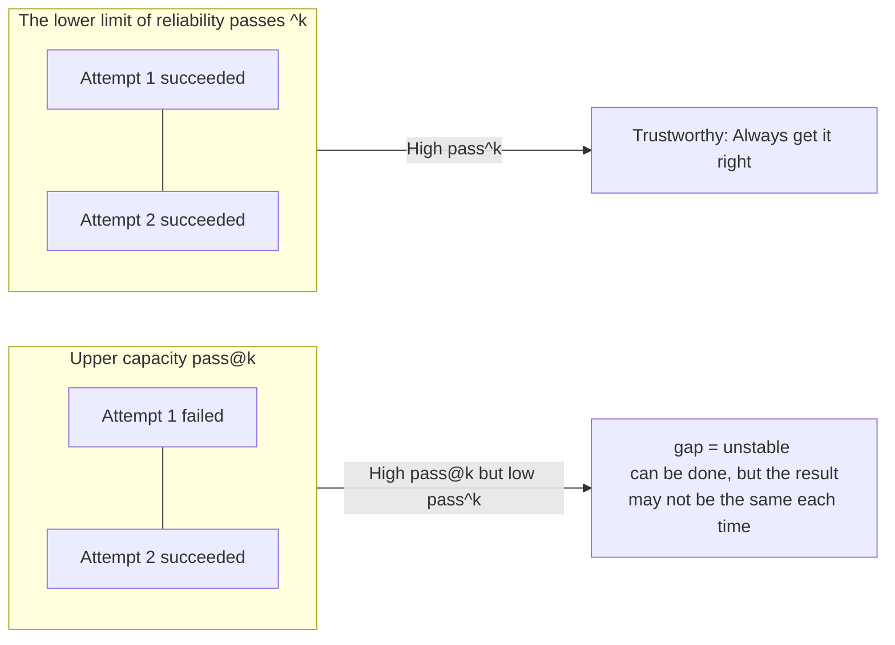

<Tip>
This is advanced content, aimed at users who want to understand how eval scores, how metrics are calculated, and how automatic multi-round evaluations run. For daily assessment, see [Quickstart](/en/eval/quickstart).
</Tip>

<Warning>
This page contains advanced source code/maintainer content. Normal users do not need to clone Comet to run evaluations. Pulling the source repository is only needed when auditing scorers, task evidence, or automated interaction implementations. For daily usage, see [Quickstart](/en/eval/quickstart).
</Warning>

Comet eval uses task checks to determine whether a run passes. Rubric, pass@k, pass^k, and weighted scores provide diagnostic information. Multi-stage workflow tasks can be driven by a subject Agent and a user-simulator Agent.

## Look at these first when reading the report

If you are not debugging the scorekeeper, you can read the report in this order

|Sequence|Report signal|Judge what|
| --- | --- | --- |
| 1 | `checks_failed` |Whether this operation really failed; Only when it is empty can it be considered passed|
| 2 | failure attribution |Should the failure be attributed to the environment, workflow, task or model|
| 3 | `pass@k` / `pass^k` |Does Skill succeed occasionally or run stably repeatedly|
| 4 | `weighted_score` |Weighted diagnostic score of the quality dimension|
| 5 |The minimum rubric dimension|Where will the next round of optimization prioritize investment|

<Note>
When making daily release judgments, don't just look at <code>weighted_score</code>. The true pass/fail first looks at <code>checks_failed</code>; rubric, pass@k and pass^k are used to determine quality, stability and the direction of the next optimization.
</Note>

## Scoring metrics

## Scoring Metrics

| Metric | Question Answered | Type | Gating |
| --- | --- | --- | --- |
| **Rubric Dimension Scores** (0.0–1.0) | How well did the agent perform on this dimension? | Diagnostic | No (informational) |
| **weighted_score** | What is the overall quality? | Diagnostic | No |
| **RubricAvg** (report column) | Average dimension score for this run | Diagnostic | No |
| **pass@k** | Probability of at least one success in k attempts (performance upper bound) | Statistical (multi-run) | No |
| **pass^k** | Probability of all k attempts succeeding (reliability lower bound) | Statistical (multi-run) | No |
| **Workflow Contract Check** | Was the Skill under test triggered according to contract? | Hard Check | Yes (missing required skills causes failure) |
| **Task Validator Pass/Fail** | Does the code implementation satisfy business acceptance criteria? | Hard Check | Yes (determines pass/fail) |

<Note>
  Rubric and pass metrics are used for diagnosis and comparison. The actual pass condition is <code>checks_failed == []</code>. Most failures come from task validators, but profiles also record workflow contract violations (such as required Skills not being invoked) into <code>checks_failed</code>.
</Note>

## Where Evidence Comes From

Comet eval collects runtime evidence from Claude CLI `stream-json`, task artifacts, validator results, and Runtime state.

A single-round evaluation runs the Agent under test directly in the Docker task directory:

```bash
claude -p "$prompt" \
  --dangerously-skip-permissions \
  --output-format stream-json \
  --verbose
```

The eval harness saves raw `stdout`/`stderr` from the run, then parses the JSONL events in `stdout` line by line. The parser extracts:

- `duration_ms`, `num_turns`, tokens, and cost from the `result` event
- Tool calls from `tool_use` events
- Bash commands, recorded as `commands_run`
- File paths from `Write`/`Edit`, recorded as `files_created`/`files_modified`
- Skill invocations, recorded as `skills_invoked`
- Corresponding `tool_result` outputs attached back to their original tool calls

Therefore, `Skills invoked`, `commands_run`, `tool_calls`, `files_created`, tokens/cost in the report are all observable behavior logs extracted from the Claude CLI structured event stream.

<Warning>
  `stream-json` remains an <strong>observable behavior log</strong>. It is suitable for tracking tool calls, commands, Skill invocations, file changes, and costs. However, it does not capture internal model reasoning or directly prove causal chains of internal decisions. Schema changes, malformed JSON lines, and CLI version updates can affect parsing, so raw `stdout`/`stderr` must be preserved for auditability.
</Warning>

### Difference Between Execution Trajectories and Event Streams

Comet Classic runtime also writes `.comet/trajectory*.jsonl` to record state transitions (e.g., `state_transitioned`). These trajectories serve as evidence of recovery resilience, and rubric checks for their presence under `recovery_resilience`.

However, `pass@k`/`pass^k` are not computed from trajectories, nor do most rubric dimensions rely solely on them. Primary evidence comes from Claude CLI `stream-json`, task directory artifacts, task validator results, and Comet runtime state files.

## Rubric Scoring

Rubric breaks down Skill quality into multiple dimensions, each consisting of several **binary (pass/fail) check items**. The dimension score = passed items / total items (0.0–1.0). Each dimension outputs a line formatted as `[RUBRIC] <Dimension>: <Score> - <Reason>`.

Scoring methodology (aligned with industry practices such as Galileo, Hebbia, and τ-bench):

- Each dimension contains N binary check items
- Dimension score = passed / total (0.0–1.0)
- Weighted score = Σ(Dimension score × weight) / Σ(weight)
- Weights reflect the dimension's relative importance to workflow quality

### Three Rubric Sets

Eval includes three built-in rubric sets, corresponding to three profiles:

| Profile | Dimensions | Total Weight | Interaction Mode | Best Suited For |
| --- | --- | --- | --- | --- |
| `generic` | 7 | 7.7 | `none` (single-turn) | Smoke testing general skills |
| `comet-workflow` | 10 | 12.0 | `auto_user` (multi-turn) | Classic `/comet` 5-phase workflow |
| `authoring-skill` | 11 | 12.8 | `auto_user` (multi-turn) | Artifacts generated by `/comet-any` |

### comet-workflow Rubric (10 Dimensions)

Used to evaluate the classic 5-phase workflow. The ten `[RUBRIC]` dimension scores serve as diagnostic references. However, the profile still enforces workflow contract checks: failing to actually invoke `comet`, nested Comet phase skills, OpenSpec dependent skills, or Superpowers dependent skills triggers a hard failure.

| Dimension | Weight | What is Checked |
| --- | --- | --- |
| `business_completion` | **2.0** (maximum) | Baseline validator pass rate (whether business tasks were completed correctly) |
| `workflow_completion` | 1.0 | Completeness of the workflow's own steps |
| `main_flow` | 1.5 | Number of five phases (open → design → build → verify → archive) leaving tangible evidence |
| `gate_guard` | 1.5 | Whether `comet-guard`/`transition`/`--apply` were properly used |
| `artifact_quality` | 1.2 | Whether proposal/design/tasks/tests have substantive content (proposal ≥ 10 lines, design includes trade-offs, tasks have ≥ 3 items, tests contain assertions) |
| `skill_invocation` | 1.0 | Whether `comet` entry, nested stage skills, OpenSpec dependencies, and Superpowers dependencies were observed in the correct order |
| `spec_drift` | 1.0 | Whether delta specs modified during build were reconciled before archiving (defaults to neutral 1.0 if specs were unchanged) |
| `decision_point_compliance` | 1.0 | Whether the agent pauses at decision points to prompt the user rather than deciding unilaterally |
| `recovery_resilience` | 1.0 | Whether state was properly persisted and recovered after interruptions (checkpoint / trajectory / context / pending / .comet.yaml) |
| `efficiency` | 0.8 (minimum) | Cost normalization (turns ≤ 80, tools ≤ 150, duration ≤ 600s) |

### generic Rubric (7 Dimensions)

Used to evaluate general skills. Unlike `comet-workflow`, missing required skills causes a hard failure (when `require_skill_invocation: true`), while other dimensions provide informational diagnostics.

| Dimension | Weight | What is Checked |
| --- | --- | --- |
| `completion` | **2.0** | Baseline validator pass rate |
| `safety_boundary` | 1.2 | Detection of dangerous commands (`rm -rf`, `git reset --hard`, `curl ... | sh`) |
| `skill_invocation` | 1.0 | Whether all required skills are invoked (neutral 1.0 if not configured) |
| `artifact_presence` | 1.0 | Whether expected artifacts exist (supports glob patterns) |
| `instruction_following` | 1.0 | Checks for failure markers mentioning constraints |
| `interaction_compliance` | 0.8 | Whether interaction rounds stay within max_turns in auto_user mode |
| `efficiency` | 0.7 | Normalized efficiency threshold matching Comet standards |

### authoring-skill Rubric (11 Dimensions)

Used to evaluate skill packages generated by `/comet-any`. Inherits four shared dimensions from generic, plus seven package-specific checks. Missing `SKILL.md`, `resolved-skills.json`, `workflow-protocol.json`, Engine files, `authoring-lanes.json`, or `skill-review.md` results in hard failure.

| Dimension | Weight | What is Checked |
| --- | --- | --- |
| `workflow_route_conformance` | **1.5** (tied for highest) | Whether protocol routing matches node order, node skill files are complete, and `comet/eval.yaml` lists routes |
| `completion` | 1.5 | Inherited from generic |
| `generated_package` | 1.4 | Package contains `SKILL.md` with routes/pause points/workflows and resolved-skill references/recovery guidelines |
| `resolved_skill_evidence` | 1.2 | `reference/resolved-skills.json` exists and `sourceSummaries` is non-empty |
| `engine_contract` | 1.2 | Presence of `skill.yaml`/`guardrails.yaml`/`checks.yaml`/`eval.yaml` under `comet/` |
| `authoring_lanes` | 1.2 | `reference/authoring-lanes.json` contains 6 required lanes and passes review |
| `safety_boundary` | 1.2 | Inherited from generic |
| `skill_invocation` | 1.0 | Inherited from generic |
| `artifact_presence` | 1.0 | Inherited from generic |
| `review_gate` | **0.8** | `reference/skill-review.md` report passes and authoring lanes review passes without blocking findings |
| `review_readiness` | 0.8 (minimum) | Evaluates to 1.0 if there are no hard failures at the generic layer |

### Weighted total score formula

```text
weighted_score = Σ(Dimension score × weight) / Σ(weight)
```

Output one line of `[RUBRIC] <dim>: <score> - <reason>` for each dimension, and finally output one line of `[RUBRIC] weighted_score: < points >`.

### RubricAvg (Report Column)

The `RubricAvg` column in the report is the ** simple average score ** (sum/len) of all dimension scores (including the `weighted_score` row) of this run. When running across multiple runs, it is the average of the average scores of each run. It is a summary of rapid horizontal comparison, which is different from the single rubric `weighted_score` (using their respective weights) algorithm.

### LLM-as-judge coverage (Optional)

Enable `BENCH_LLM_JUDGE=1`. By default, Comet's final `weighted_score` is rule-based, not LLM-as-judge. Rule rubrics capture structural signals (file existence, command execution), but they cannot judge whether output has real substance. The LLM judge reads workspace artifacts, re-scores them, and emits a `[RUBRIC-JUDGE]` line (separate from the rule-scored `[RUBRIC]` line). If judge execution fails, scoring falls back to rule results without blocking execution.

judge runs on the host machine (not within Docker) by reusing the `claude` CLI without introducing new dependencies. However, the configuration of the referee and the configuration of the Agent under test are deliberately isolated: when `BENCH_LLM_JUDGE=1` is enabled, `BENCH_JUDGE_MODEL` must be explicitly set, and it is not possible to fall back and reuse the `ANTHROPIC_MODEL` of the main model.

If `BENCH_JUDGE_BASE_URL` and `BENCH_JUDGE_AUTH_TOKEN`/`BENCH_JUDGE_API_KEY` are configured, judge will give priority to directly invoking Anthropic Messages HTTP (`/v1/messages`). When there is no dedicated judge endpoint, roll back to the host `claude` CLI, clear the inherited main `ANTHROPIC_*` provider Settings in the child process, and then map the independent judge configuration to your own CLI call:

|Environmental variable|Purpose|
| --- | --- |
| `BENCH_JUDGE_MODEL` |Required. Referee model It serves as the request model during direct HTTP and is passed to `claude --model` and the child process `ANTHROPIC_MODEL` during CLI fallback|
| `BENCH_JUDGE_AUTH_TOKEN` |Optional. The Anthropic compatible proxy token for referees takes precedence over `BENCH_JUDGE_API_KEY`|
| `BENCH_JUDGE_BASE_URL` |Optional. Anthropic compatible proxy address for referees|
| `BENCH_JUDGE_API_KEY` |Optional. Anthropic API key for referees; When setting the auth token, no child process will be passed in|

This design is to avoid the situation where "the same model acts as both the player and the judge" : the main Agent can continue to use its own `ANTHROPIC_MODEL`, `ANTHROPIC_BASE_URL` and token, while the judge must declare the model and provider separately. The direct HTTP path can also avoid the problem that some strictly Anthropic compatible proxies do not accept additional request parameters from the Claude CLI. If `BENCH_LLM_JUDGE=1` is enabled but `BENCH_JUDGE_MODEL` is missing, the report will be written as

```text
[RUBRIC-JUDGE] status: skipped - BENCH_JUDGE_MODEL is required when BENCH_LLM_JUDGE=1
```

This skipped state will not be marked as `enabled_and_successful`, nor will the referee model be invoked.

Different profiles cover different dimensions:

| Profile |Coverage dimension|Explanation|
| --- | --- | --- |
| `comet-workflow` | `artifact_quality`、`spec_drift`、`main_flow` |Three qualitative dimensions with relatively weak re-scoring rules (`llm_judge.py`)|
| `generic` / `authoring-skill` | `task_completion`、`output_quality`、`instruction_adherence` |General three dimensions, plus the `rubric_criteria` declared in the `task.toml` task as the `custom_N` dimension (`generic_llm_judge.py`)|

The three-dimensional scoring criteria of generic/authoring:

|"Dimension"|1.0 (Full marks| 0.5 | 0.0 |
| --- | --- | --- | --- |
| `task_completion` |All requirements are met, the product exists and is correct, and the baseline check is passed|Partially completed|The key products are missing or empty|
| `output_quality` |Well-structured, complete, extraordinary and with traces of thought|It exists but the content is thin and barely meets the standards|Missing, empty, obvious stub|
| `instruction_adherence` |Fully comply with instructions and constraints, have no prohibited modes, and use tools properly|Slightly deviated but with the core intention retained|Serious violation, dangerous order, constraint failure|

When judge collects workspace files, it skips directories such as `.git`, `node_modules`, and `.comet`. The upper limit for a single file is 3,000 characters, and the total budget is 20,000 characters. Large files (>50KB) and binary files will be skipped to ensure that the prompt does not get out of control. The referee must output line by line in the `[RUBRIC-JUDGE] <dim>: <score> - <reason>` format, with each reason no more than 25 words and specific content cited.

## pass@k and pass^k

These two indicators measure "ability vs. reliability" and are the key to evaluating whether a Skill can run stably and repeatedly. They are calculated based on the pass/fail sequence of ** repeated runs **.

### Definition

|Indicator|Formula|Meaning|
| --- | --- | --- |
|**pass@k** (upper capacity)| `1 - C(n-c, k) / C(n, k)` |The probability of success at least once out of k independent attempts (HumanEval unbiased estimation)|
|**pass^k** (Lower reliability limit)|`1.0` if and only if `c == n`, otherwise `0.0`|The probability of success in all k attempts|

Here, n = total number of runs, and c = number of successful runs. "Success "= Zero failure of the task validator in this run.

### Why do we need two?



<p align="center">
  
</p>

<p align="center">pass@k check the upper limit of capacity, pass^k check the lower limit of reliability. The greater the gap between the two, the more unstable it is. </p>

- **pass@k high, pass^k low ** : Sufficient ability, but ** unstable ** - "Can do it, but cannot guarantee to do it right every time". Repeatedly running a Skill to a user is a danger signal.
- Both are high: they can do it and do it right every time - reliable.

The report shows `pass@k − pass^k` as a comparison of repeated-run results.

### How can I get multiple runs

Repeated runs are driven by the eval harness's internal pytest option `--count N`: it repeats each `(task, treatment)` combination N times to generate N independent pass/fail results (`comet eval` only produces pass@1/pass^1 from a single run). The comparison report first filters out the analysis set: explicit environment issues or problems with the runner itself will be excluded, and flagged run still enters the main statistics but will be marked. The N Boolean values in the analysis set are the input of pass@k/pass^k.

```bash
# Repeat 5 times to make pass@k/pass^k meaningful
# (Repeated runs are driven internally by the eval harness's pytest --count 5)
```

<Warning>
When the number of runs is insufficient, the report warns that pass@k/pass^k for k>1 need at least 2 runs to be meaningful. A single run can only compute pass@1/pass^1; metrics with k>1 require multiple repeated runs.
</Warning>

### How to choose k

The report takes the k value from `{1, 2, 5}` that does not exceed the actual running number n (k is clamp-down to n), and if it is insufficient, it reverts to `[1]`. Report columns: `pass@1 [pass@2 pass@5]` and `pass^1 [pass^2 pass^5]`.

### Where is it?

pass@k/pass^k is not in `summary.md`, but in the `## pass@k/pass^k — capability vs reliability` section of the ** Comparative report ** (`comparison_report.md`). They are informative, not access control.

## Dual-agent automatic interaction evaluation

For multi-stage workflow skills (`comet-workflow` and `authoring-skill` profiles), the evaluation is completed by the automatic interaction of ** two agents **, without the need for human intervention.

### Two roles

|"Role"|What to do|Conversation|
| --- | --- | --- |
|The tested Agent (subject)|Run the Skill under test (such as `/comet` five stages)|Single continuous session, with `--resume` continuing in each round|
|"User Simulation Agent (simulator)|Simulate user responses at the decision point (approve reasonable plans, select reasonable defaults, and clarify only when there is real ambiguity)|A one-time `claude -p` call at each decision point, stateless|

### Interactive loop

```mermaid
flowchart TD
    Start["Round 1: The tested Agent receives the task prompt<br/> and runs the Skill for the new session"] --> Parse["Parse the output and extract the session_id and the result text"]
    Parse --> Decision{"Is it a decision point? <br/>(? /confirm/choose /<br/>approve/which ... )"}
    Decision -->|is| Sim["The user simulates the Agent to generate the reply <br/> to approve the plan/select default/push forward"]
    Decision -->|no| Complete{"Workflow completed? <br/>(archive complete /<br/>all 5 phases/done)"}
    Sim --> Resume["Next round: The tested Agent --resume the same session <br/> feed in the simulated user response"]
    Resume --> Parse
    Complete -->|is| End["End the loop"]
    Complete -->|no| Nudge["Send a "continue" prompt to advance"]
    Nudge --> Resume
```

The loop has a maximum of `max_turns` outer round trips (comet-workflow is commonly 12, authoring-skill commonly 8). It ends early when a "Complete" signal is detected (`archive complete`, `workflow complete`, `all 5 phases`, and similar markers).

Each round of the tested Agent is run with `--output-format stream-json --verbose`. The loop driver only concatenates the stream-json stdout of each round of the Agent under test for harness parsing. One-time responses from the user simulation Agent will not enter the main event stream. Therefore, event statistics only reflect the observable behavior of the subject Agent.

<Note>
<code>max_turns</code> is neither the actual number of working rounds within the Agent under test nor the number of tool calls. An outer round trip refers to: the Agent under test runs to the decision point, the user simulates the Agent's response, and then the Agent under test continues with <code>--resume</code>. The same round trip may still contain multiple assistant messages, tool calls, and file operations internally.
</Note>

### Decision point detection

If the output text of the Agent under test matches these signals, it is determined as a decision point (case-insensitive) :

```text
? | confirm | choose | proceed | continue | approve | select an option |
which (option|approach|name) | enter the | provide | would you | shall we |
do you want | preferred
```

It also supports custom `--decision-pattern`.

### The user simulates the instructions of the Agent

The simulated Agent receives the simulator prompt + the last message of the Agent under test, with the following instructions:

- When it receives a confirmation request, ** approve ** the proposed scheme/name/plan
- When it needs to make a choice, ** select the most reasonable default **
- Only ask for clarification when the question is truly ambiguous about "what to do"
- Never refuse, always keep the workflow moving forward
- "Do not write code or files.

comet-workflow uses `COMET_SIMULATOR_PROMPT`, and generic/authoring uses `GENERIC_SIMULATOR_PROMPT` (the wording is slightly simplified). When the simulation response is empty, roll back to `"Yes, please proceed with the recommended option."`.

#### Customize the simulator prompt word

The simulator instructions evaluated by auto_user can be overridden. By default, it reads from `eval/simulator-instruction.md`, and its content is the standard template of the above principles. Two coverage methods (priority from high to low) :

|"Method"|How to set|Scope of application|
| --- | --- | --- |
| `--simulator-prompt "..."` |pytest command-line parameter|Single run|
| `BENCH_SIMULATOR_PROMPT_FILE=<path>` |Environment variables (can be written into user-level `.env`)|All auto_user runs|

The relative path of `BENCH_SIMULATOR_PROMPT_FILE` is resolved from `eval/`, with the default value `simulator-instruction.md`. When the file exists, replacing it lets you test different user behavior profiles without modifying the harness.

### Design purpose

Workflow skills will pause at the decision point and wait for user confirmation. If the evaluation only runs a single round, Skill will get stuck at the first decision point. The dual-agent loop enables the evaluation to automatically run the entire workflow (open→...) →archive), and the user simulates the Agent to generate reasonable decision point inputs that can drive the process. Only in this way can the rubric score and pass/fail measured reflect the real usage scenarios.

### Single round vs. multiple rounds

- **`generic` profile** (`interaction.mode: none`) : Single-round, the Agent under test runs all at once (suitable for smoking tasks that do not require interaction).
- **`comet-workflow`/`authoring-skill` profile** (`interaction.mode: auto_user`) : Multi-round, enabling dual-agent loop.

Tasks starting with `comet-*` or `category: comet` will be automatically inferred as `comet-workflow` profile and `auto_user` will be enabled.

## The three axes of evaluation: treatment × task × reps

One evaluation is the Cartesian product of three axes:

|shaft|Meaning|Example|
| --- | --- | --- |
| **task** |A review task (directory, including instruction/environment/validation)|`comet-fix-median` (bug Fixing Dimension)|
| **treatment** |Experimental conditions (which skills/CLAUDE.md to inject)|`CONTROL` (baseline without Skill), `COMET_FULL` (Injected with comet)|
| **reps** |Repetition count (harness-internal `--count N`)|`--count 5` run each (task,treatment) five times|

### The treatment achieves A/B comparison

Running multiple treatments for the same task can measure the marginal effect of Comet Skill:

| Treatment |Injection|Purpose|
| --- | --- | --- |
| `CONTROL` |No Skill baseline|"Comparison"|
| `COMET_FULL` |comet main + 7 stage sub-skills + brainstorming (v3, `.mjs` runtime)|Current version|
| `COMET_FULL_039` |0.3.9 Freeze Baseline (`.sh` runtime)|Regression comparison|

The comparison report (`compare_baselines.py`) compares `COMET_FULL` (WORKFLOW) and `COMET_FULL_039` (BASELINE) across rubric dimensions, with CONTROL only serving as the context.

## How can indicators be included in the report

|Report location|"Content|
| --- | --- |
|The Results table of `summary.md`|Each treatment line: Checks column + RubricAvg + + the rubric dimension Turns/Duration/Tools/Tokens/Cost|
|`summary.md` Aggregated by Treatment (when reps>1)| Reps Passed、Checks、Avg Turns/Duration、Tokens、Cost、Skills、Scripts |
|Each time `report.json`|passed, checks_passed[], checks_failed[], events_summary (including failure_attribution), rubric points|
| `comparison_report.md` |pass@k/pass^k table (capability vs reliability) + rubric dimension cross-treatment comparison|

For details, see [Reading Evaluation Reports](/en/eval/reports).

## Next step

- [Reading Evaluation Reports](/en/eval/reports) — Report structure and failure attribution
- [Eval Harness](/en/eval/harness) — collect/run internal mechanics and environment variables
- [Evaluation System Overview](/en/eval/overview) — Eval in the release process
- [comet eval Command](/en/cli/eval) — Complete options reference
