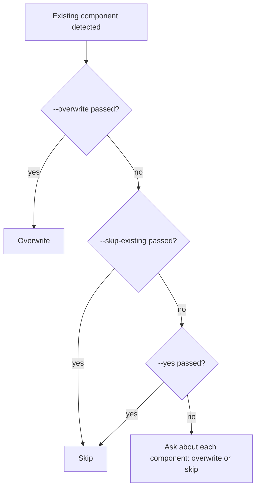
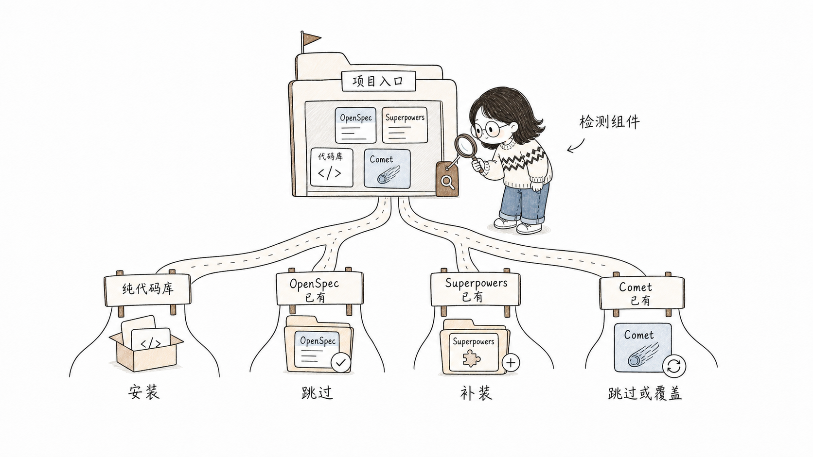
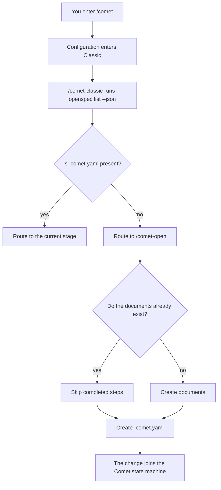

Your project may already have code, a long Git history, and perhaps OpenSpec or Superpowers in use. This page explains what happens when you add such a project to Comet Classic, and which boundaries to watch.

## Shortest path

```bash
npm install -g @rpamis/comet
cd your-existing-project
comet init --workflow classic
```

Then enter `/comet` in your AI coding platform with a description of the change you want. The project configuration routes it into Classic through the unified entry.

## What Classic initialization does

`comet init --workflow classic` scans the code base for existing components and lets you keep them or overwrite them.

### Component detection

The initializer checks for three kinds of components:

| Component | How it is detected |
| ----------- | ----------------------------------------------------------------------------------------------------------------------------------------------- |
| OpenSpec    |Whether the platform's skills directory contains a Skill whose name starts with `openspec-*`|
| Superpowers |Whether skills such as `brainstorming`, `writing-plans`, and `test-driven-development` exist. The plugin cache is checked too, so a Superpowers installed as a Claude, Codex, or OpenCode plugin is found|
| Comet       |Whether any Skill name starts with `comet`|

CLI dependencies are checked separately: whether `openspec` and `codegraph` are on `PATH`. Components that are already installed are detected and skipped by default rather than reinstalled.

### Handling existing components

When an existing component is detected:



When several components exist on the same platform, the wizard first offers a batch choice (overwrite all, skip all, or decide one by one), then handles each selection.

### What init creates

For a project-level Classic install, `comet init --workflow classic`:

- Runs `openspec init` to create the Classic OpenSpec root. New projects use `docs/openspec/`; a project that already has `openspec/` keeps the `legacy` layout.
- Installs Comet Skills, rules, and hooks into the platform directory.
- Creates the `docs/superpowers/specs`, `docs/superpowers/plans`, and `.comet/` directories.
- Writes `.comet/config.yaml` if it does not exist yet.

```yaml
# .comet/config.yaml (Classic only; language selects the Skill language)
schema: comet.project.v1
default_workflow: classic
workflows:
  - classic
ambient_resume: true
classic:
  language: zh-CN
  context_compression: off
  review_mode: standard
  auto_transition: true
```

<Note>
`.comet/config.yaml` is project-level configuration. Each change's `.comet.yaml` is created by `/comet-open`, not by init. When a change is created, `classic.language` is snapshotted into `.comet.yaml` and constrains the language of OpenSpec and Superpowers output.
</Note>

## Four kinds of existing project

<p align="center">
  
</p>

When you add an existing project, Comet detects the components already present and then decides, for each one, whether to overwrite it, skip it, install it, or update it.

### Case 1: A code base with no OpenSpec or Superpowers

This is the most common case. The initializer finds no existing components and installs everything:

```bash
comet init --workflow classic
```

Then start the first change with `/comet`.

### Case 2: OpenSpec is already in use

You already have `openspec/` and an active change. `comet init --workflow classic` recognizes the `legacy` layout and, on upgrade, does not move the project to `docs/openspec/`. When it finds an existing OpenSpec Skill and CLI, it asks whether to overwrite or skip. Skipping the existing components and adding only the Comet parts is usually the safer choice.

`openspec init` is idempotent: it works with the root directory currently configured and does not break existing changes. To move from `openspec/` to `docs/openspec/`, see [migrate the Classic layout](/en/guides/classic-layout-migration).

### Case 3: Superpowers is already in use

You already have skills such as `brainstorming` and `writing-plans`, possibly installed through a plugin. The initializer detects them and asks you to choose. Skip them to keep your customized versions.

<Tip>
If you use an older Superpowers release (below 6.0.0), Superpowers' own documentation reports that 6.0.0 and later run roughly twice as fast and use about 50% fewer tokens. When upgrading, you can choose to overwrite the Superpowers components.
</Tip>

### Case 4: Both OpenSpec and Superpowers are in use

Both sets of components exist. The initializer asks in batches; choose "Skip all" to install only Comet Skills, rules, hooks, and working directories.

## Existing OpenSpec changes without .comet.yaml

This is the most common problem when adding an existing project.

### The problem

OpenSpec changes you created with `/opsx:new` **have no `.comet.yaml`**:

- `comet status` **silently skips** them: no error, and no entry in the output.
- `comet doctor` does not detect them either.
- They appear only after you enter `/comet` on the Agent platform and Classic routes: `/comet-classic` discovers them through `openspec list --json`.

### Take over an existing OpenSpec change

Comet has no `comet adopt` or `comet import` command. Taking over an existing OpenSpec change relies on the idempotence of `/comet-open`:

1. Enter `/comet` on the Agent platform.
2. `/comet-classic` runs `openspec list --json`, finds an active change, and sees that `.comet.yaml` is missing.
3. It routes to `/comet-open`.
4. `/comet-open` finds the existing OpenSpec documents, skips completed steps, and creates `.comet.yaml`.



<Warning>
This path works cleanly only while the change is still in open, or has just been created and not advanced. Once a change has reached build or verify without a `.comet.yaml`, Comet cannot reliably reconstruct its state; start a new change instead.
</Warning>

### What to do

- If the existing OpenSpec change has not advanced yet, enter `/comet` and let Classic take it over.
- If it has reached build or verify, finish the current work and then start a new change with `/comet`. Forcing a takeover would corrupt the current state.
- After the change is picked up, confirm that `comet status` lists it, which means `.comet.yaml` now exists.

## Upgrade an existing Comet install

To upgrade a project that already uses Comet:

```bash
comet update --self-update
comet doctor
```

`comet update` refreshes Comet Skills, rules, and scripts for the installed platform. During init, `--yes` treats existing components as "skip", so use `--overwrite` when you want to refresh them.

## Checklist after connecting

| Check | Command | Expected result |
| ---------------- | ------------------------- | ------------------------------------ |
|Installation integrity| `comet doctor`            |All checks pass|
|The change is visible| `comet status`            |Your change and its current stage are listed|
|Skills are installed| `comet doctor`            |The detected platform directory contains Comet Skills|
|Project configuration exists|Open `.comet/config.yaml`|The shared entry fields and a `classic:` block are present|

## FAQ

<Accordion title="Will Classic initialization overwrite my existing hooks">
No. Comet merges hook configuration without destroying it: your hooks stay, and Comet replaces only the commands it manages. See [platform support](/en/platforms).
</Accordion>

<Accordion title="Can I install Comet without OpenSpec or Superpowers">
No, Comet depends on both. If they are already installed, choose overwrite or skip in the prompt, or let detection skip them automatically.
</Accordion>

<Accordion title="comet status does not show my change after connecting">
The change was probably created with `/opsx:new` and has no `.comet.yaml`. Enter `/comet`, and let Classic route to it and add the state file. See "Existing OpenSpec changes without .comet.yaml" above.
</Accordion>

## Next step

- [Install and update](/en/guides/install-and-update) — init, status, and doctor
- [Resuming interrupted work](/en/guides/resuming-workflow) — Continue a change after it is picked up
- [Project file structure](/en/guides/project-structure) — Which directories Comet creates
