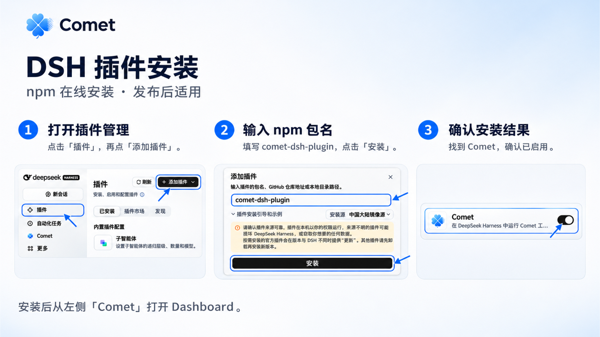
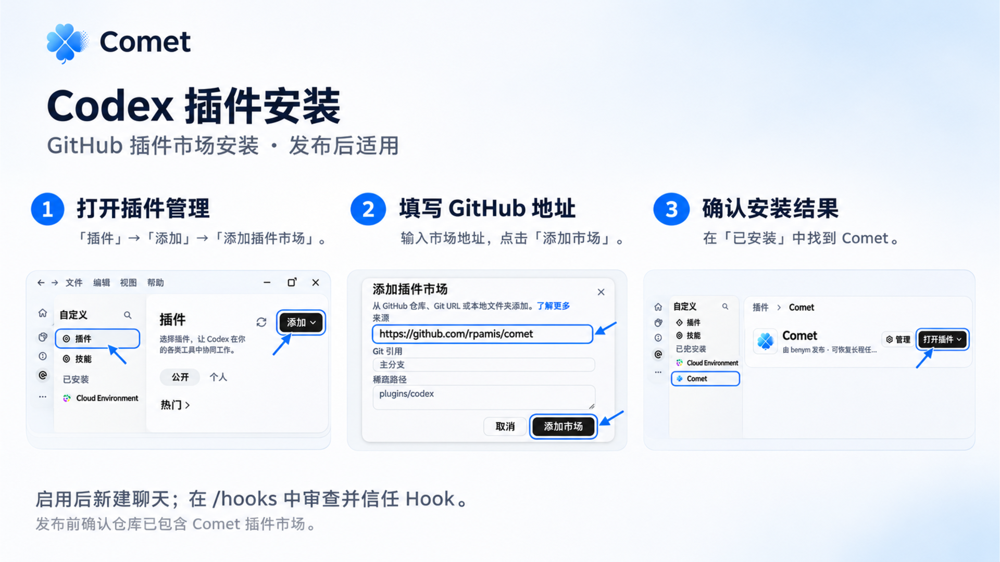

<Note>
  Before upgrading to the current SDK version, finish and archive any active 0.4.5 Native or Classic
  tasks, then update Comet. Daily stages and operations retain their existing entries. See the
  [Changelog](/en/changelog) for new capabilities.
</Note>

Install Comet through DSH or Codex plugins, or use the CLI to install, initialize, update, diagnose, and uninstall.

## Prerequisites

- Node.js 22.16 or later within the 22.x line, or Node.js 24 or later
- npm or npx
- Git

## Install through a plugin

In DSH or Codex desktop, install Comet as a plugin and open Dashboard from the sidebar. Other platforms can use the CLI instructions below.

<Note>
  Online installation uses the npm plugin package or GitHub marketplace. If either is temporarily
  unavailable, use the CLI installation method below. The screenshots illustrate the reference state
  after installation.
</Note>

<Tabs>
  <Tab title="DSH">
    1. Open **Plugins** in the sidebar and select **Add plugin**.
    2. Enter the npm package `comet-dsh-plugin`, verify its source, and select **Install**.
    3. Confirm Comet is enabled under **Installed**. Open a project session and select **Comet** in the sidebar for Dashboard; restart DSH if the entry is missing.

    <Frame caption="DSH plugin installation: add the package and confirm that Comet is enabled. Screenshots use the Chinese interface.">
      
    </Frame>

  </Tab>
  <Tab title="Codex">
    1. Open **Plugins**, then choose **Add plugin marketplace** from the **Add** menu.
    2. Enter `https://github.com/rpamis/comet` under **Source**, add the marketplace, and install and enable Comet.
    3. Check Comet under **Installed**. Start a new chat, then review and trust the Comet Hook in Codex's `/hooks` interface.

    <Frame caption="Codex plugin installation: add the GitHub marketplace and check the installed plugin. Screenshots use the Chinese interface.">
      
    </Frame>

    Activation automatically sets up the matching CLI, relying on local Node.js and npm environments. New sessions can open **Comet Dashboard** from the sidebar; after installing the plugin, you still need to manually trust the Hook in your platform.

  </Tab>
</Tabs>

After installation, confirm the Comet Skill and Dashboard are available in a new session. The following sections cover CLI installation, initialization, and updates.

## 1. Install the CLI

```bash
npm install -g @rpamis/comet
```

Confirm the command is available:

```bash
comet -v
```

## 2. Initialize a project

Run the install entry point from your project root:

```bash
cd your-project
comet init
```

`comet init` detects platforms, installs the Comet Skill, and decides the default workflow for `/comet` during project-level initialization. New projects default to Native; projects with an existing explicit Classic state stay Classic.

For the full set of options and the Native/Classic initialization boundaries, see [comet init](/en/cli/init).

### Install scope: project or global

| Scope   | Suited for                                                      | Characteristics                                                             |
| ------- | --------------------------------------------------------------- | --------------------------------------------------------------------------- |
| project | Team projects, repo conventions, configs that must be committed | Config is written into the current project, easy to collaborate on          |
| global  | Personal default environment, shared across projects            | Config is written to the user directory, convenient when switching projects |

When unsure, start with project scope — it's the easiest way to keep the whole team on the same Comet behavior.

### Install mode: copy or symlink

Classic or both initialization asks for the **install mode** after you pick platforms:

- **Copy** (default): copies an independent set of Skill files for each platform, suited for cross-device sync (committed to the repo).
- **Symlink**: creates symlinks in each platform's `skills/` directory pointing to `.comet/skills/`, so multiple platforms share one central store and a single update applies everywhere.

Installing only Native always uses Copy. For the detailed differences between the two modes, see [Supported platforms · Installation mode](/en/platforms#installation-mode-copy-vs-symlink).

<Warning>
  Symlinks depend on filesystem support. Some Windows configurations or sync tools (such as certain
  cloud drives) may not handle symlinks correctly. If you run into issues, fall back to{' '}
  <strong>Copy</strong> mode.
</Warning>

## 3. Update Comet

Update Comet as follows — it pulls the new npm package and refreshes the installed Skill, Rule, Hook, Runtime, and config:

```bash
comet update
```

When you choose to update all indexed projects in an interactive `comet update`, the corresponding npm packages are updated as well (the global package is attempted at most once).

<Note>
  Limiting the scope to a single project with <code>--current-project</code> or <code>--json</code>{' '}
  also updates the corresponding npm package by default. Add <code>--skip-self-update</code> when
  you only need to refresh assets.
</Note>

For update scope and Native/Classic update differences, see [comet update](/en/cli/update).

## 4. Health check

Whenever something looks off, run `comet doctor` for a full installation health check:

```bash
comet doctor
```

`doctor` checks Skill, scripts, working directory, and change state:

- `fail` is a blocking issue (such as a missing Skill or corrupted state) and must be addressed first.
- `warn` is usually non-blocking (such as the openspec CLI not installed when the project doesn't depend on it).

See [comet doctor](/en/cli/doctor).

## 5. Uninstall

`comet uninstall` removes only the Skill, rules, and hooks managed by Comet, and keeps your OpenSpec changes, design docs, implementation plans, and project code.

```bash
comet uninstall
```

Batch uninstall requires an explicit `--all-projects`. See [comet uninstall](/en/cli/uninstall).

## When to reinstall or update

- After upgrading `@rpamis/comet`.
- When `comet doctor` reports a Skill or script version mismatch.
- When switching between Chinese and English Skills.
- After your team updates the project-level Comet config.
- When the install summary shows `failed` for a platform, or a hook reports `[COMET-HOOK] crash` on file writes — usually an incomplete install. Re-run `comet init`/`comet update` to fill in the missing files.

## Next steps

- Full first-run walkthrough: [Quickstart](/en/quickstart).
- All supported platforms: [Supported platforms](/en/platforms).
- More questions about installation and initialization: [CLI FAQ](/en/cli/faq).

## Unregistered project platforms

Use `--platform <id>` for built-in platforms. To install an unregistered Claude-compatible project target, explicitly add `--custom-platform`. Both `init` and `update` reject unknown names instead of guessing compatibility. Check the target's Skill, rule, and Hook capabilities before confirming installation.
