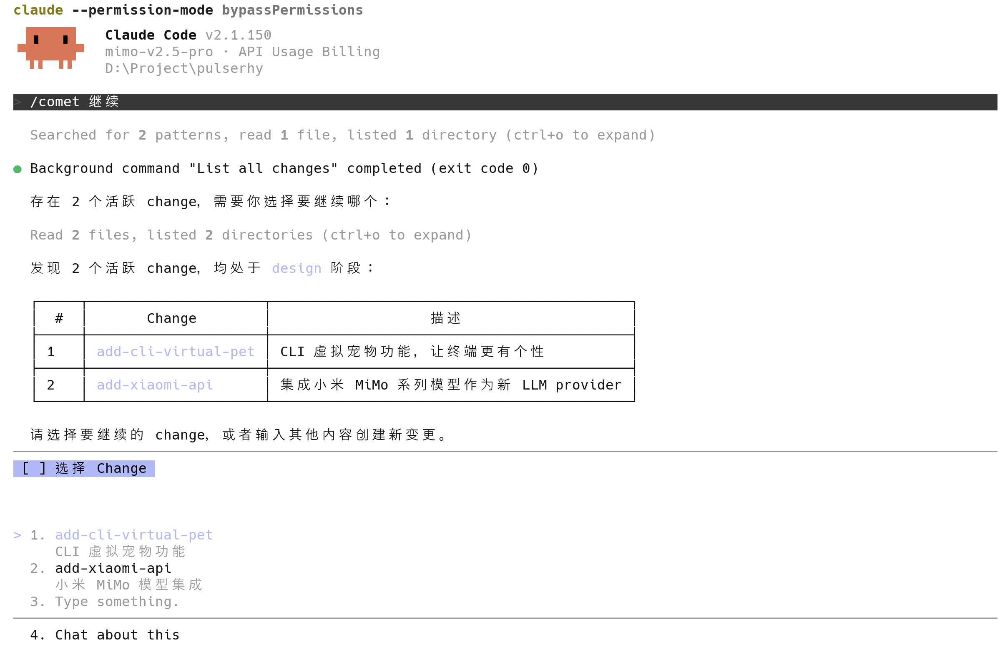
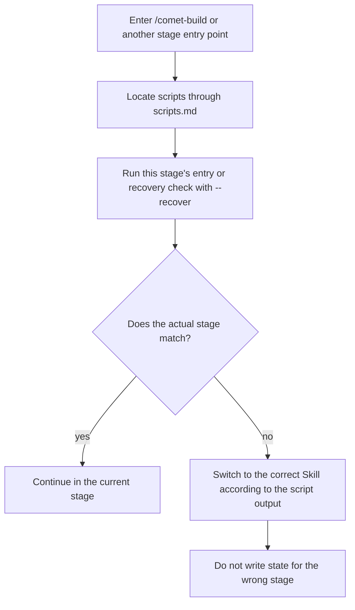

After a session is interrupted, the context is compressed, or the device is changed, simply re-enter `/comet` to restore it. Comet first reads the project root configuration, enters `/comet-native` or `/comet-classic`, and then continues from its own disk state by the corresponding workflow. Neither side will scan, guess or convert the change on the other side.

## The shortest path

Enter: In the Agent platform

```text
/comet continues
```

Comet does not rely on conversation history: Classic re-reads project configuration, OpenSpec documents, `.comet.yaml`, and runtime evidence.

<Tip>
  <strong>
    Recovery does not require running <code>comet status</code> or <code>comet doctor</code> first.
  </strong>
  Both are diagnostic commands, used only when something looks wrong: the CLI or Skill installation
  is broken, the change does not route, or the evidence does not match. Recovery is normally one
  step: <code>/comet</code>.
</Tip>

## You can also say "continue"

Starting from 0.4.0-beta.4, `comet init` and `comet update` will incorporate a Comet recovery description into the project's `AGENTS.md` and `CLAUDE.md`. When a long-term task is compressed in context, continues across sessions or devices, the Agent may have forgotten that the current request originally belonged to Comet, and the user has not re-entered `/comet`. At this point, the Agent can first run the read-only `comet resume-probe` to determine whether "continue the previous login refactoring" corresponds to the existing change, and then decide whether to re-enter the workflow.

| Scene                                                                                                                  | Detection results                                      |
| ---------------------------------------------------------------------------------------------------------------------- | ------------------------------------------------------ |
| The user explicitly requests continuing, verifying, archiving, or committing a specified change, and its state permits | Return `auto_resume` and enter the permanent entry     |
| A new session only matches a related change or has a project selection                                                 | Return `ask_user`; confirm before entering             |
| There are multiple candidates, statuses are corrupted, or users need to select                                         | Return `ask_user` and ask only one question            |
| Just asking questions, clearly not going through Comet, or currently within the Comet process                          | Return `out_of_scope` without re-entering the workflow |
| There is no active Comet Change                                                                                        | Return `none` and do not perform the recovery          |

This description only covers Comet's recovery detection; existing user rules in the file are preserved. The probe parses the configuration first and then inspects a single set of workflows. It does not roll back when the configuration is damaged. Setting `ambient_resume: false` in `.comet/config.yaml` turns off probes started by ordinary requests; it does not affect an explicit `/comet` and does not bypass existing decision points.

See [resume probe](/en/cli/resume-probe).

## How to restore Classic

<Note>
  This section also explains the <strong>background mechanism</strong>: which files{' '}
  <code>/comet-classic</code> rereads and which rules it uses to route to the next phase. You only
  need to enter <code>/comet continue</code>; Comet completes the routing below automatically.
</Note>

The recovery ability of `/comet-classic` depends on several mechanisms:

| Mechanism                                                | Explanation                                                                                                                                                                      |
| -------------------------------------------------------- | -------------------------------------------------------------------------------------------------------------------------------------------------------------------------------- |
| Re-read file state instead of trusting the conversation | Every recovery re-runs active change discovery and reads `.comet.yaml`, instead of guessing the stage from the chat history |
| File state wins; metadata repairs itself | If `.comet.yaml` conflicts with the files, the files win. Comet corrects `.comet.yaml` before continuing |
| Deterministic routing by stage | `phase`, `workflow`, `verify_result`, and related fields route to the matching stage Skill, including presets (`/comet-hotfix` for a hotfix build, `/comet-tweak` for a tweak build) |

Routing during recovery (first match wins, subject to file state):

| Current status                                             | `/comet-classic` is routed to                                                         |
| ---------------------------------------------------------- | ------------------------------------------------------------------------------------- |
| `archived: true`                                           | The process has been completed.                                                       |
| `verify_result: pass`                                      | `/comet-archive` (Confirm before filing first)                                        |
| `verify_result: fail`                                      | Verify the failure decision blocking point (you can choose to fix or accept the bias) |
| Check all of `phase: verify` or tasks                      | `/comet-verify`                                                                       |
| `phase: build`                                             | According to workflow: `/comet-hotfix`/`/comet-tweak`/`/comet-build`                  |
| `phase: design` or an existing change without a Design Doc | `/comet-design`                                                                       |
| `phase: open` or `.comet.yaml` is missing                  | `/comet-open`                                                                         |
| No active change                                           | `/comet-open`                                                                         |

As long as there is **one** active Classic change, `/comet-classic` automatically selects it; when there are multiple, it presents a list for you to choose from.

If you resume through natural language and there are multiple active changes, Comet will not pick one for you automatically; the recovery probe returns `ask_user` and waits for you to specify the target change.

### Workspace reuse of Classic Change

When creating or restoring a Classic change, Comet first reads the branch and worktree bindings recorded on the change. Any matching registered worktree is reused directly; if no matching worktree is found but the branch still exists, the recovery process recreates it. If the current directory, branch, and worktree do not match, Comet pauses to wait for your selection instead of silently switching workspaces.

Simply run `/comet` or `/comet continue` from the target project directory. If multiple active changes exist, select your target before continuing Classic. Do not attempt to manually copy change directories to restore work.

## Restoring on a different device or platform

Classic states that can be recovered across devices are saved in repository files: `.comet/config.yaml`, OpenSpec artifact roots (`docs/openspec/` for new projects), the change's `.comet.yaml`, running evidence, and `docs/superpowers/`. When opening the same repository on another device or platform, `/comet` reconstructs state from these files. For cross-device recovery of Native changes, see the [Recovery Playbook](/en/native/recovery-playbook).

<Note>
  Important note: Uncommitted workspace edits will not be pushed to the remote repository. Before
  switching devices, commit and push your code; otherwise, the new device will restore to a clean
  workspace lacking those uncommitted edits (task completion status in <code>tasks.md</code> will
  still be preserved).
</Note>

### Cross-Device Breakpoint Recovery

The diagram below illustrates cross-device breakpoint recovery: as long as repositories are synced, `/comet` can reconstruct breakpoints from file states across devices or platforms without requiring manual context handoff.



## After context compression

If the Agent platform compresses the context of a Classic change, enter `/comet` again. The project configuration routes back into Classic, and `/comet-classic` restores the state according to the recovery protocol. It reads `brainstorm-summary.md`, the handoff view, and `.comet/subagent-progress.md` when needed; you do not need to open these files yourself.

## Recover from a stage entry point

Classic normally resumes through `/comet`. Stage and preset entry points exist for manual control and debugging: `/comet-open`, `/comet-design`, `/comet-build`, `/comet-verify`, `/comet-archive`, `/comet-hotfix`, `/comet-tweak`.

The guarantee is deterministic: each phase Skill locates its scripts and then runs that phase's entry check or recovery check. The stage is always determined by the current file state.

```bash
comet state check <change-name> <phase> --recover
```

- If the check shows that the actual phase, workflow, or evidence belongs to **another** Skill, switch as the script output and `/comet-classic` routing rules say, and **do not keep writing state in the wrong phase**.
- If the working tree has uncommitted changes, attribute them first using the rule in `comet/reference/dirty-worktree.md`.



<Tip>
  These checks let you <strong>skip the unified entry and Classic routing</strong> when you already
  know which stage you are in, and still protect the workflow: if the stage is wrong, the entry check
  blocks a call that does not match the file state.
</Tip>

## Recovery during the build phase

Recovery during build is the most involved case, but `/comet-classic` handles most of it automatically.

| Situation | What Comet does |
| -------------------------------------------------------------------------------------- | --------------------------------------------------------------------------------------------------------------------------------------- |
| `build_pause: plan-ready` and the configuration is complete | Repeats the same joint decision; after you confirm, it clears the pause flag and continues |
| `build_pause: plan-ready`, the plan exists, but the execution settings are missing | Returns to the plan-ready decision and **lets you choose** execution mode, TDD, and review mode without regenerating the plan |
| `build_pause: plan-ready` but the plan file is missing | Treats the state as damaged and returns to `/comet-build` to repair or regenerate the plan |
| `isolation`, `build_mode`, or `tdd_mode` is not set | Repeats the matching `/comet-build` step so you can **make the missing selections** |
| All settings exist but tasks remain open | Reads `tasks.md` and continues with the next unchecked task |

When a subagent-mode change (`build_mode: subagent-driven-development`) is restored, the main session does not implement tasks itself. It returns to the background sub-agent scheduling rules and only coordinates.

## When there are unsubmitted changes

If the workspace has uncommitted changes, Comet attributes them for you instead of asking what you changed:

- The changes belong to the current change → fold them in and continue.
- They are unrelated to the current change → Comet pauses and asks how to handle them: merge, split into a new change, keep, or discard.
- The origin is unclear → Comet pauses, lists the files involved, and explains the reasoning.

Build outputs excluded by `.gitignore`, such as `node_modules/` and `dist/`, are excluded from user-change attribution.

<Warning>
  A dirty worktree records code changes. It <strong>does not automatically advance</strong> the{' '}
  <code>phase</code> in <code>.comet.yaml</code> or mark tasks complete in <code>tasks.md</code>.
  State advances only after attribution, verification, and the phase guard checks succeed.
</Warning>

## When you need to intervene

`/comet-classic` advances unambiguous transitions on its own, but a **decision point** always needs your choice. These are the common cases during recovery:

- **Verification failed** (`verify_result: fail`): decide whether to fix the problem or accept the deviation.
- **Real plan-ready pause**: choose workspace isolation and execution mode.
- **Missing build decision**: supply `isolation`, `build_mode`, and `tdd_mode`.
- **Unattributed uncommitted changes**: state which change they belong to.
- **Several active changes**: choose which one to resume.

Everything else follows the stage pause points (see [five-stage pause points](/en/concepts/decision-points)). Beyond those, `/comet-classic` advances automatically.

## When to use comet status and comet doctor

Both commands are diagnostic tools, not steps in recovery:

| Command | When to use it |
| -------------- | ------------------------------------------------------------------------------------------------------------------------------------------------------- |
| `comet status` | `/comet-classic` routes incorrectly or the evidence does not match, and you need to check the current stage and whether declared artifacts still exist |
| `comet doctor` | Environment or installation problems: the CLI or Skill is missing, `.comet.yaml` is malformed, or `/comet-classic` fails to start |

```bash
comet status        # Show the active change's phase, tasks, and runtime_eval
comet doctor        # Diagnose installation, environment, and Skill integrity
```

`runtime_eval` reports whether the evidence for the declared steps is actually on disk. When it fails, Comet tells you to run the command or restore the missing evidence.

## Next step

- [Resume probe](/en/cli/resume-probe) — Read-only probe before a natural-language resume
- [State corruption and recovery](/en/guides/state-recovery) — What to do when routing misbehaves or state is damaged
- [Project file structure](/en/guides/project-structure) — Where state is stored
- [Automatic transition](/en/concepts/auto-transition) — How stages advance after recovery
- [Five-stage pause points](/en/concepts/decision-points) — Where human input is required
