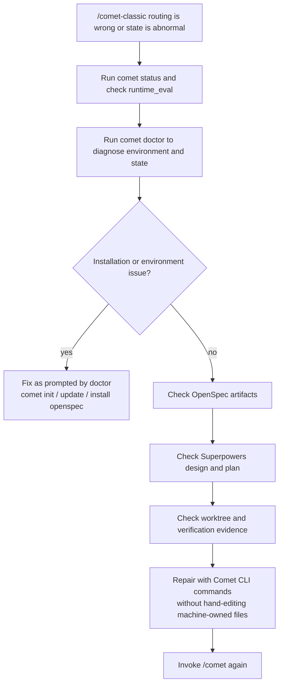

For normal Classic interruptions, invoke `/comet` (see [Resuming interrupted work](/en/guides/resuming-workflow)). Once Classic is active, the internal `/comet-classic` router reads file state and selects the right phase. This page covers internal routing discrepancies and damaged state.

When state is damaged, restore the repository's real file state first, then let the workflow continue from verified evidence. Do not hand-edit fields just to bypass workflow checks.

<p align="center">
  
</p>

<p align="center">
  When recovering state, first inspect tangible file evidence and repair according to suggestions.
  Do not manually forge state just to advance the workflow.
</p>

## First determine: Is state corrupted, or was work simply interrupted?

| Symptom                                                      | Issue Type                          | Resolution                                                                                |
| ------------------------------------------------------------ | ----------------------------------- | ----------------------------------------------------------------------------------------- |
| Session interrupted, context compressed, or switched devices | Normal interruption                 | Invoke `/comet` directly (see [Restoring Interrupted Work](/en/guides/resuming-workflow)) |
| Natural language request matches multiple active changes     | Target ambiguity (not corruption)   | Check the `reason` in recovery probe results and specify the target change to resume      |
| Uncommitted changes in working tree                          | Attribution needed (not corruption) | Confirm which change the modifications belong to before continuing                        |
| `/comet-classic` routed to incorrect phase                   | Potential metadata/file discrepancy | `/comet-classic` self-heals based on files. If still unresolved, run diagnostics          |
| `.comet.yaml` missing or malformed                           | Corrupted state                     | Run `comet doctor` for diagnostics                                                        |
| Declared artifacts/evidence missing from disk                | Missing evidence                    | Run `comet status` and inspect `runtime_eval`                                             |

## Diagnostic commands

For everyday recovery, enter `/comet` in conversation. When you suspect corrupted state files or environment issues and want to inspect them in a terminal, run these read-only diagnostic commands:

```bash
comet status        # Inspect each active change's phase, task completion, and runtime_eval
comet doctor        # Diagnose installation, environment, Skill integrity, and .comet.yaml validity
```

Add `--json` for Agents or automation scripts. If you also want to inspect why natural-language recovery probing matched or paused, you can run `comet resume-probe . --utterance "Continue the previous work"` in a terminal (read-only; it modifies no state).

The recovery probe decides whether to enter a workflow. An `ask_user` result may confirm whether a new session should continue a related change, choose a target, establish edit ownership, or handle a user decision. It does not by itself indicate damaged state. See the [recovery probe command](/en/cli/resume-probe).

### What comet status reports

Each active change reports: `phase`, task `done/total`, `workflow | build_mode`, `run_step`, `runtime_mode`, `runtime_eval` (whether the declared step evidence actually exists on disk), `design`, `plan`, `verify_result`, and a `next:` hint.

When `runtime_eval` fails, Comet prints `run <command> or restore missing evidence (...)`. Follow the prompt to run the command or restore the missing evidence.

### What comet doctor checks

`comet doctor` checks the Comet CLI version, OpenSpec CLI, Superpowers, working directories (`docs/superpowers/specs` and `docs/superpowers/plans`), installed Skill integrity on each platform, bundled scripts, CodeGraph, and each change's `.comet.yaml` and `runtime_eval`. Common repair commands include `npm install -g @fission-ai/openspec@latest`, `comet init`, and `comet update --scope ...`.

## Common symptoms and fixes

| Symptom                                                      | Possible cause                                                        | First step                                                                                                          |
| ------------------------------------------------------------ | --------------------------------------------------------------------- | ------------------------------------------------------------------------------------------------------------------- |
| `comet status` shows no next step                            | `.comet.yaml` is missing or malformed                                 | Run `comet doctor`                                                                                                  |
| build cannot enter verify                                    | Missing `build_mode`, `isolation`, or `tdd_mode`                      | Invoke `/comet` again so Classic routes back to build to select the missing options                                 |
| verify passed but cannot archive                             | Missing verification report, branch drift, or invalid state           | Restore the verification report, switch back to the bound branch, and keep `branch_status: pending` through verify  |
| After archiving, the change still shows as active            | Manual directory move or unsynchronized state                         | Check with `openspec status`, then re-run archive to finish (idempotent)                                            |
| `/comet-classic` reports a malformed `.comet.yaml`           | The file was damaged by manual edits                                  | Run `comet doctor`; in severe cases, restore `.comet.yaml` from Git                                                 |

## Recovery principles

- **Use files as evidence**: OpenSpec artifacts, Design Doc, Plan, test results, and the actual working tree are the only trusted source of state.
- **Do not manually edit machine-owned Run fields** (such as `.comet/run-state.json`, maintained automatically by Comet).
- **Do not confuse `build_pause` with `build_mode`** — they are separate fields.
- **Do not skip the verify-failure decision point** — you choose whether to fix or accept a non-blocking deviation.
- **Do not forge archive state by hand** — archiving must go through `/comet-archive` (where the Agent runs `comet archive` in the background; you can also run it in a terminal when troubleshooting).
- **Do not edit `.comet.yaml` to advance the phase by hand** — phase advancement must go through `comet guard --apply` or `comet state transition` (run by the Agent in the background, or in a terminal during troubleshooting).

## What to do if .comet.yaml is missing or broken

`/comet-classic` has recovery fallbacks for damaged state:

- When `.comet.yaml` is missing, Comet falls back to `openspec status --json`, `tasks.md`, and `docs/superpowers/` files to reconstruct state.
- When the format is damaged, disk files are the source of truth; the Agent corrects state in the background with `comet state set` (or you can run it in a terminal during troubleshooting) before continuing.
- When proposal, design, and tasks are complete while `phase` is still `open`, the Agent runs `comet guard --apply` in the background (or you can run it in a terminal during troubleshooting) to repair and advance state.

If `/comet-classic` cannot repair the file automatically (for example, severe corruption), restore `.comet.yaml` from Git and run `comet doctor` to verify.

## Recommended troubleshooting flow



## Next step

- [Resume Probe Command](/en/cli/resume-probe) — Distinguish between requests that can be automatically resumed, require confirmation, or should not enter workflow
- [Resuming Interrupted Work](/en/guides/resuming-workflow) — Classic normal interruptions only require `/comet`
- [Project File Structure](/en/guides/project-structure) — In which files state is stored
- [State Management](/en/concepts/state-management) — `.comet.yaml` fields and state guards
