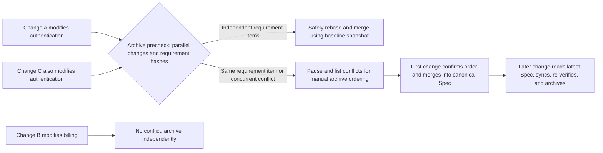

Development teams frequently advance several requirements at once—adjusting login retry policies while adding report exports. Mixing them in one branch or conversation tangles code edits, test results, and requirement documents together.

Native lets you maintain multiple independent changes in the same repository. You can direct the entire daily workflow in natural language through Agent conversation, backed by two isolation layers:

1. **Git worktrees isolate code**: Concurrent Agents write to separate directories and branches so uncommitted changes never overwrite each other.
2. **Requirement-level Spec conflict detection and archive conflict handling**: Before updating formal project specs, Comet checks conflicts by capability and Requirement ID, settling the evolution order of business contracts before code integration.

## Choose the right structure first

| Relationship between requirements | Recommended approach |
| --- | --- |
| Part of one overarching goal that splits into submodules needing coordinated integration and unified end-to-end verification | Use [Supervisor Change](/en/native/supervisor-change) so the parent manages dependency scheduling, serial integration, and final verification. |
| Independent business goals that can be coded, tested, and shipped separately | Create an independent Native change for each goal. |

The rest of this page explains how to plan and develop multiple independent Native changes in parallel.

## Plan multiple Shapes on a shared branch and defer Build

In a Git project, you do not need to create a separate worktree for every early idea. You can have the Agent create Shapes sequentially on the same branch for clarification and review (non-Git projects keep the single-change current-workspace workflow). Compatibility mode (Compat) and pinned SDK applications continue to follow their own isolation rules.

For example, propose your first requirement in chat with `/comet Adjust login retry and account lockout policy`, and once planned, propose the second with `/comet Add asynchronous CSV export to the dashboard`. Each change keeps its own `brief.md`, drafted Specs, acceptance criteria, and approval records. To switch back and add details to an earlier change, simply say: "Switch back to `session-retry-policy` and continue planning."

Only one Agent writes to a shared planning directory at a time. When you want multiple Agents to author materials or code concurrently, tell the Agent to use an independent worktree for each task.

### Approve Shape while deferring Build

If you want to confirm several proposals first and implement them in batches later, tell the Agent at final confirmation: "Confirm this proposal, but don't start writing code yet."

The Agent automatically attaches `--defer-build` along with state-version and expected-action guard parameters in the background (passing `--defer-build` alone has no effect without your explicit approval). The approval is saved, while creating the execution workspace and entering Build are deferred until you ask to start implementation.

## Automatic Build worktree preparation at kickoff

When you are ready to implement an approved change, tell the Agent: "Start implementing `session-retry-policy`." The Agent triggers kickoff in the background, and the Runtime checks whether other active changes remain in the planning workspace:

- **No other active changes**: Continues directly into Build in the current workspace without creating an extra worktree.
- **Other active changes remain**: The Runtime automatically performs a handoff and returns the new workspace path (`executionCwd`):
  1. Creates an independent branch (`comet/<change-name>` by default; appends `-build`, `-build-2`, etc. if already taken) and an independent worktree (`.worktrees/<change-name>`);
  2. Transfers the original Run, formal change materials, and confirmed Shape approval intact to the new worktree;
  3. Runs all subsequent coding in the new worktree. Hook Guard automatically protects the original planning directory against edits to the handed-off task, while still allowing you to check its status or switch to another Shape to keep planning.

### Four baseline guards before handoff

Automatic Build worktree preparation branches from committed code (`HEAD`) on the current branch. Handoff itself **never** commits or pushes on your behalf, preventing half-finished work from leaking into a new branch:

1. **Tracked code changes must be committed first**: If uncommitted tracked edits exist outside the change artifact directory and `.comet/config.yaml`, the Runtime pauses and asks you to commit the implementation baseline before continuing.
2. **Untracked files stay in the original directory**: Untracked temporary files are not copied into the new worktree automatically.
3. **Reused branches or worktrees must be clean and match the baseline**: If the target branch already exists, it must point to the same commit as the current `HEAD`. If a reused worktree contains uncommitted edits or already holds Runtime ownership records for the change, the Runtime preserves both sides and refuses to overwrite.
4. **Interrupted handoffs can be retried directly**: Keep the target directory intact and ask the Agent to continue; the Runtime completes the remaining handoff steps without duplicating Builders or overwriting finished steps.

## Isolate development from the start

If you know upfront that you will run concurrent windows, or the current directory already has uncommitted changes or another active change, simply say "develop this requirement in an independent worktree" when proposing it.

If you do not specify an isolation mode:

- When the current directory is clean and has no other active changes, Native proceeds directly in the current directory (`current`).
- When the current directory has uncommitted work, another active change, or you mention needing isolation or parallelism, the Agent automatically shows a single-select prompt for **A (current directory `current`)**, **B (new branch `branch`)**, or **C (independent `worktree`)**, and creates the corresponding branch and directory in the background.

## Workspace binding and branch verification

The Runtime persists each change's isolation mode, change branch, target branch, and workspace directory, checking them before every write and advancement to prevent three common mistakes:

- Accidentally editing code in the main directory for a task owned by an independent worktree;
- Manually switching Git branches locally and continuing an earlier change's state on the wrong branch;
- Copying context from an old conversation and running Build or Archive in the wrong directory.

Standard status queries and diagnostics inspect only the current workspace and do not automatically scan every worktree on disk. To work on a task inside an independent worktree, switch your Agent window to that directory. If you simply switched branches by mistake, switch back to the bound branch to continue. If you intentionally want to take over an idle task (with no running actions) on the current branch, tell the Agent to rebind it to the current branch (the Agent confirms there are no unreconciled executions before calling `--rebind` in the background).

## Requirement-level Delta Spec merging and archive conflict handling

In Native, each product capability's formal specification lives in `specs/<capability>/spec.md`. When modifying an existing capability, the change directory records requirement-level operations (`add`, `modify`, `remove`, `rename`) in `delta.yaml`, along with each target requirement's prior hash (`expected_hash`) and complete baseline snapshot (`base_requirements`).

This fine-grained design makes parallel archiving both safe and flexible:



Three scenarios apply:

1. **Modifying different capabilities** (for example, `authentication` and `billing`): Build, Verify, and Archive run independently in parallel; code merging follows standard Git workflows.
2. **Modifying the same capability without semantic conflict**: Using requirement prior hashes and independence checks, the Runtime identifies non-overlapping requirement items and merges them safely.
3. **Modifying the same requirement item or hitting a concurrent conflict**:
   - Archive precheck detects the conflict early and pauses, listing conflicting parallel changes or specific Requirement IDs—**never overwriting the canonical Spec**;
   - You decide in conversation which change archives first, and the Agent attaches `--serial-first <change-name>` in the background to confirm order and merge the first change into the canonical Spec;
   - The later change pulls the latest canonical Spec, reconciles both intents using its `brief.md`, updates its target specification, runs the Runtime-provided sync action, re-runs affected verification against the new baseline, and then continues archiving.

## Requirement-scope consistency check before Archive

Archive also verifies that the change's declared target Specs and acceptance criteria still match the baseline confirmed during Shape:

- Internal code refactoring or implementation cleanup that leaves requirements unchanged archives normally.
- Unconfirmed drift in target Spec scope or acceptance criteria returns the workflow to Shape for re-confirmation so formal specification changes never bypass your approval.

## Decisions you make during parallel development

The Agent and Runtime handle routine branch creation, worktree handoff, binding checks, and prechecks automatically. You typically only make decisions at four points:

1. When proposing a new requirement, decide whether to create an independent change or split it with Supervisor Change;
2. When the current directory already has uncommitted changes or an active change, choose `current`, `branch`, or `worktree`;
3. When the branch or workspace disagrees with the binding record, decide whether to switch back to the original branch or rebind on the current branch;
4. When multiple parallel changes modify the same capability Spec with conflicts, decide the archive order and review the later change's reconciled specification.

<Accordion title="Underlying commands for terminal troubleshooting (run automatically by the Agent in daily use)">

These are the public commands the Agent calls for shared planning, deferred Build, worktree creation, and branch rebinding, provided for deeper understanding or manual troubleshooting:

```bash
# Plan multiple Shapes on the current branch and switch the active task
comet native new session-retry-policy --isolation current --json
comet native new dashboard-export --isolation current --json
comet native select session-retry-policy

# Approve Shape while deferring execution workspace creation and Build
comet native next session-retry-policy --summary "Shape confirmed" \
  --confirmed --defer-build --expected-state-version <n> --expected-action confirm-shape

# Kick off Build to trigger automatic worktree creation and return executionCwd
comet native next session-retry-policy --session <session-id> --json

# Specify a new branch or independent worktree at creation time (optional --change-branch / --worktree-path)
comet native new session-timeout --isolation branch --target-branch main
comet native new session-timeout --isolation worktree --target-branch main

# Explicitly rebind an idle Run to the current branch
comet native select <change-name> --rebind --json
```

</Accordion>

Further reading: [Supervisor Change](/en/native/supervisor-change), [Safety and recovery](/en/native/safety-and-recovery), and [Native recovery playbook](/en/native/recovery-playbook).
