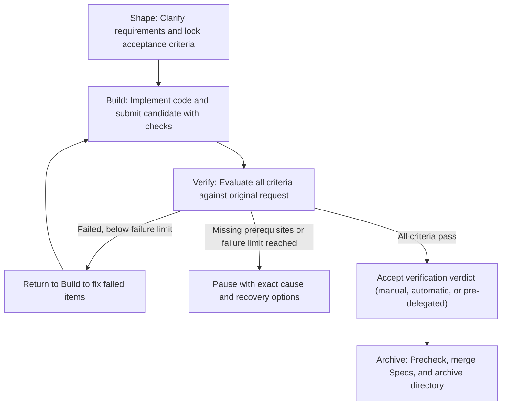

In day-to-day AI-assisted coding, the most common problems are rarely that the model cannot write code—they are drifting from the original requirement mid-conversation, declaring completion without running full checks, or fixing one bug while breaking another feature.

The **Native Loop** organizes each development change into four well-bounded phases: **Shape** (clarify requirements and lock in acceptance criteria), **Build** (implement code and submit check results), **Verify** (evaluate every acceptance criterion against your original request), and **Archive** (apply Spec changes and archive). In daily use, you interact with the Agent in natural language while the Agent calls the Runtime in the background for all state transitions and validation checks—pausing only when your decision is needed, an external blocker arises, or the failure limit is reached.



## Shape: Turn verbal ideas into verifiable acceptance criteria

Start a task by typing `/comet <your request>` directly in Agent chat—no manual CLI commands needed. The Agent automatically runs the creation command in the background and stores your **verbatim original request** (via `--task`) inside the Run. Later during Verify, the reviewer can cross-check directly against your exact words so requirements are never quietly dropped while organizing documents.

During Shape, the Agent inspects the codebase first, then clarifies ambiguities that affect visible outcomes according to your settings (see [Sequential and batch clarification](/en/native/clarification-modes) and [Which decisions need your confirmation](/en/native/decision-ownership)). After drafting `brief.md` and target Specs, Shape completes in two steps:

1. **Extract structured acceptance criteria**: The Agent extracts itemized, verifiable acceptance criteria from the formal documents and submits them to the Runtime, which assigns stable IDs (such as `A1`, `A2`). Native does not force rigid document templates, but submitted criteria must be clear, verifiable, and non-duplicated.
2. **Confirm explicitly before entering Build**: The Agent presents the complete Shape—goals and scope, key decisions, all acceptance criteria, and non-goals. The Runtime permits Build only after you explicitly confirm in conversation.

If you want to finalize several proposals first and write code later, simply tell the Agent at confirmation: "Confirm the proposal, but don't start writing code yet." The Agent attaches `--defer-build` in the background to save the approval and defer workspace creation and Build until you ask to start (see [Multi-change parallelism and conflict control](/en/native/multi-change-and-conflicts)).

## Walkthrough example: From round 1 repair to Archive

Take a concrete change named `login-error-message`: display "Invalid username or password" when login credentials are wrong, and "Too many attempts. Try again later." when rate-limited; update only frontend copy and branch handling without changing server status codes or rate-limiting rules.

| Phase | What the Agent and Runtime do behind the scenes | Your involvement and visible result |
| --- | --- | --- |
| **Shape** | Records scope, two acceptance criteria (`A1` invalid credentials, `A2` rate-limit message), and the "do not change backend" non-goal in `brief.md`, then submits criteria to the Runtime. | Review the full proposal and confirm in conversation; the Runtime saves approval and enters Build. |
| **Build (round 1)** | The Builder reads requirements and context (including automatically injected personal preferences and project knowledge), edits frontend code, runs UI tests, and submits the candidate implementation and test results in one background call. | No manual step needed; after validating the submission, the Runtime advances straight to Verify. |
| **Verify (round 1)** | The Verifier reviews in a read-only role against your original request and all criteria: simulated `401` shows the right message (`A1` `passed`), but simulated `429` still shows the wrong-password message (`A2` `failed`). | Round 1 verdict is `fail`. The Runtime preserves the confirmed Shape and sends `A2`'s failure evidence back to Build (`iteration` increments). |
| **Build + Verify (round 2)** | The Builder adds the `429` branch, re-runs affected UI tests, and submits round 2. The Verifier confirms `A2` passes, verifies `A1` has no regressions, and reuses still-valid API check results. | Both `A1` and `A2` are `passed`, and the Runtime generates the updated `verification.md`. |
| **Archive** | After acceptance, runs archive prechecks, merges Specs, and archives the change directory. | Receive the archive location summary; complete Git commit, push, or PR according to the delivery scope you confirm in conversation. |

Fixing the approved rate-limit message in round 2 is an implementation repair and stays inside the Build ↔ Verify loop. If you decide mid-way that "rate-limited errors should also show a countdown in seconds," that changes user-visible behavior—the Agent takes you back to Shape to update and re-confirm the proposal first.

## How Build ↔ Verify advances

### 1. One background submission chains internal steps

After modifying code and running builds, tests, or static checks through platform tools, the Builder submits the round's work as a **candidate implementation**, reporting the summary, check results, and known limitations to the Runtime in a single background call. The Runtime strictly validates the payload, automatically executes all approved internal steps in sequence, and returns the next pending task or human confirmation point directly, avoiding unnecessary back-and-forth.

If you want an independent pair of eyes on a critical change, tell the Agent in conversation: "Please run an independent review for this change." The Agent enables the independent-review flag (`--review independent`) in the background; this requirement persists in the Run and must be claimed and verified by a read-only session distinct from the Builder. Routine tasks default to switching into a read-only role within the current session (recorded as `self-reviewed`).

### 2. Round counters, incremental repair, and failure limits

The Runtime tracks two separate counters so platform retries are never miscounted as failed code fixes:

- **`iteration`**: The Builder's candidate implementation round. Increments by 1 each time code is repaired and resubmitted.
- **`attempt`**: The number of Verifier runs for the same candidate (for example, increments when retrying a Verifier after a platform error without consuming an implementation round).

Three practical rules govern the repair loop:

1. **Focus repairs on failed items, but verify everything**: The Runtime carries the previous round's failed criteria into Build as the repair focus, while the next formal Verify still evaluates every acceptance criterion to catch regressions.
2. **No mechanical cutoffs**: If a criterion ID fails two rounds in a row, the Runtime does not abruptly halt just because the failure list did not shrink—it lets the Agent inspect actual code changes to determine whether repairs are making real progress.
3. **Failure limit**: `native.max_verify_failures` in `.comet/config.yaml` (default `5`) caps real Verify failures for the same confirmed acceptance target. When reached, the Runtime stops the automatic loop, lists prior failure records, and lets you decide whether to try a different approach, adjust requirements, or cancel the task.

For complete details on check reuse, evidence requirements, and independent review, see [Verification and repair](/en/native/verification-and-repair).

## Editing code, docs, or requirements mid-loop

During Build, Verify, or archive-ready, if you or the Agent edit files directly, Native **does not blindly invalidate existing approvals or all tests** just because files changed. Instead, the Agent inspects the Git diff and original text and handles the edit by category:

| Edit type | Actual handling |
| --- | --- |
| Comments, formatting, or wording tweaks (behavior and acceptance meaning unchanged) | Preserves the current phase, confirmed approval, and valid check evidence, then continues directly. |
| Missing implementation detail found while requirement scope is unchanged | Ask to keep fixing in conversation; the Agent takes the implementation revision path back to Build while keeping Shape approval. |
| User-visible behavior, goals, or acceptance criteria changed | Describe the new requirement in conversation; the Agent returns to Shape in the background, explains the impact first, and asks you to re-confirm the full Shape. |
| New requirement unrelated to the current change | Create a separate independent change so unrelated edits do not mix into the current delivery. |

## Accepting verification, archiving, and canceling tasks

Once all acceptance criteria pass, Archive begins through one of three paths:

1. **Manual acceptance (`native.archive_confirmation: required`)**: The Agent presents itemized verdicts, check evidence, and known limitations; Archive runs after you explicitly agree in conversation.
2. **Project automatic archive policy (`native.archive_confirmation: automatic`)**: Even with automatic archiving enabled, the Runtime checks four conditions together—(1) the verdict is `pass`, (2) accepting verification is the only pending wait, (3) no evidence waits are pending, and (4) no `running` or `unknown` actions exist—and automatically accepts and archives only when all four hold.
3. **One-time pre-delegation**: If you explicitly tell the Agent at kickoff or during repair "accept and archive automatically once everything passes," the Agent binds this delegation (`--accept-on-pass`) when submitting the passing result. This delegation covers only acceptance and local archiving—it does not auto-approve Git merge, push, PR creation, or workspace cleanup.

### Canceling an unfinished task

If you decide mid-flight that a task is no longer needed, tell the Agent "cancel the current task" and state the reason. The Agent marks the task canceled in the background so it no longer counts as an active change and creates no false archive record. Your written code, Git commits, branches, and workspace directory stay intact—you decide whether to delete branches or clean up worktrees. Completed changes cannot be canceled.

<Accordion title="Underlying commands for terminal troubleshooting (run automatically by the Agent in daily use)">

These are the public CLI entry points the Agent calls in the background while advancing the Native Loop, provided only for offline terminal troubleshooting or manual inspection:

```bash
# Create a change and save your verbatim original request (called automatically when starting /comet)
comet native new <change-name> --task "<your original request>" --json

# Claim work and report implementation plus check results in one call (--review: current-session or independent)
comet native next <change-name> --session <session-id> --action <action-id> --result <json-file|-> --review current-session --json

# Preview and cancel an unfinished change (preserves code, branches, and workspace)
comet native cancel <change-name> --dry-run
comet native cancel <change-name> --reason "Requirement merged into another plan"
```

</Accordion>

For archiving and Git delivery verification, see [Archive and delivery](/en/native/archive-and-delivery). For configuration options, see [Native configuration](/en/native/configuration).
