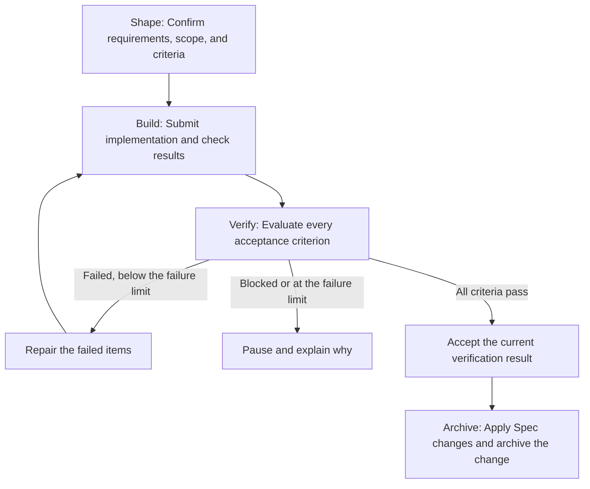

The Native Loop starts after you confirm Shape. The Builder submits an implementation for the confirmed requirements, and the Verifier checks the current implementation against every acceptance criterion. When the implementation falls short, Native returns the failed criteria to Build to guide the next round of repairs. The Runtime archives the change after verification passes and the current result is accepted.

## Confirm Shape before implementation

The Shape proposal lists the change's goals, scope, key decisions, and acceptance criteria. Before confirming, check which behaviors the change must deliver and which are outside its scope. The `brief.md` and related Specs record these decisions for Build and Verify. See [Which decisions need your confirmation](/en/native/decision-ownership).

To approve the proposal and write the code later, defer Build when approving Shape. Comet keeps the approval and prepares the workspace when implementation begins. See [Parallel changes and conflict control](/en/native/multi-change-and-conflicts).

## Example: Show different sign-in error messages

Suppose you want the sign-in page to display “Invalid username or password” for incorrect credentials and “Too many attempts. Try again later” when the request is rate-limited. This change updates the messages and keeps the server's response codes and rate-limiting rules as they are.

| Progress | What the Agent does | What you see |
| --- | --- | --- |
| Shape awaits confirmation | Define the scope in `brief.md` and give incorrect credentials and rate limiting separate acceptance criteria. | Review both messages and the behaviors that stay as they are. Confirm Shape to allow Build. |
| First Build and Verify | The Builder submits the implementation. The Verifier sees the correct message for invalid credentials but finds that rate-limited requests still show that same message. | The first criterion passes and the second fails. Native keeps Shape approval and returns the failed item to Build. |
| Build and Verify after repair | The Builder adds the rate-limit branch. The Verifier checks the rate-limit message and confirms the repair preserved the incorrect-credentials behavior. | After both criteria pass, review the evidence and accept the current result. |
| Archive | The Runtime applies the approved Spec changes to the project Specs and archives the change. | The Agent reports the archive location and verifies Git delivery within the scope you specified. |

To correct the approved rate-limit message, continue repairing the implementation. If you want to display the number of seconds remaining, that adds a display rule. Update and confirm Shape first. See [Native artifacts and state](/en/native/artifacts-and-state) for the related files.

## Iterate between Build and Verify

The Builder implements the confirmed requirements, runs the necessary checks, and submits the results. The Verifier compares the implementation with the original request, formal requirements, and acceptance criteria. For how the Agent runs and reuses checks and when it uses independent review, see [Verification and repair](/en/native/verification-and-repair).

When the implementation needs repair, the next Build round focuses on the failed items and checks other behaviors the repair may affect. The next Verify round still covers every acceptance criterion for the change. If addressing the issue requires changing the goals, scope, or acceptance criteria, the Agent updates the Shape proposal and asks you to confirm the affected decisions.

When verification failures reach the configured limit, the Runtime pauses automatic repair and returns the cause and next available action. See [Native configuration](/en/native/configuration) for the failure limit.

## Accept the verification result and archive

When every acceptance criterion passes, the Agent shows the current implementation's verdict, check results, and known limitations. You can accept the result or request further repairs. If you explicitly delegated acceptance and archiving on a pass, the Agent can proceed when that condition is met.

After archiving, Git commits, pushes, and pull requests follow the delivery scope you approved. See [Archive and delivery](/en/native/archive-and-delivery).
