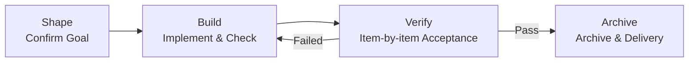

In the Native workflow, you state your goal in chat and confirm key decisions and acceptance criteria during Shape. Comet automatically manages workspace binding, advances Build implementation and Verify acceptance, and archives once verification passes and you confirm the result. New tasks can be verified directly in the current session, or with an independent review whenever needed.

Native is built for cloud-hosted strong reasoning models. It removes heavy intermediate template docs and uses clear goal boundaries, real platform check results, and item-by-item acceptance evidence as the delivery standard.

## Before you begin

- Node.js 22.16 or later in the 22.x line, or Node.js 24 or later
- Git
- Any [supported AI coding platform](/en/platforms)

## Start a Native change in three steps

<Steps>
  <Step title="Install and initialize Comet">
    Run once in your project root terminal:

    ```bash
    npm install -g @rpamis/comet
    comet init --workflow native
    ```

    Initialization installs the Native Skill and Rule files automatically; on platforms that support Hooks, it also registers the unified Router. Project settings live in `.comet/config.yaml`, and generated Native docs default to `docs/comet/`.

  </Step>

  <Step title="Describe your requirement in Agent chat">
    Open your Agent client and type in chat:

    ```text
    /comet Add avatar upload to the user profile page
    ```

    `/comet` is a chat Skill entry point (not a terminal command) that reads your project configuration and enters the Native workflow automatically. Subsequent task creation, stage progression, and status validation are handled by the Agent in the background—you do not need to run `comet native ...` commands manually.

    When creating a change, you can stay in the current workspace or let Comet create a dedicated branch or Git worktree; when running multiple requirements in parallel, Comet isolates code automatically in separate worktrees.

  </Step>

  <Step title="Confirm key decisions and acceptance criteria to start execution">
    Native scans your existing codebase first and asks only about decisions that affect visible behavior, defaults, or compatibility. For example:

    ```text
    Comet: Analyzed repository. Found existing src/components/Avatar.tsx. Please confirm:
    1. Maximum upload file size (default: 2MB)?
    2. Allowed image formats (default: JPG/PNG/WebP)?
    ```

    Reply in natural language (such as "Keep the default 2MB limit and allow JPG and PNG") and confirm the final requirements summary. Once confirmed, Comet writes the decisions into `brief.md` and target Specs, then advances automatically through **Build** (implementation) and **Verify** (item-by-item acceptance) with no manual phase switching.

  </Step>
</Steps>

## What Comet handles for you

- **Workspace preparation and binding**: Automatically creates or reuses branches and worktrees and returns to the right directory on resume; blocks writes immediately if the branch or directory does not match so edits never land in the wrong place.
- **Continuous workflow progression**: The Agent inspects code, writes implementations, and runs tests, while the Runtime tracks state, prevents stale writes, and returns the next step—pausing only when you need to make a decision or a blocker occurs.
- **Completion verified with real evidence**: The Agent runs builds and tests via platform tools, and Verify checks your original request and every acceptance item one by one; failed items return to Build with concrete evidence while reusing checks that still apply.
- **Cross-session and cross-device recovery**: Requirements, target Specs, and recovery checkpoints live in repository files. After closing a window, compacting context, or switching machines, you can resume without re-explaining the background.
- **On-demand context injection**: When Personal Memory and Project Knowledge are enabled, Comet automatically retrieves personal preferences and repository knowledge relevant to the active task.

The Native core flow has four stages:



## Resume after interruption

Reopen your project session and type in Agent chat:

```text
/comet continue
```

The Agent reads the saved task state, workspace binding, and next step in the background and continues from the latest checkpoint. If local code, branch, or worktree does not match the saved record, it stops and explains the mismatch instead of silently switching branches.

If you want to inspect progress offline in a terminal at any time, run the read-only command `comet status`:

```text
Default Workflow: native

Native Changes:
  ● avatar-upload [Build] (active)
    Target: Add avatar upload to the user profile page
    Next: Enter Verify for item-by-item acceptance after Builder submits a candidate
```

To view change progress, acceptance details, and workspace status in a browser, launch the local Dashboard:

```bash
comet dashboard   # Launch the local web control center
comet doctor      # Check installation, configuration validity, and environment health
```

## What you get upon completion

Once complete, beyond the implemented code, your repository retains the `brief.md` summary, updated project Specs, state file, and `verification.md` verification report. Future collaborators or new Agent sessions can build directly on those files without relying on old chat transcripts.

Continue reading: [Native workflow](/en/concepts/native-workflow), [Supervisor Change](/en/native/supervisor-change), [Archive and delivery](/en/native/archive-and-delivery), [Native artifacts and state](/en/native/artifacts-and-state), and [Native task recovery](/en/native/recovery-playbook).
