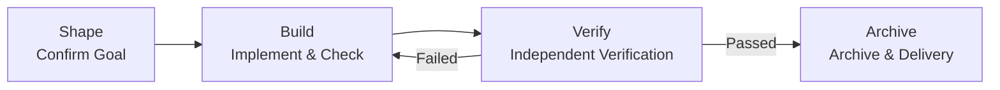

In the Native workflow, you specify your delivery goal and confirm key decisions and acceptance criteria during the Shape phase. Comet automatically manages workspace bindings, coordinates Builder implementation with independent read-only Verifier checks, and handles archiving once verified.

Native is designed for strong models like Fable 5, GPT-5.6, and equivalent tiers. It does not impose heavy procedural documentation, but uses verifiable acceptance evidence as the sole delivery criterion.

## Before you begin

- Node.js 22.16 or later within the 22.x line, or Node.js 24 or later
- Git
- A [supported AI coding platform](/en/platforms)

## Start a Native change in three steps

<Steps>
  <Step title="Install and initialize Comet">
    Run in your project root:

    ```bash
    npm install -g @rpamis/comet
    comet init --workflow native
    ```

    Initialization installs the required Native Skills and Rules. Platforms supporting Hooks also receive a unified Router. Project settings are stored in `.comet/config.yaml`, and Native documentation defaults to `docs/comet/`.
  </Step>

  <Step title="Describe what you want to achieve">
    Open your agent platform and run:

    ```text
    /comet implement avatar upload for the user profile page
    ```

    `/comet` reads your project configuration and launches the Native workflow. It is an agent Skill entry point, not a terminal shell command.

    When creating a change, you can work in the current workspace or have Comet provision a dedicated branch or worktree. For parallel execution across multiple tasks, Comet isolates changes in dedicated worktrees.
  </Step>

  <Step title="Confirm key decisions and acceptance items">
    Native inspects your existing codebase first, prompting only for decisions that affect scope, defaults, compatibility, or system risk:

    ```text
    Comet: Analyzed repository. Found existing src/components/Avatar.tsx. Please confirm:
    1. Maximum upload file size (default: 2MB)?
    2. Allowed image formats (default: JPG/PNG/WebP)?
    ```

    Reply with your choices (e.g., "Keep defaults: 2MB limit, support JPG and PNG"). Comet writes the specification into `brief.md` and advances to **Build** (implementation) and **Verify** (independent acceptance) without manual phase transitions.
  </Step>
</Steps>

## What Comet manages

- **Workspace preparation and binding**: Creates or reuses branches and worktrees, restoring the exact directory upon resume. Writes are halted if workspaces do not match.
- **Continuous workflow progression**: The model investigates and writes code while Runtime governs phase transitions. Work only pauses for user decisions or blockers.
- **Independent completion verification**: Runtime executes pre-flight checks, then dispatches a fresh read-only Verifier to test every acceptance item against actual evidence. Any failure routes back to Build with clear diagnosis.
- **Resume after interruption**: Requirements, progress, and verification records persist in project files. You can restart sessions or switch machines without losing task context.
- **Context injection**: When Personal Memory and Project Knowledge are enabled, Comet selects relevant preferences and repository policies on demand.

The Native core path consists of four phases:



## Resume after interruption

Reopen your project and type in your agent:

```text
/comet continue
```

Comet re-reads the active change, workspace bindings, and next step, resuming from the latest checkpoint. If code or workspace paths mismatch, Comet explains the issue instead of silently creating files in an incorrect directory.

To check the current stage, run `comet status` in your terminal:

```text
Default Workflow: native

Native Changes:
  ● avatar-upload [Build] (active)
    Target: implement avatar upload for the user profile page
    Next: Verifier will run independent verification once Builder submits candidate
```

To view change progress, acceptance details, and workspace status visually in a browser:

```bash
comet dashboard   # Launch local Web control center
comet doctor      # Check installation, configuration, and environment dependencies
```

## What you get upon completion

Beyond implementation code, your project retains a readable requirements brief, full target Specs, workflow state, and verification reports. Future agents can pick up where you left off from these files without guessing or relying on past chat history.

Continue reading: [Native workflow](/en/concepts/native-workflow), [Supervisor change](/en/native/supervisor-change), [Archive and delivery](/en/native/archive-and-delivery), [Artifacts and state](/en/native/artifacts-and-state), and [Recovery playbook](/en/native/recovery-playbook).
