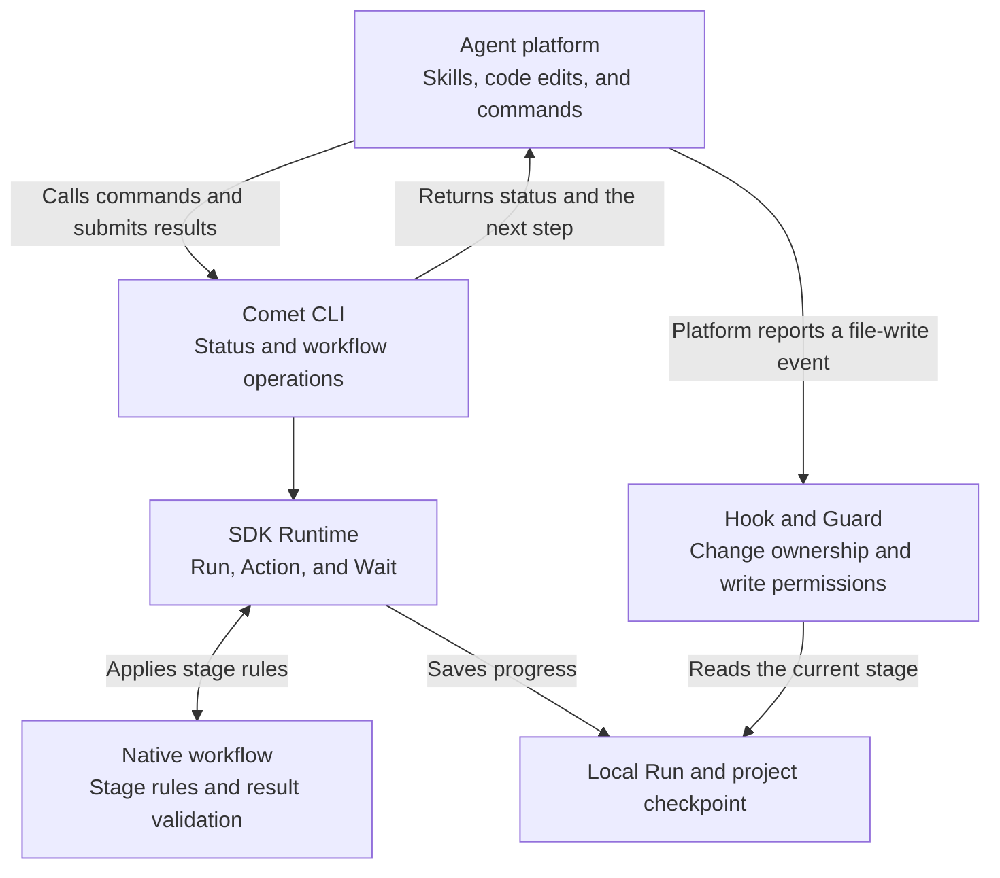

When you create a Native change, Comet creates a **Run** that records its stage, pending actions, results, and user decisions. The Native workflow defines the rules for Shape, Build, Verify, and Archive. The SDK Runtime applies those rules and persists the Run. The Agent writes code, runs checks, and evaluates acceptance criteria using the platform's sessions and tools.

## The Native workflow defines stage rules

The Native workflow determines when implementation can begin, when the Agent can submit verification results, and when the change can be archived. Shape confirmation establishes the requirements, scope, and acceptance criteria. In Build, the Agent submits an implementation candidate and actual check results. Verify evaluates every acceptance criterion against that candidate. Acceptance applies to the current candidate, and the change enters Archive after the result is accepted. When requirements change or the implementation needs repair, Native determines which stage to revisit based on what changed. See [Native Loop](/en/native/native-loop) for the conditions for entering each stage.

## The SDK Runtime persists and advances the Run

An **Action** records work for the Runtime to track, such as preparing the Shape proposal, receiving the Builder handoff, or applying the archive. A **Wait** records a pending decision, such as confirming Shape or accepting the verification result. The Runtime checks that results match the current Action and decisions match the current proposal, then saves the updated Run. If the Agent submits a stale decision, the Runtime asks it to read the current state again.

Use `comet native status <change-name> --json` to inspect a change and `comet native next <change-name> --json` to advance it. The Runtime can run successive approved internal steps until an Agent needs to act, you need to decide, or a blocker needs attention. The Skill reads the response's `continuation` to proceed or explain what is blocking progress. See [Task advancement and interruption recovery](/en/native/continuation-and-checkpoints).

## Agents implement code and submit verification evidence

The Builder and Verifier run project builds, tests, and static checks using Agent platform tools. In its submission, the Agent reports the commands it ran, their working directories and results, and any checks it skipped. Verify can reuse results that still apply to the current code and environment, then run the checks affected by the change or missing evidence. The Verifier evaluates every acceptance criterion.

Verification can take place in the current session. If the change requires independent review, the Runtime checks whether the executor qualifies when it claims the verification task. The report records the review method used. See [Verification and repair](/en/native/verification-and-repair) for evidence and repair rules.

## Hooks and Guard check writes

When an enabled Hook receives a file-write event from the Agent platform, the Guard checks the workspace selection, current stage, and target path. For example, it blocks implementation writes for a selected change that is still waiting for Shape confirmation.

To make unrelated edits in the same workspace, run `comet native select --none` to clear the selection. The Guard still protects formal workflow artifacts and Runtime data. Selecting the original change reapplies its stage restrictions. See [Native runtime protection and recovery](/en/native/safety-and-recovery) for coverage and [Status and selection](/en/cli/status) for commands.

## Project documents and local Runs support recovery

The project holds the requirements and verification artifacts. Comet's user data directory holds the local Run and execution records, with separate storage for the main workspace and each Git worktree. `comet-state.yaml` shows progress and saves checkpoints at key boundaries. Editing it or `verification.md` cannot change the workflow state of the Run.

If local records are missing, the Runtime can restore the original Run from a valid checkpoint and the accompanying project materials. If an Action was dispatched and its outcome is unknown, the Agent checks the original execution before deciding how to continue. To diagnose an issue, run `comet native doctor <change-name>`. See [Native artifacts and state](/en/native/artifacts-and-state) and [SDK failure recovery and unknown results](/en/sdk/recovery).

## Archive applies Specs and completes the Run

Once the verification result is accepted, the Runtime checks the archive prerequisites, applies the approved Spec changes to the project Specs, moves the change, and records the result. If archiving is interrupted, the Runtime checks the original Run and the files already written before resuming from recorded progress. The Agent handles Git commits, pushes, and pull requests within the delivery scope you approved. See [Archive and delivery](/en/native/archive-and-delivery).

## Supervisor coordinates parallel work

A [Supervisor Change](/en/native/supervisor-change) coordinates child tasks in the same parent Run. Each child is implemented and verified in its own Git worktree, and the Runtime schedules integration according to the dependencies. Once the children are integrated, the parent change proceeds through overall verification and archive.
