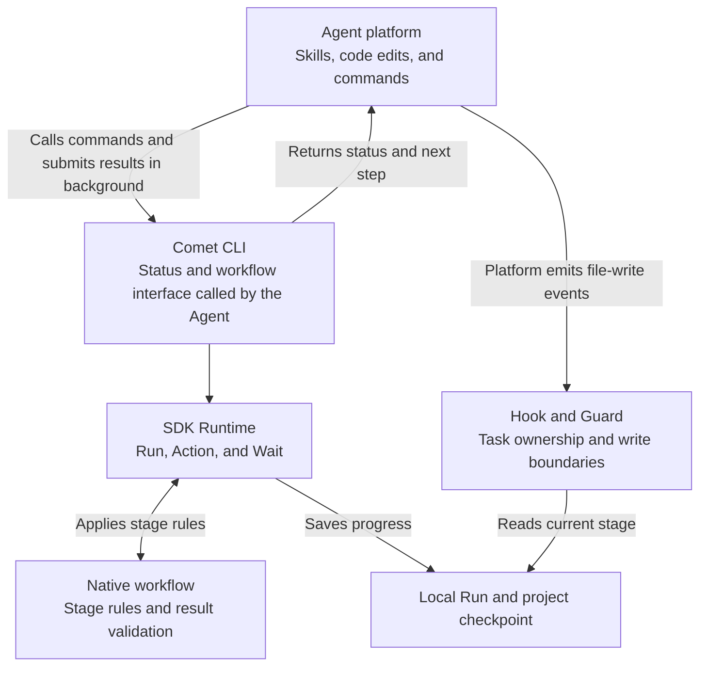

When you create a Native change, Comet creates a **Run** in the background that records its stage, pending actions, execution results, and your confirmation decisions. The Native workflow defines the rules for Shape, Build, Verify, and Archive; the SDK Runtime enforces those rules and persists the Run; and the Agent writes code, runs tests, and completes verification inside your platform session. **In daily use, you simply talk to the Agent in natural language—the Agent invokes all underlying CLI commands automatically.**

## The Native workflow defines stage rules

The Native workflow defines when coding can begin, when verification results can be submitted, and when archiving is allowed. Once Shape is confirmed, requirements, scope, and acceptance criteria serve as the contract for later stages. Build submits an implementation candidate and its check results, and Verify evaluates every acceptance criterion against that same candidate and your original request. Only after verification passes and you accept the result does the change enter Archive. If you need to fix code or revise requirements mid-task, Native decides whether to return to Build or Shape based on what changed. See [Native Loop](/en/native/native-loop) for detailed transitions.

## The SDK Runtime persists and advances the Run

- **Action**: A concrete unit of work tracked by the Runtime, such as submitting acceptance items, receiving a Builder handoff, running verification, or executing an archive.
- **Wait**: A decision point waiting for your confirmation, such as confirming Shape or accepting a verification verdict.

The Runtime verifies that submitted results match the current Action and that confirmations bind to the current proposal and state version before updating the same Run. If the Agent attempts to submit a stale decision, the Runtime rejects it and requires reading the latest state first.

In the background, the Agent inspects state read-only with `comet native status` and advances the workflow with `comet native next`. The Runtime automatically executes successive approved internal steps until an Agent needs to perform work, you need to make a decision, or a blocker occurs. See [Task progress and interruption recovery](/en/native/continuation-and-checkpoints) for the underlying mechanics.

## Agents implement code and submit verification evidence

The Builder and Verifier run builds, tests, and static checks directly through Agent platform tools, reporting the commands run, working directories, exit status, log references, and any checks that were not run. Verify can reuse check results that still apply to the current code and environment, rerunning only checks affected by edits or missing evidence, while still delivering an item-by-item verdict for every acceptance criterion.

Verification runs in the current session as a read-only role by default. If you request independent review, the Runtime enforces that an independent read-only session claims the verification task, and the report records the review method used. See [Verification and repair](/en/native/verification-and-repair) for details.

## Hooks and Guard check writes

On Agent platforms that support and enable Hooks, every file write passes through the Guard first. The Guard decides whether to allow the write based on the workspace's selected change, current stage, and target path—for example, blocking edits to application code while the selected change is still waiting for Shape confirmation.

If you need to make temporary edits unrelated to Comet in the same workspace, tell the Agent in chat to step out of the current task selection (the Agent runs `comet native select --none` in the background). Once unselected, ordinary code edits are allowed while formal workflow artifacts and Runtime data remain protected; ask the Agent to reselect the change when you return to it. See [Native Runtime protection and recovery](/en/native/safety-and-recovery) for full rules.

## Project documents and local Runs support recovery

Requirements and acceptance materials live in your repository. Complete local Runs are stored in the Comet data directory under your home directory (default `~/.comet`, configurable via `COMET_DATA_DIR`), isolated per workspace across the main checkout and every Git worktree. `comet-state.yaml` displays progress and saves recovery checkpoints (`run_checkpoint`) at key boundaries; hand-editing `comet-state.yaml` or `verification.md` cannot alter the Run's workflow state.

If local records are lost or you switch devices, the Runtime restores the original Run from a valid checkpoint and repository artifacts. If an Action was dispatched with an unknown outcome, the Agent reconciles the original platform execution and file side effects before deciding how to proceed. See [Native task recovery](/en/native/recovery-playbook) and [Native artifacts and state](/en/native/artifacts-and-state) for troubleshooting.

## Archive applies Specs and completes the Run

After you accept the verification verdict, the Runtime checks archive prerequisites, merges confirmed Spec changes into your project's official Specs, moves the change directory, and records the archive outcome. If archiving is interrupted partway through, the Runtime checks the original Run and transaction records to resume from the last completed step without duplicating writes. The Agent handles Git commits, pushes, and pull requests within the delivery scope you confirm. See [Archive and delivery](/en/native/archive-and-delivery).

## Supervisor coordinates parallel work

A [Supervisor Change](/en/native/supervisor-change) orchestrates subtasks for large requirements within a single parent Run. Each child is implemented and verified in its own Git worktree, and the Runtime merges children serially into an integration branch according to their dependency order. Once all children are integrated, the parent runs comprehensive final verification, delivery, and cleanup in the integration worktree.
