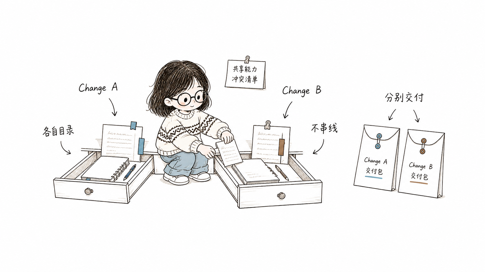

When you have two unrelated requirements on your plate, you do not need to wait for the first to finish before starting the second—nor cram both into one branch. You can direct the entire parallel planning, isolated implementation, conflict resolution, and archive flow in chat using natural language, while Comet manages branches, worktrees, and state bindings automatically.

This walkthrough follows two common product requirements:

- **`session-retry-policy`**: Lock an account for 15 minutes after 5 consecutive failed logins, reset the counter after a successful login, and keep frontend and backend lock status consistent;
- **`dashboard-export`**: Let the operations dashboard export CSVs matching active filters, switch large exports to an async background job, and display progress with failure retry.

Because these two goals do not depend on each other and can ship independently, they are best run as two **independent Native Changes** in parallel.



## First confirm: independent Changes or a Supervisor Change?

| Criterion | Multiple independent Native Changes | Supervisor Change |
| --- | --- | --- |
| Delivery relationship | Ship independently without waiting on each other | Delivered together as one unified goal |
| Acceptance boundary | Each Change archives once its own Verify passes | Children verify and merge into an integration branch; parent runs full final acceptance |
| Dependencies | Independent, or only depend on already-shipped code | Clear upstream/downstream dependencies or cross-module integration between children |
| Archiving | Each executes Archive and Git delivery independently | Children do not archive individually; parent archives and delivers once |

Even if two requirements came out of the same planning meeting, keep them as separate independent Changes whenever they can be verified and shipped on their own.

## Two ways to start in parallel

### Option A: Plan both Shapes on one branch, then split into worktrees at Build time

If you prefer clarifying and confirming both specs before coding, propose them sequentially in chat on your current Git branch:

```text
/comet Adjust login retry policy: lock for 15 minutes after 5 consecutive failures, reset on successful login. Plan on the current branch first.
```

After finalizing the first plan, confirm it while telling the Agent "Confirm this plan, but do not start coding yet" (the Agent passes `--defer-build` in the background to save your approval), then introduce the second requirement:

```text
/comet Add async CSV export by active filters to the operations dashboard, with progress tracking and failure retry. Plan on the current branch first.
```

To jump back to the first one, simply say "Switch back to `session-retry-policy`." When you are ready to build and tell the Agent "Start implementing `session-retry-policy`", because another active Change (`dashboard-export`) exists in the planning directory, the Runtime automatically creates a dedicated branch `comet/session-retry-policy` and worktree `.worktrees/session-retry-policy`, hands off the original Run, formal artifacts, and approval, and returns the new execution directory (`executionCwd`). Ensure tracked code edits outside the planning directory are committed before handoff; handoff itself never auto-commits or pushes.

### Option B: Create dedicated worktrees from the start

If you want to open two windows right away and let two Agents run Shape through Archive concurrently, tell the Agent in chat "Create this change in a dedicated worktree" (or select Option C `worktree` when prompted for an isolation mode because uncommitted changes or another active change already exist). The Runtime provisions `.worktrees/session-retry-policy`, `.worktrees/dashboard-export`, and their branches automatically.

## Developing in two windows without interference

Once the worktrees are ready, open two separate Agent sessions:

```text
Session A
  Workspace: .worktrees/session-retry-policy
  Change: session-retry-policy

Session B
  Workspace: .worktrees/dashboard-export
  Change: dashboard-export
```

Both changes move through Shape → Build → Verify → Archive independently, protected against cross-talk by four layers:

1. **Isolated Run storage**: Local SDK Runs live in your user Comet data directory, strictly isolated by workspace—submissions in Session A can never write to Session B's Run.
2. **Explicit task ownership**: Each workspace's `.comet/current-change.json` tracks the selected change. If you need to make a quick unrelated edit in the main directory, tell the Agent "Step out of the current task selection so I can edit an unrelated file" (runs `select --none` in the background, permitting ordinary code edits while still protecting workflow files); tell it to resume when you return.
3. **Hook Guard against cross-directory miswrites**: Once `session-retry-policy` has handed off to `.worktrees/session-retry-policy`, any attempt to edit its files from the old main directory is blocked immediately with the right path.
4. **Main directory edits preserved**: Worktree isolation scopes only to the change itself and never wipes personal debug files left in your main checkout.

## Handling the wrong directory or branch

To prevent cross-directory mistakes, ordinary status checks and diagnostics inspect only the current workspace and **do not automatically scan every worktree on your machine**.

- If you accidentally try to advance `session-retry-policy` from `.worktrees/dashboard-export`, the Runtime detects the directory and branch mismatch, blocks the action, and reports the expected path and branch. Switch back to `.worktrees/session-retry-policy` instead of creating a duplicate change in the wrong directory.
- If you accidentally switch branches inside a worktree, switch back to the bound branch. If you intentionally want to take over the same idle Run on the current branch, tell the Agent to rebind it to the current branch (the Agent calls `--rebind` in the background after confirming no `running` or `unknown` actions exist).

## Resolving same-capability Spec conflicts at Archive

`session-retry-policy` (modifying `authentication`) and `dashboard-export` (modifying `dashboard`) touch different capabilities and archive completely independently.

Suppose a third parallel task `session-device-limit` (concurrent device cap) **also modifies `specs/authentication/spec.md`**. When either one reaches Archive, Native protects the official Spec from silent overwrites:

### 1. Requirement-level detection and conflict pause

When modifying an existing capability, each change records requirement-level operations (`add`, `modify`, `remove`, `rename`) and baseline hashes in `delta.yaml`:

- If the two changes touch **disjoint requirements** inside `authentication`, the Runtime can merge them safely against the baseline snapshot;
- If both modify the **same requirement** or have concurrent conflicts, Archive preflight pauses, lists the conflicting parallel Change (such as `session-device-limit`) or requirement IDs, and waits for you to choose the archive order in chat.

### 2. Confirm the first Change to archive

Once you decide to archive `session-retry-policy` first:

1. The Agent confirms the order in the background with `--serial-first session-retry-policy` (bound to the current state version so stale instructions are rejected if state changes);
2. `session-retry-policy` merges its updates into the project's official `specs/authentication/spec.md` and archives its directory.

### 3. Realign the second Change to the new baseline and re-verify

When advancing `session-device-limit` next, tests run against the old baseline cannot be carried straight into Archive. The Agent walks through four steps with you:

1. Pull and re-read the updated official `specs/authentication/spec.md`;
2. Combine it with your `brief.md` to preserve both intentions, update the change's target Spec (or `delta.yaml`), and run the sync action returned by the Runtime;
3. Adjust affected implementation code to match the new baseline and rerun relevant tests via platform tools;
4. Pass Verify again before completing Archive.

## Interruption recovery and cross-device switching with multiple tasks

- **Resume a specific task locally**: Open the target worktree directory and name the task in chat (for example, "Continue `dashboard-export`").
- **Natural-language resume in a fresh session**: When multiple active changes exist in the same workspace and you simply say "continue what I was working on", the read-only `comet resume-probe` returns the candidate list for you to choose instead of guessing.
- **Continue on another device**: Stop advancing on the old device, commit and push each branch's code, `.comet/config.yaml`, and the change directory's `comet-state.yaml` (containing `run_checkpoint`), `brief.md`, and target Specs. On the new device, pull the branch and ask the Agent to run diagnostics and restore the original Run from the checkpoint (see [Native task recovery](/en/native/recovery-playbook#missing-local-run-and-cross-device-recovery)).

## Independent Archive and Git delivery

Archive and Git delivery are completely independent per Change: you can push `session-retry-policy` and open a pull request while keeping `dashboard-export` on a local branch without pushing yet.

Once SDK Archive finishes (Run status `completed`, workflow status `done`), verify local commits, merges, pushes, or pull requests against each change's confirmed delivery scope (see [Archive and delivery](/en/native/archive-and-delivery)). After archiving, clean up clean temporary worktrees with Git once you confirm they are no longer needed; directories with uncommitted edits are always preserved.

<Accordion title="Underlying command reference (normally run by the Agent; optional for terminal troubleshooting)">

```bash
# Plan two Shapes on a shared branch and switch ownership
comet native new session-retry-policy --isolation current --task "..." --json
comet native new dashboard-export --isolation current --task "..." --json
comet native select session-retry-policy

# Create a dedicated worktree directly
comet native new session-retry-policy --isolation worktree --target-branch main --task "..." --json

# Inspect detailed status read-only inside the target worktree
comet native status dashboard-export --details --json
```

</Accordion>

Continue reading: [Parallel changes and conflict control](/en/native/multi-change-and-conflicts), [Native Runtime protection and recovery](/en/native/safety-and-recovery), and [Native task recovery](/en/native/recovery-playbook).
