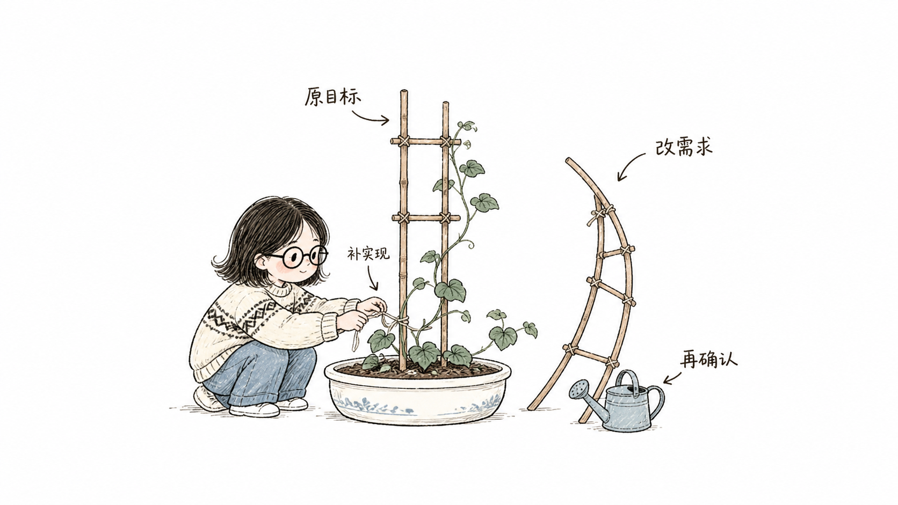

Almost no feature stays frozen from start to finish. Mid-task, four situations come up most often:

1. **The code is wrong**: Requirements did not change, but the implementation misses confirmed acceptance criteria;
2. **Requirements changed**: Product adjusts user-visible behavior, thresholds, or edge cases;
3. **Manual edits happened mid-flight**: Someone edited docs or code directly during Build, Verify, or pre-Archive;
4. **A new out-of-scope idea surfaced**: Unrelated to the current change and able to ship separately.

In day-to-day work, just describe what changed in chat—you do not need to type state-machine commands manually. The Agent invokes the appropriate revision and guard commands in the background, preserving still-valid work while preventing stale test results from reaching Archive. This guide uses a login session task (`session-timeout`) to walk through each stage.



## Classify the change first

The rule of thumb is straightforward: **did user-visible behavior or acceptance criteria change?**

| Change type | Typical example | What you say in chat (handled by the Agent in the background) |
| --- | --- | --- |
| **Implementation revision** | Confirmed session timeout is 30 minutes, but code accidentally implemented 60 minutes | Ask the Agent to fix the code to match the original spec; runs `--revise-implementation` in the background to return to Build. |
| **Requirement change** | Product changes timeout from 30 minutes to 2 hours, or adds "revoke all other devices on sign-out" | Tell the Agent the requirements changed; runs `--revise-requirements` in the background to return to Shape, show a diff summary, and reconfirm. |
| **Behavior-neutral tweak** | Edited comments, formatting, or ordinary doc wording during Verify or pre-Archive | Keeps the Run, stage, approvals, and valid checks; continue directly without rerunning Build or Verify. |
| **Out-of-scope new goal** | Near wrap-up, someone asks for an "admin active-session monitoring dashboard" | Start a separate independent Native Change instead of widening the current acceptance boundary. |

## During Shape: add or adjust freely

Before Shape is confirmed, no application code has been written yet, so you can refine or rethink freely:

- The Agent updates goals, scope, decisions, and acceptance criteria in `brief.md`, along with target Specs (and `delta.yaml` when linked to an existing capability);
- If new details introduce ambiguity, the Agent asks focused questions on the new gaps;
- If you decide to unlink an existing capability, tell the Agent "Disassociate this capability"—the Agent disassociates it through the Runtime and re-prepares Shape in the background; do not delete `capability-association.yaml` manually;
- The workflow will not enter Build until you explicitly confirm the complete Shape.

## During Build: requirements change mid-implementation

Suppose halfway through Build, stakeholders add a new requirement: "When a user signs out, invalidate all sessions for that account on other devices immediately." Because this changes user-visible behavior, it is a **requirement change**:

1. **State the change in chat**: Describe the added or modified behavior directly.
2. **Return to Shape to update docs**: The Agent pauses coding, returns to Shape in the background, and updates `brief.md`, target Specs, and acceptance criteria.
3. **Preserve existing code**: Code already written in the workspace is never discarded—it stays intact for the next Build round.
4. **Review the diff, then reconfirm**: The Agent summarizes added, removed, and changed behaviors relative to the last approved plan—plus what stays valid and what needs rework—before presenting the complete updated Shape. Build resumes only after you confirm.

## During Verify: code fix vs. requirement change

### 1. Code falls short: implementation revision

Suppose round 1 of Verify finds the timeout is still 60 minutes while the confirmed criterion requires 30 minutes. Requirements did not change—only the code has a defect:

- When the Verifier submits `fail` below the failure limit, the Runtime automatically sends the failed items back to Build;
- If Verify already passed and you spot an implementation detail to refine during review, tell the Agent "Requirements are unchanged; polish this implementation detail", and the Agent calls `--revise-implementation` in the background to return to Build:

```text
Request implementation revision during Verify
  → Keep confirmed brief.md, target Specs, and all acceptance criteria
  → Return to Build, patch code, and rerun affected checks
  → Agent submits updated candidate and check results in the background
  → Verifier checks all acceptance criteria (reusing unaffected valid checks)
```

### 2. Requirements changed: requirement revision

If product changes the timeout from 30 minutes to 2 hours during Verify, the earlier verification premise no longer holds. Once you state the new requirement in chat, the Agent runs `--revise-requirements` in the background:

1. Returns to Shape while keeping current workspace code;
2. Automatically invalidates earlier passing verdicts and archive readiness so old test results cannot endorse new requirements;
3. Updates `brief.md`, target Specs, and acceptance criteria, showing a change summary plus the complete current Shape;
4. Returns to Build after reconfirmation to update the code and re-verify.

> `verification.md` is only a readable view generated by the Runtime from structured results. Hand-editing that Markdown file cannot alter verdicts or bypass reconfirmation.

## Just before Archive: revisions are still allowed

After verification passes and while waiting for final archiving (before archive writes succeed), you can still revise requirements in chat:

- Earlier passing verdicts and archive approval are invalidated automatically;
- Workspace code stays intact;
- After reconfirming the updated Shape, finishing code updates, and passing Verify again, Archive proceeds.

Once archive writes have completed, you cannot rewind that change—open a new change for follow-up updates.

## What happens when you edit files manually during Verify or pre-Archive

Rather than rigidly kicking every single-byte edit back to Build and wiping all tests, Native defaults (`native.document_writes: allow`) to **Agent-assessed diff impact**:

1. **Inspect the actual diff**: The Agent reviews the Git diff, edited files, and affected call paths—batching consecutive saves instead of prompting on every save.
2. **Proceed by impact category**:
   - **Comments, formatting, or wording tweaks only** (no change to code behavior or acceptance meaning): Keeps the Run, current stage, approvals, and valid checks, and continues directly.
   - **Edits affecting code logic, test inputs, or runtime environment**: Runs affected platform checks along the current flow, or enters implementation revision to submit a new candidate and re-verify.
   - **Edits exceeding confirmed requirements or acceptance criteria**: Returns to Shape to reconfirm the affected decisions within the complete plan.
3. **Latest failures win**: If rerun checks produce a new failure, timeout, or unknown outcome, the latest result always takes precedence—never overwritten by an older pass.

If your team wants to block all document-type edits outside Build, set `native.document_writes: revert` in `.comet/config.yaml` to enforce strict interception.

## Out-of-scope ideas: create a separate Change

If near wrap-up you want to add an "admin active-session monitoring dashboard", it can ship independently of `session-timeout` and shares no joint acceptance boundary. Split it cleanly into two independent Changes:

```text
session-timeout          → Session timeout, sliding renewal, and expiration cleanup
admin-session-dashboard  → Admin search and forced sign-out console
```

Both can progress concurrently in separate Git worktrees; if both modify the `authentication` Spec, Archive detects the conflict and guides serial sync. See [Advancing multiple independent Native Changes in parallel](/en/native/scenarios/parallel-changes).

## How the background prevents stale confirmations from overwriting progress

Whenever you confirm an implementation or requirement revision, the Agent attaches concurrency guards (`--expected-state-version`, `--expected-action`, and `--proposal-hash` bound to the active wait). If another session advanced the state, the action no longer matches, or the instruction came from an old chat turn, the Runtime rejects the write and instructs the Agent to read the latest state first.

## Summary of what stays valid vs. what invalidates

| Action | Preserved | Invalidated or redone |
| --- | --- | --- |
| Implementation revision | Confirmed Shape, `brief.md`, target Specs, workspace code, and unaffected valid checks | Prior candidate's passing verdict; must submit a new candidate and re-verify. |
| Requirement change | Change name, existing workspace code, and audit history | Prior Shape approval, candidate verdict, and archive approval; must reconfirm complete Shape. |
| Formatting or comment edits during Verify/pre-Archive | Run, stage, approvals, and valid check evidence | None (continues once the Agent confirms behavior is unchanged). |
| Application code edits during Verify/pre-Archive | Confirmed requirements and workspace code | Affected check conclusions; rerun affected checks or revise implementation and re-verify. |
| Split out an independent Change | All state, code, and progress of the original Change | No impact on the original Change. |

<Accordion title="Underlying command reference (normally run by the Agent; no manual entry required)">

```bash
# Disassociate a capability and return to Shape
comet native spec disassociate <change-name> \
  --expected-state-version <n> --expected-action disassociate-capability

# Implementation revision / requirement revision (called by the Agent with latest version and proposal hash)
comet native next <change-name> --revise-implementation --summary "<summary>" \
  --proposal-hash <hash> --expected-state-version <n> --expected-action revise-implementation
comet native next <change-name> --revise-requirements --summary "<summary>" \
  --expected-state-version <n> --expected-action revise-requirements

# Read-only terminal check for latest status and available recovery actions
comet native status <change-name> --details --json
```

</Accordion>

Continue reading: [Which decisions need your confirmation](/en/native/decision-ownership), [Verification and repair](/en/native/verification-and-repair), and [Native task recovery](/en/native/recovery-playbook).
