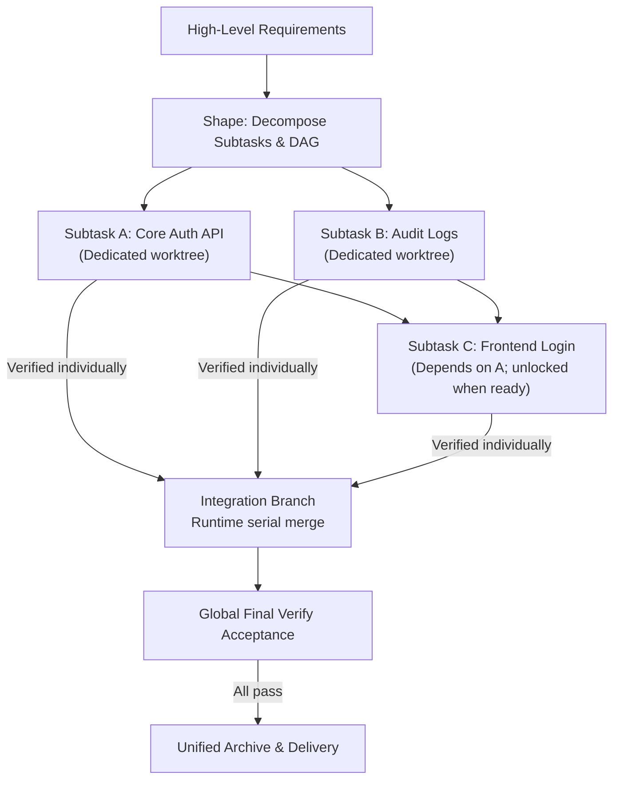

import { SupervisorVideo } from '/snippets/supervisor-video.jsx';

When tackling large, composite requirements (such as "Refactoring the authentication system: token issuance, frontend login page, and audit logs"), having a single Agent work through one long conversation often leads to context exhaustion, missed changes, or code regression.

**Supervisor Change is Native workflow's parallel delivery architecture for complex multi-module requirements**:

1. **Precision Decomposition by Acceptance Criteria**: Breaks large goals into a topologically ordered directed acyclic graph (DAG) of subtasks (child changes), where each subtask owns concrete acceptance items;
2. **Workspace Isolation**: Each subtask runs in its own dedicated Git worktree, allowing multiple agents to code in parallel without concurrent modification conflicts;
3. **Verify First, Integrate Second**: Subtask code is only merged into the integration branch by the Runtime after passing its own independent Verify stage;
4. **Unified Global Final Acceptance**: After all subtasks are integrated, the main task triggers a 100% comprehensive end-to-end regression verification against the complete system goal.



## Core Engineering Guarantees

| Core Feature | Practical Engineering Value |
| --- | --- |
| Decomposed by Acceptance Criteria | Each subtask maps to explicit test cases, eliminating ambiguous divisions of labor |
| Dependency Topology Scheduling | Runtime only activates subtasks whose prerequisites have passed, preventing downstream tasks from jumping the gun |
| Workspace Isolation | Each subtask works exclusively inside its own Git worktree, preventing conflicts between concurrent agents |
| Tamper-Proof Cryptographic Receipts | Task packages, integration baseline commits, and `runId` tokens form a strict receipt, rejecting stale or foreign callbacks |
| Global Regression Acceptance | Conducts full-system verification after all subtasks are merged, ensuring the entire product functions cohesively |

## Task Decomposition Criteria

Comet evaluates whether a task warrants decomposition before finalizing the Shape phase. Supervisor Change is only recommended when all of the following conditions are met:

- The overall goal naturally decouples into two or more independently implementable and testable subtasks;
- Every acceptance item in the original requirement can be assigned to a designated subtask without gaps;
- Input/output dependencies between subtasks can be modeled as a clear DAG;
- Parallel execution or phased delivery genuinely reduces the end-to-end delivery cycle.

If all changes modify the exact same hotspot file, or if coordination costs outweigh the benefits of concurrency, Comet keeps the change as a single sequential Native Change.

## Reviewing the Plan and Selecting a Coordination Mode

Before finalizing the Shape phase, Comet displays the subtask decomposition matrix, dependency flow, and acceptance mapping. When approving the plan, you can select the coordination mode:

| Coordination Mode | Execution Mechanism | Ideal Environment |
| --- | --- | --- |
| **A. Multi-Session Collaboration (Recommended)** | The primary session serves as coordinator, scheduling independent sessions or Agent Teams in parallel | Platforms supporting concurrent sessions (such as Codex or Claude Code Agent Teams); falls back to subagents otherwise |
| **B. Single-Session Advancement** | In the current terminal session, the agent advances through subtasks sequentially along the dependency topological order | Resource-constrained environments or when stepping through subtasks sequentially |

Once selected, the Runtime records your choice in the state file and reuses it upon resume.

## Exclusively bound workspaces

Once the Shape plan is approved, the Runtime creates a dedicated integration branch and integration worktree for the main task, and prepares isolated Git worktrees for ready subtasks.

Each dispatched task package contains:
- The subtask's assigned acceptance criteria and responsibilities;
- Its exclusive working directory path;
- The baseline commit hash of the integration branch;
- A tamper-proof `runId` credential;
- Clear exit criteria and constraints.

In multi-session mode, a maximum of 2 child tasks run concurrently by default (configurable via Dashboard or `native.max_parallel_children`). Single-session mode runs subtasks sequentially.

## Live Platform Concurrency Demos

### Multi-Session Parallel Execution in Codex

In Codex, selecting multi-session mode elevates the current session into the Supervisor. It dispatches subtasks, polls progress, orchestrates code integration, and runs final acceptance. Each subtask executes in an isolated visible session:

<SupervisorVideo
  src="/vedio/codex_compact.mp4"
  width={1230}
  height={858}
  label="Comet Supervisor Change coordinating multiple independent sessions in Codex"
  fallback="Your browser does not support HTML5 video"
/>

### Concurrency via Agent Teams in Claude Code

In Claude Code, you can leverage Agent Teams to run subtasks in parallel. Enable the experimental flag in your terminal:

```bash
export CLAUDE_CODE_EXPERIMENTAL_AGENT_TEAMS="1"
```

The primary session acts as Team Lead, assigning teammates to ready subtasks. Teammates code strictly within their assigned subtask worktrees without touching the main branch:

<SupervisorVideo
  src="/vedio/claude%20code_compact.mp4"
  width={1548}
  height={1080}
  label="Comet Supervisor Change executing subtasks via Agent Teams in Claude Code"
  fallback="Your browser does not support HTML5 video"
/>

## The Rule: "Verify First, Integrate Second"

Each subtask strictly follows a complete lifecycle:

```text
active (coding) → verified (acceptance passed) → integrated (merged into integration branch)
```

1. **Subtask Coding**: The Builder implements the feature in the subtask's dedicated worktree;
2. **Subtask Verification**: The Verifier audits code commits and verifies that subtask's specific acceptance criteria;
3. **Receipt Validation and Merge**: After verification passes, the Runtime merges the subtask's commit into the integration branch and executes integration build checks;
4. **Unlocking Downstream Tasks**: Once a subtask reaches `integrated`, dependent downstream tasks move into the `readyChildren` pool.

Subtasks never trigger final archival individually and cannot merge directly into the project main branch.

## Global Final Verify Acceptance After Full Integration

When all subtasks achieve `integrated` status, the Runtime triggers the **global final Verify phase** inside the integration worktree, running the complete test suite against 100% of the initial requirements.

- **All Tests Pass**: The change unlocks the Archive phase to merge into the main branch or generate a pull request;
- **Acceptance Fails**: The Runtime preserves the integration branch state without unrolling completed subtasks. It appends a dedicated "repair subtask" addressing the failed test cases, guides you through confirming the fix scope, and re-verifies before archival.

## Breakpoint Recovery and State Restoration

Subtask DAG topologies, ready queues, and integration progress are continuously persisted to local files. If your session disconnects or you restart your terminal, prompt your Agent:

```text
/comet continue
```

Comet restores the exact state from disk. If original external session processes or team agents are lost, Comet smoothly resumes using subagents, preserving all completed code and verification receipts.

Further reading: [Native Loop Core Cycle](/en/native/native-loop), [Multi-Change Concurrency and Conflict Control](/en/native/multi-change-and-conflicts), and [Recovery Playbook](/en/native/recovery-playbook).
