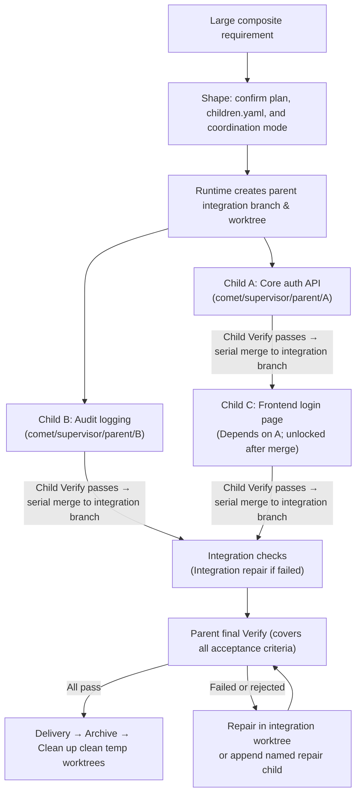

import { SupervisorVideo } from '/snippets/supervisor-video.jsx';

When a requirement spans multiple subsystems or sequential migration steps (such as refactoring an authentication token API, a frontend login page, and audit logging together), having a single Agent work end to end in one long session often fills the context window, misses edge cases, or introduces regressions.

**Supervisor Change** is Native's parallel orchestration architecture for large tasks:

1. **Split by independently verifiable outcomes**: During Shape, the parent requirement is split into subtasks with explicit dependency order (stored in `children.yaml`). Each child owns concrete acceptance criteria, while cross-module end-to-end acceptance stays with the parent.
2. **Physical isolation via dedicated branches and worktrees**: The parent owns a dedicated integration branch and integration worktree; each ready child runs on its own branch (`comet/supervisor/<parent>/<child>`) and worktree so concurrent edits never collide.
3. **Verify each child before serial integration**: After a child passes Verify in its own worktree, the Runtime merges it serially into the integration branch and runs integration checks. If integration fails, repair happens in the integration worktree without touching the project's main branch.
4. **Full final verification after complete integration**: Once every child is integrated, the parent runs final Verify in the integration worktree against all acceptance criteria from the original request, then delivers, archives, and safely cleans up temporary worktrees.



## When to split and when not to split

After confirming scope and acceptance criteria in Shape, Comet evaluates whether to recommend upgrading to a Supervisor Change:

- **Good fit for splitting**: The work splits into at least two subtasks that can be coded and verified independently (for example, distinct subsystems or phased migrations with clear handoff interfaces), dependencies are clear, and parallel execution or staged handoff provides real benefit. When these conditions hold, the Agent recommends Supervisor Change as the preferred option.
- **Keep as a single Change**: Edits are concentrated in the same core files or tightly coupled modules where splitting creates higher merge and coordination overhead, or you explicitly ask for a single Native Change. **A long PRD or a high number of acceptance items alone does not trigger splitting.**

## Confirming the split plan and choosing a coordination mode

Before final Shape confirmation, the Agent displays the subtask plan from `children.yaml`—each child's goal, dependency order (`depends_on`), assigned acceptance criteria (`covers`), and the integration criteria retained by the parent—and asks you to choose one of two coordination modes:

| Option | Coordination mode | Execution model | Concurrency limit |
| --- | --- | --- | --- |
| **A** | **Multi-session / Agent Teams (Recommended)** (`multi-session`) | The current session acts as coordinator—dispatching work, tracking progress, integrating results, and running final verification—and launches independent sessions or Agent Teams members for ready children (falling back to subagents if the platform does not support them). | Defaults to `2`; configurable via `native.max_parallel_children` in `.comet/config.yaml` (takes effect on the next dispatch). |
| **B** | **Single-session sequential** (`single-session`) | Uses the same split scope, dependency order, and verification gates, advancing children one at a time in the current session. | Fixed at `1`. |

Key notes:

- You can confirm the complete plan and pick a coordination mode in a single reply (for example, "Confirm the plan, choose A"). Replying "Confirm" without picking a mode, or picking a mode without confirming the plan, will not start Build yet.
- If your initial prompt already specified "use multi-session" or "use Agent Teams", Comet treats that as Option A without asking again.
- Once selected, the Runtime saves `coordination_mode` in `comet-state.yaml` and reuses it automatically on resume without asking again.

## Dependency-based batch scheduling and workspace isolation

After full Shape confirmation, the Runtime creates the parent integration branch and integration worktree, then schedules children in batches according to the DAG:

- **No jumping ahead of unmet dependencies**: A downstream child enters the ready queue only after **all** prerequisites in its `depends_on` list reach `integrated`.
- **Bounded concurrency**: Each round dispatches at most `max_parallel_children - active_children` new subtasks.
- **Clear task ownership**: Each ready child's pending task specifies its child name, scope, dedicated worktree path, current integration baseline commit, and assigned acceptance items.

In multi-session mode, Hook Guard prevents the parent session from editing application source code directly during Build. Child executors write only in the worktree assigned by the Runtime and hand results back to the primary session, which submits them in order while preserving the original Action, child session identity, and result structure. Children cannot directly mutate parent state or the project's target branch.

## Running concurrently across platforms

### Codex: multiple independent sessions

When you select multi-session mode in Codex, the current session acts as coordinator and opens an independent session for each ready child inside the child worktree created by the Runtime (do not let Codex create a separate set of worktrees):

<SupervisorVideo
  src="/vedio/codex_compact.mp4"
  width={1230}
  height={858}
  label="Comet Supervisor Change executing subtasks through multiple independent sessions in Codex"
  fallback="Your browser does not support HTML5 video"
/>

### Claude Code: Agent Teams

After enabling Agent Teams in an interactive Claude Code terminal, the current session acts as Team Lead and assigns a Teammate to each ready child in its designated worktree:

```bash
export CLAUDE_CODE_EXPERIMENTAL_AGENT_TEAMS="1"
```

<SupervisorVideo
  src="/vedio/claude%20code_compact.mp4"
  width={1548}
  height={1080}
  label="Comet Supervisor Change executing subtasks via Agent Teams in Claude Code"
  fallback="Your browser does not support HTML5 video"
/>

If a platform does not support independent sessions or Agent Teams—or if external sessions are lost after recovery—Comet falls back to subagents under `multi-session` instead of silently switching to `single-session`.

## Child verification, serial integration, and integration repair

Every child runs through four steps in order:

1. **Child Build**: Implements the feature in its dedicated worktree, runs checks, and submits a candidate commit.
2. **Child Verify**: Evaluates every acceptance item owned by that child with per-item verdicts of `passed`, `failed`, or `blocked` (and an overall verdict of `pass`, `fail`, or `blocked`, using either current-session or independent review). Failed children are fixed and resubmitted in the same worktree.
3. **Validation and serial merge into the integration branch**: After confirming the branch path, candidate commit hash, and bound passing Verifier record all match, the Runtime merges children one by one into the parent integration branch in Run order. Children are never archived individually and never merge directly into the target main branch.
4. **Integration checks and integration repair**: If post-merge integration or extended checks fail, the workflow does not roll back to the main branch or break apart completed children. Instead, it creates an integration repair task in the parent integration worktree. After the fix is committed, the Runtime verifies ancestry (`git merge-base --is-ancestor`) to confirm the new commit builds on the failed merge commit, checks that the worktree is clean and all checks pass, and then unlocks downstream children.

## Parent final verification, delivery, and safe cleanup

Once every child is integrated, the Runtime automatically starts **global final Verify** in the parent integration worktree against all acceptance criteria from the original request (reusing still-valid child checks and adding cross-module integration tests):

- **All criteria pass**: Enters the delivery, archive, and cleanup pipeline:
  1. **Cleanup preflight**: Before parent delivery modifies the target branch, the Runtime runs a cleanup preflight across all temporary child worktrees and the integration worktree to surface any uncommitted changes (`dirty worktree`) or unexpected state early.
  2. **Delivery and Archive**: Delivers the verified integration commit to the target branch, merges confirmed Specs, and archives the change directory.
  3. **Safe cleanup**: Deletes temporary child worktrees, the integration worktree, and temporary branches only after confirming that Archive succeeded, the target branch points to the exact verified integration commit, and every temporary worktree created for this Run is clean and unoccupied. If uncommitted files or active locks are found, the Runtime preserves the workspace and reports the blocker rather than force-deleting.
- **Parent verification fails or is rejected**: Previously integrated children are not reopened. The Runtime creates a parent repair task in the integration worktree to submit a new candidate commit and re-verify; if an isolated patch is cleaner, you can also append a uniquely named repair child covering valid acceptance IDs. If the issue requires changing overall requirements or the split plan, the Agent initiates a requirement revision in the background and returns to Shape for reconfirmation.

## Interruption recovery and cross-checkout transfer

The Supervisor's child dependency graph, coordination mode, task claims, and integration progress are persisted continuously. If your session disconnects, return to the original workspace and type `/comet continue`; the Agent reads the full state in the background and resumes scheduling:

- If external sessions or Agent Teams members disappear, the Agent first checks the original platform to verify whether subtasks are still running rather than assuming a disconnect means completion.
- If you need to move an in-progress Supervisor Child Build (including the parent checkpoint, multiple branches, worktrees, and uncommitted code) to another machine or local checkout, confirm all related Agents have stopped and run the transfer commands in your terminal:
  ```bash
  comet native transfer export <change-name> --output <new-private-directory> --confirmed-stopped
  comet native transfer import --input <export-directory>
  ```
  See [Native task recovery](/en/native/recovery-playbook#transfer-in-progress-supervisor-subtasks) for full verification checks and recovery rules.

Continue reading: [Native Loop: from implementation to trustworthy delivery](/en/native/native-loop), [Parallel changes and conflict control](/en/native/multi-change-and-conflicts), and [Native configuration](/en/native/configuration).
