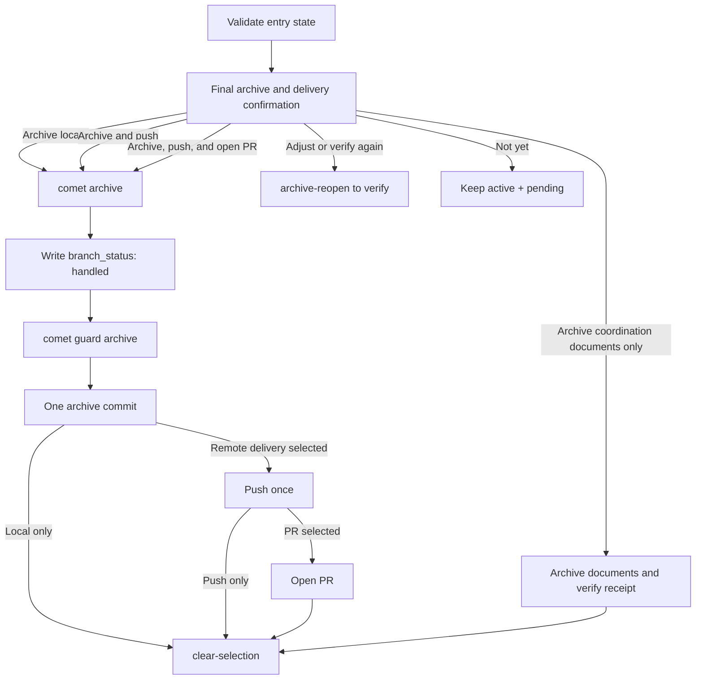

Archive merges a verified change into the main OpenSpec specs, annotates its artifacts, and moves it into the archive directory. Because this is irreversible, Comet confirms archiving and the delivery method before it starts.

<Tip>
  Normally, invoke <code>/comet</code>. When project configuration selects Classic, the internal{' '}
  <code>/comet-classic</code> router sends a verified change to <code>/comet-archive</code>. The{' '}
  <code>comet state</code>, <code>comet guard</code>, and <code>comet archive</code> commands on
  this page are run automatically by the Agent behind the scenes.
</Tip>

## Prerequisites

- `phase: archive`
- `verify_result: pass`
- `branch_status: pending`
- If the coordination root is a Git worktree, the current branch matches the change's `bound_branch`

Verify records verification evidence only. `branch_status` remains `pending` until archive delivery is handled according to the confirmed choice in this phase.

## Flow



## The invoked skill

The archive stage loads no skills. State checks, archiving, and remote delivery are all done by the `comet state`, `comet guard`, and `comet archive` commands plus git operations; `comet archive` internally invokes OpenSpec archive to merge the delta into the main spec.

## Final archive and delivery confirmation

Before confirmation, Comet shows the change, verification report, bound branch, ownership of existing uncommitted changes, and the irreversible archive operations it is about to perform.

| Choice                             | Result                                                                                                              |
| ---------------------------------- | ------------------------------------------------------------------------------------------------------------------- |
| **Archive locally only (no push)** | Archives, creates the one archive commit, and keeps it on the current bound branch, without pushing or opening a PR |
| **Confirm archive and push now**   | Archives, creates one complete commit, and pushes the current bound branch                                          |
| **Confirm archive, push, and PR**  | Archives, pushes the one complete commit, then opens a PR                                                           |
| **Adjust or verify again**         | Runs `archive-reopen`, returns to Verify, and invokes `/comet-verify`                                               |
| **Do not archive yet**             | Does not confirm or archive; keeps the change active with `phase: archive` and `branch_status: pending`             |

After you choose a delivery option in conversation, the Agent saves your delivery choice and records archive confirmation in the background (`archive_confirmation` is maintained automatically by Comet and must not be edited by hand) before executing Archive.

## Background archive execution and single commit

After confirmation, the Agent runs four protected steps behind the scenes:

1. **Archive and merge main specs**: The Agent runs `comet archive` (with a recoverable checkpoint) to invoke OpenSpec, merge the delta into the main specs, move the change directory, validate the main specs, annotate the Design Doc and Plan, and write `archived: true` in the actual archive directory.
2. **Update delivery state and run guard**: The Agent sets `branch_status: handled` and runs `comet guard <change-name> archive` before committing so `archived: true` and `branch_status: handled` enter the same archive commit. (`handled` alone does not prove that a commit, push, or PR succeeded and cannot replace the delivery choice record.)
3. **Stage only change-owned paths and commit**: The Agent explicitly stages only paths attributable to the current change — the former active change path and actual archive path, updated main specs, archive metadata in the Design Doc and Plan, and the final `.comet.yaml` in the archive directory — reviews the staged diff, and creates one archive commit. It must not use `git add -A` or include unrelated user changes.
4. **Complete remote delivery and clear selection**: After the archive commit succeeds, Comet performs only the delivery method selected during confirmation (keep locally, push the bound branch once, or push once and open a PR). Archive no longer loads Superpowers `finishing-a-development-branch` or asks about local merge, keeping the branch, or deferring push after archiving; to defer delivery, choose **Do not archive yet** before the irreversible operation. Once selected operations finish, the Agent runs `comet state delivery <change-name> --verify` and clears the current selection with `comet state clear-selection` only when verification returns `verification.status: complete`, leaving no uncommitted `.comet.yaml` behind.

<Accordion title="Background commands and terminal troubleshooting (run automatically by the Agent)">

To preview the archive without modifying files in a terminal, run:

```bash
comet archive "<change-name>" --dry-run
```

The full command sequence that `/comet-archive` executes behind the scenes is shown below for reference and troubleshooting:

```bash
# 1. Save delivery choice and confirm archive
comet state delivery <change-name> --file <delivery-choice.json>
comet state transition <change-name> archive-confirm

# 2. Merge delta specs, move the change, and annotate artifacts
comet archive "<change-name>"

# 3. Mark branch_status as handled and pass the archive guard
comet state set <change-name> branch_status handled
comet guard <change-name> archive

# 4. Stage only reviewed archive paths and create one archive commit
git add -- <reviewed archive paths...>
git diff --cached --stat
git commit -m "chore: archive <change-name>"

# 5. If remote delivery was selected, push the bound branch and open a PR as needed (skip for local-only)
git push -u origin <bound-branch>
# If "Confirm archive, push, and PR" was selected, create the PR here (for example, gh pr create)

# 6. Verify delivery result; run clear-selection only after --verify returns verification.status: complete
comet state delivery <change-name> --verify
comet state clear-selection
```

</Accordion>

## Archive documents from a non-Git coordination root

If the coordination root is outside a Git worktree and business code lives in independent child repositories, choose **Archive coordination documents only**. Comet merges the main Specs, moves the change, and saves main Spec snapshots and a file-digest receipt. This choice creates no Git commit. Commit and push code separately through each child repository's delivery workflow.

The delivery choice contains only the following value, saved outside the change directory:

```json
{ "action": "archive-only" }
```

After archiving, the Agent runs `comet guard <change-name> archive` and `comet state delivery <change-name> --verify`, and clears the current selection only when verification returns `verification.status: complete`. Preserve the archive directory, main Spec snapshots, and receipt under `.comet/classic-deliveries/`. If archived files are missing or changed, resolve the verification failure before completing the workflow.

Git projects continue to use local archive, push, or PR delivery and follow the commit steps above.

## Failure handling

- If archive, state persistence, guard, or commit fails, stop without running remote operations.
- If push fails, the complete archive commit remains local; retry only that same push in the current task.
- If PR creation fails, the branch is already pushed; retry only PR creation in the current task.
- Do not clear the current selection or declare the workflow complete after a failure.

## SDK implementation and archive commits

For a new Classic task, the delivery commit must include verified implementation and related tests that are not yet committed, together with the current archive artifacts. Omitted implementation, stale content, and unrelated files introduced after checking are rejected. Verified deletions and renames must also be committed.

The Agent explicitly stages only this change's files while preserving unrelated work. After the actual commit and approved remote delivery, the Agent follows the current next step with `comet state complete-delivery <change-name> --commit <sha> --json`. Delivery completes only after actual Git results are verified; archived documents do not replace the implementation commit.

## Next steps

- [Open phase](/en/phases/open)
- [Decision points](/en/concepts/decision-points)
- [comet archive script](/en/scripts/comet-archive)
- [State management](/en/concepts/state-management)
