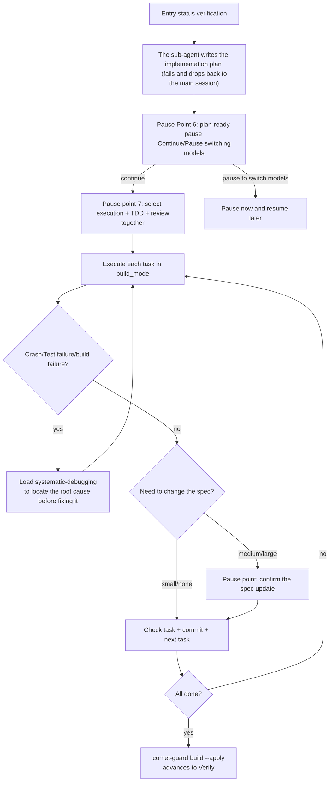
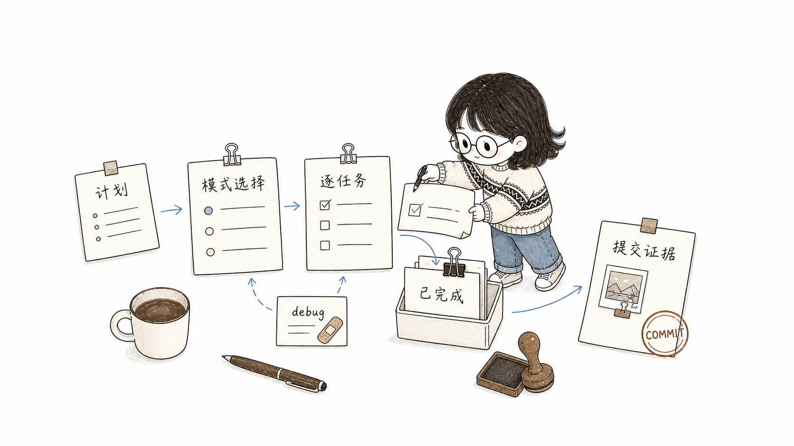

The build stage first creates an implementation plan. You then select execution, TDD, and review modes. The workflow implements and checks each task, records spec updates, and captures debugging results.

<Tip>
  In normal use you only need <code>/comet</code>. When the project uses Classic, Comet reads the
  workflow state and calls <code>/comet-build</code> automatically after design finishes. This page
  describes the internal stage Skill, which you only need to call directly when you advance the
  stage by hand. See{' '}
  <a href="#how-this-phase-is-triggered">How this phase is triggered</a>.
</Tip>

## How is this stage triggered

`/comet-build` is commonly connected automatically by `/comet-classic`.

### Default: Use /comet for automatic connection

After exiting the design phase (`phase: build`), `/comet-classic` calls `/comet-build` automatically. When you run `/comet` again, Comet routes by state: a change already in `phase: build`, or one that has a Design Doc but is not finished, goes back to the matching command — hotfix to `/comet-hotfix`, tweak to `/comet-tweak`, and full to `/comet-build`. See [automatic transition](/en/concepts/auto-transition).

### Manual: when to call /comet-build directly

- Automatic transition is off (`auto_transition: false`), so `/comet-classic` stops after design and prints a hint.
- You want to run build on its own, for example to resume an existing change in `phase: build`.
- A failed verification was rolled back with `comet-state transition verify-fail`, and the change needs another build pass.

In normal use, enter `/comet`; call the stage command directly only when you advance the stage by hand.

---

## What will you experience

The build phase has two pause points, numbered 6 and 7 across the ten pause points of the workflow. See [Five-stage pause points and decision points](/en/concepts/decision-points). They occur in this order:



<p align="center">
  
</p>

<p align="center">
  During the build phase, the plan is broken down into task cards, which are executed one by one,
  debugged, checked, and the submission evidence is left
</p>

### Step 0: Check entry state

```bash
node "$COMET_STATE" check <name> build
```

Comet reads `base-ref` and greps the plan header to find the first unfinished task. Build is idempotent: a task that is already submitted is not submitted again.

### Step 1: Draft the implementation plan

Comet dispatches a background sub-agent to load `writing-plans` and draft the plan, which keeps the main session context free. If the sub-agent cannot start, Comet falls back to drafting in the main session. The plan frontmatter must contain:

```yaml
---
change: <change-name>
design-doc: docs/superpowers/specs/...-design.md
base-ref: <git rev-parse HEAD> # The commit and verify before implementation are used to calculate the scale of the change
---
```

### Pause point 6: Build joint decision (plan-ready)

After the plan is written, Comet **pauses for your decision**:

| Option | Effect |
| -------------------------------- | ------------------------------------------------------------------------------------------------------------------------------------------------------------------------------- |
| **A: Continue now** | Stay in the current model and go to Step 3 to select execution, TDD, and review modes |
| **B: Pause to switch models** | Record `build_pause: plan-ready` and stop this `/comet-build` run. After switching models, resume with `/comet`, or call `/comet-build` directly |

<Tip>
  Option B exists to <strong>switch models</strong>: plan with one model, for example, and implement
  with a stronger coding model. On resume, Comet detects <code>build_pause: plan-ready</code> and the
  existing plan, tells you the plan is ready, and clears the flag once you confirm.{' '}
  <strong>It does not regenerate the plan</strong> and goes straight to mode selection.
</Tip>

### Pause point 7: Select the three execution modes at once

After you confirm, Comet asks for the three execution settings **in one panel**, not as three separate questions. Workspace isolation is not one of them: pause point 3 in the open stage already fixed it. That choice is stored in `isolation`, the current branch of the execution directory is stored in `bound_branch`, and the build stage only checks that the directory and branch still match. It never switches directories on its own. When `branch` was chosen, the branch name was also confirmed in the open stage (hotfix and tweak default to `hotfix/YYYYMMDD/<name>` and `tweak/YYYYMMDD/<name>`).

#### 1. Execution mode (build_mode)

| Option | Explanation | Recommended when |
| ----------------------------------- | ------------------------------------------------------------------------------------------------------------------------------------------------------------------------------ | -------------------------------------------------------------------------- |
| **A: `subagent-driven-development`** | The main session coordinates only; background sub-agents implement each task in isolation, and `review_mode` drives review | 3 or more tasks, or high complexity |
| **B: `executing-plans`** | Lightweight: implement tasks in order in the main session, with no sub-agent setup | 2 or fewer tasks, no cross-module dependencies, or the hotfix path |
| `direct` | Direct implementation | Only for hotfix and tweak by default; the full workflow requires `direct_override: true` |

<Warning>
  <code>subagent-driven-development</code> requires real background scheduling on the platform.
  Without it, Comet pauses so you can choose <code>executing-plans</code>. The full workflow cannot
  use <code>direct</code> unless you set <code>direct_override: true</code>.
</Warning>

#### 2. TDD mode (tdd_mode)

| Option | Explanation |
| --------- | --------------------------------------------------------------------------------------------------------------------------- |
| **`tdd`** | Write a failing test for each task first, then red-green-refactor (**recommended** for business logic, new features, and API work) |
| `direct`  | Direct implementation without mandatory TDD (default for hotfix and tweak) |

#### 3. Review mode (review_mode)

| Option | Explanation | Recommended when |
| -------------- | ----------------------------------------------------------------------------------------------------------------------------------------------------------------- | ------------------------------------------------------------ |
| `off`          | No automatic review                                                                                                                                               | Documents, configuration, copywriting, small low-risk changes |
| **`standard`** | No reviewer per task by default; one is dispatched only when a task hits a risk signal. The final comprehensive review runs in the verify phase | **Default recommendation**; most changes |
| `thorough`     | A reviewer (spec and quality) is dispatched for every task. The final comprehensive review runs in the verify phase                                              | High risk, multi-module, architecture, or security work |

For details, see [code review mechanism](/en/concepts/review-mode).

### Step 3: Execute task by task

Comet then executes according to `build_mode`. The two execution modes dispatch work differently:

| Dimension | `executing-plans` | `subagent-driven-development` |
| ----------------------- | -------------------------------------------------------------------------------------------------------------------------------------------------------------------------------- | --------------------------------------------------------------------------------------------------------------------------------------------------------------------- |
| Who writes the code | The main session writes code directly | The main session **coordinates only**; background sub-agents write the code, and the main session is not allowed to write code itself |
| Task advancement | Tasks run in order, one check-off at a time | Each task gets a fresh sub-agent. Once a task passes its checks, Comet starts the next task automatically |
| Review | Intensity follows `review_mode` (standard = no whole-change review inside build; thorough = a segmented review every 3 tasks). The final comprehensive review runs in verify | Task-level reviewers and repair agents are dispatched according to `review_mode` (thorough = every task; standard = risky tasks only) |
| Model selection | The main session runs everything | Every dispatch specifies a model explicitly, so implementer, fixer, and reviewer can use different tiers |
| Progress visibility | Visible directly in the conversation | Progress is tracked in `.comet/subagent-progress.md` |

<Tip>
  With <code>subagent-driven-development</code>, Comet <strong>starts the next task
  immediately</strong> after a task passes its checks, without stopping to summarize or ask you. It
  pauses only in four cases: review and repair rounds are exhausted (BLOCKED), a real ambiguity
  appears, the platform has no background scheduling, or you explicitly ask it to stop. Review
  intensity follows <code>review_mode</code> (thorough = review every task; standard = review risky
  tasks only).
</Tip>

<Note>
  The implementer sub-agent <strong>cannot choose its own task</strong>; only the main session
  selects a task, after two-stage acceptance. A reviewer receives the full task, the implementation
  commit or diff, and RED/GREEN evidence (under TDD). A reviewer cannot reach a conclusion from the
  implementer's summary alone.
</Note>

### Step 3b: Abnormal debugging protocol (mandatory)

When a crash, test failure, build failure, or unexpected behavior occurs during execution, Comet loads `systematic-debugging`:

1. **Identify the root cause first.** Read the complete error, check recent changes, and trace the data flow. Do not propose fixes before the root cause investigation is complete.
2. When the root cause is a bug in the source code, add a minimal failing test that reproduces it first, then fix the source code.
3. After the fix, run the failing test, the related tests, and the project build, and confirm that all of them pass.
4. Failed tests, source fixes, and the `tasks.md` check-off stay within the current change. Do not open a separate change to write test cases and bypass the current verification loop.

#### Parallel troubleshooting of multiple failures

Before starting the debugging protocol, assess whether the failures are independent, which decides between serial and parallel troubleshooting:

| Situation | Handling |
| ----------------------------------------------------------------- | ----------------------------------------------------------------------------------------------------------------------------------------------------------- |
| **Serial** (follow `systematic-debugging`) | 2 or fewer failures; the failures are related (fixing one may fix another), share state, or touch the same files, so independence is not established |
| **Parallel** (load Superpowers `dispatching-parallel-agents`) | **3 or more failures from unrelated problem areas** (different test files, different root causes, independent subsystems) |

When the parallel condition is met:

1. Load Superpowers `dispatching-parallel-agents` with the Skill tool.
2. For each independent failure, dispatch a background troubleshooting agent, grouped by problem area and sent in the same response so they run concurrently. Each prompt contains the full context: the specific failure, the error message, the troubleshooting scope, and a prohibition on touching code outside that problem area.
3. Agents still must not modify source code before the root cause is located. They only **locate the root cause and report it**, and do not submit fixes.
4. After the agents report back, the main session consolidates the findings and applies fixes **serially**. Repairs follow the current verification and review cycle of `review_mode`.

<Warning>
  <strong>Parallelism applies to troubleshooting only, never to code changes.</strong> Fixes always
  run serially, so several agents do not modify the same files at once. This matches the rule in{' '}
  <code>subagent-driven-development</code> against dispatching several implementation sub-agents in
  parallel. <code>review_mode: off</code> does not skip this protocol:{' '}
  <code>off</code> skips code review, not the debugging of real failures.
</Warning>

### Step 4: Incremental Spec updates

When execution reveals that the spec needs to change, handle it according to the scale:

| Scale | Trigger condition | Handling |
| -------- | --------------------------------------------------------------------------------- | ---------------------------------------------------------------------------------------------------------------------- |
| Small    | Missing acceptance scenarios or boundary conditions                              | Edit the delta spec and `design.md` directly, and append tasks |
| Medium   | Interface changes, new components, or changes in data flow                 | **Pause for your confirmation**, then load `brainstorming` to update the Design Doc and delta spec |
| Large    | A brand-new capability                                                             | **Pause and propose a split**; create a new change through `/comet-open` (`/opsx:new` cannot be used) |
| Over 50% | New tasks exceed half of the initial task list | **Pause point 7**: split into a new change, or expand the scope of the current change |

### Step 5: Verify and commit

For each task: implement according to `build_mode` → review according to `review_mode` (if enabled) → **main session verifies and checks off** `tasks.md` → commit.

```bash
node "$COMET_STATE" task-checkoff "$PLAN_FILE" "$PLAN_TASK_TEXT"
```

The task text must match exactly one unchecked item. If check-off fails, do not start the next task. `grep -c '\- \[ \]' tasks.md` shows how many tasks are still open.

### Exit

```bash
node "$COMET_GUARD" <change-name> build --apply
```

Advance to `phase: verify`, and set `verify_result: pending`.

---

## Skills used in this stage

| Skill | Purpose | When it is used |
| ----------------------------- | --------------------------------------------- | ------------------------------------------------------------------------------------------------------------------------------- |
| `writing-plans`               | Draft the implementation plan               | Step 1, run by a sub-agent first, with fallback to the main session |
| `executing-plans`             | Lightweight sequential execution                    | Step 3, when `build_mode: executing-plans` |
| `subagent-driven-development` | Sub-agent-driven execution                    | Step 3, when `build_mode: subagent-driven-development` |
| `test-driven-development`     | Enforced TDD                                    | Step 3, when `tdd_mode: tdd` |
| `requesting-code-review`      | Code review entry point                    | Step 3, when `review_mode` is `standard` or `thorough` (in executing-plans mode it follows `review_mode`; in subagent mode it follows the per-task reviewers) |
| `systematic-debugging`        | Root-cause debugging                            | Step 3b, loaded when a crash, test failure, or build failure occurs |
| `dispatching-parallel-agents` | Parallel troubleshooting | Step 3b, loaded for 3 or more independent failures (troubleshooting only; fixes stay serial) |
| `brainstorming`               | Medium-scale spec updates                      | Step 4, when interfaces, components, or data flows change |

## Artifacts

| Artifact | Location | Description |
| ---------------------- | ------------------------------------------------ | ------------------------------------------------------- |
| Implementation plan    | `docs/superpowers/plans/YYYY-MM-DD-<feature>.md` | Contains `change`/`design-doc`/`base-ref` frontmatter |
| Sub-agent progress   | `.comet/subagent-progress.md`                    | Sub-agent checkpoint (subagent mode only)    |
| Checked `tasks.md` items | `tasks.md`                                       | `- [ ]` → `- [x]`                                       |
| Code changes      | Repository code                                  | Committed to the isolated branch or worktree |

## Exit conditions (phase guard)

- Every task in `tasks.md` is checked off.
- The code is committed.
- The project build and test commands have been run explicitly and pass; do not rely on the guard's guess.
- `isolation` is `current`, `branch`, or `worktree`, and the current Git branch matches `bound_branch`.
- `build_mode` is selected (subagent mode also requires `subagent_dispatch: confirmed`).
- `tdd_mode` is selected.
- `review_mode` is selected (for `thorough`, segmented reviews have run every 3 tasks and CRITICAL/IMPORTANT findings are fixed, or acceptance reasons are recorded for anything below CRITICAL; for `standard` and `off`, the corresponding reasons are recorded).

The guard detects the project build entry automatically (`npm run build`, Maven, Cargo, and so on) and treats failed output as evidence. `.comet.yaml` and the repository root configuration no longer accept `build_command` or `verify_command`. When a team needs a fixed verification process, put it in the project's own build script.

## Resuming

Build is idempotent. On resume, `grep -n '\- \[ \]' tasks.md | head -1` finds the first unfinished task. For `build_pause: plan-ready`, see [pause point 6](#pause-point-6-build-joint-decision-plan-ready). After context compression, run `comet-state check <name> build --recover` to restore context. In subagent mode, reread `.comet/subagent-progress.md` to recover the current task and review round; **do not implement tasks directly in the main session**. If a `full` workflow stopped at plan-ready, confirm the existing workspace binding first, then complete or confirm `build_mode`, `tdd_mode`, and `review_mode`.

## Recommended path

<Tip>
  For multi-person collaboration or high-risk changes, worktree + <code>review_mode: thorough</code>{' '}
  is preferred. For small, well-scoped changes, use branch + <code>standard</code>.
</Tip>

## Change walkthrough

When build completes, Comet generates a `walkthrough.html` page by default. It explains before and after behavior, the reasons for each change, and the key code, organized by feature. Verify updates the page with real results. The page helps you read the change; it does not replace acceptance. See [walkthrough configuration](/en/native/configuration#change-walkthroughs) to turn it off.

## Next step

- [verify stage](/en/phases/verify) — Quality acceptance after build
- [Code review mechanism](/en/concepts/review-mode) — How the review modes work
- [State management](/en/concepts/state-management) — The `build_mode`, `isolation`, and `tdd_mode` fields
- [Five-stage pause points](/en/concepts/decision-points) — The decisions the build stage asks for
