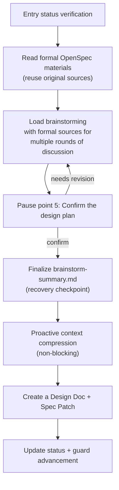

Design develops the technical approach. The Agent reads formal OpenSpec materials, uses Superpowers `brainstorming` to discuss alternatives, trade-offs, risks, and tests, and creates a Design Doc after you confirm the proposal.

<Tip>
  Normally, use <code>/comet</code>. When the project uses Classic, <code>/comet-classic</code>{' '}
  reads the state and invokes <code>/comet-design</code> after Open completes. This page describes
  the internal phase Skill. Invoke it directly only for manual control. See{' '}
  <a href="#how-this-phase-is-triggered">How this phase is triggered</a>.
</Tip>

<Note>
  `<classic-change-dir>` is the current Classic change directory. Create its `.comet/handoff/` directory before saving a discussion summary, and read the same file when resuming. Mark unapproved content as a candidate. Saving a summary does not approve the design or enter Build. Do not save it directly in the change root; follow the checkpoint path in any rejection. Source writes remain restricted by the current phase.
</Note>

## How this phase is triggered

`/comet-design` is commonly connected automatically by `/comet-classic`.

### Default: Use /comet for automatic connection

After open exits (`comet-guard <name> open --apply` advances to `phase: design`), `/comet-classic` calls `/comet-design` automatically, so you do not need to enter the next command. On a later call, if Comet detects `phase: design`, or finds a change whose Design Doc is missing, it routes to design again. See [automatic transition](/en/concepts/auto-transition).

### Manual: when to call /comet-design directly

- Automatic transition is off (`auto_transition: false`). After open finishes, `/comet-classic` stops and prints a hint, so you call `/comet-design` yourself.
- You want to run design on its own, for example to add a missing Design Doc or redo the technical design.
- A hotfix or tweak hit the upgrade signal and returns to design to complete the design.

Use `/comet` for normal operation. Invoke a phase Skill directly only when controlling that phase manually.

---

## What to expect

The core of the design stage is a brainstorming session based on real context. brainstorming reads formal materials from the open phase directly, and the design basis thus comes from real requirements and project documents.



### Step 0: Entry status verification

```bash
node "$COMET_STATE" check <name> design
```

Reuse formal-source references from the current Runtime response. Read missing context as needed without rebuilding file hashes.

### Step 1a: Read formal sources

The Agent reads the current proposal, design, tasks, and delta Specs to prepare a candidate technical proposal. Get your agreement on specific Spec patches before applying them.

Once sources are ready, follow the current Runtime instructions to submit the design proposal and wait for confirmation. Resume an unresolved proposal instead of creating it again. Routine progress does not use the old handoff packaging step or replace formal sources with a handwritten summary. See [comet handoff](/en/scripts/comet-handoff) for a reading view.

### Step 1b: Conduct brainstorming (with real context)

Load Superpowers `brainstorming` and work through the technical design, using the formal sources as context. Comet does not skip the clarification that brainstorming requires just because the context looks redundant. It will:

- Discuss the implementation path, technical risks, testing strategy, and boundary conditions.
- **Keep asking** when the objective, scope, non-goals, acceptance scenarios, or key constraints are still unclear.
- **Before writing the Design Doc**, clarify the requirement, compare two or three options, weigh the trade-offs, and confirm the direction.
- **Incrementally update** `<classic-change-dir>/.comet/handoff/brainstorm-summary.md` during the discussion. The summary records confirmed facts, constraints, candidate solutions, trade-offs, and Spec Patch candidates, and serves as the recovery checkpoint. Unconfirmed items are marked as pending or candidate.

<Warning>
  Comet <strong>does not write a second copy of the requirement spec</strong> in the Design Doc. If
  the original spec lacks boundary cases, Comet can only add them through a{' '}
  <strong>Spec Patch</strong> that is written back to the OpenSpec delta spec. A Spec Patch is limited
  to adding acceptance scenarios, correcting ambiguous wording, and adding boundary conditions. A
  substantial change to structure or scope must go back to brainstorming and be confirmed as a design
  finding.
</Warning>

<Note>
  If the <code>brainstorming</code> Skill is not available, Comet stops and asks you to install or
  enable Superpowers. It <strong>does not replace it with an ordinary conversation</strong>.
</Note>

### Pause point 5: Confirm the design plan

After brainstorming produces a proposal, Comet pauses **and waits for your explicit confirmation**. Until then it does not create the Design Doc, write `design_doc`, run the design guard, or enter `/comet-build`. The summary it presents includes:

- The agreed technical approach
- Key trade-offs and risks
- The test strategy
- If a Spec Patch is involved, the delta spec changes it will write back

If you confirm, the workflow continues. If you want changes, Comet returns to Step 1b and continues the discussion until you agree.

### Step 1d: Finalize brainstorm-summary.md

After you confirm and before the Design Doc is created, Comet writes the agreed approach to `<classic-change-dir>/.comet/handoff/brainstorm-summary.md`. The summary contains the confirmed technical approach, key trade-offs and risks, the test strategy, and the Spec Patch. It is the recovery checkpoint after context compression.

### Step 1e: Preserve resumable context

After platform context compression, read the original task, recorded design decisions, `<classic-change-dir>/.comet/handoff/brainstorm-summary.md`, and current formal sources. Do not repeat accepted decisions or rebuild an obsolete hash package.

### Step 2: Create a Design Doc

Create a Design Doc in the main session using the full brainstorming context. Add metadata when useful, for example:

```yaml
---
comet_change: <change-name>
role: technical-design
canonical_spec: openspec
---
```

Written in `docs/superpowers/specs/YYYY-MM-DD-<topic>-design.md`. If there is a Spec Patch, edit the corresponding `specs/*/spec.md`.

### Step 3: Submit the design and continue

Use the current Runtime commands to submit the confirmed design and formal-source references before entering Build. Resolve changed requirements or approval scope first, without recalculating handoff hashes or manually editing Run state.

---

## Skills used

| Skill                   | Purpose                                               | When to call                                                                         |
| ----------------------- | ----------------------------------------------------- | ------------------------------------------------------------------------------------ |
| `brainstorming`         | In-depth technical design (approach, risks, test strategy) | Step 1b, starts immediately and cannot be skipped |
| `brainstorming` (again) | Realign when a medium or large spec change appears        | When interfaces, components, or data flows change during the build phase |

The design phase does not call an OpenSpec Skill, because the OpenSpec documents were created in the open phase.

## Artifacts

| Artifact              | Location                                                    | Purpose                                     |
| --------------------- | ----------------------------------------------------------- | ------------------------------------------- |
| Design Doc            | `docs/superpowers/specs/YYYY-MM-DD-<topic>-design.md`       | Confirmed technical design                  |
| Optional reading view | `.comet/handoff/design-context.md`                          | Original OpenSpec materials in one document |
| brainstorm-summary.md | `<classic-change-dir>/.comet/handoff/brainstorm-summary.md` | Recorded discussion for context recovery    |

## Exit conditions

The proposal is confirmed, the Design Doc matches the current requirements, any necessary Spec Patch is approved, and the state records the design result and the next action. Completion is established by documents that fit the actual task; fixed headings, content hashes, or an old derived package do not count.

## When to enter

Normally, `/comet-classic` enters Design automatically after Open completes (see [How this phase is triggered](#how-this-phase-is-triggered)). Manual scenarios include a hotfix/tweak that crosses the upgrade threshold and needs full Design, or a recovered Change whose design document is missing.

<Warning>
  The full workflow does not skip design. hotfix and tweak may skip it, but once the scope grows,
  upgrade the change back to full.
</Warning>

## Recovery

Read the original task and existing decisions first. `<classic-change-dir>/.comet/handoff/brainstorm-summary.md` helps recall discussion, while current formal sources define requirements. Resume pending decisions and do not resubmit already accepted results.

## Next step

- [build stage](/en/phases/build) — Planning and execution after design
- [Context handoff and source reuse](/en/concepts/context-compression) — Formal sources, optional views, and related settings
- [Workflow intermediate artifacts](/en/concepts/intermediate-artifacts) — brainstorm-summary and other artifacts
- [Five-stage pause points](/en/concepts/decision-points) — The decisions the design stage asks for
