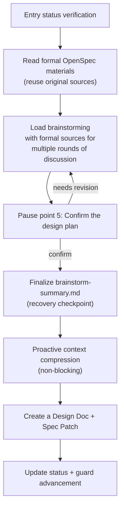

Design develops the technical approach. The Agent reads formal OpenSpec materials, uses Superpowers `brainstorming` to discuss alternatives, trade-offs, risks, and tests, and creates a Design Doc after you confirm the proposal.

<Tip>
  Normally, use <code>/comet</code>. When the project uses Classic, <code>/comet-classic</code>{' '}
  reads the state and invokes <code>/comet-design</code> after Open completes. This page describes
  the internal phase Skill. Invoke it directly only for manual control. See{' '}
  <a href="#how-this-phase-is-triggered">How this phase is triggered</a>.
</Tip>

## How this phase is triggered

`/comet-design` is commonly connected automatically by `/comet-classic`.

### Default: Use /comet for automatic connection

After the open phase exits (`comet-guard <name> open --apply` advances `phase: design`), `/comet-classic` will automatically connect and call `/comet-design` - you don't need to manually enter the next phase command after the open phase is completed. The next time `/comet-classic` is called, if `phase: design` is detected or there is a change but the Design Doc is missing, it will also be routed to design. For details, please refer to [Automatic Propulsion Mechanism ](/en/concepts/auto-transition)

### Manual: When is direct /comet-design needed

- After the automatic connection (`auto_transition: false`) -- open is completed, `/comet-classic` will stop and print hints. You need to manually call `/comet-design`.
- Just want to run the design alone (restore a change that already exists but lacks the Design Doc, or want to redo the technical design).
- If the hotfix/tweak hits the qualitative change upgrade signal, roll back to design to complete the design.

Use `/comet` for normal operation. Invoke a phase Skill directly only when controlling that phase manually.

---

## What to expect

The core of the design stage is a brainstorming session based on real context. brainstorming reads formal materials from the open phase directly, and the design basis thus comes from real requirements and project documents.



### Step 0: Entry status verification

```bash
node "$COMET_STATE" check <name> design
```

Reuse formal-source references from the current Runtime response. Read missing context as needed without rebuilding file hashes.

### Step 1a: Read formal sources

The Agent reads the current proposal, design, tasks, and delta Specs to prepare a candidate technical proposal. Get your agreement on specific Spec patches before applying them.

Once sources are ready, follow the current Runtime instructions to submit the design proposal and wait for confirmation. Resume an unresolved proposal instead of creating it again. Routine progress does not use the old handoff packaging step or replace formal sources with a handwritten summary. See [comet handoff](/en/scripts/comet-handoff) for a reading view.

### Step 1b: Conduct brainstorming (with real context)

Load Superpowers `brainstorming` and conduct in-depth technical design with the handover package as the context. Comet will not skip the clarification process of brainstorming just because of "context redundancy" - it will:

- Discuss the implementation plan, technical risks, testing strategies, and boundary conditions
- If the target/scope/non-target/acceptance scenario/key constraints are still unclear, ** continue to ask questions **
- ** Do not create a Design Doc after just one round of Q&A ** -- Go through the complete process of clarification → 2-3 candidate proposals → step-by-step confirmation
- During the Design process, ** incremental update ** `brainstorm-summary.md` (restore checkpoints, not Design Doc) will be carried out. The confirmed facts, constraints, candidate solutions, trade-offs, and Spec Patch candidates will be recorded. Unconfirmed items will be marked as "pending confirmation" or "candidate".

<Warning>
  Comet cannot write the second requirement of <strong> spec</strong> in the Design Doc. If the
  delta spec lacks acceptance scenarios, only can be written
  <strong>Spec Patch</strong> (written back to OpenSpec delta (spec) - Only for supplementary
  acceptance scenarios, correction of ambiguous wording, and addition of boundary conditions.
  Substantial changes to the structure or scope must be returned as design findings brainstorming
  confirmation.
</Warning>

<Note>
  If <code>brainstorming</code> skill is not available, the Comet will stop and prompt you to
  install/enable Superpowers,
  <strong> will not use ordinary conversations instead of </strong>.
</Note>

### Pause point 5: Confirm the design plan

After brainstorming generates a plan, Comet pauses ** to wait for your clear confirmation **. Before confirmation, one cannot create a Design Doc, write `design_doc`, run design guard, or enter `/comet-build`. The summaries it presents include:

- The adopted technical solution
- Key trade-offs and risks
- Test strategy
- If there is a Spec Patch, list the delta spec changes that will be written back

You confirm → continue; You need to adjust → Go back to 1b and continue the discussion until you confirm.

### Step 1d: Finalizing brainstorm-summary.md

After confirmation and before creating the Design Doc, Comet writes the confirmed solution into `brainstorm-summary.md`. The structure is: confirmed technical solution/Key trade-offs and risks/Test strategy/Spec Patch. This is the recovery anchor point after context compression.

### Step 1e: Preserve resumable context

After platform context compression, read the original task, recorded design decisions, `brainstorm-summary.md`, and current formal sources. Do not repeat accepted decisions or rebuild an obsolete hash package.

### Step 2: Create a Design Doc

Create a Design Doc in the main session using the full brainstorming context. Add metadata when useful, for example:

```yaml
---
comet_change: <change-name>
role: technical-design
canonical_spec: openspec
---
```

Written in `docs/superpowers/specs/YYYY-MM-DD-<topic>-design.md`. If there is a Spec Patch, edit the corresponding `specs/*/spec.md`.

### Step 3: Submit the design and continue

Use the current Runtime commands to submit the confirmed design and formal-source references before entering Build. Resolve changed requirements or approval scope first, without recalculating handoff hashes or manually editing Run state.

---

## Skills used

| Skill                   | Purpose                                               | When to call                                                                         |
| ----------------------- | ----------------------------------------------------- | ------------------------------------------------------------------------------------ |
| `brainstorming`         | In-depth technical design (plan, risk, test strategy) | Step 1b, execute immediately, do not skip                                            |
| `brainstorming` (Again) | Redesign when the medium-scale spec is updated        | When changes in interfaces/components/data flows are detected during the build phase |

The OpenSpec skill is not called in the design phase -- OpenSpec artifacts have been created in the open phase.

## Artifacts

| Artifact              | Location                                              | Purpose                                     |
| --------------------- | ----------------------------------------------------- | ------------------------------------------- |
| Design Doc            | `docs/superpowers/specs/YYYY-MM-DD-<topic>-design.md` | Confirmed technical design                  |
| Optional reading view | `.comet/handoff/design-context.md`                    | Original OpenSpec materials in one document |
| brainstorm-summary.md | `.comet/handoff/brainstorm-summary.md`                | Recorded discussion for context recovery    |

## Exit conditions

The proposal is confirmed, the Design Doc matches current requirements, necessary Spec patches are approved, and the original Runtime has recorded the design result and next action. Organize documents for the actual task; fixed headings, content hashes, and old derived packages do not establish completion.

## When to enter

Normally, `/comet-classic` enters Design automatically after Open completes (see [How this phase is triggered](#how-this-phase-is-triggered)). Manual scenarios include a hotfix/tweak that crosses the upgrade threshold and needs full Design, or a recovered Change whose design document is missing.

<Warning>
  The full workflow should not skip the design. hotfix and tweak can be skipped, but once the range
  deteriorates, it should be upgraded back to full.
</Warning>

## Recovery

Read the original task and existing decisions first. `brainstorm-summary.md` helps recall discussion, while current formal sources define requirements. Resume pending decisions and do not resubmit already accepted results.

## Next step

- [Build Phase](/en/phases/build) — Enter planning and execution after design completes
- [Context handoff and source reuse](/en/concepts/context-compression) — Formal sources, optional views, and compatible settings
- [Workflow Intermediate Artifacts](/en/concepts/intermediate-artifacts) — brainstorm-summary and other artifacts
- [Five-Phase Pause Points and Decision Points](/en/concepts/decision-points) — Detailed design pause points
