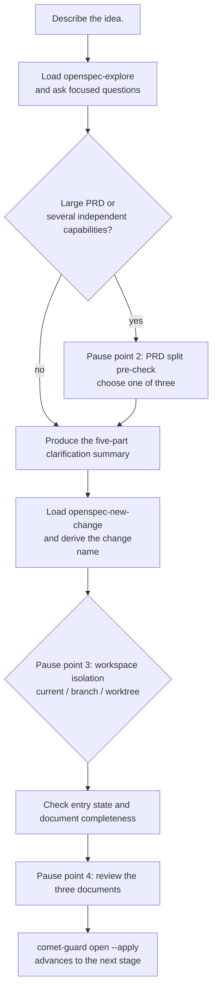

The open stage turns your idea into a change you can implement: it explores the requirement, clarifies scope, produces the proposal / design / tasks documents, and initializes the Comet state. From your side it is a guided conversation: Comet asks focused questions and starts writing documents only after both sides agree on the goal.

<Tip>
  In normal use you only need <code>/comet</code>. When the project uses Classic, <code>/comet</code>{' '}
  forwards to <code>/comet-classic</code>, which reads file state, detects the open phase, and calls{' '}
  <code>/comet-open</code>. This page describes the internal stage Skill, which you only need to call
  directly when you want to{' '}
  <strong>control the phase manually</strong>. See{' '}
  <a href="#how-this-phase-is-triggered">How this phase is triggered</a>.
</Tip>

## How this phase is triggered

`/comet-open` is normally routed automatically after `/comet` enters Classic. `/comet-classic` reads the active change list and the files on disk, builds routing context, and then decides which phase to enter.

### Default: let /comet route

Every call re-reads the files on disk instead of relying on conversation history. Comet routes to the open phase under these conditions:

| Condition | What Comet does |
| ------------------------------------------------------------ | ------------------------------------------- |
|The route is `full` and the project has no active change|Calls `/comet-open` to start a new change|
|The route is `full`, an active change exists, and your request does not name one|Pauses and asks whether to continue the existing change or create a new one|
|The active change has no `.comet.yaml`|Calls `/comet-open` to complete the state file|
|Confidence is low, several changes need recovery, or the hotfix/tweak/full signals conflict|Pauses and asks you to decide|

In daily use, enter `/comet` with a description of what you want. Once the project is configured for Classic, `/comet-classic` decides whether a new change is needed and moves to design when open finishes. See [automatic transition](/en/concepts/auto-transition).

### Manual: when to call /comet-open directly

- Automatic transition is off (`auto_transition: false`), so the workflow stops when a stage finishes and waits for you to call the next stage.
- You want to run the open phase by itself, for example for debugging or to insert a manual review between stages.

In normal use, enter `/comet`; call the stage command directly only when you advance the stage by hand.

### Workspace isolation when creating a change

Before generating the spec documents and the state file, Comet asks you to choose a workspace:

- `current`: work serially on the current branch.
- `branch`: create a dedicated branch and keep working in the current directory.
- `worktree`: create or reuse a separate worktree, which suits parallel work or a current directory that already has uncommitted changes.

If a worktree already matches the branch, Comet reuses it. If the branch exists but the worktree is missing, Comet recreates it during recovery. Follow the prompt from `/comet` and do not move the change directory by hand.

---

## What you go through

The open stage produces documents over several rounds of dialogue and several pause points. Comet asks questions and writes documents in the language you used to start the workflow.



<p align="center">
  
</p>

<p align="center">The open stage turns a vague idea into three OpenSpec documents you can execute</p>

### Step 1: Explore the requirement and clarify scope

Comet loads `openspec-explore` and asks questions about your goal until it can assemble a complete clarification summary. A single question-and-answer round is not enough; all five parts must be clear:

| Part of the clarification summary | What must be settled |
| ---------------------- | ----------------------------------- |
|**Objective**|The real problem to solve and the result you expect|
|**Non-goals**|What this change explicitly does not do|
|**Scope boundary**|The modules, user roles, platforms, and data involved or excluded|
|**Key unknowns**|Assumptions, technical risks, and external dependencies|
|**Draft acceptance scenarios**|The main success path plus the key boundary cases|

### Pause point 2: PRD split pre-check (conditional)

When your input is a **large PRD, roadmap, or complete product plan**, or the clarification summary contains **several independent capabilities**, Comet pauses and presents a **candidate split list**. Each item includes a suggested name, target scope, non-goals, dependency order, and core acceptance scenario. You then choose one of three options:

| Option | Effect |
| ----------------------------- | --------------------------------------------------------------- |
|Create multiple OpenSpec changes|Create independent changes from the split list, each through `/comet-open`|
|Keep it as one change|Do not split; continue with a single change and record in the document why you kept it together|
|Adjust the split plan, then confirm|Comet revises the split from your feedback and presents the updated list|

<Tip>
  After you confirm a split, Comet <strong>does not start all sub-changes at once</strong>. It pauses
  to ask which one to start, advances only that one, and leaves the rest ready to resume later.
</Tip>

### Pause point 3: Workspace isolation

Before generating the spec documents and `.comet.yaml`, Comet asks you to settle the isolation mode. This decision cannot be postponed to build:

| Option | Mechanism |
| ---------- | -------------------------------------------------------------------------------- |
| `current`  | Work on the current branch and bind the current Git branch as it is |
| `branch`   | Create a new branch in the current repository and confirm the branch name |
| `worktree` | Create a separate worktree for parallel work (use it directly when you explicitly want to work in parallel) |

The choice is stored in `isolation`, and the current branch of the working directory is stored in `bound_branch`. Later phase guards block an unexpected branch switch. The hotfix and tweak presets default to `current`.

Requirement clarification and naming are **non-blocking**: when scope and name are clear, Comet derives the **single kebab-case English name** from the requirement (for example `refine-requirements-doc`) and shows it directly. It asks separately only when a mutually exclusive choice would change the scope or the identity of the change, or when the name conflicts with an existing change. Comet does not create proposal / design / tasks before you confirm, and it does not generate all of them at once with `openspec-propose`.

### Step 2: Create the change structure

Comet loads `openspec-new-change`. The full workflow **does not load `openspec-propose`** (one-shot generation) by default, and allows it only when you explicitly ask. Comet uses the standard loop to generate proposal → design → tasks in order:

1. Refresh state: `openspec status --change "<name>" --json`
2. Fetch the instruction: `openspec instructions proposal|design|tasks --change "<name>" --json`
3. Read `dependencies`, follow the `template` and `instruction`, apply the `context` and `rules` constraints (do not copy them into the document), and write to `resolvedOutputPath`
4. Verify the status after each document

<Warning>
  If <code>openspec instructions</code> fails, returns invalid JSON, or does not provide a usable{' '}
  <code>resolvedOutputPath</code>, Comet <strong>stops immediately</strong> and reports the OpenSpec
  error. It <strong>does not</strong> fall back to a hard-coded document structure, because that would
  bypass project rules. The change name must be the kebab-case name you confirmed, and Comet does not
  widen or narrow the scope on its own.
</Warning>

### Step 3: Check entry state and document completeness

```bash
node "$COMET_STATE" check <name> open
```

Comet then confirms that the three files exist and are not empty: proposal (background and scope), design (architecture decisions and choices), and tasks (the task list). If any of them is missing or empty, Comet does not continue and returns to the creation step.

### Pause point 4: Review the three documents

Comet summarizes the three documents — the background and target scope from proposal, the architecture decisions from design, and the number and key items from tasks — and asks you to **choose one option**:

| Option | Effect |
| ---------------------- | ------------------------------------------ |
|Confirm and continue|The documents meet expectations, and the phase guard lets the workflow proceed|
|Needs adjustment|Tell Comet what to change; it revises the files and presents them again|

### Exit: advance to the next stage

```bash
node "$COMET_GUARD" <change-name> open --apply
```

`--apply` is required. Without it, `.comet.yaml` stays at `phase: open` and the next stage's entry check fails. The full workflow advances to `phase: design`; hotfix and tweak go directly to `phase: build` and skip design.

---

## Skills used in this stage

| Skill | Purpose | When it is used |
| --------------------- | ---------------------- | -------------------------- |
| `openspec-explore`    |Explore the problem and clarify the requirement|Step 1, starts immediately and cannot be skipped|
| `openspec-new-change` |Create the change skeleton|Step 2, runs immediately and cannot be skipped|

<Warning>
The full workflow <strong>does not load</strong> <code>openspec-propose</code> by default, because it
generates every document at once. It is allowed only when you explicitly ask for it.
</Warning>

## Artifacts

The tree below uses `<classic-root>` for the Classic OpenSpec root. New projects default to `docs/openspec/`; projects that keep the old layout use `openspec/`. The actual location is set by `classic.artifact_layout` in `.comet/config.yaml`.

<Tree>
  <Tree.Folder name="<classic-root>/changes/<name>/" defaultOpen>
    <Tree.File name=".openspec.yaml" />
    <Tree.File name=".comet.yaml" />
    <Tree.File name="proposal.md" />
    <Tree.File name="design.md" />
    <Tree.File name="tasks.md" />
    <Tree.Folder name="specs/<capability>/">
      <Tree.File name="spec.md" />
    </Tree.Folder>
  </Tree.Folder>
</Tree>

Comet initializes the state with:

```bash
node "$COMET_STATE" init <name> full
```

## Idempotence

The open stage is safe to repeat. After an interruption, enter `/comet` again; Comet skips completed steps and continues from the first incomplete one.

## Pause points at a glance

The open stage has three pause points, numbered 2 to 4 across the ten pause points of the workflow. See [five-stage pause points and decision points](/en/concepts/decision-points).

| Pause point | When it appears | What you decide |
| -------------- | --------------------------- | ---------------------- |
|2 PRD split|The input is a large PRD or contains several independent capabilities|Split, keep as one change, or adjust the plan|
|3 Workspace isolation|Before the documents and `.comet.yaml` are created|`current`, `branch`, or `worktree`|
|4 Document review|After proposal / design / tasks are generated|Confirm the name, scope, and three documents, or ask for changes|

Requirement clarification and naming are **non-blocking** by default. When scope and name are clear, Comet derives a single kebab-case English name and shows it; it asks separately only when a mutually exclusive choice would change the scope or the identity of the change.

All pause points follow the [decision point protocol](/en/concepts/decision-points): a recommendation, a default value, or an assumed agreement never replaces your explicit choice.

## FAQ

<AccordionGroup>
  <Accordion title="What if .comet.yaml is missing">
Do not work around it with `/opsx:new`, which creates only the OpenSpec documents and no `.comet.yaml`, leaving the change outside the Comet state machine. Run `/comet` again; once Classic is configured, Comet completes the state through `/comet-open`.
  </Accordion>

<Accordion title="What are the rules for a change name?">
It must be kebab-case English: lowercase letters, digits, and hyphens. Chinese or otherwise non-compliant names are converted to kebab-case. When only one name fits, Comet uses and shows it directly; it asks you to choose only when several candidates exist or the name conflicts with an existing change.
</Accordion>

<Accordion title="What should I do if openspec instructions fails">
Comet stops creating documents and reports the OpenSpec error instead of falling back to a hard-coded structure. Check that the OpenSpec CLI works and that `template`, `instruction`, and `dependencies` meet the requirements.
</Accordion>

  <Accordion title="Must a large PRD be split">
No. The split pre-check offers three options: split, keep as one change, or adjust the plan. You can keep it as one change; record in the document why you did not split it.
  </Accordion>
</AccordionGroup>

## Next step

- [design stage](/en/phases/design) — Technical design after open completes
- [Five-stage pause points](/en/concepts/decision-points) — The decisions the open stage asks for
- [PRD splitting](/en/guides/prd-splitting) — How the split pre-check works
- [Automatic transition](/en/concepts/auto-transition) — How open hands off to design
