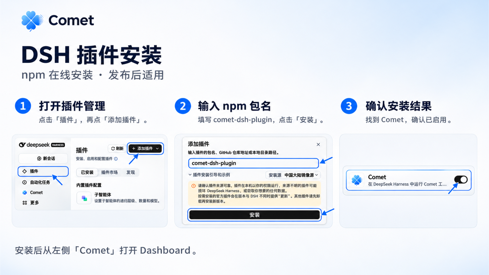
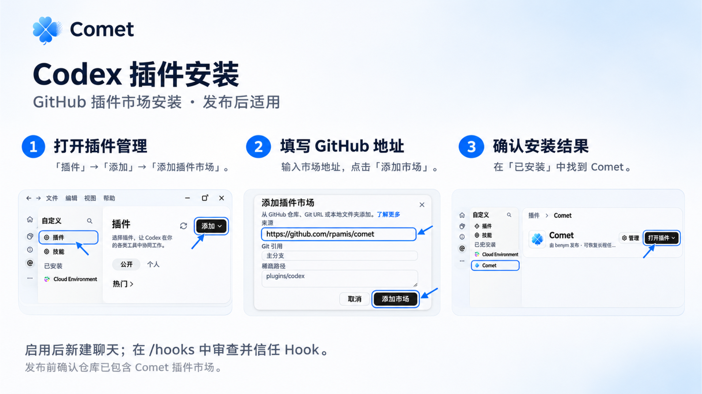

In DeepSeek Harness (DSH) and Codex desktop clients, you can connect Comet directly using dedicated plugins. Once installed, the client automatically sets up a compatible version of the CLI, provides a dedicated Dashboard entry in the sidebar, and delivers workflow rules and constraints to new sessions.

For environments without a desktop plugin system (such as Cursor, Claude Code, or headless servers), use standard [CLI installation and updates](/en/guides/install-and-update).

## Prerequisites

- Node.js 22.16 or later within the 22.x line, or Node.js 24 or later
- npm or npx
- Git
- An installed and running DSH or Codex desktop client

<Note>
  Online installation relies on npm plugin packages or the GitHub plugin marketplace. If your network environment cannot access external registries directly, you can install the CLI globally via `npm install -g @rpamis/comet` and initialize your project with `comet init`.
</Note>

## DSH plugin installation

DSH distributes the Comet plugin through an officially supported npm plugin package.

### Installation steps

1. Open the DSH desktop client and select **Plugins** at the bottom of the left navigation bar.
2. Select **Add plugin** in the upper-right corner of the plugins page.
3. Enter `comet-dsh-plugin` in the package name field, verify the plugin source, and select **Install**.
4. Once installation finishes, switch to the **Installed** tab and confirm the Comet plugin is enabled.
5. Open any project session. A **Comet** entry appears in the left navigation bar; select it to open the Dashboard. If the entry does not appear immediately, exit and restart DSH.

<Frame caption="DSH plugin installation: add the package and confirm that Comet is enabled. Screenshots use the Chinese interface.">
  
</Frame>

### Runtime mechanics

- The plugin automatically installs a matching version of the Comet CLI along with its dependencies.
- After opening a new session or restarting DSH, both the integrated terminal and system terminals can run `comet` commands directly.
- Disabling the plugin only removes desktop integration entries; it never deletes existing project rules, Spec documents, or persisted memory.

## Codex plugin installation

Codex manages third-party extensions through GitHub plugin marketplaces.

### Installation steps

1. Open the Codex desktop client and select **Plugins** in the sidebar.
2. Select the **Add** menu and choose **Add plugin marketplace**.
3. In the **Source** field, enter the Comet repository URL: `https://github.com/rpamis/comet`, then select **Add marketplace**.
4. Locate the Comet plugin within the newly loaded marketplace, select **Install**, and ensure the plugin is enabled.
5. In the **Installed** list, verify that Comet is enabled.
6. Start a new chat session, enter `/hooks` in the chat input to open the Hook manager, and review and trust the Comet Hook.

<Frame caption="Codex plugin installation: add the GitHub marketplace and check the installed plugin. Screenshots use the Chinese interface.">
  
</Frame>

### Runtime mechanics and Hook trust

- When enabled, the plugin checks the local Node.js and npm environment and provisions the matching CLI tools.
- A **Comet Dashboard** entry appears on the left side of sessions, giving quick access to progress and intermediate artifacts.
- **Hook trust**: Codex strictly isolates third-party extension interception capabilities. After installing the plugin, you must manually confirm trust in `/hooks`. Without trusted status, sessions will not automatically receive workflow rules and constraints.

## Post-installation verification

After finishing plugin installation, verify your environment with three quick checks:

1. **Workflow invocation**: Enter `/comet` in a chat session. The agent should recognize the workflow command and report the active change status.
2. **Dashboard panel**: Select the Comet icon in the sidebar to ensure the project status, task list, Personal Memory, and Project Knowledge display properly.
3. **Environment diagnosis**: Run the health check command in your terminal:

```bash
comet doctor
```

`doctor` inspects Skill status, Hook configuration, working directories, and local data structures. All green indicators confirm the installation is ready.

## Comparison: Plugin installation vs. global CLI

Choose the installation method suited to your development environment and workflow:

| Feature | Desktop plugin installation | Global CLI (`npm i -g @rpamis/comet`) |
| --- | --- | --- |
| Best for | Daily development in DSH and Codex desktop clients | Any terminal, CI/CD pipelines, headless servers, other editors |
| Dashboard entry | Integrated directly into the desktop sidebar | Run `comet dashboard` to open in your browser |
| CLI management | The plugin automatically provisions a matching CLI | Installed and updated manually using npm or pnpm |
| Hook setup | Graphical review and trust directly in the client | Managed through project initialization or global configurations |
| Core rules and data | Identical: reads and writes the local `.comet/` folder and user home directory | Identical: reads and writes the local `.comet/` folder and user home directory |

## Frequently asked questions

<AccordionGroup>
  <Accordion title="Why is the Comet Dashboard icon missing from the sidebar after installation?">
    First confirm that Comet is enabled under **Installed** in your client. Some clients require a full restart to register new sidebar extension views. Close the application completely and reopen it to display the icon.
  </Accordion>

  <Accordion title="What should I do if Codex reports workflow rules are not active?">
    Enter `/hooks` in the Codex chat window to verify that the Comet Hook is enabled and trusted. Due to sandbox security boundaries, Codex requires explicit user trust before allowing extensions to inject workflow rules.
  </Accordion>

  <Accordion title="How do I install if npm or GitHub access is blocked by network restrictions?">
    You can configure an npm mirror in your terminal (such as `npm config set registry https://registry.npmmirror.com`) or install the CLI globally:

```bash
npm install -g @rpamis/comet
```

    After installation, run `comet init` in your project root to initialize the workflow.
  </Accordion>

  <Accordion title="Will disabling or updating the plugin affect existing task progress and memory?">
    No. All Comet data (Spec files, change state, Personal Memory, and Project Knowledge) is persisted locally in the project's `.comet/` folder and your user directory. Disabling or updating the plugin only modifies client UI integration and never removes persisted data.
  </Accordion>
</AccordionGroup>

## Next steps

- [Dashboard overview](/en/dashboard/overview): Explore visual tracking and operations.
- [Native quickstart](/en/native/quickstart): Start a task-and-verification-driven workflow.
- [Install and update](/en/guides/install-and-update): Review command-line installation, updates, and uninstallation.
- [Personal Memory](/en/plugins/personal-memory): Manage cross-session personal collaboration preferences.
- [Project Knowledge](/en/plugins/project-rules): Maintain repository-level engineering practices and architecture conventions.
