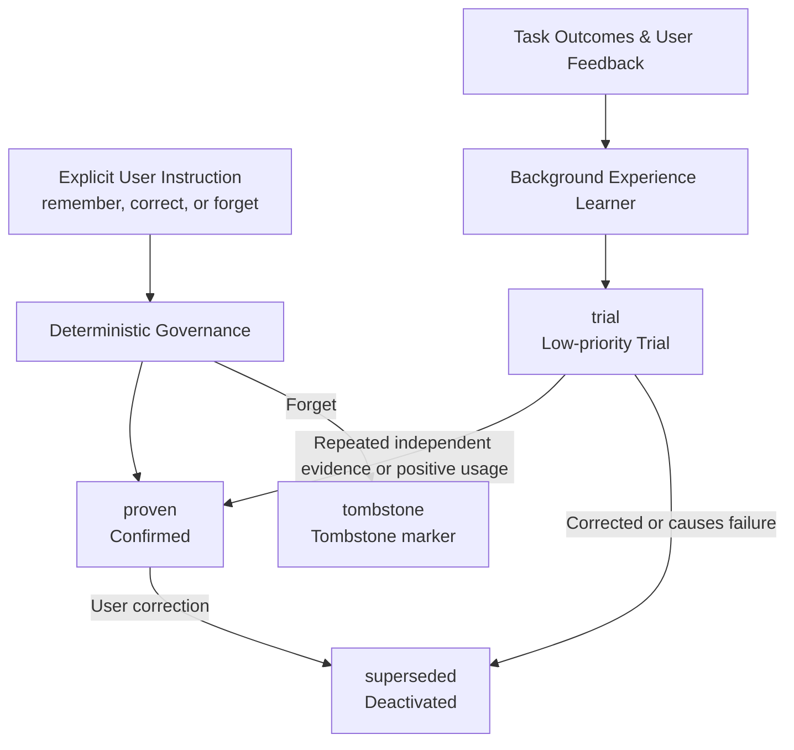

In traditional Agent coding conversations, after each new session or long-session context compression, the agent does not retain your earlier preferences: you have to repeat requests like "answer in concise language", "run unit tests before finishing", or "never modify mock files".

**Personal Memory enables Comet to save your preferences across sessions and tasks**. Your explicit communication habits, testing practices, and delivery standards are captured as traceable long-term context, automatically taking effect in future related tasks without you having to re-explain them.

<Tip>
  **Native and Out of the Box: No Setup Required**
  Personal Memory is **enabled natively by default** upon `comet init`. It requires no third-party plugin installations or external vector databases. All memories are stored locally on your machine and belong entirely to you.
</Tip>

## What to Save Here

Not every conversational comment belongs in long-term memory. Comet separates one-off instructions from durable preferences using clear criteria:

| What you say | What Comet does | Why |
| --- | --- | --- |
| "Answer in English by default from now on" | Saves as global Personal Memory | A durable communication preference across tasks and projects |
| "Run minimal relevant tests first in this repository" | Saves as a project-scoped Collaboration Policy | Your specific working habit in this codebase |
| "Don't commit code this time" | Applies to current request only | A one-off instruction that must not become a permanent default |
| "`domains` must not access the filesystem directly" | Delegated to Project Knowledge or repository Rules | An architectural constraint shared by the team, not a personal preference |

This classification is used to protect data ownership and privacy: your personal habits are never leaked to teammates, while team-wide technical conventions require verified code evidence or explicit sharing actions.

## Product Positioning and Traceable Governance

[Claude Code Auto Memory](https://code.claude.com/docs/en/memory) records build commands and debugging tips; Cursor's [Memories](https://docs.cursor.com/en/context/memories) extracts project-scoped notes from chat; [GitHub Copilot Memory](https://docs.github.com/en/copilot/concepts/agents/copilot-memory) separates repository-level facts from user-level preferences.

In addition to selecting relevant context for a prompt, Comet provides **traceable controls for personal memory**:

- **Explicit Ownership**: Every memory record belongs to the current user;
- **Flexible Scope**: Applies globally across all projects, or limits scope to a specific project;
- **Clear Authority Levels**: Strictly distinguishes explicit user instructions from background system inferences;
- **Full Lifecycle Control**: Supports trial (`trial`), confirmation (`proven`), correction (`correct`), forgetting (`forget`), and rollback (`rollback`). You can inspect the origin, trigger reasons (`whyApplied`), and effectiveness of every memory.

## Three Kinds of Personal Memory

<p align="center">
  
</p>

### 1. Core Profile: Stable User Profile

Core Profile stores long-term universal background and habits:

- Language and communication style (e.g. "Use natural phrasing without robotic cliches");
- Developer role and technical background (e.g. "Experienced with TypeScript and Rust");
- Output formatting and evidence preferences (e.g. "Include execution summaries after code edits");
- Communication boundaries.

Core Profiles do not depend on specific files or workflow phases. When a task starts, key profile entries inject into the baseline context, using a small number of tokens.

### 2. Collaboration Policy: Conditional Working Habits

Collaboration Policy describes how you want the Agent to work under specific conditions:

- In a certain project, run unit tests immediately after modifying code;
- Check artifact synchronization scopes before changing specific directories;
- List code defects by severity during code review;
- Verify clean workspaces and remote git states before archiving.

Policies support scoping by project, file path, operation type, or workflow phase, preventing irrelevant prompts from polluting other tasks.

### 3. Personal Episode: Reviewable Past Experiences

Personal Episode compactly records concrete lessons learned from debugging or verification:

- Context and specific goals of the task;
- Key actions and crucial fixes applied;
- Actual execution outputs and verification evidence;
- Actionable takeaways that can inform future policies.

Episodes are primarily used for background learning and pattern extraction. They store only essential evidence references, never raw conversational noise, full tool logs, or model thinking traces.

## How Memories Form



### Method 1: Explicit User Instructions

When you prompt "Remember that...", "Always do X from now on", or directly correct or forget a memory, Comet records it deterministically. Explicit instructions immediately enter the `proven` state and apply to subsequent tasks.

Temporary phrasing like "Just this once" or "Temporarily for this task" applies only to the current prompt and does not enter long-term storage.

### Method 2: Autonomous Extraction from Task Outcomes

Comet's background learning extracts stable patterns from development cycles. Inferred memories first enter the `trial` state:

- Project-level inferences must recur across multiple distinct changes within the same repository; global inferences require evidence from multiple projects;
- Trial memories graduate to `proven` only after proving beneficial across repeated tasks;
- If rejected, corrected, or linked to test failures, the memory is superseded (`superseded`) or discarded immediately.

## Task Matching and Context Injection

When a task begins, the **Context Director** dynamically filters candidate memories based on the project, file paths, and current phase (e.g. Shape, Build, or Verify):

- Crucial core profiles and directly matched high-confidence policies inject into active context;
- Other relevant items enter a lightweight Context Manifest containing summaries, trigger rationales, and stable IDs;
- If the Agent needs deeper context, it expands records by ID on demand, avoiding token bloat;
- When advancing between phases (e.g. from Build to Verify), the system refreshes matched policies automatically.

Every selected memory is tagged with **`whyApplied`**, allowing you to audit why an entry was selected for that task.

## Separation of Concerns: Personal Memory vs. Project Knowledge

Personal Memory and Project Knowledge maintain distinct boundaries:

| Content | Personal Memory | Project Knowledge |
| --- | --- | --- |
| "I prefer answers in English" | Global Personal Preference | Not applicable |
| "In this repository, I always run minimal unit tests first" | Project-Scoped Personal Preference | Not applicable |
| "The auth module is composed of three internal packages" | Not applicable | Project Model |
| "Modifying Provider interfaces requires contract tests" | Not applicable | Project Policy |
| A successful debugging experience | Personal Episode | Upgraded to team troubleshooting knowledge if verified with repo evidence |

Personal habits are never automatically promoted into team-shared knowledge without explicit user confirmation.

## Managing Memory: Dashboard and CLI

### Recommended: Visual Management in Dashboard

Launch the local Web console to manage your personal memories interactively:

```bash
comet dashboard
```

Navigate to **Personal Memory**:

- **Card-Based Categorization**: Browse Core Profiles, Collaboration Policies, and Personal Episodes, filtered by global or project scopes;
- **Edit and Correct Online**: Click any card to edit its content, adjust its scope, correct inaccuracies, or click "Forget";
- **Inspect Call Rates and Rationale**: Check 7-day injection frequencies, latency, and `whyApplied` trigger explanations.

<Accordion title="Command-Line Management (Advanced & CI/CD)">
Use `comet memory` subcommands in terminal or script workflows:

```bash
# Check memory status and list records
comet memory status .
comet memory list .

# Simulate memory retrieval for a specific task
comet memory retrieve . --task "Implement new CLI command"

# Explicitly add a global memory
comet memory remember . --text "Answer in English by default" --scope global

# Correct or forget specific memories
comet memory correct . --id <memory-id> --text "Updated concise answer preference"
comet memory forget . --id <memory-id>
comet memory rollback . --id <memory-id>

# Git sync across machines
comet memory remote . --set <git-repo-url>
comet memory sync .

# Pause and resume learning
comet memory pause . --project <project-key> --learning   # Pause automatic learning
comet memory pause . --resume                            # Resume
```

- `forget` retains rollback capabilities by default; add `--permanent` to purge records and leave anti-relearning tombstones;
- **Cross-Device Sync**: Synchronize personal memories across multiple machines via a private Git repository.
</Accordion>

## Privacy and Security Boundaries

- **User Directives Take Precedence**: Your immediate conversational instructions always override existing memories;
- **Minimal Storage**: Never captures raw chat histories, full code diffs, or model hidden reasoning tokens;
- **No Autonomous Side Effects**: Personal Memory never autonomously triggers git commits, pushes, deletions, or releases;
- **Graceful Failure Isolation**: If memory reading fails or is paused, Native and Classic workflows execute normally without disruption.

Further reading: [Personal Memory Principles](/en/plugins/personal-memory-principles), [Project Knowledge](/en/plugins/project-rules), and [Comet Dashboard](/en/dashboard/overview).
