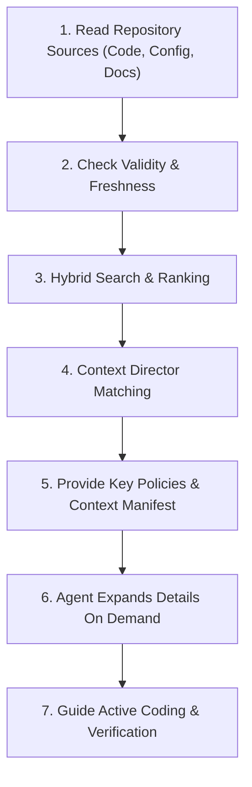

In a large repository, Agents spend tokens finding the directory structure, module dependencies, and coding conventions. Without that context, an Agent can miss related changes or encounter a problem the team has already resolved.

**Project Knowledge enables Comet to capture verifiable architectural facts and engineering conventions**. As you execute requirements, complete reviews, and archive changes, Comet automatically extracts reusable patterns and recalls relevant content in future tasks, helping agents locate relevant entry points, complete affected scopes, and follow existing verification approaches.

<Tip>
  **Enabled by Default: Coexists with Repository Rules**
  Project Knowledge is **enabled natively by default** upon `comet init`. Repository rules like `AGENTS.md` and `CLAUDE.md` remain your top-level explicit directives, while Project Knowledge equips the agent with evidence-backed architectural understanding and historical debugging lessons.
</Tip>

## Boundaries with Rules and Project Wikis

### 1. Repository Rules Remain Explicit Top-Level Directives

Project Knowledge does not replace existing Rule files. You continue using platform-native rule mechanisms to declare hard team boundaries, such as `AGENTS.md` for Codex, `CLAUDE.md` for Claude Code, or `.cursor/rules` for Cursor.

Comet never silently modifies your Rule files. When a Rule is cited as a knowledge source, the original Rule file always maintains supreme arbitration authority.

### 2. Incremental Accumulation Without Bloated Wiki Generation

Project Knowledge does not scan the entire repository to generate a full wiki. Generic implementation details that can be read directly from source code are not stored in knowledge bases to avoid retrieval noise.

Project Knowledge preserves only **high-value information with real decision impact on future tasks**: module boundaries, cross-package dependencies, approved architectural decisions, and regression-tested troubleshooting recipes.

## Core Capabilities at a Glance

| Core Capability | Context Provided | Real-World Value |
| --- | --- | --- |
| Project Orientation | Directory responsibilities, module boundaries, and workspace layout | Narrows code search radius and locates entry points faster |
| Impact Scope Analysis | Module dependencies, registry points, and build artifact relations | Preemptively identifies required test updates, configurations, and docs |
| Architectural Decision Understanding | Accepted technical choices and design patterns | Prevents agents from proposing solutions that contradict existing architecture |
| Workflow Reuse | Verified build, test, and deployment commands | Reuses established team procedures without trial-and-error |
| Troubleshooting Lessons | Root causes, fixes, and re-verification commands from past defects | Reduces recurring bugs and repeated debugging effort |

## Two Categories of Project Knowledge

<p align="center">
  
</p>

### 1. Project Model: Static Architectural Facts

Project Models describe structural facts verifiable against current codebase evidence:

| Type | Meaning | Real-World Example |
| --- | --- | --- |
| `topology` | Directory structure, workspace partitioning, and module responsibilities | CLI entry points reside in `app/`, core domain logic in `domains/` |
| `fact` | Objective technical facts about the repository | Runtime artifacts must be synchronized via `npm run build:assets` |
| `dependency` | Call relationships between modules, packages, and components | Dashboard reads plugin states through the Plugin Host |

### 2. Project Policy: Engineering Practices and Decisions

Project Policies capture conventions, constraints, and lessons learned from everyday development and task acceptance:

| Type | Meaning | Real-World Example |
| --- | --- | --- |
| `decision` | Confirmed technical or product decisions | Native and Classic maintain independent state machines |
| `pattern` | Preferred design patterns advocated by the team | New platform integrations must derive from a unified registry |
| `procedure` | Repeatable operational procedures | When altering core runtime protocols, test assets must be rebuilt and checked |
| `constraint` | Hard engineering boundaries | Domain layers must never directly hardcode platform-specific paths |
| `failure-resolution` | Defect resolutions verified with passing tests | If frontend assets expire, rebuild assets before running browser tests |

<Info>
  **Automated Policy Enforcement (`enforced`)**: When a policy is linked to concrete test or validation commands and executes successfully, it upgrades to the `enforced` state. In Native workflows, these commands automatically incorporate into the Verify phase, where automated checks enforce the policy.
</Info>

## Project Memory: Verified Lessons Recorded Directly by Agents

Project Memory provides lightweight, file-based experience storage within the Project Knowledge system. When a task completes and passes verification, the Agent can directly record verified lessons into local cache:

```bash
comet knowledge remember . --title "Clean build cache before compiling" --text "After changing protocol fields, run pnpm clean before building to prevent artifact hash mismatch" --type procedure --paths "packages/core"
```

- `--type` supports `fact`, `decision`, `pattern`, `procedure`, `constraint`, and `failure-resolution` (defaults to `pattern`);
- Reusing an existing title updates the original record without creating a duplicate.
- Lessons persist in a local cached `MEMORY.md` index and standalone Markdown files without dirtying your Git working tree;
- Context manifests prioritize relevant memory summaries, allowing the Agent to expand full texts on demand.

## Context Matching and Delivery Flow



1. **Candidate Filtering**: Filters memories by project, active file paths, workflow phases (e.g. Build or Verify), and operations;
2. **Lightweight Manifest Injection**: Injects Context Manifest summaries by default to avoid large amounts of text occupying the context;
3. **Source Freshness Checking**: When underlying code or configs change or are deleted, obsolete knowledge is immediately invalidated or marked `superseded`, so the Agent is not given conclusions that are no longer valid.

## Management and Inspection

### Recommended: Visual Management in Dashboard

Launch the local Web console:

```bash
comet dashboard
```

Open **Project Knowledge**:

- **Categorized Browsing**: Inspect Project Models (topologies) and Project Policies (rules), verifying applicable paths and evidence sources;
- **Interactive Retrieval Simulation**: Enter a task description (e.g. "Refactor user authentication") to preview matched knowledge cards, ranking scores, and specific `whyApplied` rationales;
- **Edit and Rebuild Online**: Edit records directly, deprecate outdated entries, or rebuild the local full-text search index with one click.

<Accordion title="Command-Line Management (Advanced & CI/CD)">
Query and maintain project knowledge from scripts or terminal sessions:

```bash
# Check project knowledge status
comet knowledge status .

# Simulate retrieval: inspect what knowledge triggers when editing a path
comet knowledge query . --task "Modify auth module" --path src/auth --phase build --operation edit

# List all confirmed policies
comet knowledge list . --state proven

# Manually add a verified lesson
comet knowledge remember . --title "Always run unit tests via pnpm" --text "Due to monorepo symlinks, tests must be run via pnpm test" --type constraint

# Correct, forget, or rebuild index
comet knowledge correct . --id <record-id> --text "Updated explanation"
comet knowledge forget . --id <record-id>
comet knowledge rebuild .
```
</Accordion>

## Product and Security Boundaries

- **Source Code and Tests Take Precedence**: Live codebase implementations, configurations, and automated test outcomes maintain supreme authority;
- **Platform Rule Compatibility**: Continues supporting platform-native Rule files and discovery behaviors;
- **Zero Autonomous Side Effects**: Project Knowledge provides understanding only, never committing, pushing, or releasing code autonomously;
- **Isolation and Deactivation**: Can be deactivated from the Dashboard plugin center; deactivation halts retrieval injection without impacting Native or Classic core workflows.

Further reading: [Project Knowledge Principles](/en/plugins/project-knowledge-principles), [Personal Memory](/en/plugins/personal-memory), and [Dashboard Overview](/en/dashboard/overview).
