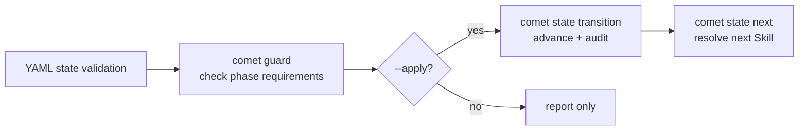

This page lists the commands used in the Classic five-stage workflow to select changes, check phase conditions, hand off context, and archive. When you enter `/comet` in conversation, the Agent invokes these commands behind the scenes. The same commands work identically on Windows, macOS, and Linux without Bash, Git Bash, or WSL.

<Note>
  The commands on this page are called by the Agent behind the scenes. You do not run them yourself. In day-to-day work you just enter <code>/comet</code> in the conversation, answer the Agent's questions, or say "continue". This page is for troubleshooting in a terminal, writing scripts, or integrating another Agent platform.
</Note>

```bash
comet state <subcommand>
comet guard <change-name> <phase> [--apply]
comet handoff <change-name> [options]
comet archive <change-name> [--dry-run]
```

| Public command  | Responsibility                                                                                             | Reference                                  |
| --------------- | ---------------------------------------------------------------------------------------------------------- | ------------------------------------------ |
| `comet state`   | Select the current change, read and transition state, record command evidence, and resolve the next Skill. | [comet state](/en/scripts/comet-state)     |
| `comet guard`   | Check phase requirements; `--apply` advances only after all checks pass.                                   | [comet guard](/en/scripts/comet-guard)     |
| `comet handoff` | Inspect formal handoff sources; use `design --write --full` for an optional reading view.                  | [comet handoff](/en/scripts/comet-handoff) |
| `comet archive` | Complete the OpenSpec merge and archive after final confirmation.                                          | [comet archive](/en/scripts/comet-archive) |

## Packaged launchers

See [installation requirements](/en/guides/install-and-update) for supported Node.js versions.

Comet moved from Bash scripts to Node `.mjs` launchers so the same workflow works on Windows, macOS, and Linux without Git Bash or WSL. The packaged command launchers are thin wrappers that import the generated `comet-runtime.mjs` in the same directory. The runtime bundles its dependencies and does not rely on the project's `node_modules`; launchers and runtime must stay on the same version.

<Note>
  The <code>comet-*.mjs</code> files remain compatibility and troubleshooting entry points. Agent instructions, scripts, and terminal troubleshooting should prefer the stable top-level CLI above.
</Note>

## How the commands cooperate



State remains split across human-readable `.comet.yaml`, machine-owned `.comet/run-state.json`, and append-only `.comet/state-events.jsonl`. Use `comet status`, `comet doctor`, or `comet dashboard` for normal inspection.
