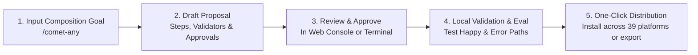

In day-to-day development, an individual Skill is usually just a static prompt (`SKILL.md`). For multi-step complex workflows, it lacks state machine protection, human approval checkpoints, and the ability to resume reliably after interruptions.

**Comet Any lets you use natural language inside your Agent to compose existing Skills, tools, and deterministic scripts into resilient, production-ready workflow applications**. The Agent establishes input/output contracts, writes entry rules, and implements business validators, while the SDK assembles the plan into an executable application equipped with quality gates and breakpoint recovery.



## Step 1: Prepare the Environment and Describe Your Goal

Ensure Comet is installed globally and initialized in your project root. Inside a supported Agent (such as Codex or Claude Code), type `/comet-any` and describe your workflow:

```text
/comet-any
Compose local research and report generation Skills into an automated project weekly-report workflow:
1. First, collect and summarize accepted changes from this week;
2. Generate an initial draft containing "Completed This Week" and "Risks & Next Steps" sections;
3. Verify that every conclusion cites specific source evidence; missing reports or incomplete citations must block publication;
4. The workflow must pause and wait for my manual review of the draft before writing the final publication file.
```

<Tip>
  When describing your goal, clearly specify: **inputs**, **key execution steps**, **primary artifacts**, **automated validation criteria**, and **mandatory human decision checkpoints**.
</Tip>

## Step 2: Confirm Composition Type and Application Architecture

The Agent analyzes your goal and recommends the best architectural pattern:

| Application Type | Ideal Use Case | Architectural Highlights |
| --- | --- | --- |
| **Standalone SDK Application** | Dedicated workflows like weekly reports, research, or content publishing | Fully custom execution phases, human approval gates, and validators |
| **Native Extension** | Customizing engineering development lifecycles | Retains Native's Builder, Verifier, and Archive phases, inserting business hooks at allowed points |
| **Classic Composition** | Enterprise-grade standardized processes | Follows the five-phase state machine, adding or replacing specific phase skills |

The Agent clarifies any tradeoffs and organizes steps, dependencies, and validation rules into a structured blueprint.

## Follow a Complete Scenario Deep Dive

<CardGroup cols={3}>
  <Card
    title="Compose Any Skill"
    icon="wand-magic-sparkles"
    href="/en/skill-creator/standalone-composition"
  >
    Combine research, writing, and citation checking into an approved weekly report application.
  </Card>
  <Card title="Customize Native" icon="meteor" href="/en/skill-creator/native-customization">
    Add team conventions and security reviews while preserving independent verification.
  </Card>
  <Card title="Customize Classic" icon="signature" href="/en/skill-creator/classic-customization">
    Replace the Design Skill and add backward interface compatibility checks.
  </Card>
</CardGroup>

## Step 3: Review and Approve the Complete Plan

Before building the application, the Agent presents the complete execution plan. You can verify:

- **Workflow and Dependencies**: Which existing Skills are invoked and their execution sequence;
- **Business Validators**: Checks verifying that expected files exist and adhere to required formats;
- **Human Approval Gates**: Checkpoints where the workflow pauses and requires your explicit sign-off.

You can approve, request adjustments, or reject the plan. Once revised, the blueprint updates and awaits your confirmation.

## Step 4: Local Automated Validation and Optional Eval

Once approved, the Comet SDK compiles the application into a deterministic package and executes local validation in a temporary sandbox:

- **Happy Path Testing**: Verifies that ideal inputs successfully generate expected output files;
- **Error Path Interception**: Injects missing files or malformed sources to confirm that validation gates intercept errors correctly;
- **Optional Model Eval**: After local checks pass, optionally trigger model evaluations to test capability and stability on real LLM runs.

## Step 5: Preview Installation and Distribute / Export

After local validation passes, Creator displays the installation preview: destination paths, platform Skill entry points, dependencies, and compatibility notes. Confirm to finalize installation:

```bash
# Launch local console to inspect applications and distribute with one click
comet dashboard
```

- **Install to Local Platforms**: Write entry points directly to Claude Code, Codex, and other supported platforms for immediate use;
- **Export Standalone Packages**: Export clean, self-contained packages free of local execution histories, ready to distribute across projects or teams via `comet publish distribute`.

## Resuming After Interruptions

If your authoring session disconnects, invoke `/comet-any` in the same project, or run the following terminal commands:

```bash
# Inspect creation status
comet creator status weekly-report --project . --json

# Execute the next step
comet creator next weekly-report --project . --json
```

Comet restores state from disk checkpoints. You can also view full authoring records, dependency graphs, and execution evidence in **Comet Dashboard → Comet Any**.

Further reading: [SDK Core Concepts](/en/sdk/overview), [Authoring Preferences](/en/skill-creator/preferences), and [Publishing and Distribution](/en/skill-creator/publishing).
