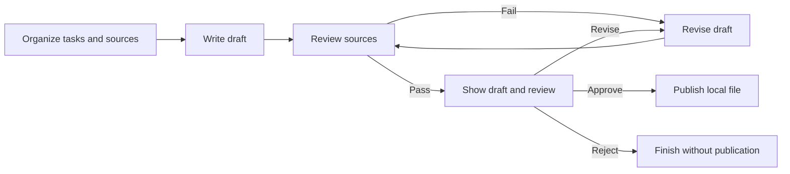

You have independent Skills and want them to collaborate under consistent rules instead of explaining the sequence every time. Use `/comet-any` to create a standalone SDK application that records input, steps, files, acceptance, and user decisions together.

This tutorial combines task research, report writing, and source review. The application accepts weekly task records and writes a local publication only after source review and approval of the actual draft. It does not use Native or Classic development phases.

## 1. Define input and the final result

Specify what one execution handles. Here, input includes a week, tasks, and output directory. Each task has a title, acceptance status, and source reference. Tasks without acceptance evidence cannot enter the completed list.

```json
{
  "week": "2026-W42",
  "tasks": [
    {
      "title": "Deliver authentication rate limiting",
      "accepted": true,
      "source": "records/auth-rate-limit.md"
    }
  ],
  "outputDirectory": "reports/weekly"
}
```

This is business input for the generated application, not a complete `comet runtime dispatch` request. Supply actual tasks and readable source files.

Restrict output to allowed project paths. Application packages, Run records, and credentials are not report output. Email, website, or other external publication requires separate permissions and reconciliation interfaces.

## 2. Prepare cooperating Skills

This example assumes:

```text
team-skills/
  task-research/SKILL.md
  report-writing/SKILL.md
  source-review/SKILL.md
```

| Skill          | Input                                 | Result                                                 |
| -------------- | ------------------------------------- | ------------------------------------------------------ |
| Task research  | Task records and readable sources.    | Accepted tasks, unresolved items, and a source index.  |
| Report writing | Organized tasks and the week.         | Markdown draft with required sections.                 |
| Source review  | Draft, task list, and actual sources. | Conclusion-to-source mapping and an acceptance result. |

Paths are illustrative. Have the Agent inspect actual content, scripts, and resources for compatible inputs and outputs. Chat-only and file-writing Skills have different responsibilities that must be declared.

## 3. Describe the workflow and approval scope

Enter this in an Agent session supporting Creator:

```text
/comet-any
Name this creation weekly-report and compose an independent SDK weekly report application.
Use ./team-skills/task-research, ./team-skills/report-writing, and ./team-skills/source-review.
Read actual Skills. Organize tasks and sources, write a draft, then check sources for every completed-work conclusion.
Input contains week, tasks, and outputDirectory. Sources must be readable; output stays inside project reports/weekly.
The draft needs Completed this week and Risks and next steps sections. Review maps conclusions to acceptance evidence.
Give every Run separate draft and review files so weeks and Runs do not overwrite one another.
On review failure retain and revise the draft, then review again. Unchecked requirements cannot pass.
Show the actual draft and review before the user chooses local publication, revision, or rejection.
Revised drafts need fresh review and approval; rejection finishes without publication.
Do not send email or deploy a website. Write only the local final report and verify it matches the approved draft.
Show the complete entry, business rules, steps, positive and negative artifact samples, and main workflow acceptance.
Wait for separate plan and installation confirmation.
```

Actual graph dependencies enforce ordering. This example needs research before writing, so it does not require parallel work. For independent sources in parallel, specify join conditions and separate outputs.

## 4. Check the three result paths

The plan should include:



| Condition                                             | Purpose                                                 |
| ----------------------------------------------------- | ------------------------------------------------------- |
| Completed tasks have acceptance evidence.             | Do not report ongoing work as delivered.                |
| Review reads actual sources.                          | A plausible citation list does not prove support.       |
| Draft and review have clear paths and hashes.         | Downstream work checks existence and unchanged content. |
| Approval shows the actual draft and review.           | The user knows which content is being approved.         |
| Publication verifies approved content.                | Do not publish a different report afterward.            |
| Revision limits and stopping conditions are explicit. | Avoid unbounded failure loops.                          |

File-producing steps declare actual artifacts. Explain file-free interaction or computation and how results are saved. Inspect negative samples and business validators; see [artifact acceptance](/en/sdk/artifact-validation).

## 5. Exercise the workflow, not just files

Standalone applications exercise the actual main workflow in an isolated project. Require these scenarios:

| Scenario                                                            | Expected result                                              |
| ------------------------------------------------------------------- | ------------------------------------------------------------ |
| Complete sources and user approval.                                 | Real draft and review, with publication only after approval. |
| Valid draft sections, but one conclusion lacks acceptance evidence. | Reject and revise; no publication.                           |
| Review passes and the user rejects publication.                     | Finish normally without a final published file.              |
| User requests changes.                                              | Revised content receives fresh review and approval.          |
| Process exits before approval.                                      | Retain the draft and original pending Wait for recovery.     |

Also check missing files, empty content, and hash drift. Conversation-only steps still participate in main workflow acceptance; no file is not an exemption.

Isolated checks do not establish actual model-call quality. Model Eval checks real Skill coordination, anomaly detection, approval branches, and recovery. Uncovered paths remain unverified.

## 6. Install and generate the first report

Confirm installation to export the complete package and install platform entries and dependencies. Inspect entry names, output scope, host tools, and Hook activation; see [installation and distribution](/en/skill-creator/publishing).

Load the entry reported by installation and provide real data:

```text
Use the installed weekly-report application for week 2026-W42.
Tasks come from records/week-42.json and sources are in records/.
Write inside reports/weekly. Show the reviewed draft and wait for my decision on local publication.
```

The first execution should pause to show the draft. Revise, reject, or approve; after approval, check the actual final file against that draft.

On rejection, `completed` means the declared path finished, not that the report was published. Dashboard records creation separately from each application Run: building the application and using it are different processes.

## 7. Resume and add capabilities

For interrupted creation:

```bash
comet creator status weekly-report --project . --json
comet creator next weekly-report --project . --json
```

For interrupted report execution, continue the original application Run and Wait rather than running publication again. Query an unknown external operation first. This example publishes locally; external services need additional recovery contracts.

To add translation, publication channels, or child review workflows, provide the original package and new input, output, approval, and failure requirements. Prepare and confirm a new version. Declare effects and reconciliation per channel; one draft approval does not authorize arbitrary sending destinations.
