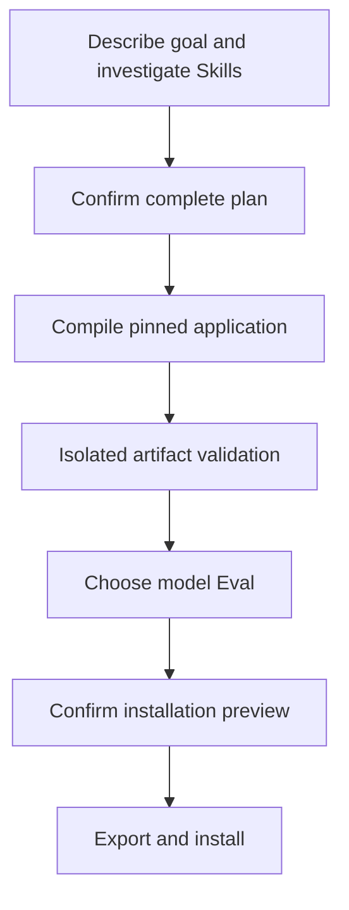

Creator uses the same Run to associate the goal, actual plan, user decisions, compiled package, and installation result. Read that Run when the workflow pauses, then continue with its current Action.



## 1. Investigate the goal and actual dependencies

The Agent reads Skill content, scripts, and resources to establish inputs and outputs, user interaction, side effects, failure, and recovery. Resolve missing Skills, ambiguous sources, or insufficient capabilities first.

## 2. Confirm the complete business plan

The plan includes application type, actual workflow graph, complete Skill/Rule content, dependencies, and artifact requirements. Every added or replacement execution step declares required files. Explain why when a step genuinely produces no files.

Business validators include normal and abnormal samples. The user reads the plan and approves, revises, or rejects it. The decision binds to the current proposal.

## 3. Compile and validate the actual package

SDK pins dependency content and generates the package. Creator runs artifact checks in an isolated Node process and temporary project without real host credentials.

| Result                         | Next step                                                                   |
| ------------------------------ | --------------------------------------------------------------------------- |
| Checks pass                    | Continue to optional model Eval                                             |
| Checks fail                    | Fix and retry, revise the plan, or reject                                   |
| Dependencies or modules change | Restore pinned content or prepare and confirm again                         |
| Execution result unknown       | Check the original Action and actual files, then report the original result |

Local validation has no skip path. A business validator's abnormal samples must pass general file and format checks and then fail the business conditions.

Standalone applications also exercise the actual main workflow in an isolated project, including execution, interaction, child workflows, and approvals. Conversation-only steps participate too. Passing file checks does not establish coverage of every branch; see [compose an independent workflow](/en/skill-creator/standalone-composition).

## 4. Choose model Eval

You can run model Eval or explicitly skip it. Evaluation pins the actual application, dependencies, and 2–4 cases. Interruptions and revisions reuse the original cases.

Reports explain model behavior and actual coverage. Unexecuted paths remain uncovered. Model results cannot replace local file validation or actual host validation.

## 5. Confirm the installation preview

Check the export location, platform entries, Runtime, Rule/Hook entries, conflicts, and missing capabilities. SDK writes only after the user confirms the current preview. File or configuration changes invalidate original preview approval.

## 6. Use and observe after installation

Load the installed entry Skill on the target platform and execute along the application Run. Dashboard shows authoring records and application Runs separately, retaining pinned versions, execution attempts, decisions, and artifacts.

Use [comet application](/en/cli/application) for installation, upgrades, and selective uninstall in other projects or platforms.

## Read the next step after interruption

```bash
comet creator status weekly-report --project . --json
comet creator next weekly-report --project . --json
```

Returned Actions, Waits, and proposal hashes determine what is currently allowed. Report host Actions and user decisions through [comet creator dispatch](/en/cli/creator). Do not edit Run JSON or create another Run for the same installation or publication.
