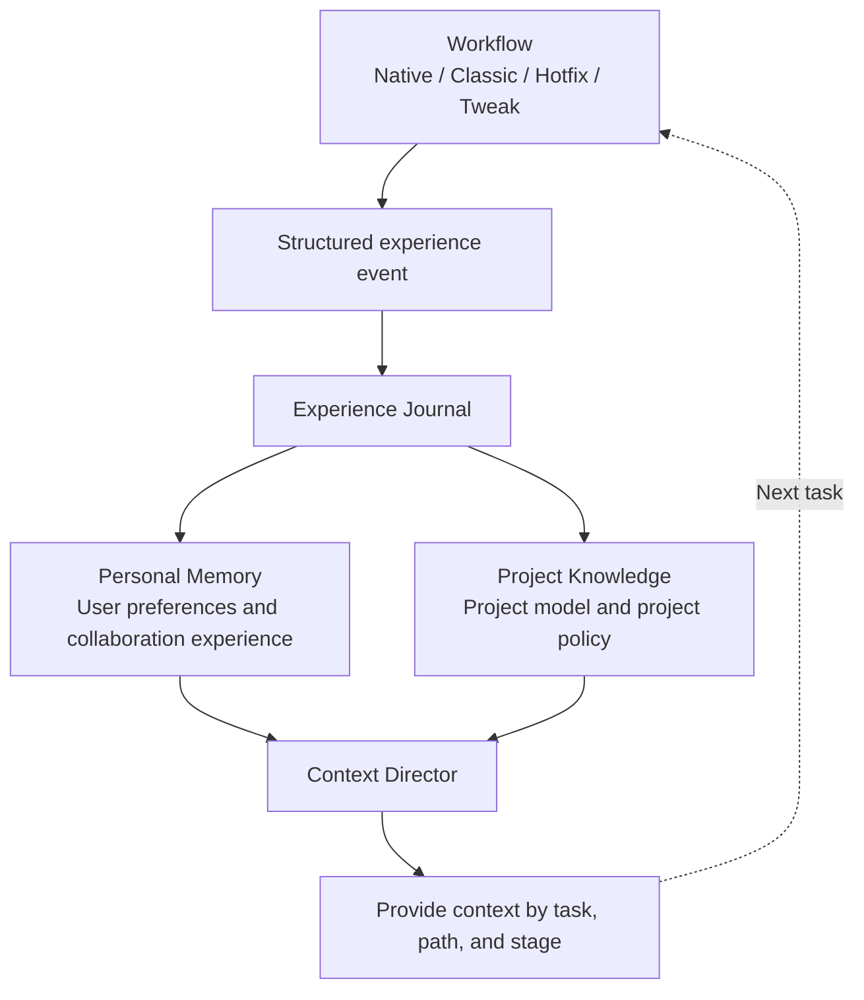

The changes from 0.4.0 to rc.1 focus on three directions: enabling work experience to be managed, Project Knowledge to be verified, and large Native requirements to be accomplished through the collaboration of multiple independent sessions. They all follow the same principle: user-readable content, machine operation status, and verifiable evidence each assume different responsibilities.

This is not a command name adjustment. After the upgrade, users will see the new plugin center on the Dashboard and also see the parent Change, child, worktree and the final integration status in the Native large-scale requirements. The ordinary workflow still starts from the existing `/comet` or `/comet-native` entry.

## Main changes

| Theme | User-Perceptible Changes | Detailed Guide |
| --- | --- | --- |
| Agent Learning Loop | User signals, verification, and Review findings form controlled, reusable experience; background reflection failures never block active tasks | [Agent Learning Loop](/en/plugins/agent-learning-loop) |
| Personal Memory | Users can inspect, correct, forget, and roll back personal preferences; relevant items are injected progressively per task | [Personal Memory](/en/plugins/personal-memory) |
| Project Knowledge / Project Policy | Agents retrieve project structure, decisions, workflows, and constraints; source changes invalidate stale records | [Project Rules](/en/plugins/project-rules) |
| Dashboard Plugin Center | Personal Memory and Project Knowledge maintain independent state, sources, application histories, and lifecycle controls | [Dashboard Overview](/en/dashboard/overview) |
| Native Supervisor Change | Large requirements break down into dependent child tasks executed in isolated worktrees and verified on the parent Change | [Supervisor Change](/en/native/supervisor-change) |
| Native Portable State | Phase, acceptance, handoff, inspection, recovery, and Supervisor summaries are saved in human-readable state, while machine runtime state stays local | [Artifacts and State](/en/native/artifacts-and-state) |
| CodeGraph and Platform Support | Native initialization can configure CodeGraph; DeepSeek Harness and Oh My Pi gain install, update, diagnose, and uninstall workflows | [Platform Support](/en/platforms) |

## The rc.1 Working Model in a Single Task

Workflows do not dump all historical records into the Agent context simultaneously. Personal Memory and Project Knowledge are pre-filtered based on scope, active task, touched paths, operation, and phase. A concise subset of highly relevant content is directly injected, while longer or lower-priority items enter the Context Manifest for the Agent to expand on-demand by stable ID.

## Most Noticeable Changes for Users

### Plugin Center in Dashboard

The Dashboard no longer displays only Changes and workflow artifacts. The Plugin Center organizes Personal Memory and Project Knowledge into dedicated workspaces, surfacing records, sources, statuses, application histories, diagnostics, and settings. Pages prioritize cached snapshots so background refreshes never block the initial screen waiting on indexing or reflection.

Plugin deactivation, restoration, and removal have explicitly bounded scopes. Deactivating Personal Memory preserves existing records; pausing Project Knowledge only affects retrieval in the active project; and uninstalling plugins deletes neither repository documentation nor personal data. Once re-enabled, plugins resume operating under their active configuration.

### Separation of Personal and Project Knowledge

Personal Memory stores user language preferences, communication styles, and personal collaboration learnings. Project Knowledge preserves architecture layouts, dependencies, decisions, workflows, constraints, and verified defect resolutions. Personal preferences never automatically morph into team rules, nor do project rules override active user instructions or repository rules.

### Decomposed Execution for Large Native Requirements

Supervisor Change confirms decomposition during the Shape phase, the runtime evaluates which child tasks are ready, and isolated sessions focus solely on their assigned child worktrees. The parent Change sequentially integrates results and conducts final verification. Codex can use isolated project tasks, while Claude Code can collaborate via teammates in Agent Teams sessions. Users select multi-session or single-session execution once; if multi-session support is unavailable or lost during recovery, Comet falls back automatically to subagents without repeatedly prompting or silently degenerating into an untracked single session.

## What Has Not Changed

- Native still comprises Shape, Build, Verify, and Archive, with completion determined jointly by deterministic runtime checks and independent verifications.
- Project Policy is not a replacement rule file—repository `AGENTS.md`, existing rules, code, configs, and test suites remain higher-priority ground truth.
- Personal Memory never records full conversation transcripts, tool logs, full diffs, hidden chain-of-thought, or general codebase facts.
- Remote Providers are optional; network timeouts never silently fall back to an alternate Provider.
- Learning and retrieval are strictly bounded assistance features—they will never commit, push, delete, or publish code on your behalf.
- Existing Native Quickstart and Classic five-stage documentation remain the standard entry points for daily workflows.

## Recommended Reading Order

If you only want to explore new capabilities, start with [Agent Learning Loop](/en/plugins/agent-learning-loop), then read [Personal Memory](/en/plugins/personal-memory) and [Project Rules](/en/plugins/project-rules) as needed. If you need to handle large-scale Native requirements, proceed directly to [Supervisor Change](/en/native/supervisor-change). For complete itemized changes, refer to the [0.4.0-rc.1 Changelog](/en/changelog).
