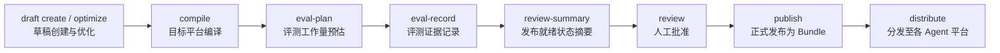
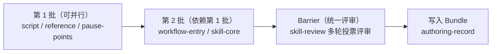

---
title: 'comet bundle'
description: '底层 Bundle 编译与命令参考：什么时候需要直接用 comet bundle，以及它和 /comet-any、comet creator、comet publish 的分工。'
---

`comet bundle` 负责 Skill Bundle 的底层打包：跨平台编译、记录 Eval 评测证据、保存人工终审的批准记录。日常评审和分发 Bundle，建议直接使用 [comet publish](/zh/cli/publish)。

基于 `/comet-any` 的 SDK 工作流应用，查看创作状态用 [comet creator](/zh/cli/creator)，本地安装和分发用 [comet application](/zh/cli/application)。

## 什么时候需要直接调用本命令

- 检查 Bundle 草稿（draft）或跨平台编译的输出日志；
- 排查某个平台的编译结果，例如平台缺少的能力（capability gap）或可执行权限的确认；
- 手动登记结构化的 Eval 评测证据；
- 在 CI/CD 脚本里调用只输出 JSON 的底层接口。

## 处理流程



## Skill Creator 指令已并入 comet creator

自 0.4.0-beta.1 起，Skill 创作统一使用 `comet creator`。下列旧版 Bundle 命令别名已废弃：

```text
comet bundle factory-*
comet bundle authoring-*
comet bundle list
comet bundle status
```

旧命令与当前命令的对应关系：

| 历史预发布别名 | 当前标准指令 |
| --- | --- |
| `comet bundle factory-guide` | `comet creator guide` |
| `comet bundle candidates` | `comet creator candidates` |
| `comet bundle factory-propose` | `comet creator propose` |
| `comet bundle factory-init` | `comet creator init` |
| `comet bundle factory-resolve` | `comet creator resolve` |
| `comet bundle factory-generate` | `comet creator generate` |
| `comet bundle authoring-plan` | `comet creator authoring-plan` |
| `comet bundle authoring-record` | `comet creator authoring-record` |
| `comet bundle list/status` | `comet creator list/status` |

## 创作协议（Authoring Protocol）

`/comet-any` 生成的 Skill 可以包含业务规则和执行步骤。生成过程遵循**创作协议（Authoring Protocol）**：多个相互独立的创作通道（Lane）组成一个有向无环图，每条通道产出的内容都要通过 Schema 校验，最后经过多个维度的代码评审。

### 分批执行与多通道并行

创作分**批**进行，同一批里的通道可以并行，后一批依赖前一批的结果：



| 创作通道（Lane） | 核心交付物 | 职责 |
| --- | --- | --- |
| `script` | 运行时脚本：workflow-state、workflow-guard、workflow-handoff、comet-plan、comet-check、comet-hook-guard | 生成驱动状态机流转的 6 个执行脚本 |
| `reference` | workflow-protocol、resolved-skills、composition-report、authoring-lanes | 产出工作流协议和 Skill 依赖组合的记录 |
| `pause-points` | decision-points、recovery | 保存决策停顿点和中断恢复规则 |
| `workflow-entry` | 入口 Skill 正文（Decision Core） | 编写入口 Skill 中负责调度和分发的主逻辑 |
| `skill-core` | 节点 Skill 正文（Guidance） | 编写各业务节点的执行指导 |
| `skill-review` | skill-review 评审结论报告 | 作为最后一道质量检查（Barrier） |

执行创作协议时，创作 Agent 使用 `comet creator authoring-plan` 和 `comet creator authoring-record`：

- **生成创作计划**：输出本次要执行的 Lane、各 Lane 的交付物和创作深度（`quick` 只覆盖主要通道，`full` 覆盖全部通道）；
- **Schema 校验**：各 Lane 提交的 JSON 必须符合该通道的数据结构，状态只能是 `DONE`/`DONE_WITH_CONCERNS`/`NEEDS_CONTEXT`/`BLOCKED`，并且带有产物清单、发现的问题（findings）和证据字段；
- **核对声明的文件（Claims Validation）**：Lane 声明产出的每个文件都必须真实存在于磁盘上，且内容哈希一致；
- **写入 Bundle 创作状态**：校验通过后，把结果写入 Bundle 创作状态（`BundleAuthoringState`），记录通道状态、问题严重程度（`critical`/`important`/`minor`）和评审证据；
- **评审证据**：`skill-review` 通道记录评审方式（`deterministic-check-only`/`llm-single`/`llm-multivote`）、投票结果、评审维度和缺陷清单，评审结论不能写死为“全部通过”。

### 生成文档的两个区域（Authored Zones）

编译生成的 `SKILL.md` 分成两个区域：

- **Auto zone（自动生成区）**：Frontmatter 元数据、路由分发表、入口和出口的阶段检查、证据格式声明和中断恢复说明。这部分由框架模板自动生成。
- **Authored zone（创作区）**：入口文档的 `## Decision Core` 和各节点的 `## Guidance`，由专门的子 Agent 结合具体项目编写。

工作流节点分为两类。`delegates` 节点只负责调用已有的外部 Skill，本身只需要简短的路由说明；`substance` 节点负责工作流的主要逻辑，必须有具体的执行指导。如果某个 `substance` 节点缺少创作指导，生成器会在生成的文档里写入带警示的 `AUTHORING PENDING` 占位符，并把它列进未完成节点清单。**这样的 Bundle 不能进入发布就绪状态**，避免分发缺少指导的节点。

## draft 与 compile 调试指令

```bash
# 手动创建或优化草稿（排查问题或手动调整时使用）
comet bundle draft create <name> --default-locale en --json
comet bundle draft optimize <bundle> --name <name> --json

# 编译生成某个 Agent 平台的适配包
comet bundle compile <name> --platform <id> --json
```

## eval 评测指令

```bash
# 预估评测工作量和预算
comet bundle eval-plan <name> --level quick --json
comet bundle eval-plan <name> --level full --json

# 登记评测证据
comet bundle eval-record <name> --result <file> --json
```

### eval-plan 返回内容

`eval-plan` 返回 `BundleEvalPlan { level, components[], estimatedRuns, tokenWorkload, explanation }`，说明评测包含哪些组件、预计运行多少次：

| 评测等级 | 覆盖的核心评测组件（components） | 预估调用轮次（estimatedRuns） |
| --- | --- | --- |
| `quick` 轻量级 | static 静态扫描、entry-smoke 冒烟测试、baseline 基准对比、assertion-grading 断言打分、platform-compile 平台编译 | `4 + entries * 2` |
| `full` 全量级 | 包含 `quick` 的全部组件，另加 trigger-accuracy 意图识别率、routing-overlap 路由重叠检测、failure-analysis 失败分析等 | `quick + 6 + entries * 3` |

### eval-record 接受证据的条件

评测结果必须对应草稿当前的哈希和评测清单的哈希。Runtime 按下面的规则决定是否接受：

- `result.schemaVersion` 不是 `2`，或 `result.provider` 不是 `"comet-eval"`：拒绝写入；
- `result.draftHash` 与当前草稿的哈希不一致：只写日志，状态不推进；
- `result.evalManifestHash` 与当前 `comet/eval.yaml` 重新计算出的哈希不一致：只写日志，状态不推进；
- 只有评测全部通过（`result.passed === true` 且 `failures` 为空），状态才进入 `eval-passed`；
- 评测未通过时，状态退回 `draft`，已有的 review 批准和就绪状态会被清除。

详细的 JSON 结构见 [发布与分发 Skill · eval-record 证据契约](/zh/skill-creator/publishing#eval-record-证据契约)。

## review 与 publish 核心指令

```bash
# 生成评审摘要
comet bundle review-summary <name> --platform <id> --json

# 人工批准或驳回
comet bundle review <name> --approve --reviewer <reviewer> --json
comet bundle review <name> --reject --reviewer <reviewer> --json

# 正式发布为不可变的 Bundle
comet bundle publish <name> --platform <id> --json

# 分发到指定的 Agent 平台
comet bundle distribute <name> --platform <id> --scope project --preview --json
comet bundle distribute <name> --platform <id> --scope project --json
```

发布前先看 review summary 里的发布就绪状态（readiness）。只要有一项发布检查没通过，就不能把 Bundle 标记为 ready 并发布；按 JSON 输出里列出的阻塞原因修正后，重新提交评审。日常发布请参阅 [comet publish 命令行参考](/zh/cli/publish)。

## 通用选项

| 选项 | 说明 |
| --- | --- |
| `--project <dir>` | 目标项目根目录（默认为 `.`，即当前工作区） |
| `--json` | 输出结构化的 JSON，供脚本解析 |
| `--platform <id>` | 目标平台标识符（可多次传入，绑定多个平台） |
| `--scope <project\|global>` | 分发范围（项目目录或全局用户目录） |
| `--level <quick\|full>` | 评测的工作量和覆盖范围 |
| `--result <path>` | 评测结果文件的绝对路径 |
| `--approve` / `--reject` | 人工审查的结论：批准或驳回 |
| `--reviewer <name>` | 审核人的标识 |
| `--preview` | 只生成分发预览，不写入文件 |
| `--confirm-executables` | 明确确认包内可执行脚本的权限 |
| `--skip-capability <cap>` | 跳过指定的可选扩展能力 |
| `--default-locale <locale>` | 默认语言（用于 `draft create`） |
| `--locale-option <locale>` | 追加一种支持的语言（可多次传入） |
| `--engine` | 开启 Engine 运行时（用于 `draft create`） |

## 与 comet publish、comet creator 的分工

`comet creator` 用于日常创作和中断后恢复，`comet publish` 是日常发布入口，`comet bundle` 提供底层的编译和审计命令。

| 命令 | 定位 | 适合谁 |
| --- | --- | --- |
| `comet creator` | 管理整个创作流程，并支持中断后恢复 | 日常开发者、创作 Agent |
| `comet publish` | 审查与分发的统一入口 | 日常开发者、负责发布的人 |
| `comet bundle` | 底层的 Bundle 编译和备用命令 | 审计、排查编译问题、编写 CI/CD 脚本 |

<Info>
  日常发布优先使用 <a href="/zh/cli/publish">comet publish</a>。
  <code>comet bundle</code> 只在排查深层编译问题或做严格的安全审计时使用。
</Info>

## 相关文档

- [comet publish 交互发布指南](/zh/cli/publish) — 日常发布的标准入口
- [comet creator 创作指令参考](/zh/cli/creator) — `/comet-any` 的状态流转和中断恢复
- [SDK 工作流应用架构](/zh/sdk/applications) — 完整 SDK 应用包的结构和依赖
- [SDK 应用安装与分发](/zh/cli/application) — 把应用分发到多个平台
