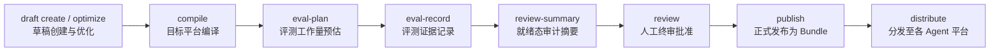
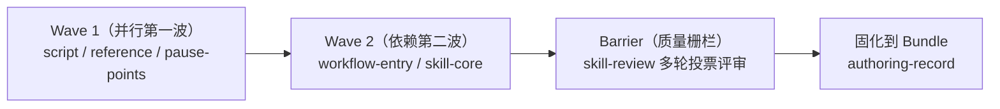

---
title: 'comet bundle'
description: '深入了解底层 Bundle 编译与后端指令集，明晰其与 /comet-any、comet creator 及 comet publish 的职责分工与边界。'
---

`comet bundle` 负责底层跨平台的 Skill Bundle 打包、跨端编译编排、Eval 评测证据记录以及人工终审凭据。日常的 Bundle 评审与分发建议直接使用 [comet publish](/zh/cli/publish)。

Comet Any 创作体系面向完整的 SDK 工作流应用，状态探查推荐使用 [comet creator](/zh/cli/creator)，最终的本地安装与分发推荐使用 [comet application](/zh/cli/application)。

## 什么时候需要直接调用本命令

- 深入审计 Bundle 草稿（draft）与跨平台编译输出日志；
- 调试特定平台的编译器行为、能力代沟（capability gap）或可执行权限披露；
- 手动录入并固化结构化的 Eval 自动化评测证据；
- 编写平台级持续集成（CI/CD）脚本时调用纯 JSON 后端接口。

## 典型后端流转拓扑



## Skill Creator 相关指令已收敛至 comet creator

自 0.4.0-beta.1 版本起，`comet creator` 已成为承接 Skill 创作全生命周期的标准命令行入口。下列历史预览阶段的 Bundle 命令别名已全量废弃：

```text
comet bundle factory-*
comet bundle authoring-*
comet bundle list
comet bundle status
```

现代指令映射关系对照表：

| 历史预发布别名 | 当前标准指令 |
| --- | --- |
| `comet bundle factory-guide` | `comet creator guide` |
| `comet bundle candidates` | `comet creator candidates` |
| `comet bundle factory-propose` | `comet creator propose` |
| `comet bundle factory-init` | `comet creator init` |
| `comet bundle factory-resolve` | `comet creator resolve` |
| `comet bundle factory-generate` | `comet creator generate` |
| `comet bundle authoring-plan` | `comet creator authoring-plan` |
| `comet bundle authoring-record` | `comet creator authoring-record` |
| `comet bundle list/status` | `comet creator list/status` |

## 创作协议（Authoring Protocol）体系

`/comet-any` 生成的 Skill 可以包含业务规则和执行步骤。生成过程遵循**创作协议（Authoring Protocol）**：一个由多个正交创作通道（Lane）构成的有向无环图，每条通道产出的技术内容均经受 Schema 强校验，最终汇流至多维度代码评审门禁。

### 创作流水线与多通道并行

创作推进按**波次（Wave）**有序推演，每个通道均为支持并发的独立作业单元：



| 创作通道（Lane） | 核心交付物 | 架构定位与职责说明 |
| --- | --- | --- |
| `script` | 运行时脚本群（涵盖 workflow-state、workflow-guard、workflow-handoff、comet-plan、comet-check、comet-hook-guard） | 生成支撑状态机流转的 6 个核心执行脚本 |
| `reference` | workflow-protocol、resolved-skills、composition-report、authoring-lanes | 产出底层通信协议与组件依赖组合证据 |
| `pause-points` | decision-points、recovery | 固化流程决策锚点与故障断点自愈规约 |
| `workflow-entry` | 入口 Skill 正文（Decision Core） | 负责统一调度分发的主入口逻辑创作 |
| `skill-core` | 节点 Skill 正文（Guidance） | 各具体业务执行节点的实战指引创作 |
| `skill-review` | skill-review 评审结论报告 | 充当最终的质量门禁栅栏（Barrier） |

在驱动创作协议推演时，请优先调用 `comet creator authoring-plan` 与 `comet creator authoring-record`：

- **解析生成创作规划**：输出当前拟执行的 Lane 清单、各 Lane 预期交付物以及创作深度（`quick` 仅覆盖骨干通道，`full` 全量覆盖所有通道）；
- **Schema 契约校验**：各 Lane 提交的 JSON 数据包必须严格契合该通道的元数据模型（状态码受限于 `DONE`/`DONE_WITH_CONCERNS`/`NEEDS_CONTEXT`/`BLOCKED`，且产物清单、分析洞察 findings 与证据链字段齐全）；
- **声明真实性防伪校验（Claims Validation）**：Lane 声明产出的所有文件（Claims），物理磁盘上必须真实存在且内容哈希强匹配；
- **固化落盘至 Bundle 状态机**：校验通过后，将成果固化进 Bundle 创作状态机（`BundleAuthoringState`），记录通道状态、问题严重度分级（`critical`/`important`/`minor`）与评审证据；
- **多维度真实评审证据**：`skill-review` 通道记录审查来源（`deterministic-check-only`/`llm-single`/`llm-multivote`），客观记录评审员投票结果、审视维度与缺陷清单，防止硬编码“全量通过”。

### 生成文档的双区隔离架构（Authored Zones）

最终编译生成的 `SKILL.md` 实行严格的双区物理隔离：

- **Auto zone（自动生成控制区）**：Frontmatter 元数据、路由分发表、Entry/Exit 阶段门禁检查、证据格式声明及断点恢复指南。此为不变的底层控制面，完全由框架模版自动编译生成。
- **Authored zone（智慧创作区）**：入口文档的 `## Decision Core`、各节点的 `## Guidance`。由各专门的子 Agent 结合具体项目工程深度提炼创作。

工作流节点划分为 `delegates`（覆盖代理层：用于安装并暴露成熟的外部富能力，本身仅需轻量路由指引）与 `substance`（业务核心层：承载工作流核心逻辑，必须具备详实、深度的实战指导）。若一个 `substance` 核心节点缺失创作指导，系统会显式渲染出带有警示的 `AUTHORING PENDING` 占位符，并在未完工节点清单中暴露。**该隐患会直接阻断 Bundle 晋升至发布就绪态**，防止生成器输出缺失指导的空壳节点。

## draft 与 compile 调试指令

```bash
# 手动创建或针对性优化草稿（排障或显式调优时使用）
comet bundle draft create <name> --default-locale en --json
comet bundle draft optimize <bundle> --name <name> --json

# 编译生成特定 Agent 平台的适配代码包
comet bundle compile <name> --platform <id> --json
```

## eval 评测体系指令

```bash
# 规划预估评测工作量与预算
comet bundle eval-plan <name> --level quick --json
comet bundle eval-plan <name> --level full --json

# 录入并固化评测客观证据链
comet bundle eval-record <name> --result <file> --json
```

### eval-plan 规划报文解读

返回结构化的 `BundleEvalPlan { level, components[], estimatedRuns, tokenWorkload, explanation }` 描述性预算预估报文：

| 评测等级 | 覆盖的核心评测组件（components） | 预估调用轮次（estimatedRuns） |
| --- | --- | --- |
| `quick` 轻量级 | static 静态扫描、entry-smoke 冒烟测试、baseline 基准对比、assertion-grading 断言打分、platform-compile 平台编译 | `4 + entries * 2` |
| `full` 全量级 | 涵盖 quick 全量项 + trigger-accuracy 意图识别率、routing-overlap 路由重叠检测、failure-analysis 容灾排错分析等 | `quick + 6 + entries * 3` |

### eval-record 证据准入鉴权门禁

评测结论必须在底层与当前 draft 哈希及评测清单哈希强绑定，Runtime 依循以下准则严格鉴权：

- 若 `result.schemaVersion !== 2` 或提供方不符合 `result.provider === "comet-eval"`，立即拒绝落盘；
- 若测试报告绑定的 `result.draftHash` 与当前真实状态不符，仅写入日志文件，状态机绝不向前推演；
- 若报告中的 `result.evalManifestHash` 与当前重新计算的 `comet/eval.yaml` 哈希不一致，同样仅落盘日志，不推进状态；
- 唯有在评测结论全绿通过（`result.passed === true` 且 `failures` 为空）时，状态机才会晋升至 `eval-passed`；
- 一旦测试未通过，状态机立即回退至 `draft` 草稿态，清空原有的 review 审批与就绪状态。

详细的 JSON Schema 契约请参阅 [发布与分发 Skill · eval-record 证据契约](/zh/skill-creator/publishing#eval-record-证据契约)。

## review 与 publish 核心指令

```bash
# 生成多维度综合评审摘要大盘
comet bundle review-summary <name> --platform <id> --json

# 人工正式授权审批或否决驳回
comet bundle review <name> --approve --reviewer <reviewer> --json
comet bundle review <name> --reject --reviewer <reviewer> --json

# 正式发布为不可变标准化 Bundle
comet bundle publish <name> --platform <id> --json

# 安全分发至指定的 Agent 平台
comet bundle distribute <name> --platform <id> --scope project --preview --json
comet bundle distribute <name> --platform <id> --scope project --json
```

在执行发布前，必须仔细审阅 review summary 中的就绪状态（readiness）。只要有一项发布检查未通过，严禁将 Bundle 标记为 ready 并强行发布。请结合 JSON 报文中明确返回的阻塞根因完成修正，随后重新提交评审。面向普通开发者的标准发布指引请参阅 [comet publish 命令行参考](/zh/cli/publish)。

## 通用选项参数

| 选项参数 | 详细语义说明 |
| --- | --- |
| `--project <dir>` | 目标项目根目录（默认值为 `.` 当前工作区） |
| `--json` | 输出机器可读的标准结构化 JSON 报文 |
| `--platform <id>` | 目标平台标识符（支持多次传入绑定多个平台） |
| `--scope <project\|global>` | 分发生效范围（项目局部或全局用户目录） |
| `--level <quick\|full>` | 设定 Eval 评测的工作量与覆盖深度 |
| `--result <path>` | 评测客观测试报告的文件物理绝对路径 |
| `--approve` / `--reject` | 明确的人工审查裁决：批准放行或驳回拦截 |
| `--reviewer <name>` | 署名本次人工审核的责任人标识 |
| `--preview` | 纯只读拉取分发预览报告，绝不执行物理写操作 |
| `--confirm-executables` | 显式放行对包内可执行脚本的安全权限披露与确认 |
| `--skip-capability <cap>` | 显式跳过可选的附加扩展能力 |
| `--default-locale <locale>` | 声明默认语言区域（用于 `draft create`） |
| `--locale-option <locale>` | 追加支持的多语言选项（支持多次传入） |
| `--engine` | 声明开启高级 Engine 运行时（用于 `draft create`） |

## Bundle 与周边命令集的架构定位划分

`comet creator` 是日常创作与断点恢复的主入口，`comet publish` 是面向开发者的友好发布通道，而 `comet bundle` 则充当底层核心引擎的纯后端控制台。

| 核心命令集 | 架构系统定位 | 最适合的目标受众 |
| --- | --- | --- |
| `comet creator` | 统领全流程创作状态机与断点自愈 | 日常开发者、高阶创作 Agent |
| `comet publish` | 人类友好的一站式审查与分发入口 | 日常开发者、团队发布责任人 |
| `comet bundle` | 裸机级 Bundle 底层编译与后备指令集 | 平台审计员、底层排障、高级 CI/CD 集成流水线 |

<Info>
  日常面向业务交付的发布，强烈推荐优先使用 <a href="/zh/cli/publish">comet publish</a>。
  <code>comet bundle</code> 仅在遭遇深层编译异常排障或进行严格的安全合规审计时使用。
</Info>

## 相关文档

- [comet publish 交互发布指南](/zh/cli/publish) — 开发者一站式发布标准通道
- [comet creator 创作指令参考](/zh/cli/creator) — `/comet-any` 状态机流转与自愈
- [SDK 工作流应用架构](/zh/sdk/applications) — 完整 SDK 应用制品包与依赖规范
- [SDK 应用安装与分发](/zh/cli/application) — 面向生产环境的应用多平台分发
