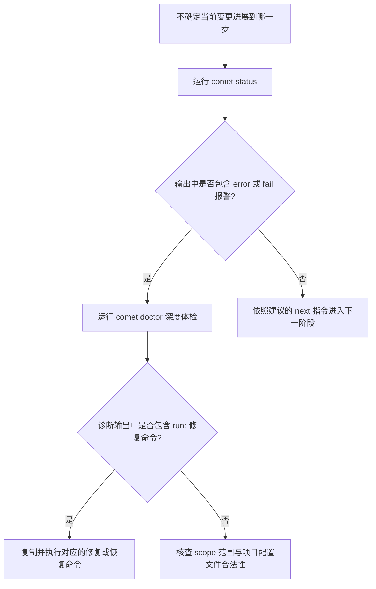

`comet doctor` 专职排查“系统当前为何无法正常运转”。

它会检查 Node.js 运行环境、CLI 版本、依赖完整性、工程核心目录、Skill/Rule/Hook 部署情况、Runtime 状态机、CodeGraph 代码知识图谱以及当前 change 状态。`comet status` 显示任务推进到哪一步，`comet doctor` 定位环境与依赖故障。

默认诊断执行为纯只读模式，绝不会在检查过程中私自改写任何物理文件。唯有显式指定 `--repair` 标志时，系统才会针对可自愈的故障执行修复动作。

针对 CodeGraph 代码图谱，诊断会细分呈现四项独立指标：CLI 工具就绪度、工程索引新鲜度、MCP 插件服务注册状态以及各 Agent 平台的生效（effective）评级。索引处于最新状态仅说明底层数据完成落盘，并不等同于特定 Agent 一定能直接消费图谱；精准排障请查阅 JSON 中的 `codegraph` 对象。

## 基本用法

```bash
comet doctor
comet doctor --scope project
comet doctor --json
```

常用选项参数：

| 参数选项 | 说明 |
| --- | --- |
| `--json` | 输出机器可读的结构化全景诊断 JSON 数据 |
| `--scope <scope>` | 设定诊断的作用域：支持 `auto`（自动推断）、`project`（当前项目）或 `global`（全局环境），默认为 `auto` |
| `--repair` | 触发针对 Hook 钩子、Rule 规范及当前 change 绑定关系的自动化物理修复 |
| `--strategy <strategy>` | 指定 Classic 根目录迁移中断时的恢复策略：可选 `continue`（接续前行）或 `rollback`（安全回滚）；必须与 `--repair` 联用 |
| `--yes` | 免交互确认需要人工授权的项目修复动作（例如重建 CodeGraph 索引）；必须与 `--repair` 联用 |

## 终端文本诊断回显

在项目级 Skill 尚未完整部署、Classic 产物根目录缺失且 CodeGraph 存在待同步变更的典型故障现场下，运行 `comet doctor --scope project` 将回显如下诊断报告：

```text
Comet Doctor (scope: project)

  ✓ Environment: node v22.20.0; platform win32/x64; project D:\Project\Comet; global C:\Users\BENYM
  ✓ Comet CLI: installed (0.4.0-beta.20)
  ✓ openspec CLI: installed (1.7.0)
  ✓ Superpowers: detected (Claude Code project, Codex project, Antigravity project, Antigravity 2.0 project; version not recorded by skills installer)
  ✗ Classic artifact layout: docs: configured docs/openspec/ missing; alternate openspec/ missing — run: comet classic root show, then restore the configured root or use comet classic root move
  ✓ Classic platform tool assets: no OpenSpec platform tool assets under docs/
  ✗ Classic OpenSpec root: Configured Classic OpenSpec root is missing: docs/openspec (alternate openspec is missing)
  ⚠ working directories: partial (missing: docs/openspec/changes, docs/openspec/changes/archive, docs/openspec/specs)
  ⚠ Comet skills: not installed in project scope — run: comet init --scope project
  ✓ scripts present: OK (12 scripts)
  ✓ CodeGraph CLI: CodeGraph CLI is installed
  ⚠ CodeGraph project index: CodeGraph index has 1 pending change(s) — run: codegraph sync
  ⚠ CodeGraph MCP registration: no supported Agent configuration detected
  ✓ current selection: no active Comet change
```

各行开头的状态符号含义如下：

- `✓`：该项指标全量合规，运行健康，无需任何干预。
- `⚠`：检测到警告或非关键的可选组件缺失。通常不影响核心流转，但强烈建议依循提示尽快补齐。
- `✗`：阻塞检查未通过。请务必优先排查该行末尾 `run:` 所给出的针对性修复指令。

在上述示例中，首要矛盾在于 Classic 产物根目录：配置声明了 `docs/openspec/`，但物理磁盘上目录缺失。先运行 `comet classic root show` 核准实际配置，再手动检出该目录或运行 `comet classic root move` 迁移。末尾的 `current selection: no active Comet change` 纯属中性事实，仅说明当前工程内暂无聚焦的活动中变更。

## 核心诊断检查项全览

| 检查项名称 | 核心诊断职责与判定边界 |
| --- | --- |
| `Environment` | 探查当前的 Node.js 版本、底层操作系统平台、当前项目物理路径及全局主目录 |
| `Comet CLI` / `openspec CLI` | 核查核心命令行工具的安装就绪情况及当前版本号 |
| `Superpowers` | 探查外部 Superpowers 依赖套件在当前环境中的可用性 |
| `Classic artifact layout` / `Classic OpenSpec root` | 深度校验 Classic 模式配置的产物根目录是否存在、文件是否具备正常读写权限 |
| `working directories` | 校验 `changes`、历史归档目录及 `specs` 规范等工作子目录是否健全 |
| `Comet skills` / `scripts present` | 检查当前作用域下的业务 Skill 资产与 Runtime 运行时脚本是否齐备 |
| `CodeGraph CLI` | 校验 CodeGraph 底层命令行工具是否已成功安装 |
| `CodeGraph project index` | 判定当前工程图谱索引是处于最新、残缺、过期滞后还是尚未初始化状态 |
| `CodeGraph MCP registration` | 核查已检测到的 Agent 客户端中是否合规注册了有效的 CodeGraph MCP 协议服务 |
| `CodeGraph effective for <Agent>` | 判定特定 Agent 是否同时齐备 CLI、最新索引数据及合法的 MCP 注册服务 |
| `current selection` | 确认当前是否存在明确绑定的活动中 Comet change 写入上下文 |

## 科学选定诊断作用域

- `--scope auto`（默认）：智能联动诊断。优先全量体检当前项目工程；若当前工程未独立初始化，则回退探测可用的全局共享资产。
- `--scope project`：严格仅诊断当前项目上下文，专用于确认当前仓库是否已合规完成本地工程化初始化。
- `--scope global`：严格仅体检用户全局主目录，适合排查跨项目共享的全局 Skill、Rule 规范、Hook 钩子或 Runtime 运行时。

若全局 Comet 运行环境完备，但当前项目尚未拷贝项目级私有 Skill，`--scope auto` 会提示全局环境可用并将项目级副本标记为建议项。仅在团队明确要求将工程配置与 Skill 随仓库提交纳管时，方需运行：

```bash
comet init --scope project
```

## 结构化 JSON 诊断报文

当需要编写 CI/CD 自动化流水线或对接监控报警时，使用：

```bash
comet doctor --json
```

顶层数据包清晰提炼整体健康态：

```json
{
  "scope": "project",
  "status": "failed",
  "healthy": false,
  "repaired": [],
  "results": [
    {
      "check": "Comet CLI",
      "status": "pass",
      "message": "installed (0.4.0-beta.19)"
    },
    {
      "check": "Classic OpenSpec root",
      "status": "fail",
      "message": "Configured Classic OpenSpec root is missing: docs/openspec"
    }
  ]
}
```

`healthy: false` 明确表明至少存在一项 `fail` 级别的致命问题；具体的修复建议承载于 `results[].message` 文本中。唯有当 `status: passed` 且 `healthy: true` 时，方准判定本次环境体检全绿合格。

`codegraph` 对象深入展开 `cliStatus`、`indexStatus`、`mcpStatus`、`agents` 及 `effectiveForAgent`。只有当 CLI 完备、工程索引新鲜度达标、且平台 MCP 配置精准指向 CodeGraph 服务时，目标 Agent 才会获得生效认证。

## 何时追加 `--repair` 执行物理修复

推荐始终遵循“先无害诊断、后授权修复”的原则：先运行不带 `--repair` 的 `comet doctor` 查看诊断结果。唯有当回显明确指明支持自动修复、或者你已确认需要重置 Hook、Rule、selection 绑定或恢复迁移中断现场时，方追加参数执行：

```bash
comet doctor --repair
```

`--repair` 会引发真实的物理文件写操作。若 Classic 产物根目录迁移中断，请结合现场明确追加 `--strategy continue` 或 `--strategy rollback`；若涉及 CodeGraph 等需要人工确认的重构项目，还须合并追加 `--yes`。若仅用于排障复查，请务必省略 `--repair`。

## 共享存储与插件残留文件锁排查

若需深度排查共享存储目录中可能残留的僵尸锁，可对特定物理文件执行只读透视：

```bash
comet doctor --lock-file <锁文件路径> --json
```

该透视操作绝不会加载复杂的项目集成逻辑，更不会擅自杀死正在安全执行中的合法事务。唯有在诊断明确输出可执行指令时方可依循操作。标准的 Native 与 Classic 工作流已不再使用跨进程协调锁，切勿把底层共享存储排障当作日常断点恢复的前置动作。

## 推荐的自愈排障决策树


