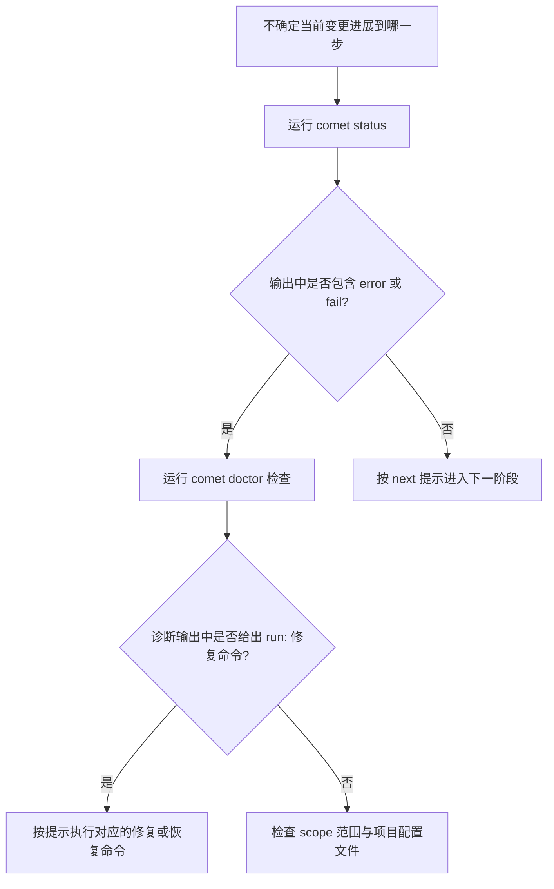

`comet doctor` 用来排查环境问题：Comet 为什么跑不起来、缺了什么、怎么修。它会检查 Node.js 环境、CLI 版本、依赖、工程目录、Skill/Rule/Hook 部署、Runtime 状态、CodeGraph 代码索引和当前 change 状态。`comet status` 看任务推进到哪一步，`comet doctor` 找环境和依赖的问题。

默认情况下诊断只读，不改任何文件。只有加 `--repair` 时，系统才会修复能自动修复的问题。

CodeGraph 部分会分别报告四项：CLI 是否可用、工程索引是否最新、MCP 服务是否注册，以及各 Agent 平台是否真正生效（effective）。索引是最新的，只说明底层数据已经写入，不代表某个 Agent 一定能用上；要排查这一项，看 JSON 里的 `codegraph` 对象。

## 基本用法

```bash
comet doctor
comet doctor --scope project
comet doctor --json
```

| 选项 | 说明 |
| --- | --- |
| `--json` | 输出结构化的 JSON 诊断结果 |
| `--scope <scope>` | 诊断范围：`auto`（自动判断）、`project`（当前项目）或 `global`（全局环境），默认 `auto` |
| `--repair` | 修复 Hook、Rule 及当前 change 绑定关系中的问题 |
| `--strategy <strategy>` | Classic 根目录迁移中断后的处理方式：`continue`（继续）或 `rollback`（回滚）；需要与 `--repair` 一起用 |
| `--yes` | 跳过需要人工确认的修复动作（例如重建 CodeGraph 索引）；需要与 `--repair` 一起用 |

## 终端输出的诊断报告

下面是一次典型故障的输出：项目级 Skill 没有完整部署，Classic 产物根目录不存在，CodeGraph 还有待同步的变更。运行 `comet doctor --scope project` 会得到：

```text
Comet Doctor (scope: project)

  ✓ Environment: node v22.20.0; platform win32/x64; project D:\Project\Comet; global C:\Users\BENYM
  ✓ Comet CLI: installed (0.4.0-beta.20)
  ✓ openspec CLI: installed (1.7.0)
  ✓ Superpowers: detected (Claude Code project, Codex project, Antigravity project, Antigravity 2.0 project; version not recorded by skills installer)
  ✗ Classic artifact layout: docs: configured docs/openspec/ missing; alternate openspec/ missing — run: comet classic root show, then restore the configured root or use comet classic root move
  ✓ Classic platform tool assets: no OpenSpec platform tool assets under docs/
  ✗ Classic OpenSpec root: Configured Classic OpenSpec root is missing: docs/openspec (alternate openspec is missing)
  ⚠ working directories: partial (missing: docs/openspec/changes, docs/openspec/changes/archive, docs/openspec/specs)
  ⚠ Comet skills: not installed in project scope — run: comet init --scope project
  ✓ scripts present: OK (12 scripts)
  ✓ CodeGraph CLI: CodeGraph CLI is installed
  ⚠ CodeGraph project index: CodeGraph index has 1 pending change(s) — run: codegraph sync
  ⚠ CodeGraph MCP registration: no supported Agent configuration detected
  ✓ current selection: no active Comet change
```

各行开头的符号含义：

- `✓`：这一项正常，不需要处理。
- `⚠`：有警告，或有可选组件缺失。通常不影响主流程，但建议按提示补齐。
- `✗`：阻塞项，必须先处理。按该行末尾 `run:` 给出的命令修复。

上例的问题在 Classic 产物根目录：配置里写的是 `docs/openspec/`，但磁盘上没有这个目录。先运行 `comet classic root show` 确认实际配置，再创建该目录，或用 `comet classic root move` 迁移。末尾的 `current selection: no active Comet change` 只说明当前没有进行中的 change，不是错误。

## 检查项一览

| 检查项 | 检查内容 |
| --- | --- |
| `Environment` | Node.js 版本、操作系统平台、当前项目路径和全局主目录 |
| `Comet CLI` / `openspec CLI` | 命令行工具是否已安装，版本是多少 |
| `Superpowers` | 外部 Superpowers 依赖在当前环境是否可用 |
| `Classic artifact layout` / `Classic OpenSpec root` | Classic 配置的产物根目录是否存在、是否可读写 |
| `working directories` | `changes`、归档目录和 `specs` 等子目录是否齐全 |
| `Comet skills` / `scripts present` | 当前范围内的 Skill 和 Runtime 脚本是否齐全 |
| `CodeGraph CLI` | CodeGraph 命令行工具是否已安装 |
| `CodeGraph project index` | 判定当前工程图谱索引是处于最新、残缺、过期滞后还是尚未初始化状态 |
| `CodeGraph MCP registration` | 核查已检测到的 Agent 客户端中是否合规注册了有效的 CodeGraph MCP 协议服务 |
| `CodeGraph effective for <Agent>` | 某个 Agent 是否同时具备 CLI、最新索引和正确的 MCP 注册 |
| `current selection` | 当前有没有明确选中的 Comet change |

## 选择诊断范围

- `--scope auto`（默认）：先完整检查当前项目；如果项目还没初始化，再检查全局安装的资产。
- `--scope project`：只检查当前项目，用来确认这个仓库是否已完成本地初始化。
- `--scope global`：只检查用户主目录下的全局安装，适合排查跨项目的 Skill、Rule、Hook 或 Runtime。

如果全局环境正常，但当前项目没有项目级的 Skill，`--scope auto` 会提示全局可用，并把项目级副本标为建议项。只有团队要求把配置和 Skill 随仓库提交时，才需要运行：

```bash
comet init --scope project
```

## JSON 诊断结果

需要接入 CI/CD 流水线或监控报警时，使用：

```bash
comet doctor --json
```

输出顶层包含整体结果：

```json
{
  "scope": "project",
  "status": "failed",
  "healthy": false,
  "repaired": [],
  "results": [
    {
      "check": "Comet CLI",
      "status": "pass",
      "message": "installed (0.4.0-beta.19)"
    },
    {
      "check": "Classic OpenSpec root",
      "status": "fail",
      "message": "Configured Classic OpenSpec root is missing: docs/openspec"
    }
  ]
}
```

`healthy: false` 表示至少有一项 `fail`；具体修复建议在 `results[].message` 里。只有 `status` 为 `passed` 且 `healthy` 为 `true`，才表示全部检查通过。

`codegraph` 对象包含 `cliStatus`、`indexStatus`、`mcpStatus`、`agents` 和 `effectiveForAgent`。只有 CLI 可用、索引最新、平台的 MCP 配置正确指向 CodeGraph 服务，目标 Agent 才会真正生效。

## 什么时候用 `--repair`

先用不带 `--repair` 的 `comet doctor` 看结果，确认输出里明确说能自动修复，或者你确实需要重置 Hook、Rule、selection 绑定、恢复中断的迁移时，再加这个参数：

```bash
comet doctor --repair
```

`--repair` 会真的写文件。Classic 产物根目录迁移中断时，按实际情况加 `--strategy continue` 或 `--strategy rollback`；涉及 CodeGraph 等需要人工确认的项，还要加 `--yes`。只想复查问题就不要加 `--repair`。

## 排查共享存储中的残留锁文件

如果怀疑共享存储目录里还留着进程退出后未清理的锁文件，可以对指定文件做只读检查：

```bash
comet doctor --lock-file <锁文件路径> --json
```

这个检查不加载项目集成逻辑，也不会终止正在运行的进程。只有输出里给出可执行的操作时，才按提示处理。Native 和 Classic 工作流已经不再使用跨进程协调锁，不要把这个排查当成日常恢复的前置步骤。

## 排查流程


