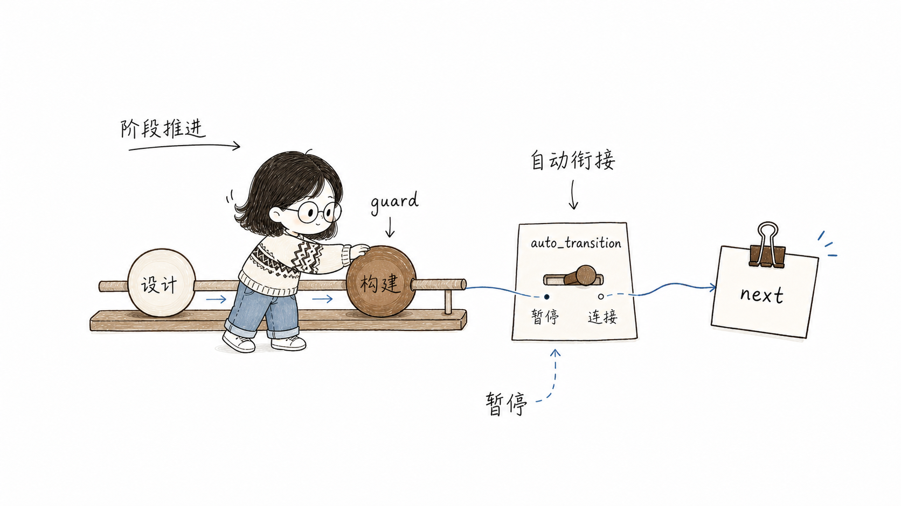

在项目配置为 Classic 的情况下，在 Agent 中调用 `/comet` 时，系统底层会交由 `/comet-classic` 自动检测当前变更处于哪个阶段、推进内部状态机，并判断是否无缝唤起下一阶段的 Skill。本文详细说明其背后的状态检测逻辑与恢复机制。

## 阶段推进 vs 自动衔接

在自动流转体系中，包含两个职责清晰的底层动作：

| 动作类型     | 负责组件           | 具体执行内容                       | 是否受 auto_transition 影响        |
| ------------ | ------------------ | ---------------------------------- | ---------------------------------- |
| **阶段推进** | guard `--apply`    | 校验通过后，更新 `.comet.yaml` 中的 `phase` 字段 | 否，只要阶段任务合格，始终会执行更新 |
| **自动衔接** | `comet-state next` | 阶段更新后，决定是否自动调用下一个阶段的 Skill   | 是，受 `classic.auto_transition` 控制 |

<Warning>
  <strong>阶段推进本身必定会执行</strong>：只要当前阶段的任务达标，guard 的 <code>--apply</code> 就会把 <code>phase</code> 推进到下一状态。<code>auto_transition</code> 仅仅决定是否在当前会话中“一口气自动触发下一个 Skill”。而在所有预设的人工决策点上，无论 <code>auto_transition</code> 设为什么，流程都必须停下来等待你确认。
</Warning>

<p align="center">
  
</p>

<p align="center">阶段推进负责记录状态，自动衔接则控制是否自动加载并触发下一阶段的 Skill</p>

## 自动检测如何运转

每次你在对话中输入 `/comet` 时，系统都会直接重新扫描项目中的磁盘文件和状态机，完全不依赖易丢失的会话聊天记录。

### 第 0 步：扫描当前活跃变更（Active Change）

1. **预设检测（最高优先级）**：若命中 hotfix 或 tweak 场景，直接调用对应的轻量预设 Skill。
2. 若未命中预设，系统运行 `openspec list --json` 检索项目中所有尚未归档的 change。
3. 根据变更数量与输入内容采取对应动作：

| 活跃变更数   | 你的输入           | 系统的实际响应                                            |
| ------------ | ------------------ | --------------------------------------------------------- |
| 0 个         | 普通需求描述       | 自动调用 `/comet-open` 开启全新变更                        |
| 1 个         | `/comet <新描述>`  | 提示确认：是继续该活跃 change，还是为新需求创建独立变更   |
| 多个         | `/comet <新描述>`  | 提示确认：是继续已有任务还是新建任务；若选继续，会列出清单供挑选 |
| 1 个         | 仅输入 `/comet`    | 自动选中唯一的活跃 change 并继续推进                      |
| 多个         | 仅输入 `/comet`    | 打印活跃任务列表，等待你指定目标 change                    |

### 第 1 步：读取物理状态

优先读取当前 Classic 产物根目录下的 `changes/<name>/.comet.yaml`。
新项目默认存储在 `docs/openspec/changes/<name>/.comet.yaml`，保留旧版布局的项目为 `openspec/changes/<name>/.comet.yaml`。
若该状态机文件缺失，系统会退一步检查 `tasks.md`、`docs/superpowers/` 以及运行 `openspec status` 进行文件级推断。

### 第 2 步：阶段精准判定

系统按以下顺序从上往下依次匹配，命中即止（以磁盘真实文件为基准；若发现状态机与文件不符，会以文件为准修复 `.comet.yaml`）：

| 匹配条件                                       | 最终路由走向                                                      |
| ---------------------------------------------- | ----------------------------------------------------------------- |
| `archived: true` 或已进入归档目录              | 提示该变更已全部完结                                              |
| `verify_result: pass`                          | 进入 `/comet-archive`（先进行归档前确认）                         |
| `verify_result: fail`                          | 失败 ≤3 次时自动打回 build 修复；第 4 次失败时暂停等待你决策       |
| `phase: verify` 或任务列表全部完成勾选         | 唤起 `/comet-verify` 执行验收                                     |
| `phase: build` 或已有 Design Doc 但执行未完毕  | full 流程进入 `/comet-build`，预设分别进入 hotfix 或 tweak        |
| `phase: design` 或已有变更但尚未产出 Design Doc| 唤起 `/comet-design` 进行技术方案推敲                             |
| `phase: open` 或仅有目录未生成 `.comet.yaml`   | 唤起 `/comet-open` 补全需求规格                                   |
| 无任何活跃变更                                 | 唤起 `/comet-open` 创建新变更                                     |

## 状态转换链路

阶段推进通常通过守卫命令的 `--apply` 或直接调用 `comet-state transition` 完成：

```bash
# 阶段守卫检查通过后更新状态（在阶段 Skill 退出前调用）
node "$COMET_GUARD" <change-name> <phase> --apply

# 触发明确的状态转换事件
node "$COMET_STATE" transition <change-name> open-complete
node "$COMET_STATE" transition <change-name> design-complete
node "$COMET_STATE" transition <change-name> build-complete
node "$COMET_STATE" transition <change-name> verify-pass
node "$COMET_STATE" transition <change-name> verify-fail
```

核心流转链如下：

```text
open-complete → design-complete → build-complete → verify-pass → archived
                                                      ↑
                                               verify-fail（打回 build 修复）
```

## 自动衔接：解析下一步指令

每当一个阶段顺利完工并更新状态后，系统会运行 `next` 解析下一步行动：

```bash
node "$COMET_STATE" next <change-name>
```

标准输出结构如下：

```text
NEXT: auto|manual|done
SKILL: <skill-name>     # 流程完成（done）时省略
HINT: <message>         # 仅在 manual 时输出提示信息
```

| 输出标识       | 核心含义                                  | 对应触发条件                   |
| -------------- | ----------------------------------------- | ------------------------------ |
| `NEXT: auto`   | 自动无缝唤起下一个阶段的 Skill            | `auto_transition` 未设为 `false` |
| `NEXT: manual` | 停止自动流转，输出友好提示并等待你手动执行 | `auto_transition: false`       |
| `NEXT: done`   | 该变更已全面完成并归档                    | `archived: true`               |

### 各阶段路由分发表

`next` 命令会根据当前的 `phase` 与工作流类型（full / hotfix / tweak）精准分发后续 Skill：

| 当前 phase | full 流程        | hotfix 预设                      | tweak 预设                      |
| ---------- | ---------------- | -------------------------------- | ------------------------------- |
| open       | `/comet-design`  | `/comet-build`（分流至 hotfix）  | `/comet-build`（分流至 tweak）  |
| design     | `/comet-build`   | —                                | —                               |
| build      | `/comet-verify`  | `/comet-verify`                  | `/comet-verify`                 |
| verify     | `/comet-archive` | `/comet-archive`                 | `/comet-archive`                |

无论前期走的是完整流程还是轻量预设，verify 与 archive 阶段的处理逻辑完全一致，均使用标准化的验收与归档 Skill。

## 连续执行与决策打断

输入一次 `/comet` 并进入 Classic 模式后，系统会自动从当前检测到的阶段顺畅启动。当一个阶段的退出门槛达成后，自动平滑流转到后续步骤：

```text
/comet
  ↓ 自动检测阶段
/comet-open ──→ /comet-design ──→ /comet-build ──→ /comet-verify ──→ /comet-archive
```

**自动推进仅在纯自动化步骤之间生效。**
一旦流程遇到预设的 [决策停顿点](/zh/concepts/decision-points)，系统必须毫无例外地暂停并等待人工拍板，严禁 Agent 擅自以“默认设置”或“根据历史习惯”代替你做决定。
在支持交互式卡片的平台上，系统会优先展示结构化的单选或多选控件；如果当前平台不支持，则平滑降级为标准的编号文本选项。

## auto_transition 的配置方法

`auto_transition` 用于控制是否在阶段完成后自动唤起下一步。其生效优先级为：

```text
change 级 .comet.yaml > 环境变量 > 项目级 .comet/config.yaml > 内置默认值（true）
```

| 选项值         | 实际效果                              |
| -------------- | ------------------------------------- |
| `true`（默认） | 输出 `NEXT: auto`，由 Agent 自动进入下一阶段 |
| `false`        | 输出 `NEXT: manual` 并打印提示，等待你手动触发下一步 |

### 什么时候适合设为 false？

- 团队希望在每个阶段切换时由人工进行代码或方案检视；
- 不同的阶段由不同的人员或不同的模型接力处理；
- 在自动化测试或 CI/CD 流水线中需要更精细的分步控制。

```bash
# 通过环境变量临时关闭自动推进
export COMET_AUTO_TRANSITION=false
```

## 轻量预设平滑升级

如果使用 hotfix 或 tweak 过程中发现改动规模超出预期，系统会主动暂停，并给出两个明确选项：

| 触发场景        | 具体表现                                                              | 处理策略       |
| --------------- | --------------------------------------------------------------------- | -------------- |
| 架构变动信号    | 出现跨模块协作、引入新 capability、Schema 变动、公开 API 变化等重大影响 | 命中任意一项即暂停 |
| 改动文件数超阈值 | 修改文件数量超过设定的阈值                                            | 暂停等待人工评估 |

| 选项名称                    | 执行效果                                                                    |
| --------------------------- | --------------------------------------------------------------------------- |
| 继续按轻量预设推进          | 保持当前预设，继续执行                                                      |
| 升级为完整 `/comet-classic` | 触发 `transition preset-escalate`，退回 design 阶段补齐设计文档并按全流程推进 |

升级通道 `preset-escalate` 具有严格的事务保证：它会一次性将流程类型切换为 `full`、将阶段回退到 `design` 并清理临时的设计记录，这三个动作要么全部成功，要么完全不执行。

## 断点智能恢复

在遭遇对话中断或长上下文被压缩后，只需重新输入 `/comet`。系统会自动重走状态探测逻辑，精准回到断点位置：

| 异常断点场景                                                           | 系统的恢复策略                                                  |
| ---------------------------------------------------------------------- | --------------------------------------------------------------- |
| `phase: build` 且标记为 `plan-ready`（所有配置已选定）                  | 重新呈现联合决策面板，确认无误后清除暂停标记继续执行            |
| `phase: build` 且标记为 `plan-ready`（尚缺配置）                        | 重新唤起联合决策，等待你补选执行方式、TDD 模式与审查严格度      |
| `phase: build` 且标记为 `plan-ready` 但计划文件丢失                    | 判定为中间文件损坏，由 Agent 重新生成落地计划                   |
| `phase: verify` 且上轮验收结果为 `fail`                                | 失败 ≤3 次时自动打回 build 修复；第 4 次失败时暂停等待人工决策  |
| `phase: open` 但实际规格文档已全部齐全                                 | 先自动运行 guard `--apply` 修正状态机，再继续推进               |
| `phase: archive`                                                       | 严密限制仅能调用 `/comet-archive` 终结任务                      |

恢复过程完全基于物理文件，即使会话历史被清空也丝毫不会受到影响。

## 行为边界与风险防范清单

Comet 的自动推进具有极为清晰的边界防护，以下是 Agent 严禁出现的越界行为：

| 危险想法 / 违规倾向         | 潜在风险与底线规则                      |
| --------------------------- | --------------------------------------- |
| “我觉得用户大概率会选这个方案” | 严禁代用户做主，遇到停顿点必须等待明确答复 |
| “这改动挺小的，就不打扰用户了” | 决策点无轻重之分，规定需要确认的必须停下 |
| “用户上次选了 A，这次肯定也选 A” | 历史偏好仅供参考，不能取代当前的直接确认 |
| “前面步骤都跑通了，应该稳了” | 流程跑完不代表验收合格，必须严格检查真实测试证据 |

## 下一步

- [五阶段停顿点和用户选择点](/zh/concepts/decision-points) — 掌握所有自动推进会暂停的人工决策点
- [Classic 配置](/zh/classic/configuration) — `auto_transition` 与更多高级配置项
- [工作流概念](/zh/concepts/workflow) — 五阶段如何协同运转
- [恢复中断的工作](/zh/guides/resuming-workflow) — 遭遇中断后的实操指南
