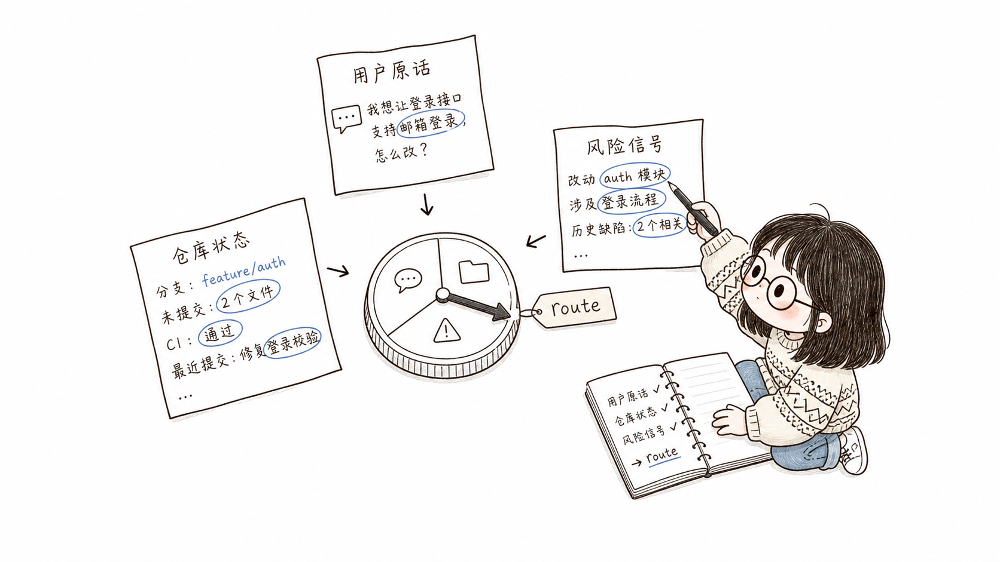
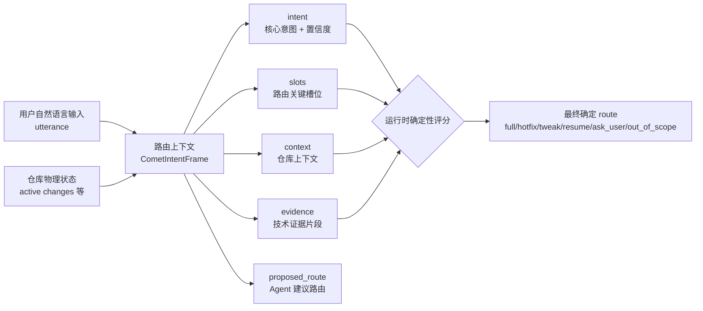
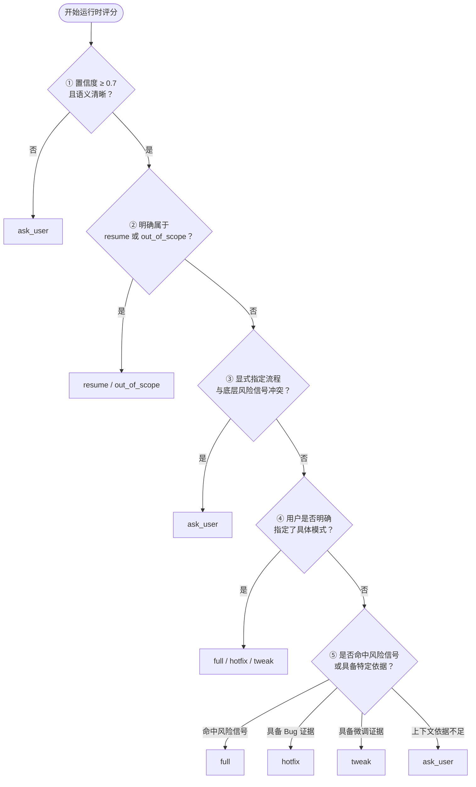

在 Classic 模式下，日常开发只需在 Agent 中输入 `/comet` 并附带任务描述。系统内部的 `/comet-classic` 路由引擎会综合**意图分类**、**关键槽位提取**与代码仓库的实际物理状态，精准裁决本次任务该走向哪个工作流。

<p align="center">
  
</p>

<p align="center">
  路由引擎综合分析用户输入、仓库状态与潜在风险信号，由运行时计算最优路由
</p>

## 六种路由走向

输入需求后，Comet 会自动将本次调用匹配至以下六种走向之一：

| 路由走向（route） | 核心含义                                         | 唤起的下一步 Skill     | 是否需要人工确认 |
| ----------------- | ------------------------------------------------ | ---------------------- | ---------------- |
| `full`            | 走完整的五阶段（open → design → build → verify → archive） | `comet-open`           | 否               |
| `hotfix`          | 快速修复已有已知异常，跳过独立设计文档           | `comet-hotfix`         | 否               |
| `tweak`           | 目标清晰的中轻量调整，增量 Spec 即为正式规格产物 | `comet-tweak`          | 否               |
| `resume`          | 继续推进某个处于进行中的活跃变更                 | 由该变更当前所处阶段决定 | 否               |
| `ask_user`        | 上下文证据不足或存在规则冲突，暂停等待确认       | 无（等待用户选择）     | **是**           |
| `out_of_scope`    | 仅为咨询提问，非实际代码研发任务                 | 无（直接回复答疑）     | **是**           |

其中需要特别注意：

- 只有 `ask_user` 与 `out_of_scope` 需要**显式人工确认**。在判断依据不足时，Comet 宁可主动暂停求证，也绝不盲目猜测。
- `full`、`hotfix` 与 `tweak` 会直接对应到确定的入口 Skill；而 `resume` 则根据你要恢复的那个变更当前停在哪一阶段顺畅接续。

<Warning>
  这是 Comet 极为重要的安全机制：<strong>物理风险信号的优先级始终高于口头表述</strong>。如果你口头上说要走 <code>hotfix</code>，但改动内容实际上触碰了核心公开 API 或底层数据结构，运行时会果断判定为 <code>ask_user</code> 并暂停，严禁在高风险场景下违规冒进。
</Warning>

## 典型场景剖析

通过以下真实开发示例，了解系统如何根据不同上下文给出合理的路由决策：

### 场景一：修复已知 Bug

```text
/comet 登录接口偶发 500，帮我排查修复一下
```

- `intent.name`: `fix_bug`，高置信度；
- `existing_behavior: true`（针对现有缺陷修复）；
- 核心风险信号全为 `false`；
- 具备强有力的 `workflow_candidate: hotfix` 事实依据。

→ 路由至 **`hotfix`**，直接唤起 `comet-hotfix`。这是典型的修复场景：快速修复现有行为异常，不增加新业务能力，也不破坏接口与 Schema。

### 场景二：口头说“微调”，实则破坏了对外接口

```text
/comet 稍微小改一下，把 CLI 的 --force 参数直接去掉
```

- `intent.name`: `make_tweak`；
- `user_explicit_workflow: tweak`（用户口头表达为微调）；
- 但同时检测到 `public_api_change: true`（删除公开命令行参数属于破坏性接口变更）。

→ 路由至 **`ask_user`**。口头指定的轻量模式与底层的重大风险信号发生冲突，系统主动暂停，提示你确认是否真的要跳过设计阶段直接修改外部公开契约。

### 场景三：恢复未完结的任务

```text
/comet 继续上次的 note-board
```

- `requested_action: continue`；
- `change_id: note-board` 且在当前活跃任务列表中。

→ 路由至 **`resume`**，系统根据 `note-board` 当前停顿的具体阶段精准唤醒。

### 场景四：纯粹咨询答疑

```text
/comet Comet 的 verify 阶段主要做哪些检查？
```

- `intent.name: ask_question`；
- `requested_action: question`。

→ 路由至 **`out_of_scope`**。检测到你只是在咨询技术细节，并未发起真实的代码变更，Comet 会直接回答问题，绝不节外生枝创建空任务。

## 日常使用建议

在日常编码中，你**完全无需手动构造复杂的路由参数**。在 Agent 中正常输入 `/comet` 后，系统会自动在后台完成意图解析与评分。只需留意以下几点：

1. **清晰准确地描述诉求**：描述越具象，路由就越精准。例如“修复订单重复提交的 Bug”比模糊的“看看这个接口”更容易直接命中 `hotfix`。
2. **遇到暂停无需惊慌**：当证据不充分或可能存在重大影响时，系统主动暂停确认是为了保护你的代码安全。
3. **全程可追溯**：若对路由结果有疑问，可以随时调阅路由上下文与诊断日志。

高级开发者或开源贡献者若想直接观察底层的评分输出，可以在终端中运行：

```bash
# 将一个路由上下文 JSON 传入运行时进行评分
node "$COMET_INTENT" route '{"schema_version":"comet.intent.v1", ...}'

# 或者从标准输入读取
node "$COMET_INTENT" route --stdin < frame.json
```

系统会输出最终裁决的 `route`、分歧诊断报告 `diagnostics` 以及规范化后的 `normalizedFrame`。

## 与独立命令 `/comet-tweak` 的分工

既然路由引擎能够自动分发至 `tweak`，那么单独的 `/comet-tweak` 入口还有必要保留吗？

两者定位互补，各有用途：

- **`/comet`**：日常标准统一入口，根据项目配置自动分流；
- **`/comet-classic`**：Classic 内部路由引擎，负责基于上下文判定具体流程；
- **`/comet-tweak`**：面向 tweak 预设的显式入口，适用于开发者已经非常明确要走微调流程的场景。

## 意图判定的底层架构（排障与进阶参考）

以下内容深入剖析路由引擎的底层判定逻辑，日常使用了解即可。

### 为什么需要结构化的意图帧？

在早期版本中，路由分发很大程度上依赖 Prompt 中的自然语言约定（例如“若是 Bug 就走 hotfix……”）。这种朴素做法在实际工程中存在三大痛点：

| 痛点问题     | 具体表现                                                           |
| ------------ | ------------------------------------------------------------------ |
| **不可解释** | 为什么选了这条路径？模型无法给出结构化论据，全凭提示词模糊推测    |
| **不可复核** | 缺乏结构化的中间参数，一旦路线选错，难以快速定位是哪条信号产生误导 |
| **不可恢复** | 对话一旦中断，模型只能重新再盲猜一次                               |

Comet 引入了结构化的意图帧（`CometIntentFrame`），将用户意图抽象为**带明确字段、证据来源与置信度**的标准数据。运行时并不轻信 Agent 初步推荐的候选路径，而是基于确定性规则重新评分，并将任何判断分歧记入诊断日志。

通过这一机制，路由决策实现了**完全的可解释、可复核与断点可复原**。

### 意图分类与槽位提取流程

**意图识别**负责定义“用户要干什么”（如开启新任务、修 Bug、微调、继续任务或咨询）。
**槽位提取**则将自然语言与当前 Git 状态解构为结构化的技术信号，每项信号均严格标注来源（`user` / `repo` / `state`）。



#### 核心风险槽位（slots）

在所有槽位中，对最终流向起决定性作用的是以下几个布尔型的**重大风险信号**：

| 槽位标识                    | 命中后的倾向                                         |
| --------------------------- | ---------------------------------------------------- |
| `existing_behavior: true`   | 属于修复既有功能缺陷 → 倾向于 `hotfix`               |
| `new_capability: true`      | 涉及新增完整业务能力 → 必须进入 `full`               |
| `public_api_change: true`   | 改变对外公开 API 或命令契约 → 必须进入 `full`        |
| `schema_change: true`       | 变更核心数据格式（如配置文件规范） → 必须进入 `full` |
| `cross_module_change: true` | 涉及跨模块边界的深度联动 → 必须进入 `full`           |

一旦命中上述后四项中任意一个重大风险信号，即便口头上说得再轻描淡写，运行时都会强制将其推向安全稳妥的 `full` 流程。

### 运行时评分优先级

在 Agent 整理好意图帧后，运行时通过固定的优先级算法给出最终 `route`：



这一套严谨的判定链路杜绝了盲目猜测：
1. **置信度不足（< 0.7）直接进入 `ask_user`**：宁可多问一句，绝不冒险走错流程；
2. **存在多个未结任务且未指明时进入 `ask_user`**：由你明确指定要继续哪一个；
3. **物理风险信号永远具有一票否决权**：即便要求走轻量修复，只要改动越界，立刻暂停请示。

## 下一步

- [工作流核心概念](/zh/concepts/workflow) — 深入了解 Classic 五阶段流转细节
- [决策停顿点全景速查](/zh/concepts/decision-points) — 掌握所有需要人工把关的关键时刻
- [核心脚本概览](/zh/scripts/overview) — 了解底层脚本如何高效协同
