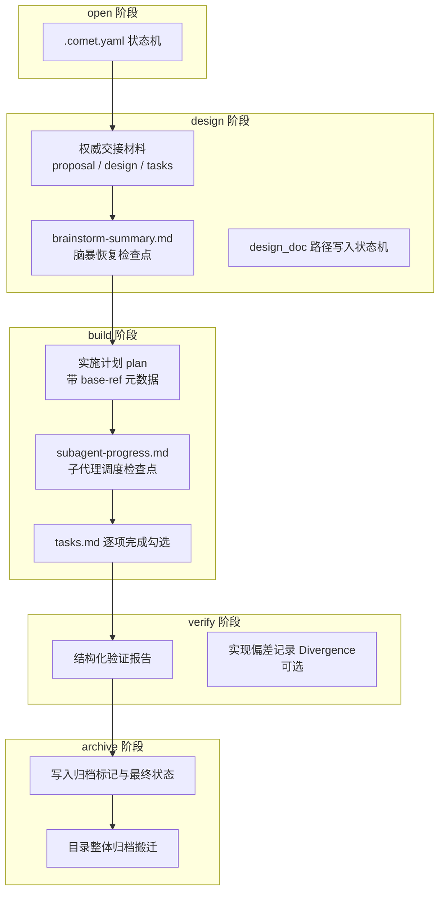

在运行 `/comet` 的五阶段流程中，Comet 会在各个阶段动态生成一系列中间工作文件。
这些文件专用于**长上下文压缩、意外断点恢复、保存质量证据以及各阶段之间的可靠交接**。最终交付给用户的，依然是干净的业务代码、需求文档与标准架构方案。

深入了解这些中间文件的作用，能帮助你在会话被压缩后恢复进度，在遇到异常时快速定位排查，并在归档前确认交付物是否齐全。

## 中间产物流转过程



<p align="center">
  
</p>

<p align="center">各类中间产物分别负责上下文唤醒、断点恢复、阶段交接与验收留证</p>

下文中使用 `<classic-root>` 指代当前 Classic OpenSpec 根目录：新项目默认保存在 `docs/openspec/`，保留旧版布局的项目为 `openspec/`。实际位置由配置项 `classic.artifact_layout` 决定，详见 [项目文件结构](/zh/guides/project-structure)。

## 贯穿全局的状态机：.comet.yaml

| 关键属性 | 具体说明                                    |
| -------- | ------------------------------------------- |
| **存放路径** | `<classic-root>/changes/<name>/.comet.yaml` |
| **创建时机** | open 阶段初始由 `comet-state init` 自动生成 |
| **更新时机** | 每个阶段守卫放行时自动更新对应字段          |
| **维护方式** | 机器严格维护（由脚本读写、guard 命令校验）  |

这是 Comet 唯一的跨阶段权威状态文件。随着工作流稳步推进，其中的状态字段会逐步确定下来，详见 [状态管理](/zh/concepts/state-management)。

<Note>
  在 Classic 工作流中，<code>.comet.yaml</code> 始终是当前运行状态的唯一权威来源。
  <code>.comet/state-events.jsonl</code> 是只允许追加的审计日志，用于回溯状态变更原因。
  <code>.comet/run-state.json</code> 与 <code>trajectory.jsonl</code> 属于底层运行缓存。
  在跨会话断点恢复时，系统主要依赖 <code>.comet.yaml</code> 与 Markdown 检查点，日常无须手动修改底层日志。
</Note>

### state-events.jsonl（状态变更审计流水）

| 关键属性 | 具体说明                                                                           |
| -------- | ---------------------------------------------------------------------------------- |
| **存放路径** | `<classic-root>/changes/<name>/.comet/state-events.jsonl`                          |
| **创建时机** | 首次成功触发状态流转（state transition）时自动创建                                 |
| **核心作用** | 完整记录由守卫检查、状态流转以及归档操作引起的每一次字段变迁                      |
| **维护方式** | 由 Comet 自动追加写入，纯文本可读，切勿手动篡改                                    |

该文件不作为当前状态的判决依据，但在复盘排查时极具价值，能清晰回答：当前 `phase` 是何时由哪个守卫推进的？当时更新了哪些具体字段？

## design 阶段中间产物

design 阶段主要负责需求澄清与方案定稿，确保上下文传递给后续的编码阶段。

### 原文复用与集中阅读视图

Classic 模式直接引用 proposal、design、tasks 与增量 Specs 原始文档，Agent 根据任务需要按需加载，无需重复生成冗余的 Hash 镜像包。

只有当你希望在一个独立的 Markdown 文件中集中通读全部上下文时，才需要让 Agent 生成汇总视图（后台执行 `comet handoff <change-name> design --write --full`）。该命令会在 `.comet/handoff/design-context.md` 生成只读的汇总视图，仅供阅读，不能替代原始材料，详见 [comet handoff 脚本](/zh/scripts/comet-handoff)。

### 脑暴进展快照：brainstorm-summary.md

| 关键属性 | 具体说明                                                             |
| -------- | -------------------------------------------------------------------- |
| **存放路径** | `<classic-root>/changes/<name>/.comet/handoff/brainstorm-summary.md` |
| **创建时机** | 在 design 阶段方案头脑风暴讨论中增量生成                             |
| **核心作用** | **长上下文压缩后的关键恢复依据**，会话压缩后可直接从这里找回方案决策 |
| **维护方式** | 由 Agent 自主维护（格式结构受 Skill 严格约束）                       |

该快照负责记录：
- 双方已达成共识的技术架构与选型；
- 方案的核心取舍与潜在风险点；
- 事先定好的测试策略；
- 尚未最终敲定的待定选项（明确标注为 `pending` 或 `candidate`）。

<Tip>
  <code>brainstorm-summary.md</code> 是方案设计阶段极其关键的断点。一旦遭遇对话窗口压缩，Agent 会直接从该文件中唤醒既定结论，避免重新展开冗长讨论。它在头脑风暴中<strong>增量更新</strong>，并在方案敲定后最终定稿。
</Tip>

## build 阶段中间产物

build 阶段的中间文件专注于任务拆解跟踪与多子代理（Subagent）的调度恢复。

### 实施计划（plan）

| 关键属性 | 具体说明                                            |
| -------- | --------------------------------------------------- |
| **存放路径** | `docs/superpowers/plans/YYYY-MM-DD-<feature>.md`    |
| **创建时机** | build 阶段由子代理调用计划生成工具编写产出          |
| **核心作用** | 编码实施指南，其文档头（frontmatter）是后续验收的关键证据 |
| **维护方式** | 由 Agent 自主编写并由用户确认                       |

该计划的文档头记录了代码验证所需的重要元数据：

```yaml
---
change: <openspec-change-name>
design-doc: docs/superpowers/specs/YYYY-MM-DD-<topic>-design.md
base-ref: <编码前的 git HEAD commit hash>
---
```

其中 `base-ref` 记录了实际编码前的 Commit SHA，在 verify 阶段用它来客观统计本次代码改动的真实边界。

### 子代理调度检查点：subagent-progress.md

| 关键属性 | 具体说明                                                                  |
| -------- | ------------------------------------------------------------------------- |
| **存放路径** | `<classic-root>/changes/<name>/.comet/subagent-progress.md`               |
| **创建时机** | build 阶段（仅在启用 `subagent-driven-development` 模式时创建）            |
| **核心作用** | **子代理调度的检查点**，确保任务逐项推进且状态不丢失                  |
| **维护方式** | 严格由**主会话**写入，后台子代理无权编辑                                  |

该文件记录了当前子任务的详细执行状态：
- 当前正在执行的子任务描述及其对应的 OpenSpec 原始任务；
- 当前子状态（`implementing` 编码中 / `task-review` 审查中 / `checkoff` 勾选中 / `done` 已完成）；
- 本次改动关联的 Commit Hash、变更文件列表与红绿测试证据；
- 既定的代码审查严格度（`review_mode`）；
- 审查反馈意见与当轮重修轮次。

<Warning>
  <code>subagent-progress.md</code> 每完成一个子任务便会刷新一次。负责编码或审查的后台 Subagent <strong>禁止编辑该文件</strong>，该文件完全由主调度会话统一管理。这从机制层面避免了子代理擅自把自己标记为“已通过”的隐患。
</Warning>

### 任务完成跟踪：tasks.md 勾选

| 关键属性 | 具体说明                                 |
| -------- | ---------------------------------------- |
| **存放路径** | `<classic-root>/changes/<name>/tasks.md` |
| **核心作用** | 真实的进度跟踪看板（`- [ ]` → `- [x]`）   |
| **维护方式** | 主会话在审查通过后逐项勾选               |

Comet 不设立多余的任务完成计数器，直接以 `tasks.md` 内的标准复选框作为唯一事实。系统使用 `comet-state task-checkoff` 验证任务项是否被合法勾选。在子代理模式下，只有主会话确认审查通过后才会在文档中打勾，实现严格的权责分离。

## verify 阶段中间产物

### 结构化验证报告

| 关键属性 | 具体说明                                                            |
| -------- | ------------------------------------------------------------------- |
| **存放路径** | `docs/superpowers/reports/YYYY-MM-DD-<change-name>-verify.md`       |
| **创建时机** | verify 验收阶段，全部通过并写入文件后才标记为 pass                    |
| **核心作用** | 验收依据：包含各项检查结果明细、PASS/FAIL 状态及例外接受理由  |
| **维护方式** | 由 Agent 自动生成并保存                                             |

报告路径会同步记录在 `.comet.yaml` 中。阶段守卫在放行进入归档前，会强制校验该验证报告在磁盘上是否存在且状态达标。

### 实现偏差记录（Implementation Divergence，可选）

| 关键属性 | 具体说明                                                           |
| -------- | ------------------------------------------------------------------ |
| **存放路径** | 追加记录在 Design Doc（`docs/superpowers/specs/...-design.md`）末尾 |
| **触发时机** | 完整验收时发现代码实现与最初设计存在分歧，且用户选择接受偏差时      |
| **核心作用** | 客观记录代码实现与原始设计文档之间的合理偏差及决策背景             |

若你确认接受该偏差，接受的原因与影响范围会一并记录在验证报告中备查，主 Spec 始终保持为最新权威版本。

## archive 阶段产物

进入归档阶段后，系统不再创建冗余文件，而是对已有产物进行规范标注，并将目录统一搬迁至归档仓库。

### 归档元数据标注

| 目标文件               | 标注内容                                         | 具体含义                     |
| ---------------------- | ------------------------------------------------ | ---------------------------- |
| Design Doc 设计文档    | `archived-with: <archiveName>` + `status: final` | 标明所属归档版本与定稿状态   |
| 实施计划 Plan          | `archived-with: <archiveName>`                   | 标明所属归档版本             |

### 规范归档目录

整个 change 目录会被完整移动至 `<classic-root>/changes/archive/YYYY-MM-DD-<name>/`，包括所有的状态机、过程快照、子任务进度与增量 Spec。搬迁完成后，`.comet.yaml` 状态正式更新为 `archived: true`。

## 中间产物速查清单

| 日常开发诉求                  | 查阅对应的中间产物                          |
| ----------------------------- | ------------------------------------------- |
| 查看当前阶段、执行模式与审查配置 | 直接查看 `.comet.yaml`                      |
| 查阅方案设计时的需求背景      | 查看正式的 proposal、design、tasks 原始文档 |
| 了解头脑风暴达成了哪些共识    | 查阅 `.comet/handoff/brainstorm-summary.md` |
| 掌握子代理当前正在做哪一步    | 查阅 `.comet/subagent-progress.md`          |
| 检查任务列表完成进度          | 查看 `tasks.md` 复选框的勾选情况            |
| 查阅自动化测试与验收结果      | 查看 `docs/superpowers/reports/...-verify.md` |
| 探究当前阶段为什么发生流转    | 查看 `.comet/state-events.jsonl` 的最新事件 |

## 下一步

- [工作流核心概念](/zh/concepts/workflow) — 了解中间文件在五阶段中的演变逻辑
- [状态管理](/zh/concepts/state-management) — 掌握 `.comet.yaml` 的每一个配置字段
- [上下文交接与原文复用](/zh/concepts/context-compression) — 深入理解无损交接机制
- [恢复中断的工作](/zh/guides/resuming-workflow) — 借助产物恢复工作现场
