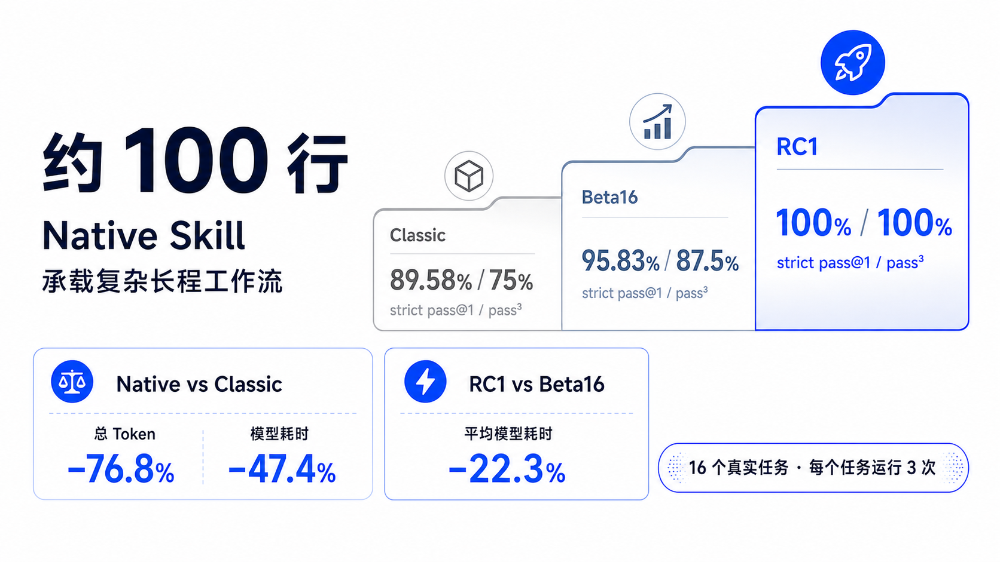
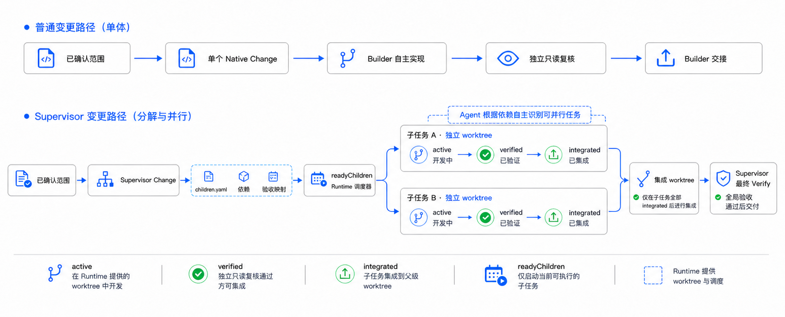

## 目标驱动的 Agent 研发模式

Native 是 Comet 面向云端旗舰模型的轻量开发工作流。像 Claude Opus、GPT-5 这类模型，本身已经具备很强的代码理解、方案构思和测试规划能力；对这类模型套用繁杂的中间模板文档和刻板步骤，反而会拖慢节奏。

Native 核心只把控两件事：

- **明确需求边界**：通过 `brief.md`（记录目标、范围、非目标以及你确认过的关键决策）和目标 Specs，把“具体要交付什么”定清楚，同时原样保存你的原始请求。
- **基于真实证据验收**：Builder 通过 Agent 平台工具执行必要检查并提交候选实现，Verify 对照原始请求与全部验收项逐条核验，确保代码真正达标。

至于具体的代码结构、内部规划和编码手法，都交给模型自主决定。日常使用中，你只需在对话里用自然语言沟通，所有状态推进和保护校验都由 Agent 在后台调用 Runtime 完成。

在 Comet Eval 与 Classic 的实测对比中（覆盖 16 个真实任务、48 次运行，选取双方都通过的 41 组配对样本），Native 的总 Token 消耗减少了 **76.8%**，Agent 交互轮次减少了 **57.4%**，总耗时缩短了 **47.4%**，三次全通过率达到 **87.5%**。详细实验设计与原始数据见 [Native 与 0.4.0 Classic 真实评估](/zh/eval/comet-native-vs-040-experiment)。

### Native Loop 如何达成目标

Shape 把你的目标转化为清晰的 `brief.md`、目标 Specs 和结构化验收条目；Build 阶段由模型自主编码并用平台工具跑检查；Verify 对照原始请求和全部验收项逐条核验结果。

只要有验收项未通过，Runtime 就会带着具体的失败依据把任务带回 Build，修复后再次核验全部验收项；只有全部通过，并且你接受了验收结果，才会进入 Archive。过程中如果遇到需要你拍板的新决策、外部阻塞或达到失败上限，循环会自动暂停并把决定权交还给你，避免无效空转。

### 与 `/goal` 的异同

Native Loop 在理念上也是一种 Goal Loop，和 [`/goal`](https://learn.chatgpt.com/use-cases/follow-goals) 一样让 Agent 围绕可验证终点持续推进。两者的区别在于：`/goal` 提供通用的长时间执行能力，而 Native Loop 面向软件工程场景，内置了需求界定、阶段守卫、工作区隔离和证据验收：

| 对比项 | `/goal` | Comet Native |
| --- | --- | --- |
| 目标定义 | 用户提供自然语言目标与停止条件 | Shape 将目标转化为 `brief.md`、Specs 和逐项可验证的验收条目 |
| 状态恢复 | 由平台环境保存 Goal 内部状态 | 本机 Run 与仓库检查点配合，新会话或新设备可按需恢复 |
| 完成判定 | 由模型自行判断是否达到停止条件 | Agent 实跑检查，Verify 对照原始请求和真实证据逐项核验 |
| 工程协作 | 专注单一目标的持续运行 | 内置分支管理、worktree 隔离、多任务并行、Supervisor 拆分与归档 |
| 结果保留 | 结束当前 Goal 对话 | 完整保存可追溯的需求、状态检查点、验收报告与归档 Specs |

两者也可以结合使用：由 `/goal` 提供长时间的持续驱动，由 Native 负责研发过程中的需求边界、工作区保护、状态守卫和归档交付。

> 结合用法：在 Agent 对话中输入 **/goal 使用 comet skill 实现这个任务**，即可在 Goal 模式下运行 Comet Native。

<Tip>
  **实测数据：Native 相比原生 Goal 的稳定性表现**

  在 [Native 0.5.3 与原生 Goal 实测对比](/zh/eval/comet-native-053-vs-goal-experiment) 实验中，Comet 在 SkillsBench 与 WorkBuddy-Bench 基准任务上对比了未配置 Comet 的 Claude Code 原生 `/goal` 模式。

  实验表明：原生 Goal 虽然具备单次跑通的能力（SkillsBench 上 pass@3 为 100.0%），但缺少固定的验收检查，多次重复执行时容易出现行为漂移或超时（SkillsBench 上连续 3 次满分的 pass^3 为 0.0%）；Comet Native 通过 Shape 验收项约束与 Verify 基于真实测试的修复循环，整体满分率达到 66.7%（Goal 为 44.4%），pass^3 达到 33.3%，在复杂的长任务中保持了更高的重复运行稳定性。
</Tip>

## 让 Skill 回归本质

在传统做法里，人们常把设计、计划、TDD、Code Review 等大量细碎规则硬编码进同一个大 Skill，结果容易与强模型自身的推理规划产生冲突。

Skill 本质上是按需注入 Agent 上下文的引导能力。因此 Comet Native **刻意不在流程里堆砌冗长的编码方法论**：如果你想让 Agent 采用 TDD 或在写完后做专门的 Code Review，只需按需安装对应 Skill，并在 `AGENTS.md`、`CLAUDE.md`、Comet 个人记忆或 Rule 等位置说明你的偏好即可。

Native Skill 只专注生命周期与状态协议，具体编码手法交给模型和专项 Skill。得益于这种解耦设计，**100 多行的 Native Skill 就能驱动过去需要多套重型组件才能完成的完整研发流程**。

## 四个阶段推进

Native 主链路聚焦四个结果：目标清晰、实现可控、验收可靠、交付可查。模型自主决定实现路径，Runtime 负责阶段衔接与写入保护，只在需要你作决定或遇到阻塞时暂停。架构细节见 [Native Runtime 的组成](/zh/native/runtime)。

### Shape：把模糊想法整理成可验证目标

Shape 会先查明代码库现状，再把信息分为三类处理：可自行查明的客观事实由 Agent 直接调查；影响功能行为、兼容性或交付范围的决策向你提问；纯内部实现细节由模型自行权衡。

提问时，Agent 按项目配置的 `batch`（每轮集中问独立问题）或 `sequential`（逐题递进问）组织轮次，并为每道题附上推荐方案与实际影响。当所有关键分歧都已确认、`brief.md` 和目标 Specs 整理完毕，且你对最终完整方案明确确认后，Runtime 才放行进入 Build。详见 [Sequential 与 Batch 澄清](/zh/native/clarification-modes) 与 [哪些决定需要你确认](/zh/native/decision-ownership)。

### Build：模型自主实现，Comet 管理工作区与状态

进入 Build 后，`brief.md` 与目标 Specs 界定了“交付什么”，模型自主决定架构、测试和工具调用；Comet 负责分支与 worktree 隔离、状态同步和异常恢复。

常规需求在单个 change 中完成；涉及多个可独立验证模块的大型需求，可以升级为 [Supervisor Change](/zh/native/supervisor-change)，由 Runtime 按依赖为各子任务分配独立 worktree 并行开发，验收通过后串行合入集成分支。Builder 提交的代码称为**候选实现**，仍需经过 Verify 检验。

### Verify：让每一个“完成”都有真实证据

Verify 对照你最初的原始请求、`brief.md`、目标 Specs、实际代码改动以及平台实跑的检查结果逐项核查。常规任务可在当前会话以只读角色验收，也可按你的要求交给独立只读会话审查；Build 阶段仍有效的检查结果可以直接复用。

只要有验收项未通过，Runtime 就把失败依据带回 Build 修复，修完后仍覆盖全部验收项，防止修好 A 弄坏 B。连续失败达到配置上限或遇到外部环境缺失时，循环自动暂停向你说明原因。详见 [Native Loop](/zh/native/native-loop) 与 [验证与修复](/zh/native/verification-and-repair)。

### Archive：规范合并 Specs 并归档交付

全部验收项通过且你接受结果后，Runtime 执行预检、合并项目正式 Specs、将 change 目录移入归档历史，并生成或更新 `verification.md`。归档前如果代码或需求又发生改动，由 Agent 评估影响并按需补验或重审，不会让过期结论进入正式归档。

归档完成后，Agent 按你确认的交付范围（仅保留本地工作区、本地提交、合并到目标分支、推送或创建 PR）执行并核对实际 Git 状态。详见 [归档与交付](/zh/native/archive-and-delivery)。

## 状态保存与断点恢复

关闭窗口、上下文压缩或更换开发机时，Comet 依赖三处各司其职的记录恢复现场：

1. **本机 Run 目录**（默认位于 `~/.comet` 下按工作区隔离的目录）：保存完整运行历史、动作领取、用户决定与事务日志，无需提交到 Git。
2. **change 目录下的 `comet-state.yaml`**：记录业务阶段与验收状态，并在稳定边界保存防篡改的恢复检查点（`run_checkpoint`）。换设备或本机记录丢失时，只需同步仓库文件就能从检查点恢复原 Run。
3. **`.comet/current-change.json`**：记录当前工作区选中的 change，防止误改其他任务的目录。日常只需在对话里告诉 Agent 切换任务或临时取消选中，不需要手动修改该文件。

如果恢复时发现本地分支、目录或事务状态不一致，Comet 会主动暂停并说明原因，不会在错误目录下盲目写入。详见 [Native 任务恢复](/zh/native/recovery-playbook)。

## 与 Classic 工作流的关系

Native 与 Classic 相互独立、按需互补，选型对比见 [Native 还是 Classic](/zh/native/native-vs-classic)。日常在 Agent 对话中输入 `/comet` 时，系统按 `.comet/config.yaml` 自动路由到对应工作流。

延伸阅读：[Native 快速开始](/zh/native/quickstart)、[Native Loop](/zh/native/native-loop)、[Native 产物与状态](/zh/native/artifacts-and-state) 与 [Native 的运行时保护与故障恢复](/zh/native/safety-and-recovery)。
