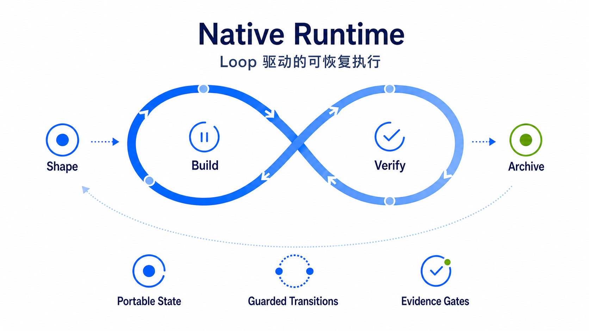
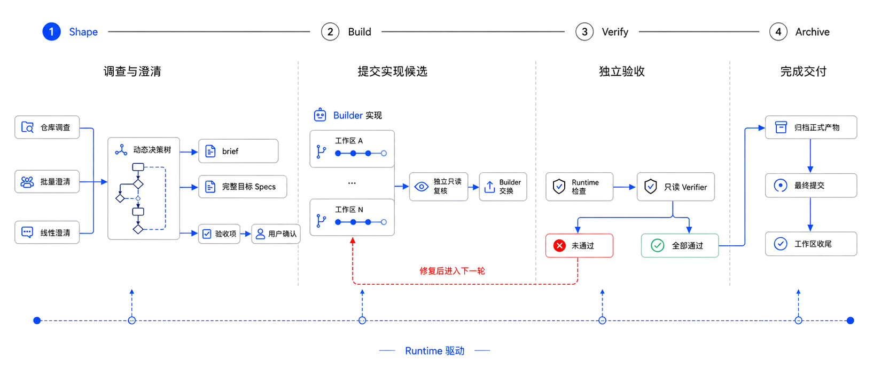
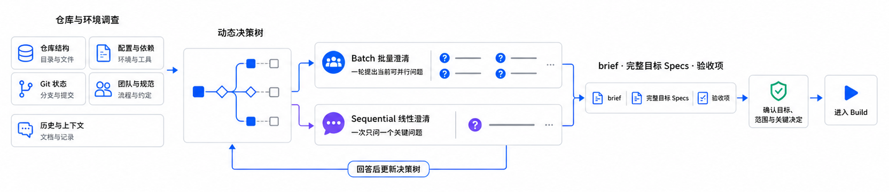

## 目标驱动的 Agent 研发模式

Native 是 Comet 专门为现代高能力档模型打造的轻量开发工作流。像 Fable 5、GPT-5.6 这类模型，本身就已经具备极强的代码理解、方案构思与测试规划能力。对于这类模型，若依然强制套用繁杂的设计文档、固定的任务计划与刻板的流程约束，不仅拖慢节奏，实际收益也十分有限。

Native 核心只把控两件事：

- **明确需求边界**：通过 `brief.md`（清晰记录目标、范围、非目标以及经你确认的关键决策）和完整目标 Specs，把“具体要做什么”彻底定下来。
- **基于证据验收**：由 Runtime 严格执行必要的自动化检查，再由 Verify 对照原始需求与验收项，验证最终代码是否真正达标。

至于具体的任务规划、代码实现、测试编写与审查方式，则完全交给模型自主决策。

在 Comet Eval 与 Classic 的实测对比中（覆盖 16 个真实任务、48 次运行，选取双方均通过的 41 组配对样本），Native 的总 Token 消耗减少了 **76.8%**，Agent 交互轮次减少了 **57.4%**，总耗时缩短了 **47.4%**，三次全通过率达到 **87.5%**。详细实验设计与原始数据请参考 [Native 与 0.4.0 Classic 真实评估](/zh/eval/comet-native-vs-040-experiment)。


### Native Loop 如何达成目标

Shape 将用户目标转化为清晰的 brief、Specs 以及可验证的验收项；Build 阶段由模型自主编码实现；Runtime 负责执行必要检查，并由 Verify 严格对照原始需求和验收标准判断交付质量。



任何未通过的验收项都会携带具体的失败原因打回 Build 阶段，由模型针对性修复后重新核验；只有当所有验收项全部通过且结果获得接受，才会解锁 Archive 阶段。如果在推进过程中遇到需要人工裁决的新决策或无法逾越的外部阻塞，循环会主动暂停并将控制权交还给你，避免无休止的无效尝试。



### 与 `/goal` 的异同

Native Loop 在理念上也是一种 Goal Loop。它与 [`/goal`](https://learn.chatgpt.com/use-cases/follow-goals) 一样，都让 Agent 紧密围绕可验证的终点持续攻坚。两者的核心区别在于：`/goal` 提供的是通用的长程执行能力；而 Native Loop 则专为软件工程研发量身定制，内建了严密的阶段治理、客观验收标准与状态机管理：

| 对比项   | `/goal`                    | Comet Native                                             |
| -------- | -------------------------- | -------------------------------------------------------- |
| 目标定义 | 用户提供自然语言目标与停止条件 | Shape 将目标转化为 brief、Specs 和逐项客观验收标准         |
| 状态恢复 | 由平台环境保存 Goal 的内部运行状态 | 状态保存在项目文件中，新会话随时可由 Runtime 无缝接续    |
| 完成判定 | 由模型自行判断是否达到停止条件 | Runtime 严格执行测试检查，并在 Verify 中依据真实证据逐项验收 |
| 工程协作 | 专注于单一目标的持续运转   | 内置分支管理、worktree 隔离、多任务并行、自动回退重试与归档闭环 |
| 结果留存 | 结束当前 Goal 对话         | 完整留存可供审计追溯的需求、状态机、验收报告与归档记录   |

简而言之，Native 在通用长程目标执行的基础上，补齐了软件工程落地不可或缺的**目标界定、断点恢复、证据核验与规范归档**。你也可以将二者结合使用：由 `/goal` 提供长效持续运行支持，由 Native 负责研发流程中的目标把控、工作区绑定、状态守卫与达标裁决。

<Tip>
  **实测数据：Native 相比原生 Goal 的稳定性表现**

  在 [Native 0.5.3 与原生 Goal 实测对比](/zh/eval/comet-native-053-vs-goal-experiment) 实验中，Comet 在 SkillsBench 与 WorkBuddy-Bench 基准任务上对比了未配置 Comet 的 Claude Code 原生 `/goal` 模式。

  实验表明：原生 Goal 虽然具备单次跑通的能力（SkillsBench 上 pass@3 为 100.0%），但因缺少确定性质量门禁，在多次重复执行时容易发生行为漂移或超时（SkillsBench 上连续 3 次满分的 pass^3 为 0.0%）；而 Comet Native 凭借 Shape 阶段的验收项约束与 Verify 阶段的真实测试回退闭环，整体满分率达到 66.7%（Goal 为 44.4%），pass^3 达到 33.3%，在复杂长程任务中展现出显著更高的重复运行稳定性。
</Tip>

## 让 Skill 回归本质

在传统开发范式中，开发者往往倾向于在 Skill 中写入大量繁杂的工程规则，强制 Agent 必须严格按照设计、计划、TDD、审查的死板步骤推进。然而，当模型进化到现代高阶梯队后，其自身的代码探索、逻辑推导和工具规划能力早已非常强大。过于死板的流程硬编码，反而容易与模型更高效的原生推理思路产生冲突。

让我们回到 Skill 的底层机制：Skill 本身作为 System Prompt 注入到 Agent 的运行环境中；Agent 运行时会根据当前任务与 Skill 的描述信息进行匹配，决定何时渐进式加载该能力。

因此，Comet Native **刻意不在 Build 阶段重复堆砌冗长的工程实施规则**。以 TDD 为例：如果你希望 Agent 在实现时采用测试驱动开发，只需配置或安装通用的 TDD Skill 即可。

在运行 Comet Native 时，**Agent 会自主判断并调用最适合当前任务的工程 Skill**。Native Skill 因而能保持极度纯粹，只专注于管理生命周期与状态协议，而具体的技术实现手段则交给专门的 Skill 提供。这种基于 ReAct 模式的解耦设计，正是业界 Agent 架构演进的主流方向。得益于这种精简架构，**仅需 100 多行的 Comet Native Skill 即可轻松承载过去 Classic 多组件协同才能完成的复杂流程**。

## 四个阶段稳步推进

Native 的主链路聚焦四个关键结果：目标清晰、实现可控、验收可靠、交付可查。模型拥有充分的自主权来决定具体实现路径，Runtime 则负责保障阶段间的自动衔接，并在遇到需要人工确认的决策时及时暂停。关于 Runtime 的详细架构，请参考 [Native Runtime 的组成](/zh/native/runtime)。

### Shape：将模糊想法转化为清晰可执行的目标

Shape 会先全面扫描项目仓库，结合已有代码上下文动态抛出真正需要确认的问题。Comet 将信息严格划分为三类：

- **可自主查明的客观事实**：能从代码库或构建配置中直接找到答案的内容，由 Agent 自行查明，绝不打扰用户。
- **需要人工确认的产品决策**：直接影响最终功能行为、技术选型或兼容性约定的关键抉择，必须由你拍板。
- **内部实现细节**：不改变外部交互行为的纯内部编码选择，交由模型自行权衡。

在交互体验上，Shape 采用类似高强度对齐的澄清机制。Agent 会在底层动态维护一棵决策树：每次排查出新代码事实或收到你的明确答复后，它都会即时更新关联分支，进而推导出下一步真正需要沟通的问题。系统支持两种澄清交互形式，并始终为每个问题提供推荐答案与影响说明：

- **Batch（批量澄清）**：一次性集中呈现当前相互独立的几个问题，适合希望快速确认、一口气推进的场景。
- **Sequential（逐步澄清）**：一次只聚焦一个影响最大的核心问题；在你答复后再刷新决策树并深入下一层，适合复杂架构权衡。



只有当所有核心分支达成一致，`brief.md`、Specs 与验收项梳理完毕，且你对最终范围与关键决策完成确认后，Runtime 才会解锁放行进入 Build。详细说明请参考 [澄清模式](/zh/native/clarification-modes) 与 [决策归属](/zh/native/decision-ownership)。

### Build：模型自主实现，Comet 保驾护航

进入 Build 阶段后，`brief.md` 与 Specs 共同界定了“最终交付什么”，模型根据任务复杂度自主决定架构方案、测试手法与所需工具。Comet 负责工作区环境隔离、状态同步、阶段流转与异常恢复，让模型把算力全神贯注地倾注在业务代码上。

常规需求在一个 change 中即可顺利搞定。如果遇到规模庞大、涉及多项独立模块的大型需求，Native 会启动 Supervisor Change 模式：先理清各个子任务的先后依赖与验收边界，再为满足启动条件的子任务分别准备独立的 Git worktree。不同子任务支持在多会话中并行开发，最终只有测试通过且依赖就绪的成果才会按部就班集成。


Builder 提交的代码仅被视作**候选实现**，必须通过后续 Verify 阶段的严格考验。详细机制请参考 [Supervisor Change](/zh/native/supervisor-change)。

### Verify：让每一个“完成”都经得起检验

Verify 阶段接手提交的候选代码，严格对照最初的原始需求、brief、完整 Specs、实际代码变更以及 Runtime 自动化检查结果逐项核查。新建任务支持在当前会话中快速核验，也可根据需要启用独立审查，实际采用的审查方式会明确记录在报告中。Build 阶段已跑过且依然有效的检查结果可直接复用；任何遗漏项、伪造项或报错检查都无法侥幸蒙混过关。

一旦验收发现瑕疵，Runtime 会带着详尽的报错日志将任务打回 Build 阶段。Builder 在修复时会优先排查未通过项及其关联代码；在局部修复完成后，系统仍会执行一次全局核验，防止“修好了 A 却改坏了 B”。若遭遇连续多次修复无果或运行环境报错，循环会主动停下来向你求助，杜绝 Token 浪费。

详细机制请参考 [Native Loop](/zh/native/native-loop) 与 [验证与修复](/zh/native/verification-and-repair)。

### Archive：将通过验收的成果规范归档

只有全部验收项均亮起绿灯并获得接受，系统才允许进入 Archive。Runtime 会生成排版工整的 `verification.md`，完整记录需求背景、测试证据与最终验收结论，并将敲定的规格文档沉淀到项目知识库中。

归档时系统会复用已有的测试结论，并最后复核一次代码与规格的吻合度。如果在准备归档的关头代码或需求又被擅自改动，既有结果将立即作废，任务会自动退回对应阶段重新核对。

最终，Comet 根据你的偏好完成提交与交付。针对不同隔离模式（current、branch、worktree），系统提供清晰的交付动作：
- 在 `current` 模式下（直接在当前分支开发），Comet 确认无误后直接就地完成归档，不做任何额外的分支合并或推送；
- 在 `branch` 或 `worktree` 隔离模式下，系统在归档前提供明确选项：仅在本地保留工作区、本地合并分支、直接推送远程、推送并自动创建 PR、或暂缓归档。

此后，无论何时更换开发设备或新建会话，你都能从项目归档文件中清晰追溯每一次需求的来龙去脉。详细内容请参考 [归档与交付](/zh/native/archive-and-delivery)、[产物与状态](/zh/native/artifacts-and-state) 以及 [连续推进与恢复](/zh/native/continuation-and-checkpoints)。

## 状态管理与断点恢复

关闭窗口、切换机器或遭遇意外中断时，Comet 能够直接基于保存在项目中的状态文件，从上次停下的位置精准继续。状态信息清晰分布在三个位置：

1. 当前 change 目录下的 `comet-state.yaml`：详细记录当前阶段、循环轮次、验收进展、交接摘要、最新检查结论、阻塞原因以及下一步建议。即便切换电脑或本机临时缓存丢失，Runtime 也能仅凭该文件完整重建状态。
2. `.comet/runtime/native/` 下的本机文件：包含本地 `state.json`、运行日志、进程锁与事务记录。这些文件属于本地缓存，无需同步到 Git，损坏或丢失时会自动从 YAML 文件恢复。
3. `.comet/current-change.json`：标明当前会话正在操作哪个 change，防止改动误写到其他需求目录中。日常查询命令（如 `status` 和 `show`）保持纯只读，不会篡改此指针。如果当前 change 已归档或删除，你可以随时手动切回目标变更：

   ```bash
   comet native select <change-name>
   ```

在执行恢复时，若本地代码、产物目录或 Git 分支与记录的状态不符，Comet 会主动暂停并向你说明不一致之处，绝不会悄无声息地在错误目录下继续运行。

## 与 Classic 工作流的关系

Native 与 Classic 是两套完全互补且独立的工作流，分别适配不同能力的模型和团队风格，选型建议请参考 [Native 还是 Classic](/zh/native/native-vs-classic)。日常在 Agent 中输入 `/comet` 时，系统会严格按照 `.comet/config.yaml` 的配置进行路由分发，两套体系各自管理专属的 change 目录、阶段守卫与状态机。

推荐继续阅读：[Native 快速开始](/zh/native/quickstart)、[Native Loop 深度解析](/zh/native/native-loop)、[产物与状态管理](/zh/native/artifacts-and-state) 以及 [安全与恢复指南](/zh/native/safety-and-recovery)。
