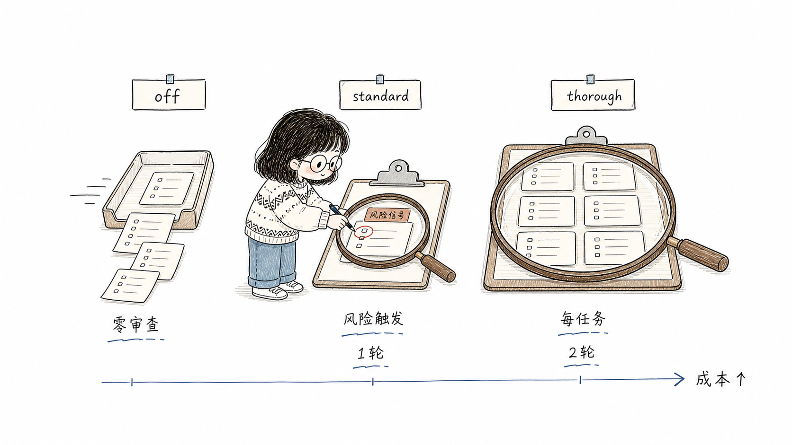

`review_mode` 控制 Classic 在 build 阶段什么时候安排任务级代码审查、允许自动修复几轮，以及 verify 阶段最终审查的严格程度。build 阶段内：`off` 不安排审查；`standard` 只审查高风险任务；`thorough` 每个子任务都审查。**整个变更的最终代码审查只在 verify 阶段做**，子任务全部写完后，build 阶段不再追加全局审查。

<Note>
  <code>review_mode</code> 只控制工作流内部的<strong>自动</strong>审查。你随时可以手动调用 <code>/comet-review</code>，对当前变更做一次只读审查。这条命令不推进工作流状态，只报告代码 Diff 中的正确性、安全漏洞、边界条件和测试覆盖问题，不会改文件，也不能代替 Verify 验收。
</Note>

## 如何选择 review_mode

选哪一档，取决于改动风险和你能接受的时间、Token 开销。hotfix / tweak 预设默认关闭审查（`off`），新建的完整流程默认用 `standard`：

| 场景 | 推荐模式 | 时间与 Token 开销 | 适用原因 |
| --------------------- | ------------------- | ----------------- | -------------------------------------------- |
| hotfix / tweak、文档等低风险改动 | `off`（默认） | 最低、最快 | 改动很小，不需要完整审查 |
| 日常多数完整流程变更 | `standard`（默认） | 中等 | 低风险任务放行，高风险任务即时审查，开销可控 |
| 涉及安全、鉴权、数据迁移 | `thorough` | 最高、最慢 | 每个子任务单独审查，覆盖安全相关改动 |
| 跨子系统、核心架构重构 | `thorough` | 最高、最慢 | 逐任务审查，覆盖跨模块改动的影响 |

### 三档模式对比

| 维度 | `off` | `standard` | `thorough` |
| ---------------- | ---------------------------- | -------------------------------------------- | ------------------------------------------- |
| **任务级审查** | 0 个 | 只在命中风险信号时安排 | **每个任务**都安排 |
| **何时审查** | 不审查 | 出现风险信号时介入 | 每个子任务完成后立即审查 |
| **审查范围** | — | 风险任务：Spec 契约 + 代码质量 | 每个任务：Spec 契约 + 代码质量 |
| **自动修复轮次** | 0 轮 | 单任务**最多修复 1 轮**再复查 | 单任务**最多修复 2 轮**再复查 |
| **什么时候暂停** | — | 修复 1 轮后复查仍不通过 → 标记 BLOCKED | 修复 2 轮后复查仍不通过 → 标记 BLOCKED |
| **最终审查** | verify 阶段跳过 | 在 verify 阶段统一执行 | 在 verify 阶段统一执行 |
| **速度** | 最快 | 适中（低风险任务跳过） | 最慢（每个任务都要审查） |
| **Token 消耗** | 最低 | 适中 | 较高 |
| **适用场景** | hotfix / tweak、小改动 | 日常多数完整流程变更 | 核心底层、架构重构、安全相关改动 |
| **默认值** | hotfix / tweak 默认 | full 流程默认 | 需要显式指定 |

### 成本与耗时差异

成本差异主要来自审查的次数。`off` 模式下 N 个任务一个审查 Agent 都不启动，最快也最省 Token。`standard` 只审查涉及敏感边界的任务，单个任务最多自动修 1 轮。`thorough` 的开销随任务数线性增长：N 个任务就启动 N 次后台审查，每次还可能触发最多 2 轮修复。对一个含 12 个子任务的变更，`standard` 可能只介入两三次，`thorough` 则会做满 12 次审查，交互轮次成倍增加。

<p align="center">
  
</p>

<p align="center">off、standard 与 thorough 对应不同的审查频次与资源开销</p>

<Tip>
  不确定选哪一档时，用默认的 <code>standard</code>。它会识别出风险任务并即时审查，兼顾交付安全和执行效率。
</Tip>

## 单个任务的审查流程

`review_mode` 决定 build 阶段每个子任务要不要审查、什么时候审查，以及发现问题后能自动修几轮。所有模式的底线相同：实现者先自测、提交代码、上报测试证据和风险信号，主会话核验后打勾并安排下一个任务。`subagent-driven-development` 模式下的流程如下：

### standard：只审查高风险任务

在 `standard` 模式下，子任务默认**不安排审查**。主会话看完实现者的报告、快速看一遍 Diff 后：
- **没有命中风险信号**：直接在 `tasks.md` 中打勾，安排下一个任务；
- **改动涉及敏感边界**：系统立刻为该任务启动独立的只读审查，从 Spec 契约和代码质量两方面检查。没有严重问题就放行；发现 CRITICAL / IMPORTANT 缺陷就自动修复，**最多修 1 轮**再复查。复查仍不通过时标记为 **BLOCKED**，停下来由你处理。

### thorough：每个任务都审查

在 `thorough` 模式下，每个子任务完成后 Comet 都会启动独立的后台审查，完整检查这个子任务。高风险和核心架构变更要逐项通过审查后才集成。发现严重问题就自动修复，**最多修 2 轮**；2 轮后仍不通过，标记为 **BLOCKED** 停下来问你。

### off：不做自动审查，只看测试结果

在 `off` 模式下，build 阶段**完全不安排**后台审查和自动修复。任务是否完成，只看实现者的自测结果、构建输出和测试的实际执行证据。跳过自动审查的原因会记录在中间产物里。

<Warning>
  <code>off</code> 只是跳过<strong>由大模型担任的代码审查</strong>，<strong>不等于跳过测试和构建</strong>。编码过程中出现测试报错、构建失败或运行时崩溃时，系统仍会停下并进入排错流程，不允许带着未解决的报错继续。
</Warning>

## verify 阶段的最终审查

需要注意：**整个变更的最终代码审查只在 verify 阶段执行**，所有子任务完成后不会额外增加一次全量审查，而是直接进入 verify。`review_mode` 只决定 verify 阶段做不做这次审查：`off` 跳过并记录原因，`standard` 和 `thorough` 都会执行。

## 哪些改动算风险任务

命中以下**任意一项**时，任务会被标记为风险任务，`standard` 模式下会自动触发审查：

- 跨子系统或跨模块的修改；
- 安全相关：身份认证、权限校验、加解密算法、SQL 查询构建、不可信的外部输入、密钥和凭据处理；
- 并发控制、线程锁、跨进程共享状态；
- 数据表结构变更或数据库迁移脚本；
- 公共 API 或对外命令行参数有变动；
- 实现者在总结里明确给出了带风险警告的结论（`DONE_WITH_CONCERNS`）；
- 单个子任务的改动超过 200 行。

## 审查模型选择

为避免成本失控，安排实现、修复或审查时**都要指定合适的模型**。不指定时，系统可能沿用会话里最强的模型，响应变慢、额度消耗也更快：

| 角色 | 建议 |
| ----------------------- | ------------------------------------------------------------------------------------------------------------------------------ |
| **代码实现与问题修复** | 只改 1–2 个文件且 Spec 写得很细 → 轻量模型；多文件协作、复杂逻辑或常规调试 → 标准模型；大范围重构或整体架构调整 → 最强的模型 |
| **子任务审查** | 按 Diff 的大小和复杂度指定。常规语法改动用标准模型即可；并发和安全相关的复杂改动用更强的模型 |
| **最终审查** | verify 阶段的整体审查，建议用当前可用的最强模型 |

## 配置和优先级

`review_mode` 的优先级从高到低：

```text
当前变更的 .comet.yaml  >  COMET_REVIEW_MODE 环境变量  >  .comet/config.yaml 中的 classic.review_mode  >  standard
```

### 项目默认值

在 `.comet/config.yaml` 中指定：

```yaml
classic:
  review_mode: thorough
```

项目里新建的变更会沿用这个默认值。

### 为单个变更单独配置

完整流程进入 build 阶段时，你可以在决策面板中直接选定 `review_mode`，或直接在对话中告知 Agent 修改；状态写入由 Agent 在后台自动完成，无需手动执行命令。

<Accordion title="Agent 后台调用命令参考">

```bash
comet state set <change-name> review_mode standard
```

</Accordion>

## 离开 build 阶段的条件

`review_mode` 是完整流程离开 build 阶段时**必须满足的条件**：
1. 阶段检查必须通过 `review_mode selected`；
2. 状态流转命令 `comet-state transition build-complete` 会核对该字段。

两项都通过后，任务才进入 verify 阶段。

## 下一步

- [Classic 配置](/zh/classic/configuration) — `review_mode` 字段的完整定义
- [build 阶段](/zh/phases/build) — 审查机制在编码中怎么配合
- [verify 阶段](/zh/phases/verify) — 验证阶段如何完成最终审查
