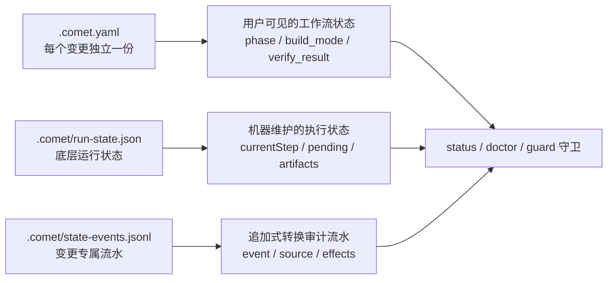
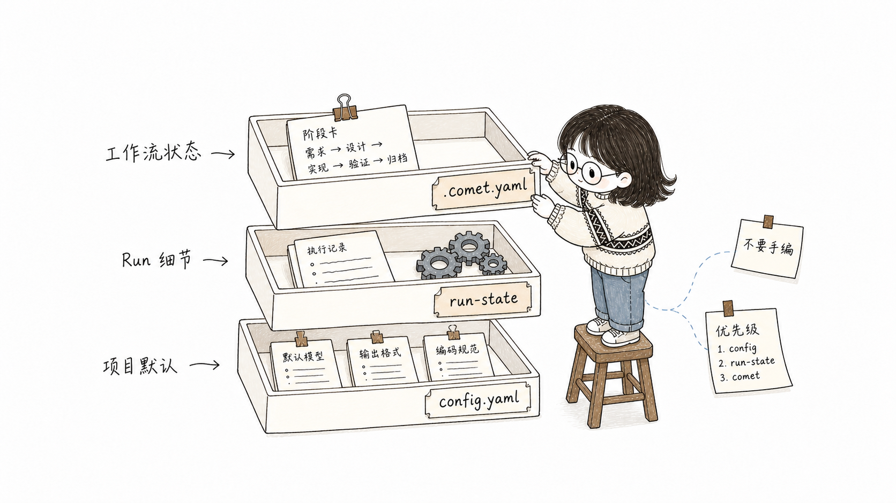

<Note>
  新建的 Classic change 采用轻量 SDK Runtime 与 <code>comet-state.yaml</code> 架构，已有 <code>.comet.yaml</code> 记录可兼容读取。所有阶段准入、决策确认、质量验证与最终归档要求保持完全一致。
</Note>

Classic 模式完全基于磁盘文件持久化状态。Comet 会将每一次变更的所处阶段、执行模式、分支绑定与验证结论直接写入项目仓库。每次在 Agent 中调用 `/comet` 时，系统都会重新扫描这些文件，完全不依赖易丢失的会话历史。你只需了解核心状态文件的职责与排查命令，即可在会话中断后精准恢复。关于项目全局配置（`.comet/config.yaml`），请查阅 [Classic 配置](/zh/classic/configuration)。

下文中使用 `<classic-root>` 指代当前 Classic OpenSpec 的存放根目录：新项目默认保存在 `docs/openspec/`，沿用旧版布局的项目为 `openspec/`。实际位置由配置项 `classic.artifact_layout` 决定，详见 [项目文件结构](/zh/guides/project-structure)。

<Warning>
  <strong>禁止手动随意篡改状态文件：</strong>阶段守卫遵循失败关闭原则（Fail Closed），一旦检测到状态文件不一致或存在非法篡改，将直接阻断执行：
  <ul>
    <li>
      <code>.comet.yaml</code> 中的 <code>phase</code> 只能由守卫校验放行或合法的状态流转命令推进，直接运行 <code>comet state set &lt;name&gt; phase &lt;value&gt;</code> 会被系统底层强行拒绝。
    </li>
    <li>
      <code>.comet/run-state.json</code> 等由系统自动维护的运行文件切勿手动编辑，也不要手动将未完成的 change 标记为归档（归档必须通过 <code>/comet-archive</code> 完成）。
    </li>
    <li>
      若遇到状态异常，请参考 <a href="/zh/guides/state-recovery">状态损坏与恢复</a> 使用正规命令诊断，切勿手动强行伪造字段。
    </li>
  </ul>
</Warning>

本文主要涵盖以下核心内容：

- **如何清晰掌握当前进度**：状态文件的存放分布与核心速查字段。
- **哪些配置项需要你确认**：区分需要人工决策的参数与系统自动维护的运行时状态。
- **遇到状态异常时如何排查**：状态变更审计日志与诊断工具使用方法。

## 如何清晰掌握当前进度

想知道“任务现在进行到哪一步、下一步该做什么”，最简单自然的方式是在 Agent 对话中重新输入 `/comet`（详见 [恢复中断的工作](/zh/guides/resuming-workflow)）；若想在终端中核对，随时运行 `comet status` 即可。两者均直接读取磁盘上的实际状态，不凭空猜测会话历史。

### 状态机文件的分层分布

| 文件名                      | 实际存放位置                                    | 维护与编辑规则                        | 核心作用                                          |
| --------------------------- | ----------------------------------------------- | ------------------------------------- | ------------------------------------------------- |
| `.comet.yaml`               | `<classic-root>/changes/<name>/.comet.yaml`     | 面向人类可读，由 `/comet` 守卫驱动维护 | 核心工作流状态：阶段、执行模式、测试验收结果      |
| `.comet/run-state.json`     | `<changeDir>/.comet/` 或 `.comet/runs/<runId>/` | 由系统自动读写，切勿手动篡改          | 底层执行细节：当前执行步骤、待处理操作与运行轨迹  |
| `.comet/state-events.jsonl` | `<classic-root>/changes/<name>/.comet/`         | 由系统自动追加，用户可随时查阅        | 记录历次成功状态流转（transition）的不可篡改审计流水 |



<p align="center">
  
</p>

<p align="center">
  `.comet.yaml` 标明当前位置，底层运行状态保证精确恢复，事件流水清晰记录变更原因
</p>

### 快速判断进度的核心字段

在运行 `comet status` 或恢复工作流时，系统重点核验以下关键字段：

| 关键字段        | 核心业务含义                                                                                          |
| --------------- | ----------------------------------------------------------------------------------------------------- |
| `phase`         | 当前所处的工作流阶段；系统据此将你分发到对应的阶段 Skill                                              |
| `workflow`      | 走完整的 full 流程还是 hotfix / tweak 预设，决定后续遵循哪套质量规范                                   |
| `verify_result` | 验收测试是否达标。只有为 `pass` 才能进入归档；为 `fail` 时会自动打回 build 阶段修复                   |
| `build_pause`   | 编码阶段内部是否处于等待状态。`plan-ready` 表示实施计划已起草完毕，正等待你选定执行模式与审查配置     |
| `branch_status` | 远端交付状态。verify 阶段保持 `pending`；在归档前确认立即推送或创建 PR 后，归档完成时固化为 `handled` |
| `archived`      | 该变更是否已经正式归档完结；已归档的任务不再作为活跃变更参与日常恢复                                  |

### 多任务并行开发时明确操作目标

在多个任务并行时，`.comet/current-change.json` 记录了当前工作区选定的变更目标，避免把改动写到错误的目录里：

- 当项目中只有唯一活跃变更时，系统会自动关联；
- 存在多个活跃变更时，在对话中直接说明要操作哪一个任务即可，Agent 会在后台锁定目标；
- 当指定了 `current`、`branch` 或 `worktree` 隔离模式后，变更会通过 `bound_branch` 绑定到对应 Git 分支。如果本地分支偏离，优先切回原分支；只有在你明确要在当前分支接管该任务时，再让 Agent 重新绑定分支。

<Accordion title="底层命令参考（日常由 Agent 自动调用，终端排障可用）">

```bash
# 显式选定目标变更 / 查看当前选定 / 清除选定 / 重绑分支
comet state select <change-name>
comet state current
comet state clear-selection
comet state rebind <change-name>
```

</Accordion>

## 关键参数的人工确认规则

`.comet.yaml` 中的参数被严格划分为两类：一类是在关键节点需要你确认的业务与质量配置；另一类则是由系统在底层自动维护的运行流水。

### 需要人工确认的关键决策字段

| 字段名称              | 确认时机与规则                                                                                                  | 后续调整与生效范围                                                                                   |
| --------------------- | --------------------------------------------------------------------------------------------------------------- | ---------------------------------------------------------------------------------------------------- |
| `language`            | 初始化时通过选择语言生成全局默认值；每个新变更在创建时从项目配置继承快照                                        | 修改全局配置仅对新建任务生效，不追溯已存在的任务（详见 [Classic 配置](/zh/classic/configuration)）    |
| `isolation`           | open 阶段的工作区决策（停顿点 3）中由你明确选定 `current`、`branch` 或 `worktree`；分支名亦在该节点确认           | 选定后写入 `isolation` 并绑定当前分支 `bound_branch`；后续各阶段会强制校验分支匹配，禁止擅自跳动目录 |
| `build_mode`          | build 阶段联合决策（停顿点 6）中选定 `subagent-driven-development`、`executing-plans` 或 `direct`               | 选用子代理模式需通过合法流程确认；full 流程使用 `direct` 模式需开启显式参数覆盖                  |
| `tdd_mode`            | 在同一联合决策中选定 `tdd` 或 `direct`；轻量预设默认使用 `direct`                                                | `tdd` 强制先写失败用例；`direct` 虽然不强制红绿重构，但仍要求提供关联测试与回归证据                 |
| `review_mode`         | 在同一联合决策中选定 `off`、`standard` 或 `thorough`；full 流程默认继承 `standard`，轻量预设固定为 `off`        | 详细机制与生效规则请参考 [代码审查机制](/zh/concepts/review-mode)                                    |
| `context_compression` | 继承自项目配置中的 `classic.context_compression` 快照                                                           | 详见 [上下文交接与原文复用](/zh/concepts/context-compression)                                        |
| `auto_transition`     | 继承自项目配置快照（默认为 `true`）                                                                             | 仅在任务未显式配置时可通过环境变量 `COMET_AUTO_TRANSITION` 临时覆盖，详见 [自动推进机制](/zh/concepts/auto-transition) |

若在流程中漏选了某些必填配置，守卫会在离开当前阶段前明确拦截，并引导你回到对应节点补选，无需手工编辑文件。

### 阶段流转前的硬性检查清单

以下安全门禁同时存在于 `comet-guard` 与状态流转内核两道防线中：

| 关键阶段切换                              | 底层强制核验的约束条件                                                                            |
| ----------------------------------------- | ------------------------------------------------------------------------------------------------- |
| `build → verify` 放行前                   | `isolation` 必须合法选定，且工作区目录与绑定分支严格吻合                                          |
| `build → verify` 放行前                   | `build_mode` 必须已完成明确选择                                                                   |
| 启用 `subagent-driven-development` 时     | 必须包含合法的调度确认标记                                                                        |
| full 完整流程离开 build 阶段时            | `tdd_mode` 必须明确为 `tdd` 或 `direct`                                                           |
| full 完整流程离开 build 阶段时            | `review_mode` 必须明确为 `off`、`standard` 或 `thorough`                                          |
| `verify → archive` 放行前                 | `verify_result` 必须明确为 `pass`                                                                 |
| 验收通过转换（`verify-pass`）             | 对应的结构化验证报告 `verification_report` 必须在磁盘上真实存在，且分支状态为 `pending`           |
| 执行最终归档命令时                        | 必须完成人工归档确认（`archive_confirmation: confirmed`）                                        |
| 归档收尾完成时                            | 用户确认远端交付；归档完毕后标记 `branch_status: handled` 并将最终状态提交至独有的 Git 归档记录中 |

<Note>
  直接运行 <code>comet state set &lt;name&gt; phase &lt;value&gt;</code> 会被系统底层强行拦截。阶段推进只能通过 <code>comet guard --apply</code> 检查放行或通过合法的状态流转命令推进。
</Note>

## 常见异常排查与诊断

若遭遇网络超时、窗口误关或长上下文压缩，均属于正常中断，直接在对话中输入 `/comet` 即可平滑恢复。只有在状态文件损坏、格式报错或找不到测试报告时，才需要使用专用诊断工具。

### 查阅状态变更审计流水

Classic 状态流转均遵从严格的事件驱动模型。每一次成功的阶段推进或归档，都会自动向审计文件追加一行结构化记录：

```text
<classic-root>/changes/<name>/.comet/state-events.jsonl
```

每条流水包含的核心要素如下：

| 属性名称         | 业务含义                                                    |
| ---------------- | ----------------------------------------------------------- |
| `schemaVersion`  | 审计格式版本                                                |
| `timestamp`      | 精确写入时间戳                                              |
| `change`         | 关联的变更名称                                              |
| `event`          | 触发的状态事件（如 `open-complete`、`build-complete` 等）   |
| `source`         | 触发源（如 `comet-guard` 或 `comet-archive`）               |
| `from` / `to`    | 状态变更前后的具体取值                                      |
| `effects`        | 本次流转实际修改的字段明细（如 `phase: build -> verify`）   |

通过该流水，可以清晰还原状态机变动的完整证据链。

### 常用诊断命令速查

- `comet status`：全面展示活跃变更的所处阶段、验收结论、磁盘证据有效性以及推荐的下一步；
- `comet doctor`：检查开发环境、平台适配、Skill 完整度以及各变更状态机的健康度。

详细排查流程与修复方法请参考 [状态损坏与恢复](/zh/guides/state-recovery)。

## 附录：`.comet.yaml` 核心字段速查表

每个活跃 change 目录下的 `.comet.yaml` 包含如下规范字段：

### 基础元数据与阶段控制

| 字段名            | 数据类型 / 允许值                                      | 核心说明                                                                                      |
| ----------------- | ------------------------------------------------------ | --------------------------------------------------------------------------------------------- |
| `workflow`        | `full` \| `hotfix` \| `tweak`                          | 当前变更采用的工作流模式                                                                      |
| `language`        | `en` \| `zh-CN`                                        | 产物主输出语言，由创建时从项目配置继承                                                        |
| `phase`           | `open` \| `design` \| `build` \| `verify` \| `archive` | 当前所处阶段。初始化为 `open`，通过守卫核验后向前推进                                         |
| `auto_transition` | `true` \| `false`                                      | 阶段守卫放行后是否自动调用下一步 Skill                                                        |

### 实施与审查配置

| 字段名                | 数据类型 / 允许值                                              | 核心说明                                                                                      |
| --------------------- | -------------------------------------------------------------- | --------------------------------------------------------------------------------------------- |
| `build_mode`          | `subagent-driven-development` \| `executing-plans` \| `direct` | 编码实施模式                                                                                  |
| `build_pause`         | `null` \| `plan-ready`                                         | build 内部暂停标记。`plan-ready` 表示实施计划已就绪，正等待用户确认                           |
| `tdd_mode`            | `tdd` \| `direct`                                              | 是否采用严格的测试驱动开发规范                                                                |
| `review_mode`         | `off` \| `standard` \| `thorough`                              | 自动化代码审查强度，详见 [代码审查机制](/zh/concepts/review-mode)                             |
| `isolation`           | `current` \| `branch` \| `worktree`                            | 工作区环境隔离策略，创建时由用户明确确认                                                      |
| `bound_branch`        | Git 分支名或 `null`                                            | 当前变更绑定的专属 Git 分支，防止意外分支漂移                                                 |

### 验收与归档

| 字段名                | 数据类型 / 允许值             | 核心说明                                                                                      |
| --------------------- | ----------------------------- | --------------------------------------------------------------------------------------------- |
| `verify_result`       | `pending` \| `pass` \| `fail` | 自动化质量验收结论                                                                            |
| `verify_failures`     | 整数（系统自动计数）          | 连续验证失败次数。单次失败递增，测试通过后归零；前 3 次自动退回 build 修复，连续失败到第 4 次时强制暂停，由你决定 |
| `verification_report` | 相对路径字符串                | 最终结构化验证报告的磁盘路径，验收通过前必须真实存在                                          |
| `branch_status`       | `pending` \| `handled`        | 远端分支交付状态，在归档确认后标记为 `handled`                                                |
| `archived`            | `true` \| `false`             | 标记变更是否已完结归档                                                                        |

## 下一步

- [Classic 配置](/zh/classic/configuration) — 掌握全局配置与环境变量覆盖
- [状态损坏与恢复](/zh/guides/state-recovery) — 深度排查异常状态的实操指南
- [代码审查机制](/zh/concepts/review-mode) — 理解不同审查严格度的边界
- [工作流核心概念](/zh/concepts/workflow) — 全景了解 Classic 五阶段协同机制
