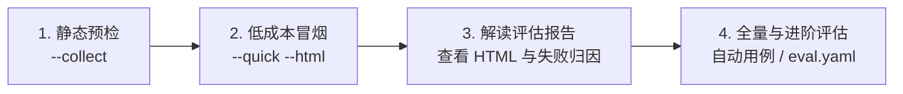

---
title: '快速上手：评估一个 Skill'
description: '从第一次运行、评估配置到报告解读，带你用 comet eval 评估本地 Skill。'
---

只要你有一个包含 `SKILL.md` 的本地目录，就可以立刻使用 `comet eval` 进行质量评估。

即使你还没来得及编写任何评测用例，**Eval 也会根据 Skill 的正文内容，自动生成 2–4 个匹配的评估用例并执行**。本文带你按实际操作顺序展开：先进行 0 配置的静态预检，再跑通低成本冒烟评估，最后解读报告并按需进阶配置。

<Tip>
  想要使用现成的公开基准任务？可在 Dashboard 的新建评估中选择 **内置数据集**，下载 WorkBuddy Code 或 SkillsBench 进行标准基准评测。详见[内置基准数据集](/zh/cli/eval#内置基准数据集)。
</Tip>

## 快速上手流程



## 第 1 步：0 配置静态预检（无需模型 Key）

在运行任何真实模型之前，先运行 `--collect` 检查 Skill 目录结构、配置与任务发现是否正常：

```bash
comet eval ./my-skill --collect
```

- **不需要 Docker，不需要配置 API Key，不产生任何费用**；
- 本地直接完成静态语法检查与任务扫描；
- 确认命令输出里识别到 Skill 名称与预定任务后，即可进入下一步。

## 第 2 步：运行低成本冒烟评估

真实运行评估前，确保本机已具备：
- Python 3.11+ 与 `uv`
- Docker 运行环境
- 选定 Agent 的 CLI（默认为 `claude-code` 或 `codex`）及对应模型 API Key

运行固定、低成本的冒烟任务验证整套执行链路：

```bash
comet eval ./my-skill --quick --html
```

- `--quick` 固定执行通用的 `generic-skill-smoke` 任务，重点核查 Skill 能否被正常注入、模型能否调用并产出结果文件；
- `--html` 指示评估完成后自动生成可交互的 HTML 报告，并在终端打印报告路径。

```text
✔ 成功加载 Skill: my-skill
✔ 正在启动隔离容器环境...
✔ 执行冒烟用例: generic-skill-smoke
✔ 评分计算完成: pass@1 = 100%
📄 评估报告已生成: .comet/eval/runs/exp-2026-11-15/summary.html
```

## 第 3 步：解读评估报告与失败定位

在浏览器中打开生成的 `summary.html`（或查看同目录下的 `summary.md` 摘要）：

1. **核心通过率**：查看 `pass@1`、`pass@k` 或 `pass^k` 指标，确认 Skill 在多次尝试下的稳定性；
2. **多维 Rubric 评分**：核对任务完成度、输出规范、是否有违规副作用等维度打分；
3. **失败原因精准归因**：若用例未通过，Comet 会在报告中自动标注问题所属类别：
   - `harness`：容器、依赖或环境报错（如 Docker 端口冲突或缺少 Python 包）；
   - `workflow`：Skill 流程引导有缺陷，Agent 在执行中迷失或超时；
   - `task`：评测任务自身的验证条件过于苛刻或有误；
   - `model`：底层大模型推理波动或偶发格式异常。

## 第 4 步：全量评估与任务自定义

跑通冒烟测试后，可以运行全量评估：

```bash
comet eval ./my-skill --html
```

如果没有手写任务，系统会根据 Skill 内容**自动生成 2–4 个评估用例**，冻结并缓存后执行。

### target 传参方式

目录、直接的 `SKILL.md` 文件或 manifest 均可作为评测 target：

```bash
# 传入 Skill 目录：自动发现其中的 comet/eval.yaml（若存在）
comet eval ./my-skill --html

# 直接传入 SKILL.md
comet eval ./my-skill/SKILL.md --html

# 直接传入 manifest
comet eval ./my-skill/comet/eval.yaml --html
```

若 Skill 位于项目外部，可用 `--project ./my-project` 指定保存运行记录和报告的项目目录。

### 自定义评估用例

想要针对自身业务手写特定的评估用例？只需在 Skill 根目录下创建 `comet/eval.yaml`：

```yaml
# my-skill/comet/eval.yaml
evaluation:
  tasks:
    - name: writes-summary
      prompt: 在当前工作区创建 summary.md 并整理核心结论。
      expect:
        files:
          - summary.md
        contains:
          summary.md:
            - '# Summary'
```

更多包含 Dockerfile、确定性测试脚本（`task.toml`）的高级任务包配置，请参考[配置评估与自定义 Task](/zh/eval/configuration)。

## 第 5 步：切换评估 Agent 与外部后端

### 切换被评测的 Agent

默认使用 `claude-code`。可以通过命令行参数或 `eval.yaml` 指定主 Agent 与独立的 LLM-as-Judge 裁判模型：

```bash
# 命令行指定使用 codex
comet eval ./my-skill --agent codex --model gpt-4o --html
```

在 `eval.yaml` 中统一配置（CLI 命令行参数优先级高于此配置）：

```yaml
execution:
  agent: codex
  model: gpt-4o
judge:
  agent: claude-code
  model: claude-3-7-sonnet
```

### 选择评估后端（本地 / LangSmith / Langfuse）

通过 `--suite` 指定评测数据同步目的地：

| 后端 | 执行命令 | 用途说明 |
| --- | --- | --- |
| `local` | `comet eval ./my-skill --html` | 默认选项，仅生成本地报告，适合日常快速迭代 |
| `langsmith` | `comet eval ./my-skill --suite langsmith --html` | 生成本地报告，并将运行轨迹、Rubric 评分同步至 LangSmith |
| `langfuse` | `comet eval ./my-skill --suite langfuse --html` | 生成本地报告，并将任务 Trace 与指标同步至 Langfuse |

## 进阶参考：用户级 `.env` 配置

第一次运行任意 `comet eval` 命令时，CLI 会自动在用户主目录下创建全局配置文件模板（仅补全缺失文件，不覆盖已有内容）：

- **Windows**：`%USERPROFILE%\.comet\eval\.env`
- **macOS / Linux**：`~/.comet/eval/.env`

你可以在该文件中集中维护常用 Agent 的 API Key 与 Base URL，避免每次在终端中重复输入。

<Accordion title="查看完整环境变量参考表">
自动生成的 `.env` 模板包含以下主要变量配置：

| 参数组 | 核心变量 |
| --- | --- |
| 主任务（Bench） | `BENCH_EVAL_AGENT`、`BENCH_API_KEY`、`BENCH_BASE_URL`、`BENCH_MODEL` |
| 独立裁判模型（Judge） | `BENCH_LLM_JUDGE`、`BENCH_JUDGE_AGENT`、`BENCH_JUDGE_API_KEY`、`BENCH_JUDGE_BASE_URL`、`BENCH_JUDGE_MODEL` |
| Claude Code | `ANTHROPIC_API_KEY`、`ANTHROPIC_BASE_URL`、`ANTHROPIC_MODEL`、`CLAUDE_CODE_SUBAGENT_MODEL` |
| Codex | `OPENAI_API_KEY`、`OPENAI_BASE_URL`、`OPENAI_MODEL` |
| Qoder | `QODER_PERSONAL_ACCESS_TOKEN`、`QODER_BASE_URL`、`QODER_MODEL` |
| CodeBuddy | `CODEBUDDY_API_KEY`、`CODEBUDDY_BASE_URL`、`CODEBUDDY_MODEL` |
| 外部追踪服务 | `LANGSMITH_API_KEY`、`LANGSMITH_PROJECT`、`LANGFUSE_PUBLIC_KEY`、`LANGFUSE_SECRET_KEY` |

模板中的参数默认均已加注释，未填写的项目保持默认行为。真实 API Key 请只保存在本地 `.env` 或当前 Shell 环境变量中，切勿提交至公开代码仓库。
</Accordion>

## 进一步阅读

- [评估系统概览](/zh/eval/overview)：深入了解评估任务、Profile、评分和运行机制；
- [评分指标与双 Agent 评测](/zh/eval/scoring)：了解 Rubric 体系、`pass@k` / `pass^k` 及多轮交互机制；
- [评估 SDK 应用](/zh/eval/applications)：如何对由 Comet Any 创作的完整应用进行自动化评测；
- [comet eval 命令行参考](/zh/cli/eval)：查看完整的 CLI 参数与选项手册。
