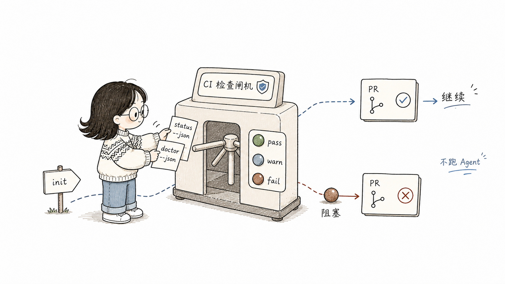

Comet CLI 为自动化运维与持续集成提供了完善的结构化 JSON 输出与非交互执行模式。你可以在 CI/CD 流水线中将它们作为安装完整性门禁、变更进度监测以及发布前的健康自检，全程无需 Agent 平台参与。

## 典型自动化场景

| 应用场景       | 推荐使用命令              | 核心作用                                          |
| -------------- | ------------------------- | ------------------------------------------------- |
| CI 环境快速就绪 | `comet init --yes --json` | 非交互一键静默安装，安全跳过交互式 CodeGraph 步骤 |
| 安装完整性门禁 | `comet doctor --json`     | 严格检查 Skill、底层脚本、工作区目录与状态机健康度 |
| 变更阶段报告   | `comet status --json`     | 结构化输出当前活跃变更所处阶段、任务进度与下一步建议 |
| PR 质量门禁    | `comet doctor --json`     | 阻断状态损坏或未通过合规校验的变更合并入主干      |

<p align="center">
  
</p>

<p align="center">在 CI 中专注于状态检查与安装完整性门禁；需要模型推理或人工决策的流程不要放入流水线</p>

## comet doctor --json：健康诊断门禁

`comet doctor` 能够全面体检项目级与全局配置环境、Skill 完整度、脚本状态、工作区以及各个活跃变更的健康度。`--json` 参数输出标准的结构化数据，非常便于流水线脚本解析。

### 标准输出结构

```json
{
  "scope": "auto",
  "results": [
    {
      "check": "Comet CLI",
      "status": "pass",
      "message": "installed (0.4.0-beta.1)"
    },
    {
      "check": "openspec CLI",
      "status": "warn",
      "message": "not installed — install with: npm install -g @fission-ai/openspec@latest"
    },
    {
      "check": "skills: Claude Code (project)",
      "status": "pass",
      "message": "complete (8 files)"
    },
    {
      "check": ".comet.yaml: add-login",
      "status": "pass",
      "message": "valid (step: collect-evidence, mode: classic)"
    }
  ]
}
```

每个检测项的 `status` 遵循三态定义：

| 状态标识 | 核心含义       | CI 处置策略     |
| -------- | -------------- | --------------- |
| `pass`   | 检查通过       | 放行，继续推进流水线 |
| `warn`   | 存在告警但不阻塞 | 允许继续，建议排查修复 |
| `fail`   | 存在必须先修复的问题 | 强制阻断 CI 流水线 |

### 在 CI 中构建质量门禁脚本

```bash
#!/bin/bash
# 只要存在 fail 项即阻断 CI
RESULT=$(comet doctor --json)
echo "$RESULT" | jq -r '.results[] | select(.status == "fail") | .check + ": " + .message'

if echo "$RESULT" | jq -e '.results[] | select(.status == "fail")' > /dev/null; then
  echo "❌ Comet doctor 报告了失败项，阻断 CI 合并"
  exit 1
fi
```

## comet status --json：状态与进度汇总

`comet status` 用于输出当前活跃变更的状态。加 `--json` 参数后会输出每个 change 的全量结构化元数据。

### 输出结构示例

```json
[
  {
    "name": "add-login",
    "workflow": "full",
    "phase": "build",
    "buildMode": "subagent-driven-development",
    "isolation": "branch",
    "verifyMode": "full",
    "verifyResult": "pending",
    "designDoc": "docs/superpowers/specs/2026-06-24-add-login-design.md",
    "plan": "docs/superpowers/plans/2026-06-24-add-login.md",
    "tasksCompleted": 7,
    "tasksTotal": 12,
    "nextCommand": "/comet-build",
    "currentStep": "implement-auth",
    "runtimeMode": "classic",
    "runtimeEval": {
      "stepId": "implement-auth",
      "passed": false,
      "requiredEvidence": ["auth-module.ts"],
      "missingEvidence": ["auth-module.ts"]
    }
  }
]
```

### 打印变更进度报告

```bash
# 格式化输出所有活跃变更的进展
comet status --json | jq -r '.[] | "\(.name): 阶段=\(.phase) 任务进度=\(.tasksCompleted)/\(.tasksTotal) 推荐下一步=\(.nextCommand)"'
```

输出效果直观明了：

```text
add-login: 阶段=build 任务进度=7/12 推荐下一步=/comet-build
fix-token-refresh: 阶段=verify 任务进度=3/3 推荐下一步=/comet-verify
```

## CI 环境静默初始化

在自动化流水线容器中，通常需要完全无人值守的非交互安装。`--yes` 会跳过所有确认提示，`--json` 会关闭 Banner 打印并自动跳过交互式 CodeGraph：

```bash
comet init --yes --scope project --language zh --json
```

`--yes` 的默认策略：
- 安装范围默认采用 `project`；
- 语言默认遵从指定参数（如 `--language zh`）；
- 平台自动探测；
- **遇到已存在的组件默认安全跳过**，绝不粗暴覆盖。若需要强制重装刷新，请显式传 `--overwrite`。

### GitHub Actions 流水线配置范例

```yaml
- name: Install Comet
  run: npm install -g @rpamis/comet

- name: Init project (non-interactive)
  run: comet init --yes --scope project --language zh --json

- name: Verify install health
  run: |
    comet doctor --json > doctor-report.json
    if jq -e '.results[] | select(.status == "fail")' doctor-report.json > /dev/null; then
      cat doctor-report.json
      exit 1
    fi

- name: Report change status
  run: comet status --json || true
```

## 不适宜放入 CI 的重型操作

以下操作深度依赖人机交互或大模型调用，切勿直接写入常规 CI 脚本中：

| 操作指令                              | 不适宜放入 CI 的核心原因            |
| ------------------------------------- | ----------------------------------- |
| `/comet`、`/comet-open` 等 Skill 命令 | 属于对话式 Skill，必须在 Agent 交互平台中运行 |
| `comet eval ... --html`               | 调用真实大模型跑评测，会消耗大量 Token 与时间 |
| `comet publish approve`               | 涉及发布签名与人工安全审核决策      |

在持续集成流水线中，**始终保持轻量化：聚焦于静态状态检查与代码健康门禁**。

## 常见疑问解答

<AccordionGroup>
  <Accordion title="CI 中运行 status 输出空数组是怎么回事？">
    这表示当前项目中没有正在推进的活跃变更，或者已有变更缺失了必要的 `.comet.yaml` 状态机。若为后者，只需在日常开发环境中输入 `/comet` 接管即可。
  </Accordion>

  <Accordion title="遇到 doctor 的 warn 告警需要让 CI 报错退出吗？">
    通常不需要。`warn` 仅表示非致命建议（例如项目暂未安装可选的外部 CLI），只有 `fail` 才代表结构性损坏或文件缺失。建议仅对 `fail` 退出非零错误码。
  </Accordion>

  <Accordion title="--json 模式的输出结构在未来版本中稳定吗？">
    是的。结构化 JSON 是 Comet CLI 严格承诺的机器契约之一，核心字段不会在无兼容预警的情况下变更。
  </Accordion>
</AccordionGroup>

## 下一步

- [comet status 命令参考](/zh/cli/status) — 深入了解所有状态字段定义
- [comet doctor 命令参考](/zh/cli/doctor) — 掌握完整的健康自检范围
- [存量项目接入指南](/zh/guides/existing-project) — 了解既有代码库的初始化技巧
