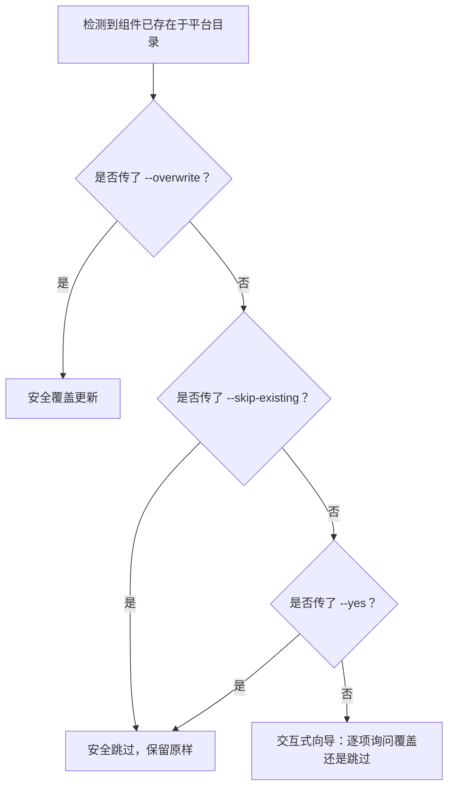
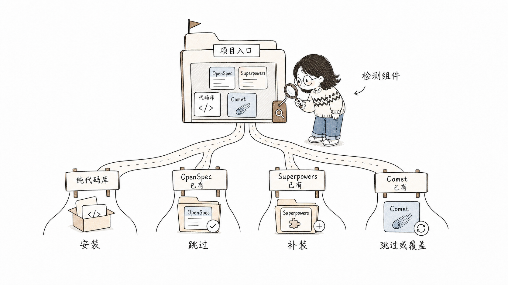
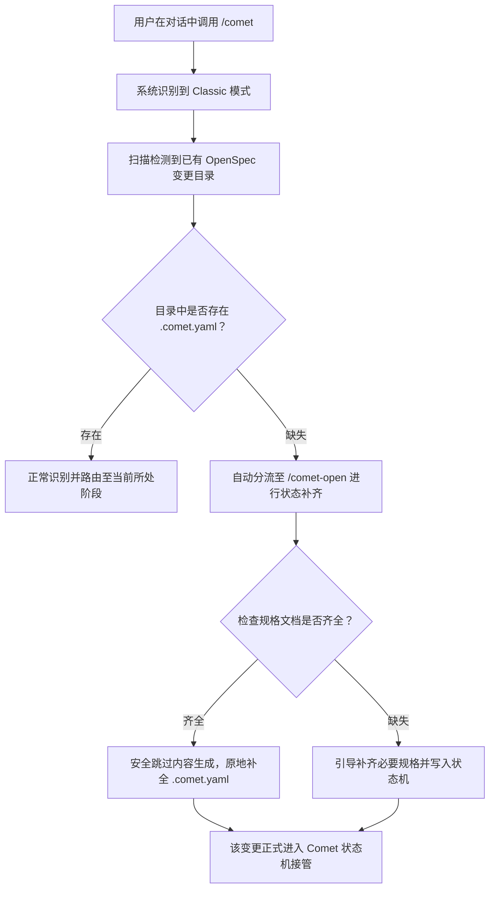

你的项目可能已经正常迭代了一段时间——拥有成熟的业务代码、丰富的 Git 提交历史，甚至团队已经在日常使用 OpenSpec 或 Superpowers。本文详细说明如何将这类存量代码库平滑接入 Comet Classic 工作流，并妥善处理历史任务。

## 最短接入路径

在项目根目录运行：

```bash
npm install -g @rpamis/comet
cd your-existing-project
comet init --workflow classic
```

随后在你的 AI 编码平台中输入 `/comet` 并附带任务描述，系统便会遵从项目配置，以统一的入口进入 Classic 模式。

## 初始化存量项目时的底层行为

执行 `comet init --workflow classic` 时，安装向导会自适应扫描代码库中的既有组件，由你选择保留原状还是覆盖刷新。

### 组件精准检测机制

安装程序会自动探测以下三类核心资产是否存在：

| 探测组件    | 具体检测手段                                                                                                                    |
| ----------- | ------------------------------------------------------------------------------------------------------------------------------- |
| OpenSpec    | 检查当前平台的 skills 目录中是否存在以 `openspec-*` 开头的规格管理 Skill                                                        |
| Superpowers | 检查是否存在 `brainstorming`、`writing-plans`、`test-driven-development` 等工程 Skill（同时扫描对应平台的插件缓存目录）        |
| Comet       | 检查目标平台中是否已部署 `comet*` 核心工作流 Skill                                                                              |

对于底层命令行工具（如 `openspec` 或 `codegraph` 是否已配置在系统 PATH 环境变量中），向导会自动识别，已就绪的组件默认不会重复安装。

### 已有组件的安全处置策略

若检测到目标平台原本就存在对应组件：



若在同一平台中检测到多个既有组件，安装向导会提供批量选择（全部覆盖 / 全部保留 / 逐项确认），减少重复操作。

### 初始化自动创建的目录结构

在项目级 Classic 安装过程中，系统会自动执行：

- 运行 `openspec init` 初始化产物根目录（新项目默认采用 `docs/openspec/`，已存在根目录 `openspec/` 的项目会自动沿用 `legacy` 兼容布局）；
- 将 Comet 所需的 Skill、Rule 与 Hook 精准部署到目标平台的对应目录；
- 创建标准的工作区目录 `docs/superpowers/specs`、`docs/superpowers/plans` 与 `.comet/`；
- 若仓库中尚未存在 `.comet/config.yaml`，自动写入标准基准配置：

```yaml
schema: comet.project.v1
default_workflow: classic
workflows:
  - classic
ambient_resume: true
classic:
  language: zh-CN
  context_compression: off
  review_mode: standard
  auto_transition: true
```

<Note>
  <code>.comet/config.yaml</code> 是仓库全局配置；而每个具体变更专属的 <code>.comet.yaml</code> 状态机是在执行 <code>/comet-open</code> 开启任务时动态生成的。
</Note>

## 四类典型存量项目实操指南

<p align="center">
  
</p>

<p align="center">接入存量项目时，先自动检查已有组件，再决定保留、跳过、补全还是更新</p>

### 场景一：纯业务代码库，此前从未使用过 OpenSpec / Superpowers

这是最普遍的新手场景。安装向导未检测到任何已有辅助组件，直接一键全量安装即可：

```bash
comet init --workflow classic
```

安装完成后，直接在对话框中输入 `/comet` 开启你的第一个规范变更。

### 场景二：代码库中已有 OpenSpec 规格资产

若仓库中原本就包含 `openspec/` 目录和未完结的变更，`comet init --workflow classic` 会自动识别为成熟的 `legacy` 布局，升级时不会强行把文件搬迁至 `docs/openspec/`。在提示检测到既有 OpenSpec 组件时，建议选择**跳过（Skip）**，仅补充 Comet 相关的守卫与路由 Skill 即可。

后续若希望平滑迁移至全新的 `docs/openspec/` 布局规范，请参考专门的 [迁移 Classic 布局指南](/zh/guides/classic-layout-migration)。

### 场景三：团队原本就在日常使用 Superpowers

若当前开发环境中已经部署了 `brainstorming`、`writing-plans` 等 Skill，向导检测到后同样会弹出确认。通常建议选择**跳过**，以免不小心覆盖团队已经深度微调过的 Prompt。

<Tip>
  若团队原本使用的 Superpowers 版本较老（低于 6.0.0），官方数据显示新版在执行速度与 Token 消耗上均有显著改善。在明确知情的前提下，亦可选择覆盖升级。
</Tip>

### 场景四：原本就同时使用 OpenSpec 与 Superpowers

两套组件均已就位。向导识别后选择“全部跳过”即可，系统仅会在轻量级层面补装 Comet 阶段守卫、流程路由与状态机目录，完全不影响你原有的开发习惯。

---

## 历史变更接管：已有 OpenSpec 变更但缺少 .comet.yaml

这是存量项目接入时最容易遇到的困惑点。

### 痛点成因

若之前的需求是通过原生外部指令（如 `/opsx:new`）创建的，这些目录中**缺乏 Comet 核心状态机 `.comet.yaml`**。这会导致：
- 运行 `comet status` 时会被系统作为非受控目录**静默跳过**；
- 运行 `comet doctor` 亦不会将其识别为正规的变更。

### 如何让 Comet 自动接管历史任务？

Comet 并不需要额外的 `comet import` 类复杂迁移指令，它直接借助 `/comet-open` 的**幂等性机制**实现接管：

1. 在 Agent 平台对话中输入 `/comet`；
2. 系统自动扫描 `openspec list --json`，发现当前存在活跃任务但缺失状态机；
3. 流程自动路由至 `/comet-open`；
4. `/comet-open` 检测到需求文档在磁盘上已然完备，直接跳过重复的探索生成环节，并在原地为你**自动补全生成 `.comet.yaml`**。



<Warning>
  此接管逻辑在任务尚处于 open 阶段（或刚创建尚未开始大量编码）时效果最佳。若一个历史任务已在外部完成了大量编码但没有任何阶段记录，建议直接在当前分支手动收尾，后续通过 <code>/comet</code> 开启下一个全新任务。
</Warning>

## 存量项目接入后的验收清单

| 核验项目         | 建议执行的验证命令        | 预期正常表现                         |
| ---------------- | ------------------------- | ------------------------------------ |
| 环境与依赖完整度 | `comet doctor`            | 各项检查均为绿色通过                 |
| 活跃变更正常受控 | `comet status`            | 能够清晰列出你的变更名称与当前阶段   |
| 平台 Skill 就绪  | `comet doctor`            | 识别的目标平台配置目录内 Skill 齐全  |
| 项目全局配置完备 | 查阅 `.comet/config.yaml` | 存在合法的共享入口与 Classic 配置块  |

## 常见疑问解答

<AccordionGroup>
  <Accordion title="初始化会冲掉我原本配置的其他 Hook 脚本吗？">
    绝对不会。Comet 在注册 Hook 时采用增量合并策略：完整保留你在既有配置文件中添加的其他脚本或工具，仅在受支持的切面注入自身必要的方法。
  </Accordion>

  <Accordion title="我可以只安装 Comet，完全不安装 OpenSpec 和 Superpowers 吗？">
    在 Classic 模式下两者属于底层支撑，无法剥离。如果你希望采用不依赖这些外部框架的方案，建议在初始化时选用 **Native 工作流**（`comet init --workflow native`）。
  </Accordion>

  <Accordion title="接入后 comet status 为何还是看不到我的任务？">
    请先在对话框中输入一次 `/comet`，让内部路由引擎触发一次自动接管并补齐 `.comet.yaml` 状态机。补全之后，命令行即可正常识别。
  </Accordion>
</AccordionGroup>

## 下一步

- [安装与更新指南](/zh/guides/install-and-update) — 掌握 CLI 的日常维护命令
- [恢复中断的工作](/zh/guides/resuming-workflow) — 了解跨设备与多会话下的断点恢复
- [项目文件结构全貌](/zh/guides/project-structure) — 了解 Comet 在磁盘上建立的文件脉络
