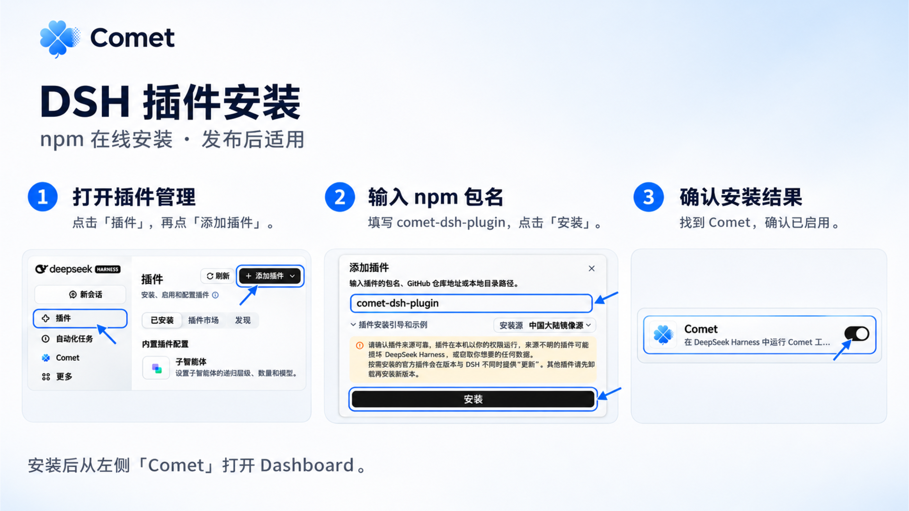
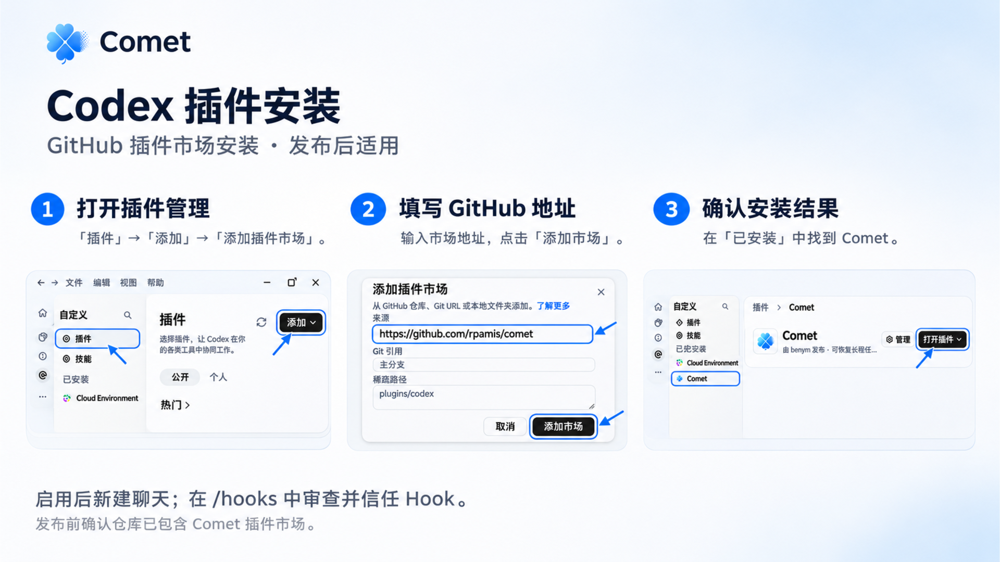

<Note>
  升级到最新版本前，建议先把进行中的活跃任务归档，再运行 Comet 更新。日常开发中的各个阶段和交互入口保持完全兼容。
</Note>

本文介绍两种安装方式：在 DSH、Codex 等桌面客户端中通过插件安装 Comet，或者在终端用跨平台的 CLI 完成全局安装、项目初始化、日常更新和卸载。

## 前置依赖要求

- Node.js 22.16 及以上的 22.x 版本，或 Node.js 24 及以上版本
- npm 或 npx
- Git

## 方式一：通过桌面端插件安装

在 DSH 或 Codex 桌面客户端中，你可以直接在插件市场一键安装 Comet，并从应用侧边栏打开可视化看板（Dashboard）。更详细的界面说明、Hook 信任设置和排障方法请参考 [桌面端插件安装](/zh/plugins/installation)。其他平台请参考下方的 CLI 安装说明。

<Tabs>
  <Tab title="DSH">
    1. 点击 DSH 左侧导航栏的**插件**，点击**添加插件**；
    2. 输入 npm 包名 `comet-dsh-plugin`，确认来源后点击**安装**；
    3. 在**已安装**列表中找到 Comet，确认插件处于启用状态。打开项目会话后，点击左侧的 **Comet** 即可打开 Dashboard；如果入口没有立即出现，重启 DSH 即可。

    <Frame caption="DSH 插件安装：添加插件、输入 npm 包名，并确认 Comet 已启用。">
      
    </Frame>

    插件安装时会自动拉取并匹配对应版本的 Comet CLI。新建对话或重启 DSH 后，终端就可以使用插件提供的命令。
  </Tab>

  <Tab title="Codex">
    1. 点击**插件**面板，在**添加**菜单中选择**添加插件市场**；
    2. 在**来源**输入框中填入 `https://github.com/rpamis/comet`，点击**添加市场**，然后在市场列表中找到 Comet 插件，点击安装并启用；
    3. 在**已安装**列表中确认 Comet。启用后新建对话，并在 Codex 的 `/hooks` 界面中确认并信任 Comet Hook。

    <Frame caption="Codex 插件安装：添加 GitHub 插件市场，并检查已安装的 Comet。">
      
    </Frame>

    插件启用时会自动准备配套 CLI，它依赖本机的 Node.js 和 npm。新会话中可以从左侧的 **Comet Dashboard** 入口打开面板；安装后仍需在客户端中手动确认信任 Hook。
  </Tab>
</Tabs>

## 方式二：通过 CLI 命令行安装（全平台通用）

### 1. 全局安装 CLI 工具

在终端运行下面的命令，全局安装 Comet CLI：

```bash
npm install -g @rpamis/comet
```

安装完成后，运行下面的命令验证安装：

```bash
comet -v
```

终端输出了版本号，就说明安装成功。

### 2. 初始化项目

进入你的项目根目录，运行向导：

```bash
cd your-project
comet init
```

`comet init` 会自动扫描当前项目所使用的 AI 平台目录，并写入项目配置。新项目默认启用轻量的 Native 工作流；若检测到既有 Classic 历史记录则保持 Classic。
详细参数说明请查阅 [comet init 参考](/zh/cli/init)。

#### 安装范围选择：项目级 vs 全局环境

| 安装范围 | 最佳适用场景                     | 核心优势                       |
| -------- | -------------------------------- | ------------------------------ |
| project  | 团队项目、仓库规范、配置需入 Git | 配置直接保存在项目内，团队同步无障碍 |
| global   | 个人开发主力机、跨项目全局复用   | 配置写入用户主目录，换项目无需重复初始化 |

如果不确定该选哪种，建议优先使用项目级安装，保证团队成员环境行为严格一致。

#### 安装模式选择：复制（Copy）vs 软链接（Symlink）

在部署 Classic 工作流或同时启用双工作流时，安装向导会询问你希望采用的**安装模式**：
- **Copy（推荐，默认）**：为各个平台独立拷贝一份 Skill 文件，适合跨开发机同步或提交到 Git 仓库；
- **Symlink**：在各平台的 `skills/` 目录中创建指向项目 `.comet/skills/` 的软链接，各平台共用这些 Skill，升级时只需更新共享目录。

详细对比请阅读 [支持的平台 · 安装模式](/zh/platforms#安装模式-复制-vs-符号链接)。

### 3. 日常版本更新

当 Comet 发布新版本后，只需在项目内运行一条命令：

```bash
comet update
```

向导会自动检测并更新 npm 包本身，并同步刷新项目中安装的 Skill、Rule 与底层守卫脚本。详细更新参数请参考 [comet update](/zh/cli/update)。

### 4. 环境健康检查（comet doctor）

任何时候遇到配置异常或行为不符预期，直接运行：

```bash
comet doctor
```

`comet doctor` 会检查 Skill 文件完整度、脚本状态、工作区目录与各变更状态机健康度：
- 标红的 `fail` 项属于阻断性问题，必须优先处理；
- 标黄的 `warn` 项属于非阻断性提示，可根据实际需要决定是否处理。

详细诊断清单请参考 [comet doctor](/zh/cli/doctor)。

### 5. 卸载清除

若后续不再需要使用 Comet，运行以下命令即可：

```bash
comet uninstall
```

`comet uninstall` 仅精准清理 Comet 自身注入的 Skill、规则与 Hook 配置，**不会触碰**你的业务代码、需求规格与设计文档。

## 什么时候建议运行更新或重新初始化？

- 手动通过 npm 升级了 `@rpamis/comet` 全局包后；
- `comet doctor` 提示本地 Skill 或脚本与核心库版本不一致；
- 团队统一调整了项目级配置；
- 在多平台切换时，某个平台的配置文件损坏需要修复。

## 下一步

- 快速跑通第一个变更：[快速开始](/zh/quickstart)
- 查看全部 39 个适配平台：[支持的平台](/zh/platforms)
- 常见问题排查：[CLI 常见问题](/zh/cli/faq)
